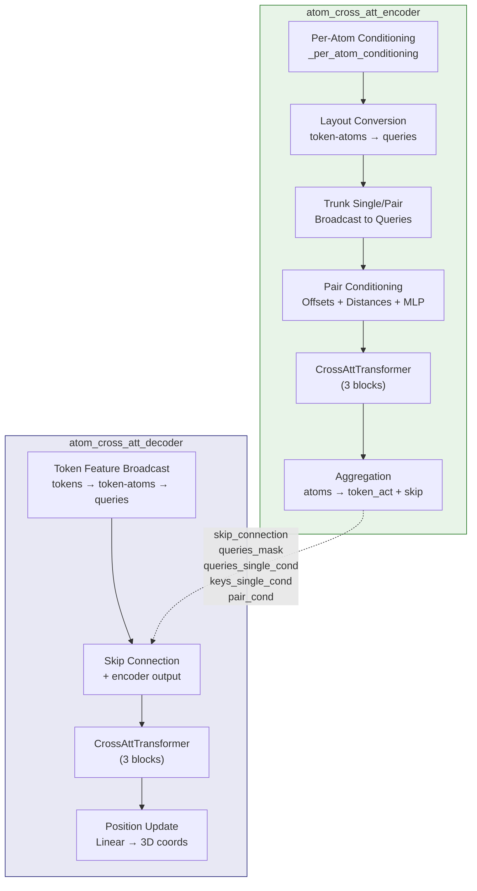
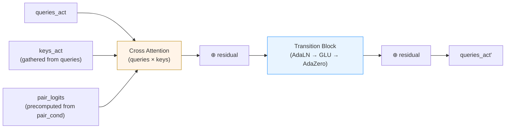

The **Atom Cross Attention** module is the critical bridge between AlphaFold3's token-level Evoformer representations and its atom-level diffusion module. It solves a fundamental architectural challenge: the Evoformer operates on coarse **token** granularity (one token per residue or ligand atom), while the Diffusion Head must predict coordinates for every individual **atom**. Atom Cross Attention provides the bidirectional information channel—encoding token representations into atom-granularity features via cross-attention, and decoding atom-level refinements back into per-atom coordinate updates—using a carefully designed **encoder-decoder** architecture with skip connections that preserve spatial conditioning across the two passes.

## Architectural Overview

The module decomposes into four tightly coupled stages, orchestrated across two top-level functions—`atom_cross_att_encoder` and `atom_cross_att_decoder`—that share a common `CrossAttTransformer` backbone but differ in their input sources and output projections:

The encoder produces an `AtomCrossAttEncoderOutput` dataclass carrying six fields—`token_act` (aggregated per-token features), `skip_connection` (raw query activations for the decoder), and four conditioning tensors (`queries_mask`, `queries_single_cond`, `keys_mask`, `keys_single_cond`, `pair_cond`) that are **reused verbatim** by the decoder. This skip-connection design ensures the decoder's cross-attention operates with identical geometric and chemical context as the encoder, eliminating information loss from the token-aggregation bottleneck.

Sources: [atom_cross_attention.py](/src/alphafold3/model/network/atom_cross_attention.py#L108-L123), [atom_cross_attention.py](/src/alphafold3/model/network/atom_cross_attention.py#L126-L360)

## The Atom Layout System

Before examining the attention mechanics, understanding the **atom layout conversion** machinery is essential. AlphaFold3 maintains three distinct atom index spaces, and `atom_layout.convert` with `GatherInfo` objects handles all transitions between them:

| Layout | Shape | Description |
|--------|-------|-------------|
| **token-atoms** | `(num_tokens, max_atoms_per_token)` | All atoms grouped by their parent token; padded to a uniform `max_atoms_per_token` |
| **queries** | `(num_subsets, num_queries)` | Flat atom subsets suitable for cross-attention; each subset contains atoms from neighboring tokens |
| **keys** | `(num_subsets, num_keys)` | Expanded key contexts for each query subset; typically a wider neighborhood than queries |

The `GatherInfo` dataclass encodes gather indices and validity masks for each conversion. The batch field `batch.atom_cross_att` provides five precomputed `GatherInfo` objects that define the complete conversion graph:

| GatherInfo | Conversion | Purpose |
|------------|-----------|---------|
| `token_atoms_to_queries` | token-atoms → queries | Scatter atoms into cross-attention subsets |
| `queries_to_keys` | queries → keys | Expand query context to key context |
| `tokens_to_queries` | tokens → queries | Broadcast per-token trunk features to queries |
| `queries_to_token_atoms` | queries → token-atoms | Gather query outputs back to token-atom layout |
| `tokens_to_keys` | tokens → keys | Broadcast per-token features to keys (derived internally) |

The `atom_layout.convert` function applies these gathers along configurable `layout_axes`, enabling seamless reshaping between the three index spaces without explicit index arithmetic in the attention code.

Sources: [atom_layout.py](/src/alphafold3/model/atom_layout/atom_layout.py#L44-L99), [atom_cross_attention.py](/src/alphafold3/model/network/atom_cross_attention.py#L143-L152)

## Per-Atom Conditioning

The `_per_atom_conditioning` function constructs the **single** and **pair** conditioning tensors from the reference structure's atomic metadata. This is the sole source of atom-level geometric and chemical information that bootstraps the entire cross-attention pipeline.

### Single Conditioning

Five atomic features are linearly embedded into `per_atom_channels` (default: 128) and summed:

| Feature | Encoding | Dimensionality |
|---------|----------|---------------|
| **Reference position** | `Linear(positions)` with highest precision | 3 → 128 |
| **Atom mask** | `Linear(mask.astype(float32))` | 1 → 128 |
| **Element** | `Linear(one_hot(element, 128))` | 128 → 128 |
| **Charge** | `Linear(arcsinh(charge))` | 1 → 128 |
| **Atom name chars** | `Linear(one_hot(atom_name_chars, 64).reshape(-1))` | variable → 128 |

The `arcsinh` transform on charge handles the unbounded integer range gracefully. The element one-hot uses 128 classes (covering the periodic table), while atom name characters use 64 classes (ASCII 32–96). The final sum is masked by the atom validity mask to zero out padding positions.

### Pair Conditioning

Pair conditioning captures **intra-token** atom-pair geometry. It is constructed from four additive components, all projected to `per_atom_pair_channels` (default: 16):

1. **Single-to-pair broadcast**: `Linear(relu(act))[row] + Linear(relu(act))[col]` — outer sum of projected single features
2. **Pairwise offsets**: `Linear(positions[i] - positions[j])` with highest precision — encodes relative displacement vectors
3. **Inverse squared distances**: `Linear(1 / (1 + ||pos_i - pos_j||²))` — provides distance-based bias that decays smoothly

These pair conditioning features from `_per_atom_conditioning` are used **only within the encoder** for the initial token-atom pair representations. The encoder subsequently constructs a richer pair representation at the query/key level (described next).

Sources: [atom_cross_attention.py](/src/alphafold3/model/network/atom_cross_attention.py#L43-L105)

## Encoder: From Tokens to Atom-Granularity Representations

The `atom_cross_att_encoder` function implements the full encoding pipeline, transforming token-level Evoformer outputs into atom-granularity representations suitable for the Diffusion Head.

### Step 1 — Query Conditioning Assembly

The per-atom single conditioning from `_per_atom_conditioning` is converted from the token-atoms layout to the queries layout via `atom_layout.convert(token_atoms_to_queries, ...)`. If the Evoformer's `trunk_single_cond` is provided, it is projected through a `Linear ∘ LayerNorm` pathway and broadcast from tokens to queries using `tokens_to_queries`, then **added** to the query conditioning. This means each query atom receives both its intrinsic chemical/geometric identity and the Evoformer's learned token-level representation.

### Step 2 — Query Activation Initialization

If `token_atoms_act` is `None` (i.e., at the beginning of the Evoformer trunk before any atom-level iterations), the query activations are set directly to the conditioning: `queries_act = queries_single_cond`. Otherwise, the existing atom activations are converted to the queries layout, projected through a linear layer, masked, and added to the conditioning. This supports **iterative refinement** where Atom Cross Attention is called multiple times within the Evoformer trunk.

### Step 3 — Key Conditioning and Layout Conversion

Key representations are derived by converting query conditioning and masks through `queries_to_keys`. This is a pure layout transformation—no new parameters are introduced—ensuring the key space is a deterministic function of the query space.

### Step 4 — Pair Conditioning at Query-Key Granularity

The encoder constructs a rich pair representation at `(num_subsets, num_queries, num_keys, per_atom_pair_channels)` through six additive components:

1. **Single-to-pair outer sum** from query and key single conditioning
2. **Trunk pair conditioning** — Evoformer pair features projected through `Linear ∘ LayerNorm`, then gathered using a composite `GatherInfo` that indexes into the flattened `(num_tokens × num_tokens)` trunk pair matrix using `tokens_to_queries` and `tokens_to_keys` indices
3. **Pairwise position offsets** between query and key reference positions, masked by `ref_space_uid` equality (offsets are only valid when both atoms share the same reference frame)
4. **Inverse squared distances** between query and key positions, similarly masked by reference frame validity
5. **Offset validity mask** — a learned embedding of whether the offset is valid, allowing the network to distinguish "zero offset because atoms coincide" from "zero offset because different reference frames"
6. **Two-layer MLP residual** — `pair_act += Linear₃(relu(Linear₂(relu(Linear₁(pair_act)))))` that refines the pair representation

> [!TIP]
> The `ref_space_uid` (reference space unique identifier) check is critical for multi-chain complexes: atoms in different chains may have independent reference frames, making their positional offsets meaningless. The `offsets_valid` mask zeroes out invalid offset/distance embeddings, and the separate validity embedding lets the network learn how to handle cross-frame atom pairs.

### Step 5 — CrossAttTransformer and Aggregation

The assembled `queries_act`, conditioning tensors, and `pair_act` are fed into a `CrossAttTransformer` (3 blocks, `num_intermediate_factor=2`). The output is masked and stored as the `skip_connection`. Finally, query activations are projected to `per_token_channels` (768), converted back to the token-atoms layout via `queries_to_token_atoms`, and **aggregated** across atoms per token using `mask_mean` with ReLU activation—producing the `token_act` output that feeds back into the Evoformer.

Sources: [atom_cross_attention.py](/src/alphafold3/model/network/atom_cross_attention.py#L126-L360)

## Decoder: From Token Features to Coordinate Updates

The `atom_cross_att_decoder` is the inverse pathway—mapping refined token-level features from the Diffusion Head back to per-atom 3D coordinate updates. Its structure mirrors the encoder but with critical differences in input handling and output projection.

### Step 1 — Token Feature Broadcast

The decoder receives `token_act` at per-token granularity. This is projected down to `per_atom_channels` (128), then **broadcast** to the token-atoms layout by expanding along the atom dimension: `token_act[:, None, :]` → `(num_tokens, max_atoms_per_token, 128)`. The broadcast tensor is converted to the queries layout, where the encoder's `skip_connection` is **added** as a residual. This skip connection injects the full encoder-era atom-level context that was lost during the encoder's token aggregation step.

### Step 2 — CrossAttTransformer Reuse

The decoder runs its own `CrossAttTransformer` (same architecture: 3 blocks, `num_intermediate_factor=2`, but with **separate parameters** named `atom_transformer_decoder`). Crucially, it reuses the encoder's `queries_mask`, `keys_mask`, `queries_single_cond`, `keys_single_cond`, and `pair_cond` **without recomputation**. This design ensures geometric consistency: the decoder's attention patterns are conditioned on the same reference structure and Evoformer pair information as the encoder's.

### Step 3 — Position Update Projection

After the transformer, query activations are masked, layer-normalized (without offset), and projected through a final `Linear(3, initializer=global_config.final_init, precision='highest')` to produce 3D coordinate updates. These are converted back to the token-atoms layout via `queries_to_token_atoms`, yielding the output shape `(num_tokens, max_atoms_per_token, 3)` that the Diffusion Head uses to update atom positions.

Sources: [atom_cross_attention.py](/src/alphafold3/model/network/atom_cross_attention.py#L370-L429)

## CrossAttTransformer: The Attention Backbone

Both encoder and delegate to `CrossAttTransformer` from the diffusion transformer module. Each block applies **cross-attention** followed by a **transition block**, with adaptive conditioning throughout:

### Cross-Attention Mechanism

The `cross_attention` function implements multi-head attention between query and key sets with adaptive layer normalization (AdaLN) on both sides:

- **Query normalization**: `adaptive_layernorm(x_q, single_cond_q)` — applies LayerNorm then modulates by a learned sigmoid-gated scale and bias from the conditioning
- **Key normalization**: `adaptive_layernorm(x_k, single_cond_k)` — same for keys, allowing asymmetric conditioning
- **Pair bias**: Precomputed `pair_logits` of shape `(num_blocks, num_subsets, num_heads, num_queries, num_keys)` are added to the attention logits, injecting geometric pair information
- **Gating**: Output is sigmoid-gated from a learned projection of `x_q`, following AlphaFold's standard gating pattern
- **Adaptive zero init**: The final projection uses `adaptive_zero_init` which, when conditioning is present, scales the output by `sigmoid(Linear(single_cond))` with bias initialized to -2 (so `sigmoid(-2) ≈ 0.12`), ensuring the cross-attention contribution starts small and grows as training progresses

### Pair Logit Precomputation

A significant optimization: `pair_cond` is normalized and projected **once** to produce pair logits for all blocks: `Linear((num_blocks, num_heads))(LayerNorm(pair_cond))`. This avoids redundant pair processing inside each block, reducing the per-block cost from O(Q·K·C) to O(Q·K·H) where H << C.

### Transition Block

Each block's feed-forward component uses the **AdaLN-Zero** pattern from DiT (Scalable Diffusion Models with Transformers): `adaptive_layernorm → GLU → adaptive_zero_init`. The Gated Linear Unit (GLU) splits the intermediate representation, applies Swish to one half, and multiplies element-wise, providing a richer nonlinearity than standard ReLU MLPs.

Sources: [diffusion_transformer.py](/src/alphafold3/model/network/diffusion_transformer.py#L266-L411), [diffusion_transformer.py](/src/alphafold3/model/network/diffusion_transformer.py#L272-L337)

## Configuration Reference

| Parameter | Encoder Default | Decoder Default | Description |
|-----------|----------------|-----------------|-------------|
| `per_token_channels` | 768 | — | Output channel dimension for token aggregation (encoder only) |
| `per_atom_channels` | 128 | 128 | Channel dimension for atom-level single representations |
| `per_atom_pair_channels` | 16 | — | Channel dimension for atom-pair representations (encoder only) |
| `atom_transformer.num_blocks` | 3 | 3 | Number of cross-attention + transition blocks |
| `atom_transformer.num_intermediate_factor` | 2 | 2 | MLP intermediate width multiplier |
| `atom_transformer.attention.num_head` | 4 | 4 | Number of attention heads |
| `atom_transformer.attention.key_dim` | 128 | 128 | Total key dimension across heads |
| `atom_transformer.attention.value_dim` | 128 | 128 | Total value dimension across heads |

> [!TIP]
> The encoder's `per_token_channels=768` matches the Evoformer trunk's single representation dimension, ensuring the aggregated `token_act` can be directly added to the trunk's single activations. The `per_atom_channels=128` is intentionally smaller—atom-level representations need less capacity than token-level ones because they primarily encode local geometric detail rather than global evolutionary context.

Sources: [atom_cross_attention.py](/src/alphafold3/model/network/atom_cross_attention.py#L34-L41), [atom_cross_attention.py](/src/alphafold3/model/network/atom_cross_attention.py#L363-L367)

## Encoder-Decoder Information Flow Summary

The complete data flow through Atom Cross Attention can be characterized as a **bottleneck architecture with skip-conditioned reconstruction**:

| Stage | Input | Output | Key Operation |
|-------|-------|--------|---------------|
| Encoder | `token_atoms_act`, `trunk_single_cond`, `trunk_pair_cond` | `AtomCrossAttEncoderOutput` | Atom conditioning → CrossAtt → Token aggregation |
| Decoder | `token_act`, `AtomCrossAttEncoderOutput` | `position_update (N×A×3)` | Token broadcast → Skip-add → CrossAtt → 3D projection |

The encoder compresses atom-level detail into token-level summaries while preserving full atom-granularity context in the skip connection. The decoder reconstructs per-atom coordinate updates by combining new token-level information (from the Diffusion Head's iterative denoising) with the cached atom-level conditioning. This design ensures that **no atom-level geometric information is lost** across the token bottleneck, while still allowing the Evoformer and Diffusion Head to operate at their preferred token granularity.

Sources: [atom_cross_attention.py](/src/alphafold3/model/network/atom_cross_attention.py#L108-L123), [atom_cross_attention.py](/src/alphafold3/model/network/atom_cross_attention.py#L370-L429)

## Related Modules

- **[Evoformer Trunk](11-evoformer-trunk)**: Produces `trunk_single_cond` and `trunk_pair_cond` consumed by the encoder; receives `token_act` back from the encoder for iterative refinement
- **[Diffusion Head](12-diffusion-head)**: Consumes the encoder's output and drives the decoder to produce per-atom coordinate updates during denoising
- **[Confidence Head](14-confidence-head)**: Operates downstream on the final atom positions predicted through this module