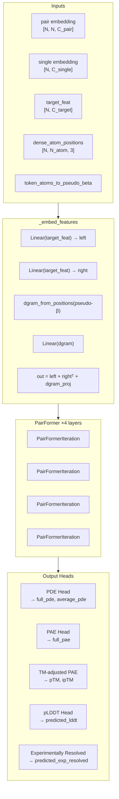
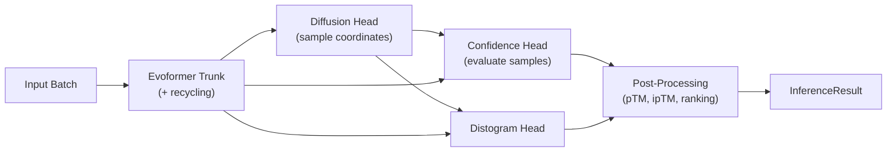

The **Confidence Head** is AlphaFold 3's dedicated neural module for predicting the reliability of its own structure predictions. Rather than producing a single scalar, it outputs a rich set of confidence signals — per-atom pLDDT, per-token-pair PAE and PDE, predicted TM-scores, and experimentally-resolved estimates — that together form the foundation for ranking, filtering, and interpreting model outputs. It operates as a post-hoc evaluator: after the Evoformer trunk produces embeddings and the Diffusion Head samples atomic coordinates, the Confidence Head consumes both to assess how trustworthy the result is.

Sources: [confidence_head.py](src/alphafold3/model/network/confidence_head.py#L38-L39), [model.py](src/alphafold3/model/model.py#L328-L339)

## Architecture Overview

The Confidence Head follows a **refine-then-decode** paradigm. It first enriches the Evoformer's pair and single representations with geometry-aware features derived from the sampled atom positions, then passes them through a lightweight PairFormer stack, and finally decodes multiple output heads from the refined representations.



The module is invoked once per diffusion sample via `sharded_map`, meaning each independently denoised structure gets its own confidence evaluation. This is critical because different samples can have varying quality, and the Confidence Head's outputs drive the ranking that selects the best prediction.

Sources: [confidence_head.py](src/alphafold3/model/network/confidence_head.py#L101-L279), [model.py](src/alphafold3/model/model.py#L328-L339)

## Configuration

The `ConfidenceHead.Config` class exposes the following parameters:

| Parameter | Type | Default | Description |
|---|---|---|---|
| `pairformer` | `PairFormerIteration.Config` | `num_layer=4` | Inner PairFormer stack configuration |
| `max_error_bin` | `float` | `31.0` | Upper bound for PDE distance error bins (Å) |
| `num_plddt_bins` | `int` | `50` | Number of bins for pLDDT histogram |
| `num_bins` | `int` | `64` | Number of bins for PDE distogram |
| `no_embedding_prob` | `float` | `0.2` | Probability of dropping the structure embedding (training only) |
| `pae` | `PAEConfig` | `max_error_bin=31.0, num_bins=64` | PAE-specific binning configuration |
| `dgram_features` | `DistogramFeaturesConfig` | default | Distogram feature extraction for pseudo-β positions |

The `PAEConfig` sub-configuration mirrors the PDE binning but is independently tunable, allowing PAE and PDE to operate on different error scales if needed.

Sources: [confidence_head.py](src/alphafold3/model/network/confidence_head.py#L41-L60)

## Internal Pipeline

### Stage 1: Feature Embedding (`_embed_features`)

The `_embed_features` method injects structural information from the sampled coordinates into the pair representation. This is the bridge between the Diffusion Head's output and the Confidence Head's processing:

1. **Target feature projection**: The `target_feat` embedding (containing residue-type and per-atom conditioning information) is projected via two independent `Linear` layers and combined as an outer sum: `left_project(target_feat) + right_project(target_feat)[:, None]`. This creates a token-pair representation from single-token features.

2. **Distogram from pseudo-β positions**: The sampled atom positions are reduced to pseudo-β positions (Cβ for non-glycine residues, Cα for glycine) using `atom_layout.convert` with `token_atoms_to_pseudo_beta`. The resulting positions are fed into `dgram_from_positions`, which computes a binned distance histogram over all token pairs — a structural fingerprint of the sampled conformation.

3. **Combination**: The three components (left target, right target, distogram projection) are summed into the existing `pair_act`, enriching it with concrete geometric information about the sampled structure.

The `pair_mask` (outer product of sequence masks) zeros out padding positions in the distogram before projection, ensuring no information leaks from padded tokens.

Sources: [confidence_head.py](src/alphafold3/model/network/confidence_head.py#L72-L99)

### Stage 2: PairFormer Refinement

After feature injection, the pair and single activations pass through a **4-layer PairFormer stack**. Each `PairFormerIteration` applies:

- **Single attention** over the token dimension (with pair bias)
- **Pair attention** (triangular multiplicative updates + attention)
- **Single transition** and **pair transition** MLPs

This refinement serves the same purpose as the Evoformer's iterative processing: it allows information to propagate across the representation so that local structural errors can be contextualized within the global fold. The PairFormer re-uses the same architectural building blocks as the main trunk but operates independently with its own parameters.

The entire stack is wrapped in `hk.experimental.layer_stack` for efficient parameter sharing across layers, and executes within a `bfloat16` context for compute efficiency before the outputs are upcast to `float32` for numerical stability in the downstream heads.

Sources: [confidence_head.py](src/alphafold3/model/network/confidence_head.py#L144-L164)

### Stage 3: Output Decoding

The refined representations are decoded by five parallel heads:

#### Predicted Distance Error (PDE)

The PDE head predicts the per-token-pair distance error between the predicted and ground-truth structures. It applies `LayerNorm → Linear(num_bins)` to the pair activation, then **symmetrizes** the logits by adding the transposed logits: `distance_logits = left_logits + swapaxes(left_logits)`. This ensures the PDE matrix is symmetric by construction.

The logits are converted to a probability distribution via `softmax`, then the expected distance error is computed as `Σ(prob × bin_center)`. The bin centers are linearly spaced from 0 to `max_error_bin` (31.0 Å) with a catch-all bin appended at the end. The result is masked by `pair_mask` and averaged to produce `average_pde`.

| Output | Shape | Meaning |
|---|---|---|
| `full_pde` | `[N, N]` | Per-token-pair expected distance error (Å) |
| `average_pde` | scalar | Mean PDE over all valid token pairs |

Sources: [confidence_head.py](src/alphafold3/model/network/confidence_head.py#L166-L200)

#### Predicted Aligned Error (PAE)

The PAE head is structurally identical to the PDE head but uses its own independent `Linear` projection and binning scheme (configured via `PAEConfig`). It applies `LayerNorm → Linear(pae.num_bins)` to produce `pae_logits`, converts to probabilities, and computes the expected error as `Σ(pae_probs × bin_centers)`. Unlike PDE, the PAE logits are **not symmetrized**, making the PAE matrix asymmetric — this reflects the fact that the alignment error from residue *i* to residue *j* differs from *j* to *i* when the optimal superposition changes.

| Output | Shape | Meaning |
|---|---|---|
| `full_pae` | `[N, N]` | Per-token-pair predicted aligned error (Å) |

Sources: [confidence_head.py](src/alphafold3/model/network/confidence_head.py#L202-L228)

#### TM-Score Adjusted PAE

The `_get_tmscore_adjusted_pae` method transforms the raw PAE probabilities into TM-score-compatible terms. For each bin, it computes:

```
tm_per_bin = 1 / (1 + (bin_center / d₀)²)
```

where `d₀ = 1.24 × (N - 15)^(1/3) - 1.8` is the TM-score length-dependent normalization factor (from Yang & Skolnick, 2004). The expected TM term is then `Σ(pae_probs × tm_per_bin)`.

Two variants are computed:
- **Global**: Uses the total number of tokens as `N`, producing `tmscore_adjusted_pae_global` for the overall pTM score.
- **Interface**: Uses the number of interface tokens per chain pair as `N`, producing `tmscore_adjusted_pae_interface` for the ipTM score. Interface tokens are computed by identifying same-chain pairs via `asym_id` and counting cross-chain interactions.

This computation is performed **outside** the bfloat16 context for numerical precision, as the d₀ calculation involves fractional exponents that are sensitive to reduced precision.

Sources: [confidence_head.py](src/alphafold3/model/network/confidence_head.py#L230-L329)

#### Predicted LDDT (pLDDT)

The pLDDT head predicts per-atom local distance difference test scores. It operates on the **single representation** (not pair), applying `LayerNorm → Linear((N_atom, num_plddt_bins))` to produce a per-atom histogram. The bin centers are uniformly spaced in [0, 1] with `num_plddt_bins = 50` bins, and the expected value is scaled to [0, 100]:

```python
predicted_lddt = Σ(softmax(logits) × bin_centers) × 100.0
```

This yields a per-atom confidence score where higher values indicate more reliable local structure. The pLDDT values are stored as B-factors in the output mmCIF files.

| Output | Shape | Meaning |
|---|---|---|
| `predicted_lddt` | `[N, N_atom]` | Per-atom predicted LDDT score (0–100) |

Sources: [confidence_head.py](src/alphafold3/model/network/confidence_head.py#L246-L259)

#### Experimentally Resolved

A binary classification head that predicts whether each atom is likely to be experimentally resolvable. It applies `LayerNorm → Linear((N_atom, 2))` to the single representation and takes the softmax probability of class 1. This helps distinguish well-ordered from disordered regions.

| Output | Shape | Meaning |
|---|---|---|
| `predicted_experimentally_resolved` | `[N, N_atom]` | Probability of being experimentally resolved (0–1) |

Sources: [confidence_head.py](src/alphafold3/model/network/confidence_head.py#L261-L271)

## Complete Output Dictionary

The `ConfidenceHead.__call__` method returns the following dictionary, which is merged directly into the model's top-level output:

| Key | Shape | Description |
|---|---|---|
| `predicted_lddt` | `[N, N_atom]` | Per-atom pLDDT (0–100) |
| `predicted_experimentally_resolved` | `[N, N_atom]` | Per-atom experimentally-resolved probability |
| `full_pde` | `[N, N]` | Full predicted distance error matrix |
| `average_pde` | `[]` (scalar) | Mean predicted distance error |
| `full_pae` | `[N, N]` | Full predicted aligned error matrix |
| `tmscore_adjusted_pae_global` | `[N, N]` | TM-score weighted PAE (for pTM) |
| `tmscore_adjusted_pae_interface` | `[N, N]` | TM-score weighted PAE (for ipTM) |

Sources: [confidence_head.py](src/alphafold3/model/network/confidence_head.py#L273-L279)

## Post-Hoc Score Derivation

The raw Confidence Head outputs are further processed at inference time in `Model.get_inference_result` to produce the final suite of confidence metrics:

### pTM and ipTM

The **predicted TM-score (pTM)** is computed by taking the per-token maximum of `tmscore_adjusted_pae_global` and averaging: `pTM = (1/N) × max_i(tmscore_adjusted_pae_global[i, j])` for each column j, then averaged. The **interface pTM (ipTM)** restricts the computation to cross-chain token pairs using `asym_id`. For single-chain targets, ipTM is undefined (NaN) and pTM is used instead.

### Ranking Score

The ranking score combines multiple signals:

```python
ranking_score = 0.8 × iptm + 0.2 × ptm
              + 0.5 × fraction_disordered
              - 100.0 × has_clash
```

The **fraction_disordered** term uses windowed relative solvent accessible surface area (rASA, from AlphaFold-RSA) with a cutoff of 0.581, computed via DSSP. The **has_clash** penalty flags structures where any chain has >100 polymer atoms within 1.1 Å of another polymer atom, or >50% of its atoms are clashing.

### Chain-Pair Metrics

Several per-chain-pair aggregations are computed:
- **`chain_pair_pae_min`**: Minimum PAE for each chain pair — indicates the best-aligned residue pair
- **`chain_pair_pde_mean/min`**: Mean and minimum PDE per chain pair
- **`chain_pair_iptm`**: Pairwise ipTM between every chain pair
- **`intra_chain_single_pde` / `cross_chain_single_pde`**: Per-chain intra- and cross-chain PDE, weighted by contact probabilities from the Distogram Head

### Contact-Weighted Ranking

An alternative ranking metric (`ranking_confidence_pae`) is computed as the negative contact-probability-weighted average of the full PAE, providing a ranking that prioritizes correctly predicted contacts.

Sources: [model.py](src/alphafold3/model/model.py#L356-L528), [confidences.py](src/alphafold3/model/confidences.py#L56-L206)

## Confidence Categories

The `ConfidenceCategory` enum classifies%:

| Category | pLDDT Range | Character Code |
|---|---|---|
| **HIGH** | 90–100 | `H` |
| **MEDIUM** | 70–89 | `M` |
| **LOW** | 50–69 | `L` |
| **DISORDERED** | 0–49 | `D` |

These categories are serialized in output JSON and attached to each atom via the `AtomConfidence` dataclass, which maps atom-level pLDDT values (read from B-factors) into categorical labels.

Sources: [confidence_types.py](src/alphafold3/model/confidence_types.py#L47-L92), [confidence_types.py](src/alphafold3/model/confidence_types.py#L96-L157)

## Integration with the Model Pipeline

The Confidence Head occupies a specific position in the AlphaFold 3 forward pass:



Key integration details:
- The Confidence Head receives **Evoformer embeddings** (pair, single, target_feat) and **sampled atom positions** from the Diffusion Head.
- It is applied via `mapping.sharded_map` with `in_axes=0` over the sample dimension, enabling parallel confidence evaluation across multiple diffusion samples.
- The `asym_id` tensor (chain assignment per token) is passed through to distinguish intra-chain from inter-chain errors for ipTM computation.
- All confidence outputs are merged into the model's result dictionary alongside diffusion samples and distogram outputs.

Sources: [model.py](src/alphafold3/model/model.py#L225-L353)

> [!TIP]
> The Confidence Head's PairFormer stack shares the **same architectural building blocks** as the main Evoformer trunk but uses completely independent parameters. This means it can learn a different distribution of attention patterns specialized for error prediction rather than structure prediction. The 4-layer depth (vs. the Evoformer's deeper stack) reflects that error prediction from already-rich embeddings requires less iterative refinement.

> [!TIP]
> The symmetrization trick for PDE logits (`distance_logits = left_logits + swapaxes(left_logits)`) is a parameter-efficient way to enforce matrix symmetry. Rather than learning a full `[N, N, C]` projection and symmetrizing the output, the model learns a single `[N, N, C]` projection and adds its transpose — halving the parameter count while guaranteeing `PDE[i,j] = PDE[j,i]` by construction. PAE deliberately omits this symmetrization because alignment error is inherently asymmetric.

## Suggested Reading

- For the embeddings that feed into the Confidence Head: [Evoformer Trunk](11-evoformer-trunk)
- For the atom positions it evaluates: [Diffusion Head](12-diffusion-head)
- For how confidence scores are interpreted in output: [Confidence Scores Explained](16-confidence-scores-explained)
- For the full output format containing all confidence fields: [Output Format and Metrics](15-output-format-and-metrics)