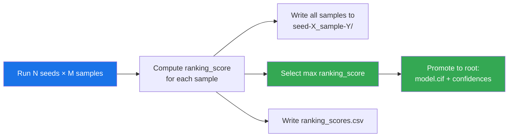
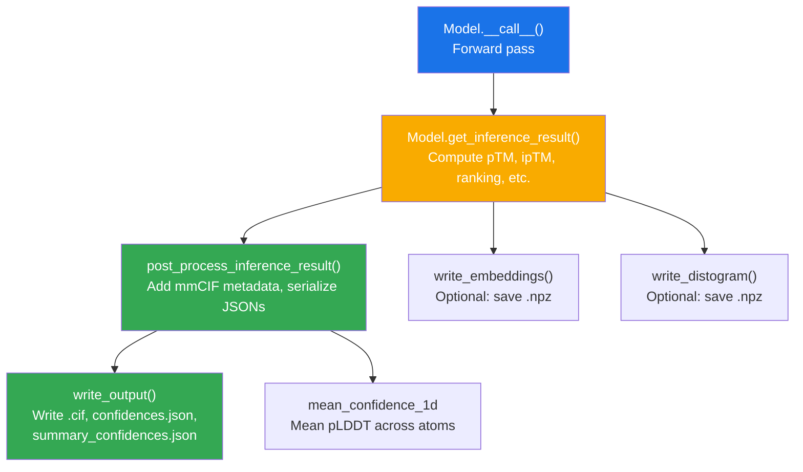

AlphaFold 3 produces a rich, multi-layered output artifact for every prediction job — from the atomic coordinates in an mmCIF file to per-atom confidence estimates and chain-pair interaction scores. Understanding the structure and semantics of these outputs is essential for interpreting prediction quality, ranking alternative samples, and downstream integration with structural biology tools. This page provides a comprehensive map of every file, metric, and data structure AlphaFold 3 writes, grounded directly in the source code that generates them.

Sources: [output.md](docs/output.md#L1-L249), [confidences.py](src/alphafold3/model/confidences.py#L1-L673), [confidence_types.py](src/alphafold3/model/confidence_types.py#L1-L294)

## Output Directory Structure

For each input job, AlphaFold 3 creates a directory named after the **sanitized** version of the job name — spaces and parentheses are replaced with underscores, while case is preserved. If the directory already exists, a timestamp is appended unless `--force_output_dir` is passed. The output path can also be a Google Cloud Storage URI (`gs://`) if the `gcsfs` dependency is installed.

The following Mermaid diagram illustrates the full output directory tree for a job called `"Hello Fold"` with 1 seed and 5 samples:

```mermaid
graph TD
    ROOT["hello_fold/"] --> T1["TERMS_OF_USE.md"]
    ROOT --> T2["hello_fold_model.cif<br/><i>Top-ranking structure</i>"]
    ROOT --> T3["hello_fold_confidences.json<br/><i>Top-ranking full confidences</i>"]
    ROOT --> T4["hello_fold_summary_confidences.json<br/><i>Top-ranking summary</i>"]
    ROOT --> T5["hello_fold_data.json<br/><i>Input + MSA + templates</i>"]
    ROOT --> T6["hello_fold_ranking_scores.csv<br/><i>All samples ranked</i>"]

    ROOT --> DISTO["seed-1234_distogram/<br/>── distogram.npz"]
    ROOT --> EMB["seed-1234_embeddings/<br/>── embeddings.npz"]

    ROOT --> S0["seed-1234_sample-0/"]
    ROOT --> S1["seed-1234_sample-1/"]
    ROOT --> S4["seed-1234_sample-4/"]

    S0 --> C0["...sample-0_model.cif"]
    S0 --> CF0["...sample-0_confidences.json"]
    S0 --> CS0["...sample-0_summary_confidences.json"]

    S1 --> C1["...sample-1_model.cif"]
    S1 --> CF1["...sample-1_confidences.json"]
    S1 --> CS1["...sample-1_summary_confidences.json"]

    S4 --> C4["...sample-4_model.cif"]
    S4 --> CF4["...sample-4_confidences.json"]
    S4 --> CS4["...sample-4_summary_confidences.json"]

    style ROOT fill:#1a73e8,color:#fff
    style S0 fill:#e8f0fe
    style S1 fill:#e8f0fe
    style S4 fill:#e8f0fe
    style DISTO fill:#fef7e0
    style EMB fill:#fef7e0
```



The directory contains three tiers of artifacts. **Root-level files** provide the single best prediction and its confidences, along with the ranking scores across all samples. **Per-sample subdirectories** (`seed-<seed>_sample-<N>/`) hold the full prediction + confidence output for every individual sample. **Optional per-seed artifacts** — distograms and embeddings — are written only when their respective flags are enabled.

Sources: [output.md](docs/output.md#L5-L83), [post_processing.py](src/alphafold3/model/post_processing.py#L104-L141)

## Core Output Files

Every prediction, whether at the root level or inside a sample subdirectory, consists of three files written by the `write_output` function. This function invokes `post_process_inference_result`, which enriches the raw model output with mmCIF metadata, then serializes two confidence JSON files alongside the structure:

| File | Format | Description |
|------|--------|-------------|
| `<name>_model.cif` | mmCIF text | Predicted 3D coordinates. Compatible with most structural biology tools. B-factor column stores per-atom pLDDT scores. |
| `<name>_confidences.json` | JSON | Full 1D and 2D confidence arrays (pLDDT, PAE, contact probabilities). |
| `<name>_summary_confidences.json` | JSON | Scalar and small-array summary metrics (pTM, ipTM, ranking_score, chain-level summaries). |

The mmCIF file is generated by converting the `InferenceResult.predicted_structure` — a `Structure` object — into mmCIF format, then adding metadata (version, timestamp, model ID) and a legal comment. The per-atom pLDDT values are encoded as B-factors within the mmCIF, making them immediately visible in molecular viewers like PyMOL or ChimeraX.

Sources: [post_processing.py](src/alphafold3/model/post_processing.py#L57-L141), [model.py](src/alphafold3/model/model.py#L79-L149)

## Confidence Metrics Overview

AlphaFold 3 extends the confidence framework from AlphaFold 2 to handle the broader range of biomolecules it predicts — proteins, nucleic acids, small-molecule ligands, and post-translational modifications. The three **core metrics** are pLDDT, PAE, and pTM/ipTM, each with domain-specific nuances:

| Metric | Scope | Scale | Purpose |
|--------|-------|-------|---------|
| **pLDDT** | Per-atom | 0–100 | Local confidence. Predicts modified LDDT considering only distances to polymers. |
| **PAE** | Per-token pair | 0–∞ Å | Relative positional error between two tokens after structural alignment. |
| **pTM** | Global scalar | 0–1 | Overall structure accuracy. >0.5 suggests correct fold. |
| **ipTM** | Global scalar | 0–1 | Interface accuracy between subunits. >0.8 = confident; <0.6 = likely failed. |

**pLDDT** has entity-specific behavior: for proteins it approximates lDDT-Cα but at atom-level granularity; for ligands, modified LDDT considers errors only between the ligand atom and polymer atoms (not ligand–ligand); for DNA/RNA, a wider 30 Å radius is used instead of the standard 15 Å.

**PAE** frames differ by entity type: proteins and nucleic acids use backbone-constructed frames (as in AlphaFold 2), while small molecules and PTMs construct frames from each atom's closest neighbors in a reference conformer.

**pTM/ipTM** are strict for small structures — pTM assigns values <0.05 when fewer than 20 tokens are involved. For these cases, PAE or pLDDT are more informative.

Sources: [output.md](docs/output.md#L86-L131), [confidences.py](src/alphafold3/model/confidences.py#L579-L631)

## Summary Confidences JSON

The `summary_confidences.json` file is serialized from the `StructureConfidenceSummary` dataclass. It contains compact metrics suitable for rapid comparison across many predictions:

| Field | Shape | Range | Description |
|-------|-------|-------|-------------|
| `ptm` | scalar | 0–1 | Predicted TM-score for the full structure |
| `iptm` | scalar | 0–1 | Predicted interface TM-score for all interfaces |
| `fraction_disordered` | scalar | 0–1 | Fraction of protein residues predicted disordered (via rASA) |
| `has_clash` | scalar | 0 or 1 | Whether any chain has significant steric clashes |
| `ranking_score` | scalar | [−100, 1.5] | Composite score for ranking predictions |
| `chain_pair_pae_min` | [C, C] | 0–∞ | Minimum PAE between each chain pair — correlates with binding |
| `chain_pair_iptm` | [C, C] | 0–1 | ipTM restricted to each chain pair (diagonal = per-chain pTM) |
| `chain_ptm` | [C] | 0–1 | pTM restricted to each individual chain |
| `chain_iptm` | [C] | 0–1 | Average interface pTM between each chain and all others |
| `chain_ids` | [C] | string | Chain IDs in same order as all chain-level arrays |

Where **C** = number of chains. The `chain_ptm` field maps to `iptm_ichain` (intra-chain pTM) and `chain_iptm` maps to `iptm_xchain` (cross-chain interface pTM) in the internal computation.

> [!TIP]
> The `chain_pair_pae_min` array is particularly useful for identifying which chain pairs interact — low minimum PAE values between two chains suggest they form an interface, while high values suggest they are independent. This can distinguish binders from non-binders without needing to know the interface in advance.

Sources: [confidence_types.py](src/alphafold3/model/confidence_types.py#L160-L230), [confidences.py](src/alphafold3/model/confidences.py#L485-L560)

## Full Confidences JSON

The `confidences.json` file is serialized from the `StructureConfidenceFull` dataclass and contains the complete 1D and 2D arrays needed for detailed analysis:

| Field | Shape | Description |
|-------|-------|-------------|
| `pae` | [T, T] | Full predicted aligned error matrix. Element (i, j) = predicted error in position of token j when aligned to frame of token i. |
| `atom_plddts` | [A] | Per-atom pLDDT scores on 0–100 scale |
| `contact_probs` | [T, T] | Predicted probability that tokens i and j are in contact (≤8 Å between representative atoms) |
| `token_chain_ids` | [T] | Chain ID for each token |
| `token_res_ids` | [T] | Residue ID for each token |
| `atom_chain_ids` | [A] | Chain ID for each atom |

Where **T** = number of tokens and **A** = number of atoms. The PAE matrix is the primary input for computing pTM and ipTM scores, and the `contact_probs` matrix comes from the distogram head. Both are serialized via a C++ binding (`json_serialize`) for performance on large structures.

The `AtomConfidence` dataclass also exists separately — it pairs each atom's pLDDT with a categorical confidence level derived from the `ConfidenceCategory` enum: **H** (90–100, High), **M** (70–89, Medium), **L** (50–69, Low), **D** (0–49, Disordered).

Sources: [confidence_types.py](src/alphafold3/model/confidence_types.py#L233-L294), [confidence_types.py](src/alphafold3/model/confidence_types.py#L46-L93)

## Ranking Score Formula

The `ranking_score` is the single scalar used to rank predictions across all seeds and samples, with **higher being better**. It is computed in the `get_ranking_score` function as:

```
ranking_score = 0.8 × ipTM + 0.2 × pTM + 0.5 × fraction_disordered − 100 × has_clash
```

For **single-chain structures**, ipTM is NaN, so the formula reduces to `pTM + 0.5 × fraction_disordered − 100 × has_clash`. The weights are defined as module-level constants:

| Component | Weight | Rationale |
|-----------|--------|-----------|
| ipTM | 0.8 | Dominant term — interface confidence is the most informative signal for complexes |
| pTM | 0.2 | Secondary — overall fold quality backup |
| fraction_disordered | +0.5 | Disordered regions are expected to have low confidence; this term avoids penalizing them |
| has_clash | −100 | Severe penalty — clashing structures are essentially unrecoverable |

> [!TIP]
> The ranking score should **only** be used for ranking — not as an absolute quality measure. The `fraction_disordered` and `has_clash` terms distort its interpretability. For assessing specific chain or interface quality, use `chain_ptm`, `chain_iptm`, or `chain_pair_iptm` instead.

The clash detection (`has_clash`) flags a structure as clashing if any chain has >100 polymer atoms within 1.1 Å of another polymer atom, or if >50% of a chain's atoms are clashing. The disorder fraction uses windowed relative solvent accessible surface area (rASA) with a cutoff of 0.581, computed via DSSP.

Sources: [confidences.py](src/alphafold3/model/confidences.py#L56-L206), [confidences.py](src/alphafold3/model/confidences.py#L99-L191)

## Multi-Seed and Multi-Sample Ranking

By default, the model samples **5 predictions per seed** (`num_samples=5`). All samples are written to their respective subdirectories, and the top-ranked prediction (by `ranking_score`) is promoted to the root level. The `ranking_scores.csv` file in the root directory lists the ranking score for every prediction, enabling custom re-ranking.

The ranking flow is illustrated below:



If you are interested in a **specific entity or interaction** rather than the full complex, you should rank by a metric specific to that chain or chain-pair instead of the global `ranking_score`. For example, use `chain_pair_iptm[i, j]` when you know chains i and j should interact (e.g., antibody–antigen), or `chain_iptm[i]` when you care about where a ligand binds but don't know which chain it contacts.

Sources: [output.md](docs/output.md#L134-L151), [confidences.py](src/alphafold3/model/confidences.py#L194-L206)

## Optional Outputs: Distograms and Embeddings

Two additional per-seed outputs are available via CLI flags:

### Distogram (`--save_distogram=true`)

Saved at `seed-<seed>_distogram/distogram.npz` as a compressed NumPy archive with a single key `distogram` of shape `[T, T, 64]` and dtype `float16`. The 64 bins represent distance probability distributions between token pairs. For a 5,000-token input, this consumes ~3 GiB.

### Embeddings (`--save_embeddings=true`)

Saved at `seed-<seed>_embeddings/embeddings.npz` with two keys:

| Key | Shape | Dtype | Description |
|-----|-------|-------|-------------|
| `single_embeddings` | [T, 384] | float16 | Per-token representations from the Evoformer trunk |
| `pair_embeddings` | [T, T, 128] | float16 | Pairwise token representations from the Evoformer trunk |

For a 5,000-token input, embeddings consume ~6 GiB. They can be loaded with standard NumPy:

```python
import numpy as np

with open('embeddings.npz', 'rb') as f:
    embeddings = np.load(f)
    single_embeddings = embeddings['single_embeddings']  # [T, 384]
    pair_embeddings = embeddings['pair_embeddings']        # [T, T, 128]
```

Sources: [output.md](docs/output.md#L214-L236), [post_processing.py](src/alphafold3/model/post_processing.py#L143-L155)

## Chirality Validation

AlphaFold 3 provides a `compare_chirality` function in `model/scoring/chirality.py` to validate that predicted ligand stereochemistry matches reference structures. This is critical because the ranking score does not natively penalize chiral inversions — in the AlphaFold 3 paper, a separate chirality-aware ranking was applied to reduce chiral error rates.

The function works by: (1) extracting each single-residue ligand chain from the predicted structure, (2) constructing an RDKit Mol with stereochemistry assigned from 3D coordinates, (3) comparing chiral centers against either a user-supplied reference Mol or the CCD entry for that residue name, and (4) returning a dictionary mapping chain IDs to boolean chirality-match results. Only elements C and S are considered as chiral centers.

Sources: [output.md](docs/output.md#L238-L249), [chirality.py](src/alphafold3/model/scoring/chirality.py#L149-L199)

## Confidence Category Thresholds

The `ConfidenceCategory` enum maps continuous pLDDT scores to discrete interpretability categories, as used in the `AtomConfidence` dataclass:

| Category | Char | pLDDT Range | Typical Interpretation |
|----------|------|-------------|----------------------|
| HIGH | H | 90–100 | Very confident — likely correct atom positions |
| MEDIUM | M | 70–89 | Generally reliable — local fold likely correct |
| LOW | L | 50–69 | Low confidence — local geometry may be wrong |
| DISORDERED | D | 0–49 | Very low — region is likely unstructured or the prediction failed |

These thresholds are identical to AlphaFold 2's established conventions, ensuring consistency for users migrating between versions.

Sources: [confidence_types.py](src/alphafold3/model/confidence_types.py#L46-L93)

## InferenceResult: The Internal Data Backbone

All output files trace back to the `InferenceResult` dataclass, which is the central artifact produced by `Model.get_inference_result`. It carries four fields:

| Field | Type | Contents |
|-------|------|----------|
| `predicted_structure` | `Structure` | Predicted coordinates with pLDDT stored as B-factors |
| `numerical_data` | `Mapping[str, float\|int\|ndarray]` | Full arrays (PAE, contact_probs) → `confidences.json` |
| `metadata` | `Mapping[str, float\|int\|ndarray]` | Scalars and small arrays (pTM, ipTM, ranking_score, chain-level metrics) → `summary_confidences.json` |
| `model_id` | `bytes` | Identifier for the seed/sample combination |

The `get_inference_result` method computes all inference-time quantities that are not part of the JAX forward pass — specifically pTM, ipTM, chain-pair PAE, chain-pair ipTM, the ranking score, and disorder/clash flags. This separation keeps the compiled JAX model lean while allowing rich post-hoc analysis.

Sources: [model.py](src/alphafold3/model/model.py#L53-L77), [model.py](src/alphafold3/model/model.py#L355-L399)

## Data Flow: From Model to Disk

The complete path from model inference to written files is captured below:



The `ProcessedInferenceResult` dataclass is the intermediate form between raw inference and disk I/O — it holds the final CIF bytes, the two JSON byte strings, the mean 1D confidence, and the ranking score. This decoupling allows the post-processing pipeline to be tested independently of file I/O.

Sources: [post_processing.py](src/alphafold3/model/post_processing.py#L34-L141), [model.py](src/alphafold3/model/model.py#L328-L353)

---

**Next steps**: For a deeper explanation of what each confidence score measures and when to trust it, see [Confidence Scores Explained](16-confidence-scores-explained). For the post-processing and scoring pipeline that transforms raw model outputs into ranked predictions, see [Post-Processing and Scoring](17-post-processing-and-scoring).