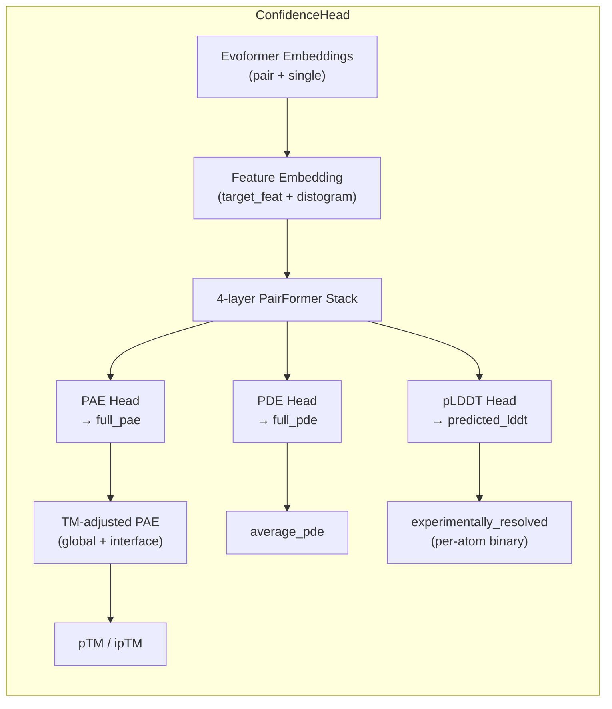
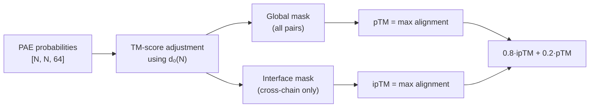
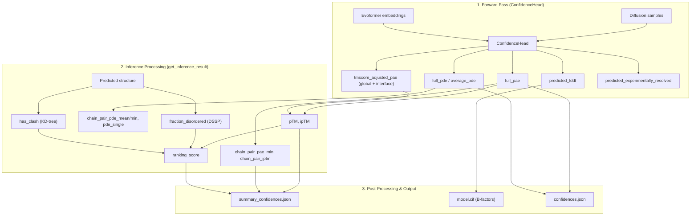

AlphaFold 3 produces a rich hierarchy of confidence signals — from per-atom local confidence to global inter-chain quality assessments — that together determine how much trust to place in a predicted structure. Understanding what each score measures, how it is computed, and how it feeds into the final ranking is essential for interpreting prediction results and making downstream decisions.

## The Confidence Head: Neural Architecture

All confidence predictions originate from the **ConfidenceHead**, a dedicated neural network module that runs after the Evoformer trunk and the Diffusion Module have produced atom positions. The ConfidenceHead takes three inputs: the Evoformer's **pair** and **single** embeddings, and the **sampled atom positions** from the diffusion process. It refines the pair representation through a 4-layer PairFormer stack, then branches into three output heads: pLDDT (per-atom), PAE (per-token-pair), and PDE (per-token-pair distance error).



The feature embedding stage injects structural information into the pair representation: it projects the `target_feat` embedding from both the left and right token dimensions, then computes a **distogram** from pseudo-beta atom positions and projects it into the pair channels. This gives the ConfidenceHead access to both the learned Evoformer representations and the explicit geometry of the sampled structure.

Sources: [confidence_head.py](src/alphafold3/model/network/confidence_head.py#L38-L99), [confidence_head.py](src/alphafold3/model/network/confidence_head.py#L101-L279)

## pLDDT: Per-Atom Local Confidence

**pLDDT** (predicted Local Distance Difference Test) is the most granular confidence metric — a score in [0, 100] assigned to **every atom** in the predicted structure. It estimates the expected lDDT between the predicted and true atomic positions, where lDDT measures the fraction of inter-atomic distances within a threshold that are preserved. In the output CIF file, pLDDT values are stored as B-factors, making them immediately visible in molecular visualisation tools.

The ConfidenceHead computes pLDDT from the **single representation** after the PairFormer stack. A linear layer maps to shape `[num_tokens, num_atoms, 50]` (50 bins by default), applies softmax, and computes the expected value over evenly-spaced bin centers spanning [0, 1], then scales by 100:

| Step | Shape | Operation |
|------|-------|-----------|
| Input | `[num_tokens, single_dim]` | Single activation from PairFormer |
| Logits | `[num_tokens, num_atoms, 50]` | Linear + LayerNorm |
| Probabilities | `[num_tokens, num_atoms, 50]` | Softmax over bin axis |
| Bin centers | `[50]` | Evenly spaced in [0.005, 0.995] |
| **pLDDT** | `[num_tokens, num_atoms]` | Σ(prob × bins) × 100 |

Each pLDDT value is classified into one of four **ConfidenceCategory** levels, which provide a human-readable quality label:

| Score Range | Category | Character | Interpretation |
|-------------|----------|-----------|----------------|
| 90 – 100 | **HIGH** | `H` | Very high confidence; likely correct |
| 70 – 90 | **MEDIUM** | `M` | Confident; generally correct backbone |
| 50 – 70 | **LOW** | `L` | Low confidence; likely incorrect |
| 0 – 50 | **DISORDERED** | `D` | Very low; likely unstructured/disordered |

These categories are the standard way to colour-code AlphaFold structures and decide which regions are reliable for downstream analysis.

> [!TIP]
> pLDDT is stored as the B-factor column in the output CIF file, so any molecular viewer that colours by B-factor will automatically display per-atom confidence. The `AtomConfidence` dataclass provides a structured way to access these values programmatically.

Sources: [confidence_head.py](src/alphafold3/model/network/confidence_head.py#L246-L259), [confidence_types.py](src/alphafold3/model/confidence_types.py#L46-L93), [confidence_types.py](src/alphafold3/model/confidence_types.py#L96-L158)

## PAE: Predicted Aligned Error

**PAE** (Predicted Aligned Error) is a `[num_tokens × num_tokens]` matrix that estimates the expected positional error (in Ångströms) at token *j* when the predicted structure is superimposed onto the true structure at token *i*. It captures **relative positional uncertainty** between pairs of domains, chains, or structural elements. High PAE values between two regions indicate that their relative placement is unreliable, even if both regions individually have high pLDDT.

The PAE head produces logits over 64 bins spanning [0, 31] Å, applies softmax, and computes the expected value:

| Parameter | Value | Description |
|-----------|-------|-------------|
| `num_bins` | 64 | Number of discretisation bins |
| `max_error_bin` | 31.0 Å | Maximum error represented |
| Bin spacing | ~0.49 Å | Evenly spaced from 0 to 31 Å |
| Catch-all bin | Last bin + step | Captures errors exceeding 31 Å |

The output key `full_pae` is the full `[num_tokens, num_tokens]` matrix. From this, several **chain-level summaries** are derived:

- **chain_pair_pae_mean** — contact-probability-weighted mean PAE per chain pair `[num_chains, num_chains]`
- **chain_pair_pae_min** — minimum PAE per chain pair, indicating the best-aligned sub-region
- **pae_ichain** — within-chain (intra-chain) PAE per chain `[num_chains]`
- **pae_xchain** — cross-chain PAE per chain `[num_chains]`

Sources: [confidence_head.py](src/alphafold3/model/network/confidence_head.py#L202-L228), [confidences.py](src/alphafold3/model/confidences.py#L355-L419), [confidences.py](src/alphafold3/model/confidences.py#L485-L560)

## PDE: Predicted Distance Error

**PDE** (Predicted Distance Error) is another `[num_tokens × num_tokens]` matrix, but it estimates the **absolute** expected error in inter-token distances — without any structural alignment. While PAE measures error after optimal superposition, PDE captures raw distance prediction uncertainty. This makes PDE particularly useful for assessing the confidence of inter-chain distances and contacts.

The PDE head produces symmetrised logits (the output is forced symmetric by adding the transposed logits), then computes expected values over 64 bins spanning [0, 31] Å. The `average_pde` scalar averages the full matrix to a single summary number.

Derived chain-level summaries include:

| Metric | Shape | Description |
|--------|-------|-------------|
| `chain_pair_pde_mean` | `[num_chains, num_chains]` | Mean PDE per chain pair |
| `chain_pair_pde_min` | `[num_chains, num_chains]` | Minimum PDE per chain pair |
| `intra_chain_single_pde` | `[num_samples, num_chains]` | Within-chain PDE per chain (contact-weighted) |
| `cross_chain_single_pde` | `[num_samples, num_chains]` | Cross-chain PDE per chain (contact-weighted) |

Sources: [confidence_head.py](src/alphafold3/model/network/confidence_head.py#L166-L200), [confidences.py](src/alphafold3/model/confidences.py#L299-L330), [confidences.py](src/alphafold3/model/confidences.py#L243-L296)

## pTM and ipTM: Global and Interface Quality

**pTM** (predicted TM-score) and **ipTM** (interface predicted TM-score) are the most important **global** quality indicators. They estimate the TM-score between the predicted and true structures — pTM for the entire structure, ipTM restricted to inter-chain interfaces.

Both are computed from the **TM-score-adjusted PAE**, which transforms the raw PAE probabilities through the TM-score formula. For a given number of residues *N*, the scaling factor is:

**d₀(N) = 1.24 · (N − 15)^(1/3) − 1.8**  (clipped to N ≥ 19)

This is the standard d₀ from the TM-score definition (Yang & Skolnick, 2004). The TM-adjusted PAE for each bin is:

**TM_per_bin = 1 / (1 + (bin_center / d₀)²)**

The final per-pair TM term is the expectation: **Σ(PAE_probs × TM_per_bin)**. The pTM is then the maximum over all possible alignments (rows of the matrix), and ipTM restricts the pair mask to inter-chain token pairs (`asym_id[i] ≠ asym_id[j]`).



For multi-chain complexes, AlphaFold 3 also computes **chain-pairwise ipTM** — a `[num_chains, num_chains]` matrix where entry *(i, j)* is the ipTM computed over just chains *i* and *j*. From this, two per-chain summaries are derived:

- **chain_ptm (iptm_ichain)** — the diagonal of the chain-pair ipTM matrix (each chain against itself)
- **chain_iptm (iptm_xchain)** — each chain's average ipTM across all other chains

Sources: [confidence_head.py](src/alphafold3/model/network/confidence_head.py#L281-L329), [confidences.py](src/alphafold3/model/confidences.py#L579-L631), [confidences.py](src/alphafold3/model/confidences.py#L634-L672), [model.py](src/alphafold3/model/model.py#L183-L222)

## Ranking Score: Selecting the Best Prediction

AlphaFold 3 generates multiple samples per prediction. The **ranking score** determines which sample is the "best" and is reported as the primary quality metric. It combines several signals into a single scalar:

```
ranking_score = ptm_iptm_average + 0.5 × (1 − fraction_disordered) − 100 × has_clash
```

Where:
- **ptm_iptm_average** = 0.8 × ipTM + 0.2 × pTM (for multi-chain) or just pTM (for single-chain)
- **fraction_disordered** — fraction of protein residues with windowed relative accessible surface area (rASA) > 0.581
- **has_clash** — binary flag (0 or 1) indicating whether any chain has significant steric overlap

The weights are hardcoded:

| Component | Weight | Effect |
|-----------|--------|--------|
| ipTM | 0.8 | Primary signal for complexes |
| pTM | 0.2 | Secondary signal for complexes; sole signal for monomers |
| fraction_disordered | 0.5 | Penalises disordered regions (subtracted) |
| has_clash | 100.0 | Heavy penalty for steric clashes |

> [!TIP]
> For single-chain predictions, ipTM is NaN and the ranking score falls back to pTM alone (plus the disorder/clash terms). When comparing predictions across targets, use `ranking_score` rather than pTM or ipTM in isolation, as it incorporates both structural quality and physical plausibility.

Sources: [confidences.py](src/alphafold3/model/confidences.py#L56-L59), [confidences.py](src/alphafold3/model/confidences.py#L194-L206), [model.py](src/alphafold3/model/model.py#L414-L420), [model.py](src/alphafold3/model/model.py#L487-L493)

## Disorder Detection: AlphaFold-RSA

AlphaFold 3 implements **AlphaFold-RSA** (Relative Solvent Accessible Surface Area) for disorder prediction, following Sander & Rost (1994). The algorithm:

1. Runs **MKDSSP** on the predicted structure to compute per-residue solvent accessibility
2. Normalises each residue's accessibility by its **maximum accessible surface area** (residue-type-specific, e.g., ALA=106, TRP=227)
3. Applies a **windowed average** (window size 25) to smooth the signal along the sequence
4. Classifies residues with rASA > **0.581** as disordered
5. Reports the **fraction_disordered** as the mean disordered fraction across all protein chains

The windowed averaging step uses reflection padding at sequence boundaries and convolution with a uniform kernel, providing a local estimate of solvent exposure that is robust to isolated outliers.

Sources: [confidences.py](src/alphafold3/model/confidences.py#L32-L96), [confidences.py](src/alphafold3/model/confidences.py#L99-L137)

## Clash Detection

Steric clashes indicate physically implausible predictions. The `has_clash` function identifies chains where polymer atoms overlap unreasonably:

1. Build a **KD-tree** from all polymer atom coordinates (protein + RNA + DNA)
2. Query all neighbours within **1.1 Å** (the clash cutoff radius)
3. Filter to inter-residue or inter-chain clashes only (adjacent residues in the same chain are excluded)
4. For each chain, check two conditions:
   - **More than 100 clashing atoms** (absolute threshold), OR
   - **More than 50% of the chain's atoms are clashing** (fractional threshold)
5. If any chain meets either condition, the entire structure is flagged as clashing

The heavy 100× penalty in the ranking score ensures that clashing structures are effectively eliminated from top-ranked selections.

Sources: [confidences.py](src/alphafold3/model/confidences.py#L140-L191)

## Experimentally Resolved Prediction

The ConfidenceHead also produces a **predicted_experimentally_resolved** score per atom — a binary probability (softmax of 2 logits) estimating whether the atom would be resolved in a hypothetical X-ray crystal structure. This provides insight into which atoms are in well-ordered, crystal-like environments versus flexible or solvent-exposed positions. While not used in the ranking score, this signal can be valuable for experimental planning and interpretation.

Sources: [confidence_head.py](src/alphafold3/model/network/confidence_head.py#L261-L271)

## Complete Score Inventory

The following table summarises every confidence signal available in an AlphaFold 3 inference result, where it is stored, and its dimensionality:

| Score | Level | Shape | Storage | Used in Ranking |
|-------|-------|-------|---------|-----------------|
| pLDDT | Per-atom | `[num_atoms]` | B-factor in CIF | No |
| ConfidenceCategory | Per-atom | `[num_atoms]` | JSON (H/M/L/D) | No |
| full_pae | Per-token-pair | `[N, N]` | `confidences.json` | No |
| full_pde | Per-token-pair | `[N, N]` | `confidences.json` | No |
| contact_probs | Per-token-pair | `[N, N]` | `confidences.json` | No |
| pTM | Global | scalar | `summary_confidences.json` | Yes |
| ipTM | Global | scalar | `summary_confidences.json` | Yes |
| ranking_score | Global | scalar | `summary_confidences.json` | Yes |
| fraction_disordered | Global | scalar | `summary_confidences.json` | Yes |
| has_clash | Global | scalar | `summary_confidences.json` | Yes |
| chain_pair_pae_min | Chain-pair | `[C, C]` | `summary_confidences.json` | No |
| chain_pair_iptm | Chain-pair | `[C, C]` | `summary_confidences.json` | No |
| chain_ptm | Per-chain | `[C]` | `summary_confidences.json` | No |
| chain_iptm | Per-chain | `[C]` | `summary_confidences.json` | No |
| average_pde | Global | scalar | metadata | No |

Sources: [model.py](src/alphafold3/model/model.py#L494-L528), [confidence_types.py](src/alphafold3/model/confidence_types.py#L160-L230), [confidence_types.py](src/alphafold3/model/confidence_types.py#L233-L293), [post_processing.py](src/alphafold3/model/post_processing.py#L57-L101)

## Data Flow: From Forward Pass to Output Files

The complete pipeline from neural network output to persisted files involves three stages: the ConfidenceHead forward pass, post-inference metric computation, and serialisation.



The output directory for each prediction contains:
- **`model.cif`** — the predicted structure with pLDDT as B-factors
- **`confidences.json`** — full 2D confidence data (PAE, PDE, contact_probs)
- **`summary_confidences.json`** — scalar and chain-level summary scores

Sources: [model.py](src/alphafold3/model/model.py#L355-L528), [post_processing.py](src/alphafold3/model/post_processing.py#L104-L137)

## Interpreting Confidence Scores in Practice

The key principle is that **pLDDT and PAE answer different questions**. A region with high pLDDT (local confidence) may still have high PAE relative to another region, meaning their relative orientation is uncertain. This is especially common in multi-domain proteins and multi-chain complexes where domain interfaces are poorly determined.

**For monomeric proteins**, focus on pLDDT for local quality and pTM for global quality. Regions with pLDDT < 50 should generally be treated as disordered. The ranking_score equals pTM (plus disorder/clash terms) since ipTM is undefined.

**For complexes**, ipTM is the most informative single number — it measures the confidence in the inter-chain arrangement. A high ipTM (> 0.8) indicates the complex interface is well-predicted; a low ipTM (< 0.5) suggests the relative chain placement is unreliable. Check `chain_pair_iptm` and `chain_pair_pae_min` to identify which specific chain pairs are uncertain.

**For ranking multiple samples**, always use `ranking_score` rather than any individual component. It balances structural quality (pTM/ipTM), physical plausibility (clash penalty), and predicted disorder into a single comparable metric.

For details on the output file format and how these scores map to specific JSON fields, see [Output Format and Metrics](15-output-format-and-metrics). For the ranking and post-processing logic that consumes these scores, see [Post-Processing and Scoring](17-post-processing-and-scoring).