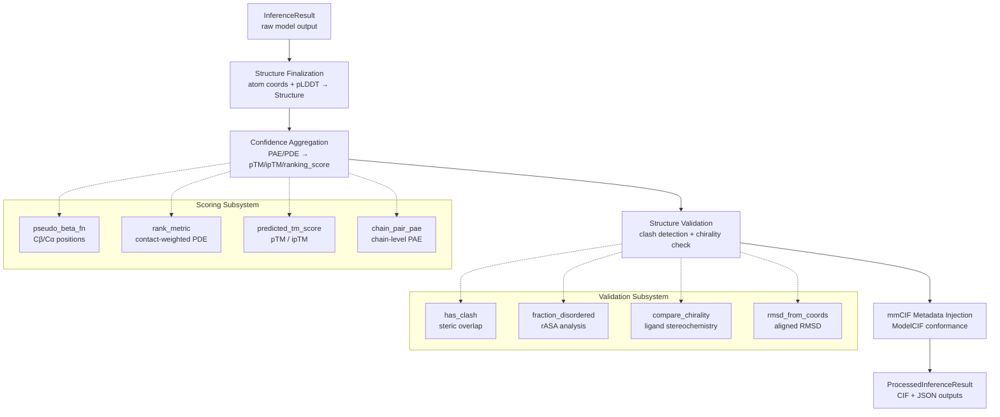

AlphaFold 3's post-processing pipeline transforms raw neural network outputs into validated, scored, and serialized structural predictions. This stage operates after the Diffusion Head generates atom coordinates and the Confidence Head produces error estimates, orchestrating **structure finalization**, **confidence aggregation**, **ranking score computation**, **chirality validation**, and **ModelCIF-compliant serialization** into a unified output artifact.

## Architectural Overview

The post-processing pipeline follows a deterministic linear flow from raw model output to serialized output files. Each stage consumes the product of its predecessor and enriches the result with progressively higher-level abstractions — from per-atom coordinates to global ranking scores.



Sources: [post_processing.py](src/alphafold3/model/post_processing.py#L57-L101), [model.py](src/alphafold3/model/model.py#L53-L77), [confidences.py](src/alphafold3/model/confidences.py#L1-L60)

## The InferenceResult Data Model

The **`InferenceResult`** dataclass is the central contract between the neural network forward pass and all downstream post-processing. It is a frozen (immutable) dataclass that encapsulates the complete output of a single model run.

| Attribute | Type | Description |
|-----------|------|-------------|
| `predicted_structure` | `Structure` | Predicted atom coordinates with pLDDT values stored as B-factors |
| `numerical_data` | `Mapping[str, float\|int\|ndarray]` | Full arrays for serialization (PAE matrix, contact probabilities) |
| `metadata` | `Mapping[str, float\|int\|ndarray]` | Scalar summaries for ranking and reporting (pTM, ipTM, ranking_score) |
| `debug_outputs` | `Mapping[str, Any]` | Raw forward-pass outputs for debugging |
| `model_id` | `bytes` | Identifier of the model checkpoint that produced this result |

The `get_predicted_structure` function constructs the `Structure` object by rearranging the Diffusion Head's atom positions from the model's internal token-based layout to a flat atom layout, then populating B-factors from the Confidence Head's `predicted_lddt` output. Atoms not predicted by the model receive zero coordinates with a logged warning.

Sources: [model.py](src/alphafold3/model/model.py#L53-L149)

## Post-Processing Pipeline

The `post_process_inference_result` function is the primary entry point. It executes four sequential transformations on an `InferenceResult`:

1. **mmCIF metadata injection** — `add_metadata_to_mmcif` enriches the predicted structure's mmCIF representation with ModelCIF-conformant fields: audit conformance, license/disclaimer, authorship, citation, software provenance, and QA metric declarations (global and local pLDDT).

2. **Per-atom confidence extraction** — `AtomConfidence.from_inference_result` reads each atom's B-factor (pLDDT) and classifies it into a `ConfidenceCategory`.

3. **Structure confidence summarization** — `StructureConfidenceSummary.from_inference_result` extracts the global metrics (pTM, ipTM, ranking_score, fraction_disordered, has_clash) plus chain-pair matrices from the inference result's metadata.

4. **Full confidence data packaging** — `StructureConfidenceFull.from_inference_result` packages the complete PAE matrix, contact probabilities, token-level chain/residue IDs, and per-atom pLDDTs.

The result is a **`ProcessedInferenceResult`** — a frozen dataclass carrying the final CIF bytes, mean confidence, ranking score, summary JSON, full data JSON, and model identifier.

Sources: [post_processing.py](src/alphafold3/model/post_processing.py#L34-L101)

### Output Serialization

The `write_output` function persists a `ProcessedInferenceResult` to disk as three core files, with optional zstandard compression:

| File | Content | Format |
|------|---------|--------|
| `{prefix}model.cif` | ModelCIF-compliant structure with all metadata | mmCIF text |
| `{prefix}confidences.json` | Full PAE matrix, contact probs, per-atom pLDDTs | JSON |
| `{prefix}summary_confidences.json` | Scalar scores + chain-pair matrices | JSON |

A separate `write_embeddings` function serializes pair and single embeddings as a compressed NumPy `.npz` archive.

> [!TIP]
> The summary confidences JSON is never compressed (always written as raw bytes), while the model CIF and full confidences JSON respect the `compress=True` flag with `.zst` suffix. This design ensures that summary files remain trivially readable for quick model ranking without decompression overhead.

Sources: [post_processing.py](src/alphafold3/model/post_processing.py#L104-L155)

## Confidence Score Computation

### Ranking Score Formula

The ranking score is the single scalar used to rank multiple sampled predictions. It balances interface quality, overall fold confidence, disorder, and steric plausibility:

```
ranking_score = (0.8 × ipTM + 0.2 × pTM) + 0.5 × fraction_disordered − 100 × has_clash
```

For single-chain structures where ipTM is NaN, the formula degrades to using pTM alone in place of the weighted average. The **fraction_disordered** term provides a small bonus for disordered regions (reflecting that disordered predictions are honest and thus preferable to falsely confident ones), while the **clash penalty** aggressively demotes structures with significant steric overlaps.

| Weight | Value | Rationale |
|--------|-------|-----------|
| `_IPTM_WEIGHT` | 0.8 | Interface quality dominates for multi-chain complexes |
| `_FRACTION_DISORDERED_WEIGHT` | 0.5 | Modest bonus for honest disorder prediction |
| `_CLASH_PENALIZATION_WEIGHT` | 100.0 | Near-elimination of structures with chain clashes |

Sources: [confidences.py](src/alphafold3/model/confidences.py#L57-L206)

### Predicted TM-Score (pTM and ipTM)

The `predicted_tm_score` function computes the predicted TM-score from the TM-adjusted PAE matrix. For the interface variant (ipTM), the pair mask is further restricted to cross-chain residue pairs via `asym_id[:, None] != asym_id[None, :]`. The computation normalizes the PAE-weighted alignment scores per residue and returns the maximum over all possible alignments.

The `chain_pairwise_predicted_tm_scores` function extends this to all chain pairs, producing a `[num_chains, num_chains]` symmetric matrix where entry `(i, j)` is the ipTM between chain `i` and chain `j` (or the pTM for diagonal entries where `i == j`).

Sources: [confidences.py](src/alphafold3/model/confidences.py#L579-L672)

### Contact-Weighted Ranking Metric

The `rank_metric` function computes a contact-probability-weighted average of the predicted distance error (PDE), used during sampling to select which diffusion samples to retain:

```
rank_metric = −Σ(full_pde × contact_probs) / (Σ(contact_probs) + ε)
```

This formulation down-weights PDE contributions from distant, non-contacting residue pairs, producing a metric that focuses on local structural accuracy where it matters most.

Sources: [confidences.py](src/alphafold3/model/confidences.py#L209-L236)

### PAE Chain-Level Aggregation

AlphaFold 3 provides rich chain-level decompositions of the PAE through two complementary aggregation functions:

**`chain_pair_pae`** produces two matrices per sample:
- `chain_pair_pred_err_mean` — contact-probability-weighted mean PAE per chain pair
- `chain_pair_pred_err_min` — minimum PAE per chain pair (identifies the best-predicted interface region)

**`pae_metrics`** orchestrates the full PAE analysis pipeline, computing chain-pair PAE means/mins, chain-pair ipTMs, and reducing these to per-chain intra-chain (`ichain`) and cross-chain (`xchain`) summaries via `reduce_chain_pair`. The reduction supports both `mean` and `min` aggregation types with `per_chain` or `per_token` weighting.

Sources: [confidences.py](src/alphafold3/model/confidences.py#L355-L560)

### Confidence Categories

Per-atom pLDDT scores are discretized into four confidence categories via the `ConfidenceCategory` enum:

| Category | Char | pLDDT Range | Interpretation |
|----------|------|-------------|----------------|
| `HIGH` | H | 90–100 | Very high confidence, likely correct |
| `MEDIUM` | M | 70–90 | Confident, generally correct backbone |
| `LOW` | L | 50–70 | Low confidence, likely incorrect |
| `DISORDERED` | D | 0–50 | Very low confidence, potentially disordered |

Sources: [confidence_types.py](src/alphafold3/model/confidence_types.py#L46-L93)

## Structure Validation

### Clash Detection

The `has_clash` function identifies steric overlaps that indicate pathological predictions. It operates on polymer and nucleic acid atoms (proteins, RNA, DNA), building a `cKDTree` spatial index and querying for atom pairs within a **1.1 Å cutoff radius**. A clash is registered only for non-adjacent residues (|res_id difference| > 1) or inter-chain pairs. A chain is flagged as clashing if it has **>100 clashing atoms** or if **>50% of its atoms** are involved in clashes.

Sources: [confidences.py](src/alphafold3/model/confidences.py#L140-L191)

### Disorder Prediction via Relative Solvent Accessibility

The `fraction_disordered` function implements **AlphaFold-RSA** (defined in Mariani et al., 2022), which predicts intrinsic disorder from the predicted structure's solvent accessibility. The algorithm:

1. Computes per-residue relative accessible surface area (rASA) via MKDSSP
2. Applies a **windowed moving average** (default window = 25 residues) using reflected padding
3. Classifies residues as disordered where rASA > **0.581** (the published threshold)
4. Returns the fraction of protein residues classified as disordered

Identical chain sequences share cached rASA computations for efficiency.

Sources: [confidences.py](src/alphafold3/model/confidences.py#L62-L137)

### Chirality Validation

The `compare_chirality` function validates that predicted ligand stereochemistry matches reference expectations. For each single-residue ligand chain, it:

1. Constructs an RDKit `Mol` object from the predicted 3D coordinates using `AssignStereochemistryFrom3D`
2. Obtains a reference molecule either from a user-provided dictionary or from the **Chemical Component Dictionary (CCD)**
3. Finds chiral centres (restricted to C and S elements) using `FindMolChiralCenters`
4. Compares chirality assignments between predicted and reference, returning a per-chain boolean indicating match

This validation is critical for small-molecule ligands and modified residues where inverted stereocenters represent qualitatively different chemistry. The function gracefully handles chains with degenerate geometries (e.g., zero-length vectors from colinear atoms) by returning `None` and skipping comparison.

Sources: [chirality.py](src/alphafold3/model/scoring/chirality.py#L30-L199)

## Alignment and RMSD Scoring

The alignment module provides structural comparison primitives used in evaluation and validation:

**`transform_ls`** — Computes the least-squares best-fit rotation matrix between two coordinate sets via SVD of the cross-covariance matrix. An optional `allow_reflection` flag controls whether improper rotations (reflections) are permitted.

**`align`** — Performs rigid-body alignment of one coordinate set to another. The transformation is computed on specified index subsets (`x_indices`, `y_indices`), then applied to the full coordinate set, enabling alignment on one region and scoring on another.

**`rmsd_from_coords`** — Computes the aligned RMSD between decoy and ground-truth coordinates with independent control over alignment indices and scoring indices:

```
RMSD = √(mean(‖aligned_decoy[include] − gt[include]‖²))
```

Sources: [alignment.py](src/alphafold3/model/scoring/alignment.py#L25-L157)

## Pseudo-Beta Computation

The `pseudo_beta_fn` computes representative per-residue positions using the pseudo-β convention: for standard amino acids this is the Cβ atom, while for glycine (which lacks Cβ) it is Cα. For ligand residues, the function defaults to the first dense atom (index 0). The function returns both positions and a validity mask, and supports both JAX and NumPy backends via the `use_jax` flag for compatibility across training and inference contexts.

Sources: [scoring.py](src/alphafold3/model/scoring/scoring.py#L30-L77)

## Structure Cleaning (Pre-Inference)

While primarily a pre-inference concern, the structure cleaning pipeline directly affects post-processing quality by defining the atom set that the model will predict. The `clean_structure` function applies a configurable sequence of filters:

| Filter | Operation | Default in Pipeline |
|--------|-----------|-------------------|
| `drop_missing_sequence` | Remove chains with unknown sequences | `True` |
| `drop_non_standard_atoms` | Remove atoms not in CCD | `True` |
| `filter_waters` | Remove water chains | `True` |
| `filter_hydrogens` | Remove hydrogen atoms | `True` |
| `filter_leaving_atoms` | Remove glycan leaving atoms (O1) | `True` |
| `covalent_bonds_only` | Keep only covalent bonds | `True` |
| `remove_polymer_polymer_bonds` | Remove inter-polymer bonds | `True` |
| `remove_bad_bonds` | Remove bonds > 2.4 Å length | `True` |

The leaving-atom filter has a fast path for standalone glycans (bulk O1 drop) and a general path that iterates per-residue when ligand-ligand bonds require context-dependent decisions. Bad bond removal uses a squared-distance threshold of 2.4² = 5.76 Ų to avoid unnecessary square root computation.

> [!TIP]
> The `fix_standalone_glycans` flag corrects a training-era behavior where O1 leaving atoms were dropped from glycans even when unbonded. Setting it to `True` preserves these atoms but departs from the training regime — use with awareness that the model was not trained on structures with standalone glycan O1 atoms.

Sources: [structure_cleaning.py](src/alphafold3/model/pipeline/structure_cleaning.py#L75-L251)

## mmCIF Metadata and ModelCIF Conformance

The `add_metadata_to_mmcif` function transforms a raw predicted structure mmCIF into a **ModelCIF 1.4.5-conformant** document. It injects:

- **Audit conformance** — dictionary name, version, and location URL
- **License and disclaimer** — non-commercial use terms with URL reference
- **Authorship** — Google DeepMind and Isomorphic Labs as both audit and citation authors
- **Citation** — the Nature 2024 paper (DOI: 10.1038/s41586-024-07487-w, PMID: 38718835)
- **Software provenance** — AlphaFold version string with model checkpoint identifier
- **Protocol steps** — coevolution MSA → template search → modeling
- **QA metrics** — global pLDDT (mean over all atoms) and local pLDDT (per-atom B-factor)

The global pLDDT is computed as the mean of all `_atom_site.B_iso_or_equiv` values in the output structure, reflecting AlphaFold 3's per-atom (rather than per-residue) confidence granularity.

Sources: [mmcif_metadata.py](src/alphafold3/model/mmcif_metadata.py#L56-L198)

## End-to-End Data Flow Summary

The following table traces a single atom's confidence value from neural network output to final serialized file:

| Stage | Representation | Location |
|-------|---------------|----------|
| Network output | `predicted_lddt` per flat-layout atom | Diffusion + Confidence Head |
| Structure assembly | `atom_b_factor` field on `Structure` | `get_predicted_structure` |
| Atom confidence | `AtomConfidence.confidence` list | `AtomConfidence.from_inference_result` |
| Category assignment | `ConfidenceCategory` enum (H/M/L/D) | `ConfidenceCategory.from_confidence_score` |
| mmCIF serialization | `_atom_site.B_iso_or_equiv` column | `Structure.to_mmcif_dict` |
| Local QA metric | `_ma_qa_metric_local.metric_value` | `add_metadata_to_mmcif` |
| JSON serialization | `atom_plddts` array in `confidences.json` | `StructureConfidenceFull.to_json` |

Sources: [model.py](src/alphafold3/model/model.py#L104-L149), [confidence_types.py](src/alphafold3/model/confidence_types.py#L112-L157), [mmcif_metadata.py](src/alphafold3/model/mmcif_metadata.py#L183-L198)

---

For the complete description of all output files and their schemas, see [Output Format and Metrics](15-output-format-and-metrics). For the mathematical foundations of pTM, ipTM, and PAE, see [Confidence Scores Explained](16-confidence-scores-explained). For the Diffusion Head that generates the atom coordinates entering this pipeline, see [Diffusion Head](12-diffusion-head).