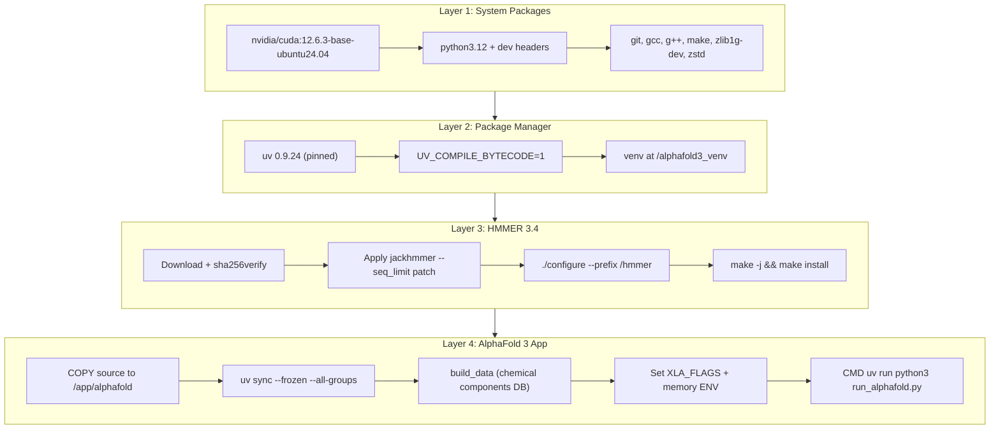

AlphaFold 3's inference pipeline is GPU-accelerated through JAX on NVIDIA CUDA, and the project distributes a production-grade Dockerfile that encapsulates the entire dependency stack — from the CUDA base image through HMMER sequence search tools to the Python virtual environment. This page covers the container architecture, GPU hardware requirements, XLA runtime tuning, memory configuration, and alternative deployment paths (Singularity, CPU-only, Apple Silicon). Understanding this infrastructure layer is essential before running predictions at scale.

## Container Image Architecture

The Dockerfile builds on **`nvidia/cuda:12.6.3-base-ubuntu24.04`** as its base image, establishing the CUDA runtime required for JAX GPU execution. The build proceeds through four distinct layers, each cached independently for rebuild efficiency.



**Layer 1** installs Python 3.12 with development headers, the C/C++ toolchain (`gcc`, `g++`, `make`), `git` (required by the CMake-based build system), `zlib1g-dev` (a core AlphaFold 3 dependency), and `zstd` for database decompression. **Layer 2** installs the `uv` package manager (pinned at v0.9.24 for reproducibility) and creates a virtual environment at `/alphafold3_venv` with bytecode compilation enabled for faster container startup. **Layer 3** builds HMMER 3.4 from source — this is placed before the source copy so Docker caches the layer. A custom `--seq_limit` patch is applied to `jackhmmer.c`, enabling truncation of hits after a configurable threshold, which is critical for controlling MSA depth on large inputs. **Layer 4** copies the AlphaFold 3 source, installs the exact dependency tree via `uv sync --frozen`, builds the chemical components database, and sets the XLA runtime environment variables.

Sources: [Dockerfile](docker/Dockerfile#L20-L98), [jackhmmer_seq_limit.patch](docker/jackhmmer_seq_limit.patch#L1-L33)

## Building the Docker Container

Build the container from the repository root. The `dockerignore` file excludes only the `Dockerfile` and `dockerignore` themselves from the build context, so ensure your genetic databases and model parameters directories are **not** subdirectories of the repository — otherwise they'll be copied into the build context, dramatically slowing the build.

```sh
docker build -t alphafold3 -f docker/Dockerfile .
```

On systems with restrictive file descriptor limits (AlmaLinux, Rocky, RHEL), append the ulimit flag:

```sh
docker build --ulimit nofile=65535:65535 -t alphafold3 -f docker/Dockerfile .
```

To enable Google Cloud Storage (`gs://`) path support for inputs and outputs, pass the `UV_EXTRAS` build argument:

```sh
docker build --build-arg UV_EXTRAS="--extra gcsfs" -t alphafold3 -f docker/Dockerfile .
```

The `UV_EXTRAS` argument is consumed by the `uv sync` step inside the Dockerfile and installs the optional `gcsfs` dependency, enabling `gs://` paths for `--input_dir`, `--json_path`, `--output_dir`, `--model_dir`, and `--pdb_database_path`. Database paths (`--db_dir`, `--small_bfd_database_path`, etc.) and binary paths do **not** support GCS paths.

Sources: [Dockerfile](docker/Dockerfile#L80-L82), [installation.md](docs/installation.md#L280-L393)

## GPU Hardware Requirements

AlphaFold 3 requires an **NVIDIA GPU with Compute Capability 8.0 or greater** for officially supported inference. The project has verified numerical accuracy and throughput on the following configurations:

| GPU | VRAM | Max Verified Tokens | Status |
|:----|:-----|:-------------------|:-------|
| NVIDIA A100 (80 GB) | 80 GB | 5,120 | ✅ Officially supported |
| NVIDIA H100 (80 GB) | 80 GB | 5,120 | ✅ Officially supported |
| NVIDIA A100 (40 GB) | 40 GB | 4,352 | ⚠️ Requires unified memory + sharding config |
| NVIDIA V100 | 16 GB | 1,280 | ⚠️ Known numerical issues (CUDA Cap 7.x) |
| NVIDIA P100 | 12 GB | 1,024 | ⚠️ Limited testing |
| CPU-only | — | — | ⚠️ ~100× slower, no accuracy testing |
| Apple Silicon (MPS) | — | — | ⚠️ Experimental, ~3× faster than CPU |

The Docker container requires **CUDA 12.6** on the host machine. Verify GPU visibility from Docker before running AlphaFold 3:

```sh
docker run --rm --gpus all nvidia/cuda:12.6.0-base-ubuntu22.04 nvidia-smi
```

For GCP provisioning, the recommended machine type is `a2-ultragpu-1g` (12 vCPUs, 170 GB RAM, 1 TB disk, 1× A100 80 GB). At minimum 64 GB of host RAM is recommended, as the genetic search stage can be memory-intensive for long targets.

Sources: [installation.md](docs/installation.md#L1-L21), [performance.md](docs/performance.md#L186-L258)

## Running with Docker

The standard invocation mounts four volumes — input, output, model parameters, and databases — and exposes all GPUs:

```sh
docker run -it \
    --volume $HOME/af_input:/root/af_input \
    --volume $HOME/af_output:/root/af_output \
    --volume <MODEL_PARAMETERS_DIR>:/root/models \
    --volume <DB_DIR>:/root/public_databases \
    --gpus all \
    alphafold3 \
    python run_alphafold.py \
    --json_path=/root/af_input/fold_input.json \
    --model_dir=/root/models \
    --output_dir=/root/af_output
```

For mixed storage tiers (SSD + persistent disk), mount both directories and specify `--db_dir` multiple times — AlphaFold 3 searches directories in order, providing fast access with fallback:

```sh
docker run -it \
    --volume $HOME/af_input:/root/af_input \
    --volume $HOME/af_output:/root/af_output \
    --volume <MODEL_PARAMETERS_DIR>:/root/models \
    --volume <SSD_DB_DIR>:/root/public_databases \
    --volume <DB_DIR>:/root/public_databases_fallback \
    --gpus all \
    alphafold3 \
    python run_alphafold.py \
    --json_path=/root/af_input/fold_input.json \
    --model_dir=/root/models \
    --db_dir=/root/public_databases \
    --db_dir=/root/public_databases_fallback \
    --output_dir=/root/af_output
```

Ensure the output directory exists and has appropriate permissions (`chmod 755 $HOME/af_input $HOME/af_output`) before running. A permission-denied error on mount source paths indicates the models or data directories are missing or inaccessible.

Sources: [installation.md](docs/installation.md#L298-L365), [README.md](README.md#L61-L72)

## XLA Runtime Configuration

The Dockerfile sets three critical XLA environment variables that directly impact compilation time and memory behavior. These are **not optional** — omitting them will either cause excessive compilation times or out-of-memory failures.

| Environment Variable | Default in Dockerfile | Purpose |
|:---------------------|:---------------------|:--------|
| `XLA_FLAGS` | `--xla_gpu_enable_triton_gemm=false` | Disables Triton GEMM to work around an XLA compilation-time regression |
| `XLA_PYTHON_CLIENT_PREALLOCATE` | `true` | Enables JAX GPU memory preallocation |
| `XLA_CLIENT_MEM_FRACTION` | `0.95` | Preallocates 95% of GPU memory, sufficient for 5,120 tokens on 80 GB GPUs |

### CUDA Capability 7.x Override

For V100 and other Compute Capability 7.x GPUs, the `XLA_FLAGS` must be changed entirely. Triton GEMM is not supported on these devices, so only the fusion rewriter pass needs disabling:

```sh
ENV XLA_FLAGS="--xla_disable_hlo_passes=custom-kernel-fusion-rewriter"
```

Without this flag, Capability 7.x GPUs produce **obviously bad output** with extensive steric clashes (ranking scores of -99 or lower).

### Unified Memory for Constrained GPUs

To run inputs larger than 5,120 tokens or on GPUs with less than 80 GB VRAM, enable unified memory — this allows GPU memory to spill to host memory at the cost of slower access:

```sh
ENV XLA_PYTHON_CLIENT_PREALLOCATE=false
ENV TF_FORCE_UNIFIED_MEMORY=true
ENV XLA_CLIENT_MEM_FRACTION=3.2
```

Sources: [Dockerfile](docker/Dockerfile#L87-L97), [performance.md](docs/performance.md#L296-L345), [known_issues.md](docs/known_issues.md#L1-L8)

## JAX Backend and GPU Device Selection

AlphaFold 3 exposes two key flags for controlling JAX device assignment at runtime:

**`--jax_backend`** selects the compute backend:

| Value | Description | Requirements |
|:------|:-----------|:------------|
| `gpu` (default) | NVIDIA GPU inference | Compute Capability ≥ 8.0 recommended |
| `cpu` | CPU-only inference (~100× slower) | Must also set `--flash_attention_implementation=xla` |
| `mps` | Apple Silicon GPU via Metal | Must also set `--flash_attention_implementation=xla` |

**`--gpu_device`** selects which GPU to use on multi-GPU systems (zero-based index, default `0`). This index applies **after** any filtering by `CUDA_VISIBLE_DEVICES`, making it possible to isolate specific GPUs at the container level and then address them by relative index.

### Flash Attention Implementation

The `--flash_attention_implementation` flag controls the attention kernel, with implications for GPU compatibility:

| Implementation | Speed | GPU Requirement | Notes |
|:--------------|:-----|:---------------|:------|
| `triton` (default) | Fastest | Ampere+ (CC ≥ 8.0) | Most thoroughly tested |
| `cudnn` | Fast | Ampere+ (CC ≥ 8.0) | Alternative kernel |
| `xla` | Slowest | Any GPU | Portable, no flash attention; required for CPU/MPS |

Sources: [run_alphafold.py](run_alphafold.py#L328-L378), [installation.md](docs/installation.md#L481-L537)

## Singularity Deployment

For HPC environments where Docker is unavailable, AlphaFold 3 can run inside Singularity. The workflow requires building from the Docker image via a local registry:

```sh
# 1. Build the Docker image first
docker build -t alphafold3 -f docker/Dockerfile .

# 2. Start a local registry and push the image
docker run -d -p 5000:5000 --restart=always --name registry registry:2
docker tag alphafold3 localhost:5000/alphafold3
docker push localhost:5000/alphafold3

# 3. Build the Singularity image
SINGULARITY_NOHTTPS=1 singularity build alphafold3.sif docker://localhost:5000/alphafold3:latest
```

Verify GPU access from Singularity before running predictions:

```sh
singularity exec --nv alphafold3.sif sh -c 'nvidia-smi'
```

The runtime command uses `--nv` (NVIDIA visibility) and `--bind` instead of `--volume`:

```sh
singularity exec \
     --nv \
     --bind $HOME/af_input:/root/af_input \
     --bind $HOME/af_output:/root/af_output \
     --bind <MODEL_PARAMETERS_DIR>:/root/models \
     --bind <DB_DIR>:/root/public_databases \
     alphafold3.sif \
     python run_alphafold.py \
     --json_path=/root/af_input/fold_input.json \
     --model_dir=/root/models \
     --db_dir=/root/public_databases \
     --output_dir=/root/af_output
```

Sources: [installation.md](docs/installation.md#L394-L479)

## CPU-Only and Apple Silicon Fallback

When no NVIDIA GPU is available, AlphaFold 3 can run in CPU-only mode. This is roughly **100× slower** than GPU inference and is not officially tested for numerical accuracy, but it is useful for testing or resource-constrained environments.

### Linux / macOS CPU-Only

```sh
uv run run_alphafold.py \
    --json_path="..." \
    --output_dir="..." \
    --model_dir="..." \
    --jax_backend="cpu" \
    --flash_attention_implementation="xla"
```

### Apple Silicon GPU (MPS)

On macOS with Apple Silicon, the `jax-mps` Metal plugin provides roughly **3× faster** inference than CPU-only mode. This is experimental and community-supported:

```sh
uv run run_alphafold.py \
    --json_path="..." \
    --output_dir="..." \
    --model_dir="..." \
    --jax_backend="mps" \
    --flash_attention_implementation="xla"
```

Note that `jax-metal` (the native JAX Metal plugin) is unfinished as of 2026, so MPS remains the only GPU path on Apple Silicon. A `NotImplementedError` from Tokamax's gated linear unit on GPU is safe to ignore — Tokamax will fall back to an alternative implementation automatically.

Sources: [installation.md](docs/installation.md#L481-L545), [pyproject.toml](pyproject.toml#L17-L29), [known_issues.md](docs/known_issues.md#L64-L82)

## JAX Compilation Cache and Bucket Configuration

### Persistent Compilation Cache

Model compilation is expensive (minutes of GPU time). To avoid recompilation between runs, enable the JAX persistent compilation cache:

```sh
docker run -it \
    --volume <CACHE_DIR>:/root/cache \
    ... \
    alphafold3 \
    python run_alphafold.py \
    --jax_compilation_cache_dir=/root/cache \
    ...
```

For non-local filesystems (e.g., Google Cloud Storage), the `gcsfs` extra must be installed at build time (see [Building the Docker Container](#building-the-docker-container) above).

### Compilation Buckets

AlphaFold 3 groups input token sizes into **buckets** to avoid per-input recompilation. The default bucket sizes are:

```
128, 256, 384, 512, 768, 1024, 1280, 1536, 2048, 2560, 3072, 3584, 4096, 4608, 5120
```

Any input exceeding the largest bucket (5,120 tokens) triggers a new compilation for that exact size. To avoid repeated compilations for large inputs, extend the bucket list via `--buckets`:

```sh
--buckets 256,512,768,1024,1280,1536,2048,2560,3072,3584,4096,4608,5120,5376
```

This trade-off means more buckets lead to more compilations but less padding waste, while fewer buckets reduce compilations at the cost of potentially wasted compute on padded inputs.

Sources: [run_alphafold.py](run_alphafold.py#L356-L365), [performance.md](docs/performance.md#L259-L362)

## NVIDIA Container Toolkit Setup

Before Docker can pass GPUs to containers, the host must have the NVIDIA drivers and container toolkit installed. On Ubuntu 22.04 LTS:

```sh
# Install NVIDIA drivers
sudo apt-get -y install alsa-utils ubuntu-drivers-common
sudo ubuntu-drivers install
sudo nvidia-smi --gpu-reset
nvidia-smi  # Verify driver installation
```

Then install the NVIDIA container toolkit for Docker:

```sh
curl -fsSL https://nvidia.github.io/libnvidia-container/gpgkey | sudo gpg --dearmor -o /usr/share/keyrings/nvidia-container-toolkit-keyring.gpg \
  && curl -s -L https://nvidia.github.io/libnvidia-container/stable/deb/nvidia-container-toolkit.list | \
    sed 's#deb https://#deb [signed-by=/usr/share/keyrings/nvidia-container-toolkit-keyring.gpg] https://#g' | \
    sudo tee /etc/apt/sources.list.d/nvidia-container-toolkit.list
sudo apt-get update
sudo apt-get install -y nvidia-container-toolkit
nvidia-ctk runtime configure --runtime=docker --config=$HOME/.config/docker/daemon.json
systemctl --user restart docker
sudo nvidia-ctk config --set nvidia-container-cli.no-cgroups --in-place
```

If `nvidia-smi` fails with a communication error after driver installation, reboot the machine with `sudo reboot now` to reset the GPU.

Sources: [installation.md](docs/installation.md#L105-L156)

## Pipeline Stage Separation

AlphaFold 3's two main stages have fundamentally different hardware profiles. The **data pipeline** (MSA + template search) is CPU-only and I/O-bound, while **model inference** requires a GPU. These can be run independently to optimize resource utilization:

| Stage | Flag | Hardware | Typical Duration |
|:------|:-----|:---------|:-----------------|
| Data Pipeline | `--run_data_pipeline=true --run_inference=false` | CPU + fast disk + RAM | Minutes to hours |
| Model Inference | `--run_data_pipeline=false --run_inference=true` | GPU (80 GB VRAM) | Seconds to minutes |

This separation enables cost-effective workflows: run the data pipeline on cheap CPU-only machines, then transfer the augmented JSON (containing embedded MSAs and templates) to a GPU machine for inference only. See [Performance Optimization](21-performance-optimization) for detailed staging strategies.

> [!TIP]
> Always verify GPU visibility from the container with `nvidia-smi` before running inference. A silent fallback to CPU will appear to work but will be ~100× slower and may produce numerically unverified results.

> [!TIP]
> On multi-GPU systems, use `CUDA_VISIBLE_DEVICES` at the Docker level (e.g., `--env CUDA_VISIBLE_DEVICES=0`) combined with `--gpu_device=0` in `run_alphafold.py` to pin each run to a specific GPU. This avoids JAX defaulting to the first visible device when running concurrent predictions.

Sources: [run_alphafold.py](run_alphafold.py#L102-L111), [README.md](README.md#L74-L82), [performance.md](docs/performance.md#L1-L17)

## Next Steps

- For detailed performance tuning including sharded databases and throughput optimization, see [Performance Optimization](21-performance-optimization).
- For the C++ components that the Dockerfile compiles (HMMER, pybind11 bindings), see [C++ Bindings and Parsers](19-c-bindings-and-parsers).
- For input format details when constructing your `fold_input.json`, see [Input Examples and Patterns](22-input-examples-and-patterns).