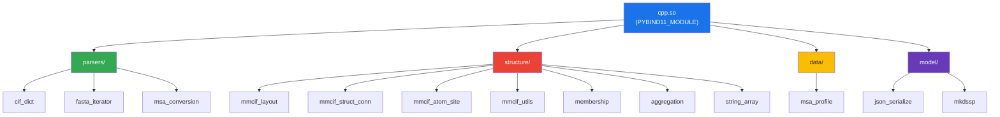
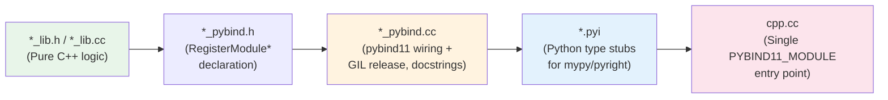

AlphaFold3's computational bottleneck lives in parsing and serialization — operations that Python handles poorly at scale. The codebase addresses this through a **pybind11-based native extension** (`cpp.so`) that exposes 13 C++ submodules to Python, organized across three domains: **parsers** (CIF, FASTA, MSA format conversion), **structure** (mmCIF layout, atom sites, aggregation), and **model** (JSON serialization, DSSP secondary structure). Every submodule follows an identical contract — a `RegisterModule*(pybind11::module)` function wired into a single `PYBIND11_MODULE` entry point — making the architecture both uniform and extensible.

## Architecture: The Single-Module Extension Pattern

All C++ bindings compile into **one shared object** (`cpp.so`), registered through a centralized `PYBIND11_MODULE` macro in [cpp.cc](src/alphafold3/cpp.cc#L44-L56). Rather than building independent Python extensions per domain, every `RegisterModule*` function receives a `def_submodule()` handle, creating a namespace tree accessible as `alphafold3.cpp.<submodule>` from Python:



The build system in [CMakeLists.txt](CMakeLists.txt#L75-L76) uses `file(GLOB_RECURSE)` to collect all `.cc` files under `src/alphafold3/`, excluding test/benchmark variants, and compiles them into the single `pybind11_add_module(cpp)` target. This design eliminates symbol resolution complexity at runtime — all registration functions share one translation unit scope.

Sources: [cpp.cc](src/alphafold3/cpp.cc#L1-L57), [CMakeLists.txt](CMakeLists.txt#L72-L110)

## Build Dependencies and Toolchain

The C++ extension targets **C++20** and depends on six externally-fetched libraries, each pinned to a specific commit for reproducibility:

| Dependency | Version / Tag | Role | Link Target |
|---|---|---|---|
| **Abseil-cpp** | 20240116.2 | Hash maps, strings, status types | `absl::flat_hash_map`, `absl::node_hash_map`, `absl::strings`, `absl::status`, `absl::statusor`, `absl::log`, `absl::check` |
| **pybind11** | v2.12.0 | Python↔C++ binding framework | Core binding infrastructure |
| **pybind11_abseil** | HEAD @ 2024-08-07 | Abseil type casters for pybind11 | `pybind11_abseil::absl_casters` |
| **libcifpp** | v7.0.3 | mmCIF specification validation | `cifpp::cifpp` |
| **dssp** | v4.4.7 | Secondary structure assignment | `dssp::dssp` |
| **Python3 NumPy** | System | Array interop | `Python3::NumPy` |

The `CMAKE_POSITION_INDEPENDENT_CODE` flag and `ABSL_PROPAGATE_CXX_STD` ensure ABI compatibility across all linked artifacts. The `NPY_NO_DEPRECATED_API` definition silences NumPy 1.7+ deprecation warnings.

Sources: [CMakeLists.txt](CMakeLists.txt#L28-L110)

## Parser Submodules

### CifDict — mmCIF Dictionary Parser

The **CifDict** module is the most complex parser in the codebase. It implements a full [CIF v1.1](https://www.iucr.org/resources/cif/spec/version1.1/cifsyntax) tokenizer and dictionary builder in C++, replacing what would otherwise be extremely slow Python-level string processing on large mmCIF files (which can exceed 100MB for the `_atom_site` loop alone).

The core class `CifDict` wraps a `shared_ptr<const Dict>` where `Dict = absl::node_hash_map<string, vector<string>>`. The `node_hash_map` is chosen deliberately — it **guarantees pointer stability**, which is essential because `ExtractLoopAsList` and `ExtractLoopAsDict` return `string_view` objects that must outlive the dict entries they reference.

**Key API surface (from the `.pyi` type stub):**

| Python API | C++ Implementation | Description |
|---|---|---|
| `cif_dict.from_string(mmcif_string)` | `CifDict::FromString` | Parses CIF string → `CifDict` object |
| `cif_dict.parse_multi_data_cif(cif_string)` | `ParseMultiDataCifDict` | Multi-record CIF → `dict[str, CifDict]` |
| `cif_dict.tokenize(cif_string)` | `Tokenize` | Low-level CIF tokenizer |
| `CifDict.extract_loop_as_list(prefix)` | `CifDict::ExtractLoopAsList` | Extracts loop entries as `list[dict]` |
| `CifDict.extract_loop_as_dict(prefix, index)` | `CifDict::ExtractLoopAsDict` | Extracts loop entries as `dict[dict]` indexed by column |
| `CifDict.get_array(key, dtype, gather)` | NumPy-native in pybind | **Optimized** array extraction with dtype conversion, NaN handling for `.` values, and fancy indexing via NumPy arrays |
| `CifDict.to_string()` | `CifDict::ToString` | Serializes back to valid CIF |

The tokenizer in [cif_dict_lib.cc](src/alphafold3/parsers/cpp/cif_dict_lib.cc#L60-L89) handles the full CIF grammar: whitespace-delimited tokens, single/double-quoted strings with escape semantics, `#`-prefixed comments, and semicolon-delimited multiline values. It uses a heuristic pre-allocation of `lines.size() * 21` tokens (based on the typical 21-column `_atom_site` loop) for performance.

The pybind layer in [cif_dict_pybind.cc](src/alphafold3/parsers/cpp/cif_dict_pybind.cc#L1-L200) adds a **NumPy-aware `get_array` method** that supports fancy indexing: the `gather` parameter accepts `None` (all values), a Python `slice`, or a NumPy integer array (`int16` through `uint64`), enabling zero-copy gathering of scattered indices into typed arrays — critical for extracting atom coordinates by residue index without intermediate Python lists.

> [!TIP]
> The `get_array` method treats the CIF `.` character as `np.nan` when `dtype` is `np.float32` or `np.float64`, and deduplicates identical strings to share one Python object — both behaviors save substantial memory on large mmCIF files.

Sources: [cif_dict_lib.h](src/alphafold3/parsers/cpp/cif_dict_lib.h#L1-L157), [cif_dict_lib.cc](src/alphafold3/parsers/cpp/cif_dict_lib.cc#L1-L200), [cif_dict_pybind.cc](src/alphafold3/parsers/cpp/cif_dict_pybind.cc#L1-L200), [cif_dict.pyi](src/alphafold3/parsers/cpp/cif_dict.pyi#L1-L136)

### FastaIterator — FASTA Sequence Parser

The FASTA parser provides **both eager and lazy** parsing strategies. The eager functions `parse_fasta` and `parse_fasta_include_descriptions` consume an entire FASTA string at once, while the iterator classes `FastaFileIterator` and `FastaStringIterator` yield one `(sequence, description)` pair at a time — critical for memory efficiency when processing multi-GB MSA files from jackhmmer output.

| API | Strategy | Input Source | GIL Behavior |
|---|---|---|---|
| `parse_fasta(fasta_string)` | Eager | String | Released during call |
| `parse_fasta_include_descriptions(fasta_string)` | Eager | String | Released during call |
| `FastaFileIterator(fasta_path)` | Lazy iterator | File path | Released per `__next__` |
| `FastaStringIterator(fasta_string)` | Lazy iterator | String | Released per `__next__` |

All bindings use `py::call_guard<py::gil_scoped_release>()` to free the Python GIL during computation, enabling true parallelism when invoked from multiple Python threads. The `PythonFastaStringIterator` wrapper class holds a `py::object` reference to the input string, preventing the critical use-after-free scenario documented in the docstring where deleting the backing Python string would invalidate the `string_view`.

Sources: [fasta_iterator_lib.h](src/alphafold3/parsers/cpp/fasta_iterator_lib.h#L1-L102), [fasta_iterator_lib.cc](src/alphafold3/parsers/cpp/fasta_iterator_lib.cc#L1-L131), [fasta_iterator_pybind.cc](src/alphafold3/parsers/cpp/fasta_iterator_pybind.cc#L1-L137), [fasta_iterator.pyi](src/alphafold3/parsers/cpp/fasta_iterator.pyi#L1-L32)

### MsaConversion — A3M ↔ Stockholm Format Bridge

MSA tools produce output in different alignment formats. HHblits uses **A3M** (compact, with insertions as lowercase), while the broader AlphaFold3 pipeline expects **Stockholm** format (fully expanded with gap characters). The `msa_conversion` module bridges this gap:

- **`convert_a3m_to_stockholm(a3m_sequences)`** — Expands lowercase insertion columns in A3M into uppercase + gap-padded Stockholm columns. For example, `["abCD", "CgD", "fCDa"]` → `["ABC-D-", "--CGD-", "F-C-DA"]`.
- **`align_sequence_to_gapless_query(sequence, query_sequence)`** — Reverses the process: given a Stockholm-aligned sequence and a gapless query, it produces A3M by lowercasing residues at query gap positions and dropping double-gap columns.

Both functions release the GIL and operate entirely on `string_view` for zero-copy iteration over input sequences.

Sources: [msa_conversion_pybind.cc](src/alphafold3/parsers/cpp/msa_conversion_pybind.cc#L1-L172), [msa_conversion.pyi](src/alphafold3/parsers/cpp/msa_conversion.pyi#L1-L36)

## Data Submodule

### MsaProfile — Residue Frequency Computation

The `msa_profile` submodule exposes a single function `compute_msa_profile(msa, num_residue_types)` that converts an integer-coded MSA (shape `[num_msa, num_res]`) into a frequency profile (shape `[num_res, num_residue_types]`). Each entry is the fraction of MSA rows exhibiting that residue type at that position — a normalization by `1 / msa_depth`. The implementation uses direct pointer arithmetic over the NumPy array data buffer for cache-friendly traversal, with `mutable_unchecked<2>()` for bounds-check-free writes.

Sources: [msa_profile_pybind.cc](src/alphafold3/data/cpp/msa_profile_pybind.cc#L1-L89)

## Model Submodules

### JsonSerialize — Zero-Allocation Confidence Serialization

The `json_serialize` module is a **hand-rolled JSON serializer** that bypasses generic JSON libraries entirely. It converts prediction confidence metrics (PAE, pLDDT, contact probabilities, chain/residue IDs) directly to a JSON string using precomputed lookup tables and `absl::string_view` appends.

The key optimization is `MakeStringFrom2DigitNum()`, a `constexpr` function that pre-generates a 10,000-entry lookup table at compile time mapping integers 0–9999 to their decimal string representations. The `StringFromFraction`, `StringFrom2DigitNum1Decimal`, and `StringFrom2DigitNum2Decimal` functions use this table for **branch-free float-to-string conversion** of confidence scores in the `[0, 1]` and `[0, 99.9]` ranges — avoiding `snprintf` overhead for millions of PAE entries.

The capacity pre-computation in `StructureConfidenceFullToJson` reserves the exact string size needed before any appends, eliminating all reallocations.

> [!TIP]
> The JSON serializer outputs `null` for NaN confidence values (representing intra-chain PAE for single-chain predictions) and clamps floats to their valid range before lookup-table conversion — ensuring the output is always valid JSON without runtime format checks.

Sources: [json_serialize_pybind.cc](src/alphafold3/model/json_serialize_pybind.cc#L1-L200)

### Mkdssp — Secondary Structure Assignment

The `mkdssp` module wraps the [DSSP](https://github.com/PDB-REDO/dssp) (v4.4.7) and [libcifpp](https://github.com/pdb-redo/libcifpp) (v7.0.3) C++ libraries to compute secondary structure annotations from mmCIF data. The binding function `get_dssp(mmcif, model_no, min_poly_proline_stretch_length, calculate_surface_accessibility)` constructs a `cif::file` from the mmCIF string, runs the DSSP algorithm, and returns the legacy-format DSSP output as a Python string.

A notable initialization detail: the binding searches Python's `site.getsitepackages()` for the `libcifpp/components.cif` dictionary file at import time and sets `LIBCIFPP_DATA_DIR` accordingly — this is required for libcifpp's chemical component validation.

Sources: [mkdssp_pybind.cc](src/alphafold3/model/mkdssp_pybind.cc#L1-L75)

## Structure Submodules

The structure C++ modules operate on the parsed mmCIF data to extract spatial and organizational information:

| Submodule | Purpose | Key API |
|---|---|---|
| **mmcif_layout** | Hierarchical model→chain→residue→atom index structure | `MmcifLayout` class with `num_models()`, `num_chains()`, `residue_range()`, `atom_range()`, `chain_starts()`, `model_offset()` |
| **mmcif_struct_conn** | Inter-residue bond/connectivity records from `_struct_conn` | Connection extraction for covalent bond annotation |
| **mmcif_atom_site** | `_atom_site` loop processing | Atom coordinate and metadata extraction |
| **mmcif_utils** | Utility functions for mmCIF manipulation | Format conversions and validation helpers |
| **membership** | Chain membership queries | Which chains contain which residue types |
| **aggregation** | Group-by operations on index arrays | `indices_grouped_by_value(values)` — groups indices by value, e.g. `[1,1,2,3,3,1,1]` → `{1:[0,1,5,6], 2:[2], 3:[3,4]}` |
| **string_array** | Compact string storage with integer indexing | Memory-efficient string interning for chain IDs and residue names |

The `MmcifLayout` class is particularly important — it computes the **contiguous index ranges** for each structural level (model, chain, residue, atom) from the mmCIF data, enabling downstream code to slice NumPy arrays by structural unit without Python-level iteration.

Sources: [mmcif_layout_pybind.cc](src/alphafold3/structure/cpp/mmcif_layout_pybind.cc#L1-L59), [aggregation_pybind.cc](src/alphafold3/structure/cpp/aggregation_pybind.cc#L1-L64)

## Uniform Binding Pattern

Every C++ submodule follows the same three-file contract, creating a consistent and maintainable architecture:



| Layer | Responsibility | GIL Handling |
|---|---|---|
| **`*_lib.h/.cc`** | Pure C++ with `absl::StatusOr` error returns | N/A (no Python) |
| **`*_pybind.h/.cc`** | Type conversion, docstrings, `ValueOrThrow` error bridge | `py::call_guard<py::gil_scoped_release>()` on CPU-bound functions |
| **`*.pyi`** | Static type information for Python tooling | N/A |
| **`cpp.cc`** | Module registration via `m.def_submodule()` | N/A |

The `py::call_guard<py::gil_scoped_release>()` pattern is applied consistently to every function that performs significant computation (parsing, conversion, serialization). Iterator `__next__` methods release the GIL per-iteration. Only trivial property accessors and constructors hold the GIL.

Sources: [cpp.cc](src/alphafold3/cpp.cc#L44-L56), [cif_dict_pybind.h](src/alphafold3/parsers/cpp/cif_dict_pybind.h#L1-L32), [fasta_iterator_pybind.cc](src/alphafold3/parsers/cpp/fasta_iterator_pybind.cc#L90-L137)

## Python Access Paths

From Python, all C++ modules are accessed through the `alphafold3.cpp` namespace:

```python
from alphafold3.cpp import cif_dict, fasta_iterator, msa_conversion
from alphafold3.cpp import mmcif_layout, mmcif_utils, aggregation
from alphafold3.cpp import json_serialize, mkdssp, msa_profile

# Parse an mmCIF file
mmcif = cif_dict.from_string(mmcif_string)
atom_sites = mmcif.extract_loop_as_list("_atom_site.")

# Lazy-iterate a large FASTA MSA
for sequence, description in fasta_iterator.FastaFileIterator("/path/to/msa.a3m"):
    process(sequence)

# Convert A3M → Stockholm alignment
stockholm_seqs = msa_conversion.convert_a3m_to_stockholm(a3m_sequences)

# Compute residue frequency profile
profile = msa_profile.compute_msa_profile(msa_array, num_residue_types=22)

# Serialize confidence metrics to JSON (zero-allocation)
json_str = json_serialize.structure_confidence_full_to_json(
    pae, token_chain_ids, token_res_ids, atom_plddts, atom_chain_ids, contact_probs
)
```

The `.pyi` stub files alongside each pybind module ensure full IDE autocomplete and type-checking support — a non-trivial investment given that pybind11-generated modules otherwise lack introspectable type information.

Sources: [cif_dict.pyi](src/alphafold3/parsers/cpp/cif_dict.pyi#L1-L136), [fasta_iterator.pyi](src/alphafold3/parsers/cpp/fasta_iterator.pyi#L1-L32), [msa_conversion.pyi](src/alphafold3/parsers/cpp/msa_conversion.pyi#L1-L36)

## Performance Rationale

The decision to implement parsers and serializers in C++ rather than Python is driven by concrete bottlenecks in the AlphaFold3 pipeline:

- **mmCIF files** for large complexes contain millions of `_atom_site` rows — Python string splitting on such data is 10–50× slower than the C++ tokenizer with pre-allocated token vectors.
- **FASTA MSA files** from jackhmmer can exceed 100GB; lazy iteration via `FastaFileIterator` avoids loading the entire file into memory.
- **JSON serialization** of a 5000×5000 PAE matrix requires formatting 25M floats — the compile-time lookup table approach avoids per-element `snprintf` calls and Python object creation overhead.
- **NumPy interop** in `CifDict.get_array` and `compute_msa_profile` operates directly on array memory buffers, eliminating Python list intermediaries.

For understanding how parsed data flows into the neural network, see [Featurisation and Batching](10-featurisation-and-batching). For the output side where `json_serialize` is consumed, see [Output Format and Metrics](15-output-format-and-metrics). For the broader infrastructure context, see [Docker and GPU Setup](18-docker-and-gpu-setup) and [JAX Geometry Module](20-jax-geometry-module).