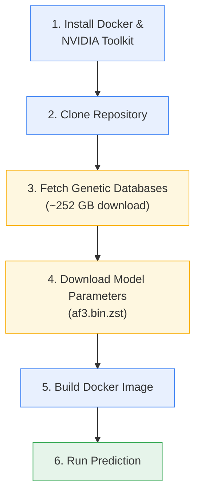

Get AlphaFold 3 running from zero to your first structure prediction. This guide walks you through the complete setup pipeline — from provisioning a GPU machine to producing your first predicted biomolecular structure — using the official Docker-based workflow.

## Prerequisites at a Glance

AlphaFold 3 has specific hardware and software requirements. Before starting, confirm your environment meets these thresholds:

| Requirement | Specification | Notes |
|---|---|---|
| **Operating System** | Linux | macOS supported in CPU-only / MPS mode only |
| **GPU** | NVIDIA with Compute Capability ≥ 8.0 | A100 80 GB and H100 80 GB are verified |
| **GPU Memory** | 80 GB recommended | Larger memory → larger predictions (up to 5,120 tokens on 80 GB) |
| **System RAM** | ≥ 64 GB | Genetic search for long targets can consume significant RAM |
| **Disk Space** | ~1 TB | ~630 GB for databases (uncompressed) + model params + working space |
| **Storage Type** | SSD recommended | Critical for genetic search I/O performance |
| **CUDA (host)** | 12.6 | Required by the Docker container |

> [!TIP]
> Inputs with up to 5,120 tokens have been verified on a single NVIDIA A100 80 GB or H100 80 GB. The `--num_recycles` and `--num_diffusion_samples` flags control inference depth vs. speed trade-offs.

Sources: [installation.md](docs/installation.md#L3-L9), [performance.md](docs/performance.md#L186-L200)

## Setup Flow

The end-to-end setup follows six sequential stages, each producing an artifact consumed by the next:



Sources: [installation.md](docs/installation.md#L23-L31), [Dockerfile](docker/Dockerfile#L20-L98)

## Step 1 — Install Docker and GPU Support

AlphaFold 3 runs inside a Docker container with GPU passthrough. Install rootless Docker and the NVIDIA Container Toolkit on your Ubuntu 22.04 LTS host:

```sh
# Install Docker
sudo apt-get update
sudo apt-get install -y ca-certificates curl
sudo install -m 0755 -d /etc/apt/keyrings
sudo curl -fsSL https://download.docker.com/linux/ubuntu/gpg -o /etc/apt/keyrings/docker.asc
sudo chmod a+r /etc/apt/keyrings/docker.asc
echo \
  "deb [arch=$(dpkg --print-architecture) signed-by=/etc/apt/keyrings/docker.asc] https://download.docker.com/linux/ubuntu \
  $(. /etc/os-release && echo "$VERSION_CODENAME") stable" | \
  sudo tee /etc/apt/sources.list.d/docker.list > /dev/null
sudo apt-get update
sudo apt-get install -y docker-ce docker-ce-cli containerd.io docker-buildx-plugin docker-compose-plugin

# Enable rootless Docker (see docs for full instructions)
sudo apt-get install -y uidmap systemd-container
```

Then install NVIDIA drivers and the container toolkit:

```sh
# NVIDIA drivers
sudo apt-get -y install alsa-utils ubuntu-drivers-common
sudo ubuntu-drivers install
nvidia-smi  # Verify — reboot if this fails

# NVIDIA Container Toolkit
curl -fsSL https://nvidia.github.io/libnvidia-container/gpgkey | sudo gpg --dearmor -o /usr/share/keyrings/nvidia-container-toolkit-keyring.gpg \
  && curl -s -L https://nvidia.github.io/libnvidia-container/stable/deb/nvidia-container-toolkit.list | \
    sed 's#deb https://#deb [signed-by=/usr/share/keyrings/nvidia-container-toolkit-keyring.gpg] https://#g' | \
    sudo tee /etc/apt/sources.list.d/nvidia-container-toolkit.list
sudo apt-get update
sudo apt-get install -y nvidia-container-toolkit
nvidia-ctk runtime configure --runtime=docker --config=$HOME/.config/docker/daemon.json
systemctl --user restart docker
sudo nvidia-ctk config --set nvidia-container-cli.no-cgroups --in-place
```

**Verify GPU access from Docker** before proceeding:

```sh
docker run --rm --gpus all nvidia/cuda:12.6.0-base-ubuntu22.04 nvidia-smi
```

Sources: [installation.md](docs/installation.md#L61-L156)

## Step 2 — Clone the Repository

```sh
git clone https://github.com/google-deepmind/alphafold3.git
cd alphafold3
```

Sources: [installation.md](docs/installation.md#L185-L189)

## Step 3 — Fetch Genetic Databases

AlphaFold 3 requires multiple genetic databases for MSA and template search. The provided `fetch_databases.sh` script downloads all of them in parallel:

```sh
./fetch_databases.sh [<DB_DIR>]
```

If `<DB_DIR>` is not specified, it defaults to `$HOME/public_databases`. This step downloads approximately **252 GB** and decompresses to approximately **630 GB** — expect around 45 minutes on a non-SSD connection. Run this in a `screen` or `tmux` session.

The resulting directory structure:

```
<DB_DIR>/
├── mmcif_files/                                                # ~200k PDB mmCIF files
├── bfd-first_non_consensus_sequences.fasta                    # BFD small
├── mgy_clusters_2022_05.fa                                    # MGnify
├── nt_rna_2023_02_23_clust_seq_id_90_cov_80_rep_seq.fasta     # NT RNA
├── pdb_seqres_2022_09_28.fasta                                # PDB seqres
├── rfam_14_9_clust_seq_id_90_cov_80_rep_seq.fasta             # RFam
├── rnacentral_active_seq_id_90_cov_80_linclust.fasta          # RNAcentral
├── uniprot_all_2021_04.fa                                     # UniProt
└── uniref90_2022_05.fa                                        # UniRef90
```

> [!TIP]
> **Do not** place `<DB_DIR>` inside the AlphaFold 3 repository directory — Docker will copy it during the image build, making it extremely slow. Also ensure full read/write permissions: `sudo chmod 755 --recursive <DB_DIR>`.

Sources: [fetch_databases.sh](fetch_databases.sh#L21-L57), [installation.md](docs/installation.md#L192-L250)

## Step 4 — Download Model Parameters

Fetch the model weights from Google Cloud Storage:

```sh
wget https://storage.googleapis.com/alphafold3/af3.bin.zst
```

Place the downloaded file in a directory referred to as `<MODEL_PARAMETERS_DIR>`. As with databases, this directory **must not** be a subdirectory of the AlphaFold 3 repository. Use of these parameters is subject to the [AlphaFold 3 Model Parameters Terms of Use](https://github.com/google-deepmind/alphafold3/blob/main/WEIGHTS_TERMS_OF_USE.md).

Sources: [README.md](README.md#L27-L32), [installation.md](docs/installation.md#L265-L274)

## Step 5 — Build the Docker Image

From the root of the cloned repository:

```sh
docker build -t alphafold3 -f docker/Dockerfile .
```

On systems like AlmaLinux/Rocky/RHEL that hit `No file descriptors available (os error 24)`, expand the limit:

```sh
docker build --ulimit nofile=65535:65535 -t alphafold3 -f docker/Dockerfile .
```

The Dockerfile builds on `nvidia/cuda:12.6.3-base-ubuntu24.04`, installs HMMER 3.4 (with a custom sequence limit patch), sets up a Python 3.12 virtual environment via `uv`, and configures XLA flags for optimal GPU compilation. The build also pre-compiles the chemical components database (`build_data`).

Sources: [Dockerfile](docker/Dockerfile#L20-L98), [installation.md](docs/installation.md#L275-L290)

## Step 6 — Run Your First Prediction

### Prepare Your Input JSON

Create an input file `fold_input.json` describing the structure you want to predict. Here is a minimal protein homodimer example:

```json
{
  "name": "2PV7",
  "sequences": [
    {
      "protein": {
        "id": ["A", "B"],
        "sequence": "GMRESYANENQFGFKTINSDIHKIVIVGGYGKLGGLFARYLRASGYPISILDREDWAVAESILANADVVIVSVPINLTLETIERLKPYLTENMLLADLTSVKREPLAKMLEVHTGAVLGLHPMFGADIASMAKQVVVRCDGRFPERYEWLLEQIQIWGAKIYQTNATEHDHNMTYIQALRHFSTFANGLHLSKQPINLANLLALSSPIYRLELAMIGRLFAQDAELYADIIMDKSENLAVIETLKQTYDEALTFFENNDRQGFIDAFHKVRDWFGDYSE"
      }
    }
  ],
  "modelSeeds": [1],
  "dialect": "alphafold3",
  "version": 1
}
```

Place it in a directory, e.g. `$HOME/af_input`. The repository includes **13 ready-made example inputs** in the `examples/` directory covering proteins, RNA, DNA, ligands (by CCD code and SMILES), modified residues, covalent bonds, and glycosylated chains.

Sources: [README.md](README.md#L38-L56), [input.md](docs/input.md#L116-L136)

### Execute the Prediction

```sh
docker run -it \
    --volume $HOME/af_input:/root/af_input \
    --volume $HOME/af_output:/root/af_output \
    --volume <MODEL_PARAMETERS_DIR>:/root/models \
    --volume <DB_DIR>:/root/public_databases \
    --gpus all \
    alphafold3 \
    python run_alphafold.py \
    --json_path=/root/af_input/fold_input.json \
    --model_dir=/root/models \
    --output_dir=/root/af_output
```

The four `--volume` flags map host directories into the container: input JSON, output directory, model parameters, and genetic databases. Ensure `$HOME/af_output` exists and is writable (`chmod 755 $HOME/af_output`).

Sources: [README.md](README.md#L60-L72), [installation.md](docs/installation.md#L298-L318)

### What You'll Get

After the run completes, the output directory contains your predicted structure and confidence metrics:

```
2PV7/
├── seed-1_sample-0/
│   ├── 2PV7_seed-1_sample-0_model.cif          # Predicted structure (mmCIF)
│   ├── 2PV7_seed-1_sample-0_confidences.json   # Full confidence arrays
│   └── 2PV7_seed-1_sample-0_summary_confidences.json
├── seed-1_sample-1/
│   └── ...
├── 2PV7_model.cif                               # Top-ranking prediction
├── 2PV7_confidences.json                         # Top-ranking confidences
├── 2PV7_summary_confidences.json                 # Summary (pTM, ipTM, ranking_score)
├── 2PV7_data.json                                # Input + MSA/template data
├── 2PV7_ranking_scores.csv                       # All samples ranked
└── TERMS_OF_USE.md
```

By default, AlphaFold 3 generates **5 diffusion samples per seed**. The top-ranked sample (by `ranking_score`) is promoted to the root directory. The primary mmCIF file is compatible with standard structural biology tools.

Sources: [output.md](docs/output.md#L1-L83)

## Key Command-Line Flags

The `run_alphafold.py` script exposes many flags for controlling behavior. Discover all options with `docker run alphafold3 python run_alphafold.py --help`. The most important ones for getting started:

| Flag | Default | Purpose |
|---|---|---|
| `--json_path` | *(required)* | Path to input JSON file |
| `--model_dir` | `~/models` | Path to model parameters directory |
| `--output_dir` | *(required)* | Path to output directory |
| `--run_data_pipeline` | `true` | Run MSA + template search (CPU-only stage) |
| `--run_inference` | `true` | Run model inference (requires GPU) |
| `--jax_backend` | `gpu` | JAX backend: `gpu`, `cpu`, or `mps` (Apple Silicon) |
| `--num_recycles` | `10` | Number of recycles during inference |
| `--num_diffusion_samples` | `5` | Number of diffusion samples per seed |
| `--max_template_date` | `2021-09-30` | Ignore templates released after this date |
| `--flash_attention_implementation` | `triton` | Attention kernel: `triton` (fastest), `cudnn`, or `xla` (portable) |

The `--run_data_pipeline` and `--run_inference` flags are especially powerful when used independently — you can run the CPU-intensive data pipeline on a machine without a GPU, then transfer the augmented JSON to a GPU machine for inference only. See [Performance Optimization](21-performance-optimization) for advanced staging strategies.

Sources: [run_alphafold.py](run_alphafold.py#L80-L111), [run_alphafold.py](run_alphafold.py#L344-L390), [README.md](README.md#L74-L82)

## Example Input Gallery

The `examples/` directory provides 13 input JSON files spanning the full range of AlphaFold 3's capabilities. Use these as templates for your own inputs:

| Example File | Entity Types | Key Feature Demonstrated |
|---|---|---|
| `ubiquitin_monomer.json` | Protein | Simple single-chain protein |
| `barnase_barstar.json` | Protein + Protein | Protein–protein complex |
| `tetr_homodimer.json` | Protein | Symmetric homodimer |
| `modified_rna.json` | RNA (modified) | Pseudouridine, methylcytidine, O-methylguanosine |
| `u1a_rna_hairpin.json` | Protein + RNA | Protein–RNA interaction |
| `tetr_dimer_dna.json` | Protein + DNA | Protein–DNA interaction |
| `methylated_dna.json` | DNA (modified) | Methylated DNA bases |
| `kras_g12c_sotorasib.json` | Protein + Ligand (CCD) | Covalent bond (`bondedAtomPairs`) |
| `streptavidin_biotin_smiles.json` | Protein + Ligand (SMILES) | Ligand specified by SMILES string |
| `rnaseb_glycosylated.json` | Protein (glycosylated) | N-linked glycosylation |
| `calmodulin_4calcium.json` | Protein + Ions | Calcium ions as ligand entities |
| `erk2_phosphorylated.json` | Protein (phosphorylated) | Phosphorylated residues |
| `tetr_dimer_tetracycline.json` | Protein + Ligand (CCD) | Small-molecule binding |

Sources: [examples/](examples/), [input.md](docs/input.md#L27-L45)

## Troubleshooting Common Issues

| Symptom | Cause | Fix |
|---|---|---|
| `nvidia-smi` fails after driver install | GPU needs reset | Run `sudo reboot now` |
| Docker container cannot see GPU | NVIDIA toolkit not configured | Verify with `docker run --rm --gpus all nvidia/cuda:12.6.0-base-ubuntu22.04 nvidia-smi` |
| `permission denied` on volume mounts | Host directory permissions | `chmod 755 $HOME/af_input $HOME/af_output` |
| Slow genetic search | Databases on HDD, not SSD | Move databases to SSD and mount separately |
| `No file descriptors available` during build | OS file descriptor limits | Add `--ulimit nofile=65535:65535` to `docker build` |
| Opaque MSA tool errors | Database directory lacks read/write permissions | `sudo chmod 755 --recursive <DB_DIR>` |

For additional known issues, see [Issues and Feedbacks](5-issues-and-feedbacks).

Sources: [installation.md](docs/installation.md#L119-L132), [installation.md](docs/installation.md#L223-L236), [installation.md](docs/installation.md#L284-L289)

## Where to Go Next

Now that you have AlphaFold 3 running, explore these topics to deepen your understanding:

- **[Input JSON Format](3-input-json-format)** — Master the full input schema for proteins, RNA, DNA, ligands, covalent bonds, and custom MSAs
- **[Output Format and Metrics](15-output-format-and-metrics)** — Interpret confidence scores (pLDDT, PAE, pTM, ipTM) and ranking
- **[Docker and GPU Setup](18-docker-and-gpu-setup)** — Advanced container configuration, Singularity, and multi-GPU setups
- **[Performance Optimization](21-performance-optimization)** — Stage the pipeline, shard databases, and tune inference parameters
- **[Input Examples and Patterns](22-input-examples-and-patterns)** — Detailed walkthroughs of all 13 example inputs