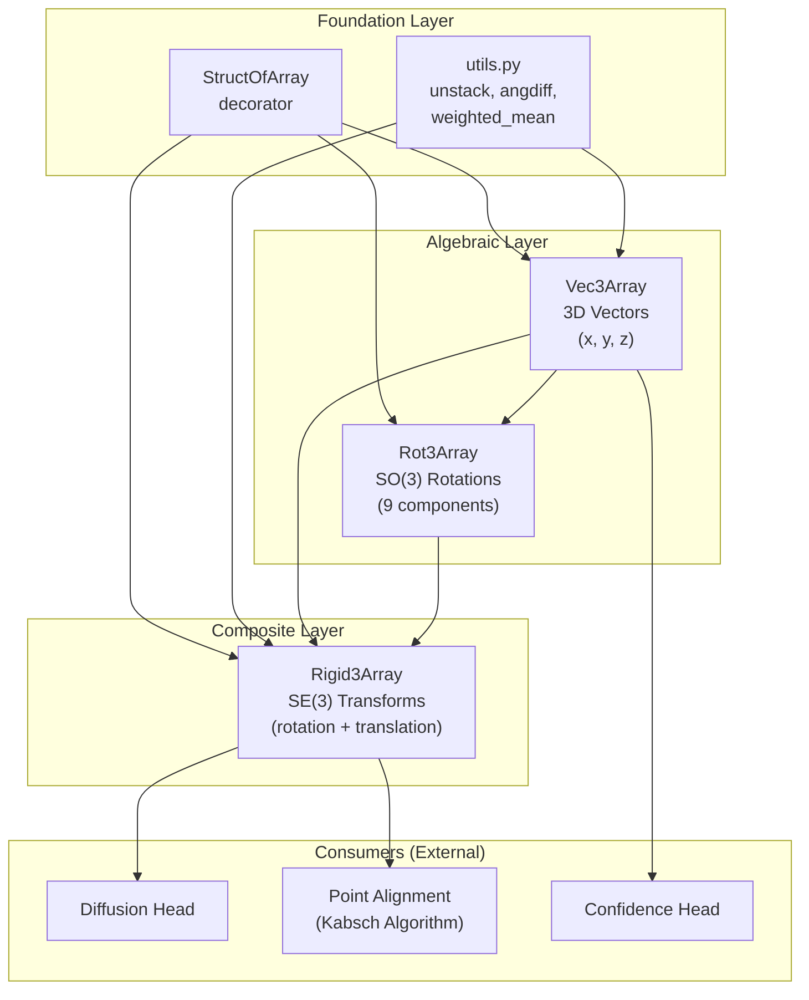

The JAX Geometry Module is AlphaFold 3's foundational algebraic framework for differentiable 3D spatial computation. It implements three core mathematical objects — **Vec3Array** (3D vectors), **Rot3Array** (SO(3) rotation matrices), and **Rigid3Array** (SE(3) rigid transformations) — using a **struct-of-arrays** memory layout optimized for TPU and GPU acceleration. Every atom coordinate, backbone frame, and structural alignment in the AlphaFold 3 pipeline flows through these types, making this module the geometric substrate upon which the entire inference architecture is built.

Sources: [\_\_init\_\_.py](/src/alphafold3/jax/geometry/__init__.py#L20-L38)

## Architectural Overview

The module is organized as a layered algebraic hierarchy, where each layer builds upon the primitives of the one below. The `StructOfArray` decorator sits at the base, providing JAX pytree registration and structural validation that all higher types inherit.



| Module | Class | Mathematical Object | Fields | Role |
|--------|-------|---------------------|--------|------|
| `vector.py` | `Vec3Array` | ℝ³ vector | `x, y, z` | Point coordinates, displacements, directions |
| `rotation_matrix.py` | `Rot3Array` | SO(3) rotation | `xx, xy, xz, yx, yy, yz, zx, zy, zz` | Orientation frames, backbone rotamers |
| `rigid_matrix_vector.py` | `Rigid3Array` | SE(3) rigid transform | `rotation`, `translation` | Local-to-global frame mapping, structural alignment |
| `struct_of_array.py` | `StructOfArray` | Decorator / metaclass | — | JAX pytree registration, dtype/shape validation |
| `utils.py` | — | Utility functions | — | Array unstacking, angular difference, weighted mean |

Sources: [\_\_init\_\_.py](/src/alphafold3/jax/geometry/__init__.py#L22-L38), [vector.py](/src/alphafold3/jax/geometry/vector.py#L37-L54), [rotation_matrix.py](/src/alphafold3/jax/geometry/rotation_matrix.py#L117-L131), [rigid_matrix_vector.py](/src/alphafold3/jax/geometry/rigid_matrix_vector.py#L108-L113)

## StructOfArray — The Foundation Decorator

The `StructOfArray` class decorator is the mechanism that makes every geometry type a first-class JAX citizen. It wraps a Python dataclass and injects four critical capabilities: **JAX pytree registration** (enabling `jax.jit`, `jax.vmap`, `jax.grad` to trace through these objects), **dtype/shape validation** (catching broadcasting errors early), **structural slicing** via `__getitem__`, and a `.replace()` method for immutable field updates. Without this decorator, none of the geometry types would be differentiable or composable within JAX transformations.

When applied with `same_dtype=True`, the decorator enforces that all array fields share a single dtype — a constraint that prevents silent precision loss when mixing `float32` coordinates with `bfloat16` intermediate values on TPU. The `__post_init__` validation checks both shape and dtype consistency across all fields, raising assertion errors at construction time rather than silently producing corrupt geometry. The pytree flattening logic separates array fields from metadata fields (those marked with `is_metadata=True`), ensuring that only arrays participate in JAX's autodiff tracing while metadata is preserved as static auxiliary data.

```python
# The decorator is applied at class definition time
@struct_of_array.StructOfArray(same_dtype=True)
class Vec3Array:
    x: jnp.ndarray = dataclasses.field(metadata={'dtype': jnp.float32})
    y: jnp.ndarray
    z: jnp.ndarray
```

This yields a frozen dataclass with injected `.shape`, `.dtype`, `__getitem__`, and `.replace()` attributes, plus full JAX pytree compatibility.

Sources: [struct\_of\_array.py](/src/alphafold3/jax/geometry/struct_of_array.py#L199-L241), [struct\_of\_array.py](/src/alphafold3/jax/geometry/struct_of_array.py#L92-L141)

## Vec3Array — 3D Vector Algebra

`Vec3Array` represents a batch of 3D vectors using a **struct-of-arrays** layout — three separate `jnp.ndarray` components (`x`, `y`, `z`) rather than a single `[..., 3]` array. This design choice is driven by two hardware-level concerns: on TPU, small matrix multiplications are extremely suboptimal and waste compute resources, and any matmul on TPU occurs in mixed `bfloat16/float32` precision which is undesirable for physical coordinates. By storing components as separate arrays, element-wise operations avoid matmul entirely, preserving full `float32` precision and leveraging vector instruction units on both CPU and GPU.

### Core Operations

The class implements a complete vector algebra through Python dunder methods and named methods. All arithmetic operators use `jax.tree.map` to apply operations across the `(x, y, z)` tuple, ensuring compatibility with JAX's tracing machinery.

| Operation | Method | Formula | Returns |
|-----------|--------|---------|---------|
| Addition | `__add__` | `(x₁+x₂, y₁+y₂, z₁+z₂)` | `Vec3Array` |
| Subtraction | `__sub__` | `(x₁-x₂, y₁-y₂, z₁-z₂)` | `Vec3Array` |
| Scalar multiply | `__mul__` | `(sx, sy, sz)` | `Vec3Array` |
| Scalar divide | `__truediv__` | `(x/s, y/s, z/s)` | `Vec3Array` |
| Dot product | `.dot()` | `x₁x₂ + y₁y₂ + z₁z₂` | `Float` |
| Cross product | `.cross()` | Standard 3D cross product | `Vec3Array` |
| Norm | `.norm(ε)` | `√max(dot(self), ε²)` | `Float` |
| Normalize | `.normalized(ε)` | `self / self.norm(ε)` | `Vec3Array` |

> [!TIP]
> The `norm()` method clips the squared norm from below using `jnp.maximum(norm2, epsilon**2)` **before** taking the square root. This ordering is critical: clipping post-sqrt would still produce NaN gradients at zero, whereas clipping pre-sqrt ensures the backward pass remains finite everywhere.

### Module-Level Functions

The module exposes free functions that delegate to the instance methods, providing a functional API style preferred in JAX codebases:

- **`euclidean_distance(v1, v2, ε)`** — Computes `√max(‖v1−v2‖², ε)` with the same pre-sqrt clipping strategy as `norm()`.
- **`square_euclidean_distance(v1, v2, ε)`** — Returns `‖v1−v2‖²` clipped from below by `ε`, useful when the squared form avoids an unnecessary sqrt.
- **`dihedral_angle(a, b, c, d)`** — Computes the torsion angle for a quadruple of points, returning a value in `[−π, π]`. This uses the cross-product formulation: given edge vectors `v1=a−b`, `v2=b−c`, `v3=d−c`, it computes normals `c1=v1×v2` and `c2=v3×v2`, then returns `atan2((c2×c1)·v2, ‖v2‖·(c1·c2))`. This is the standard biochemistry convention for backbone dihedral angles (φ, ψ, ω).

### Array Interop

Conversion between `Vec3Array` and standard JAX arrays is handled by `.to_array()` (stacks components along the last axis to produce `[..., 3]`) and `Vec3Array.from_array()` (unstacks the last axis into separate components). Pickle serialization is supported via `__getstate__`/`__setstate__` using NumPy arrays for portability.

Sources: [vector.py](/src/alphafold3/jax/geometry/vector.py#L37-L141), [vector.py](/src/alphafold3/jax/geometry/vector.py#L142-L232)

## Rot3Array — SO(3) Rotation Matrices

`Rot3Array` represents a batch of 3×3 rotation matrices as nine separate scalar fields (`xx, xy, xz, yx, yy, yz, zx, zy, zz`), following the same struct-of-arrays philosophy as `Vec3Array`. This avoids any 3×3 matrix multiplication on TPU hardware, replacing it with scalar multiplies and adds that run at full `float32` precision.

### Algebraic Operations

| Operation | Method | Implementation |
|-----------|--------|----------------|
| Inverse (transpose) | `.inverse()` | Transpose: swap row/column indices, exploiting R⁻¹ = Rᵀ for rotation matrices |
| Apply to point | `.apply_to_point(v)` | Explicit 3×3–vector product without matmul |
| Apply inverse to point | `.apply_inverse_to_point(v)` | `self.inverse().apply_to_point(v)` |
| Composition | `__matmul__` | Applies `self` to each column of `other` |

### Construction Methods

`Rot3Array` provides four distinct construction pathways, each suited to a different computational context within the AlphaFold 3 pipeline:

**1. `from_two_vectors(e0, e1)`** — Builds a rotation frame where `e0` lies on the positive x-axis and `e1` lies in the xy-plane with positive y. It orthonormalizes via Gram-Schmidt: normalizes `e0`, projects out the `e0`-component from `e1` and normalizes, then computes `e2 = e0 × e1`. This is used to construct local residue frames from backbone atom positions.

**2. `from_quaternion(w, x, y, z, normalize=True)`** — Converts a unit quaternion to a rotation matrix using the standard formula. When `normalize=True`, it first normalizes the quaternion using `jax.lax.rsqrt` for numerical stability. This is the primary pathway for `from_svd` with the quaternion formula.

**3. `from_svd(mat, use_quat_formula=True)`** — Projects an arbitrary 3×3 matrix onto the nearest rotation matrix. This is the most sophisticated constructor, offering two algorithms:

- **Quaternion formula** (default): Reformulates the projection as finding the **largest eigenvector of a 4×4 symmetric matrix** derived from the input. This matrix is constructed via `MATRIX_SVD_QUAT_FACTORS`, a precomputed `16×9` linear mapping. The largest eigenvector is then converted to a quaternion. This approach has fewer numerical issues when singular values are near-degenerate, following the method of [Markley et al.](https://citeseerx.ist.psu.edu/viewdoc/download?doi=10.1.1.65.971&rep=rep1&type=pdf).
- **SVD formula**: Computes `U, Σ, Vᵀ = SVD(M)`, then constructs `R = U · diag(1, 1, det(UVᵀ)) · Vᵀ`. The determinant correction ensures a proper rotation (not a reflection). This follows [Meyer et al.](https://arxiv.org/pdf/2006.14616.pdf) but has large gradients when the two smallest singular values are close or near zero.

**4. `random_uniform(key, shape)`** — Samples from the uniform distribution over SO(3) (Haar measure) by drawing a 4-vector from a standard normal and normalizing it as a quaternion.

### Custom JVP for Eigenvector Computation

The `largest_evec` function is decorated with `@jax.custom_jvp` to provide an analytically derived Jacobian-vector product for the eigenvector operation. Standard autodiff through `jnp.linalg.eigh` would produce incorrect gradients for eigenvectors (they are not uniquely defined — sign ambiguity), so the custom JVP computes the perturbation of the largest eigenvector using the standard formula from perturbation theory: the gradient involves the outer products of other eigenvectors scaled by `1/(λ_max − λ_i)`, clamped to avoid division by zero when eigenvalues are nearly degenerate.

Sources: [rotation\_matrix.py](/src/alphafold3/jax/geometry/rotation_matrix.py#L41-L114), [rotation\_matrix.py](/src/alphafold3/jax/geometry/rotation_matrix.py#L117-L234), [rotation\_matrix.py](/src/alphafold3/jax/geometry/rotation_matrix.py#L236-L301)

## Rigid3Array — SE(3) Rigid Transformations

`Rigid3Array` represents elements of the **special Euclidean group SE(3)**, combining a `Rot3Array` rotation with a `Vec3Array` translation. It is the highest-level geometric primitive and the primary type used throughout the AlphaFold 3 model for representing local coordinate frames and their transformations. Each residue in the protein backbone is associated with a `Rigid3Array` that maps from a canonical local frame to global coordinates, and composing these frames is how the model reconstructs full 3D structure from predicted local geometry.

### Group Operations

| Operation | Method | Formula |
|-----------|--------|---------|
| Composition | `__matmul__` | `(R₁·R₂, R₁·t₂ + t₁)` |
| Inverse | `.inverse()` | `(R⁻¹, R⁻¹·(−t))` |
| Apply to point | `.apply_to_point(p)` | `R·p + t` |
| Apply inverse | `.apply_inverse_to_point(p)` | `R⁻¹·(p − t)` |
| Compose rotation | `.compose_rotation(R')` | `(R·R', t)` — adds rotation without changing translation |
| Scale translation | `.scale_translation(s)` | `(R, s·t)` — used for iterative refinement |

### Point Alignment — The Kabsch Algorithm

The `from_point_alignment(points_to, points_from, weights)` class method implements a **weighted Kabsch alignment** — finding the optimal rigid transform that maps `points_from` closest to `points_to` in the least-squares sense. This is the geometric backbone of the Iterative Structure Refinement step in the diffusion head, where predicted local frames must be composed into a globally consistent structure.

The algorithm proceeds in three steps:
1. **Centering**: Compute weighted centroids of both point sets and subtract them
2. **Covariance matrix**: Build the 3×3 cross-covariance matrix `C = Σᵢ wᵢ · (p_toᵢ − c_to) ⊗ (p_fromᵢ − c_from)` via `_compute_covariance_matrix`
3. **SVD projection**: Project `C` onto SO(3) using `Rot3Array.from_svd`, yielding the optimal rotation; the translation is then `t = c_to − R·c_from`

### Array Interop

`Rigid3Array` supports conversion to/from two array formats: `.to_array()` produces a `[..., 3, 4]` homogeneous matrix (3×3 rotation with translation as the 4th column), and `from_array4x4()` constructs from a full `[..., 4, 4]` homogeneous transformation matrix.

```python
# Typical usage pattern: compose local frames into global coordinates
local_frame = Rigid3Array(rotation=backbone_rot, translation=backbone_trans)
global_position = local_frame.apply_to_point(local_atom_position)
```

Sources: [rigid\_matrix\_vector.py](/src/alphafold3/jax/geometry/rigid_matrix_vector.py#L39-L106), [rigid\_matrix\_vector.py](/src/alphafold3/jax/geometry/rigid_matrix_vector.py#L108-L234)

## Utility Functions

The `utils.py` module provides three focused utilities consumed by the geometry types:

- **`unstack(value, axis=-1)`** — Splits an array along the specified axis into a list of arrays, squeezing out the split dimension. This is the inverse of `jnp.stack` and is used extensively in `from_array()` constructors to decompose a `[..., 3]` or `[..., 3, 3]` array into individual components.

- **`angdiff(alpha, beta)`** — Computes the signed angular difference `(α − β)` wrapped to `[−π, π]` using the formula `((α − β) + π) mod 2π − π`. Useful for comparing backbone torsion angles.

- **`weighted_mean(weights, value, axis, eps)`** — Computes a numerically safe weighted mean by adding `eps` to the denominator, preventing NaN when all weights are zero (e.g., when computing centroids of fully masked residues).

Sources: [utils.py](/src/alphafold3/jax/geometry/utils.py#L28-L78)

## Design Rationale — Why Struct of Arrays?

The struct-of-arrays (SoA) pattern is an unconventional choice for a geometry library — most frameworks (PyTorch3D, JAX-MD) use array-of-structs (AoS) layout, storing coordinates as `[..., 3]` arrays. AlphaFold 3 inverts this convention for two hardware-specific reasons documented directly in the `Vec3Array` docstring:

**TPU optimization**: On TPU, matrix multiplication units are designed for large matmuls (≥128 dimensions). A 3×3 or 3×1 matmul wastes an entire matrix unit's compute capacity and — critically — is performed in mixed `bfloat16/float32` precision, introducing rounding errors that accumulate across the thousands of frame compositions in a protein structure. By decomposing all operations into scalar multiplies and adds, the SoA layout keeps all coordinate arithmetic in full `float32`.

**Vector instruction utilization**: On CPU and GPU, separate component arrays enable SIMD/vector instructions to operate on contiguous memory, which is more cache-friendly than strided access into a `[..., 3]` layout. The `x`, `y`, `z` arrays are each contiguous in memory, enabling efficient wide-vector operations.

> [!TIP]
> The trade-off of SoA layout is increased memory for the `jax.tree_util` pytree metadata (each `Vec3Array` is a 3-leaf pytree instead of 1 leaf) and more complex indexing. The `__getitem__` implementation in `StructOfArray` handles this by slicing each component independently, automatically propagating trailing dimensions for fields with `num_trailing_dims` metadata.

Sources: [vector.py](/src/alphafold3/jax/geometry/vector.py#L39-L49), [struct\_of\_array.py](/src/alphafold3/jax/geometry/struct_of_array.py#L27-L38)

## Integration with the AlphaFold 3 Pipeline

The geometry module is consumed at multiple architectural layers of AlphaFold 3:

- **[Diffusion Head](12-diffusion-head)**: `Rigid3Array` frames are composed during iterative structure refinement. The `from_point_alignment` method aligns predicted local frames against noisy coordinate samples at each denoising step.
- **[Atom Cross Attention](13-atom-cross-attention)**: `Vec3Array` positions define the spatial queries for attention over atom coordinates, with `euclidean_distance` computing distance-based attention biases.
- **[Confidence Head](14-confidence-head)**: `dihedral_angle` computes backbone torsion angles (φ, ψ, ω) from predicted atom positions as features for confidence estimation.
- **[Post-Processing and Scoring](17-post-processing-and-scoring)**: The `scoring/alignment.py` module implements an NumPy-based Kabsch alignment (`transform_ls`) that mirrors the JAX-based `Rigid3Array.from_point_alignment` for non-differentiable RMSD computation on CPU.

The module's public API is re-exported from `alphafold3.jax.geometry` via the `__init__.py`, providing clean import paths like `from alphafold3.jax.geometry import Vec3Array, Rigid3Array, dihedral_angle`.

Sources: [\_\_init\_\_.py](/src/alphafold3/jax/geometry/__init__.py#L22-L38), [alignment.py](/src/alphafold3/model/scoring/alignment.py#L25-L58)

## Next Steps

The geometry module provides the algebraic substrate; to understand how these types drive the actual structure prediction, explore the neural network components that consume them:

- [Diffusion Head](12-diffusion-head) — How `Rigid3Array` frame composition produces 3D coordinates from denoised local geometry
- [Architecture Overview](7-architecture-overview) — Where the geometry module sits in the full pipeline
- [Performance Optimization](21-performance-optimization) — TPU-specific considerations for the SoA layout