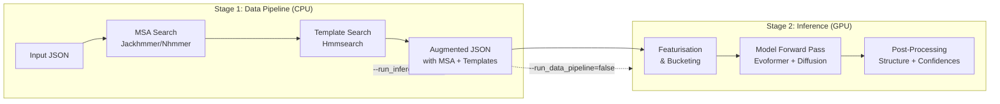
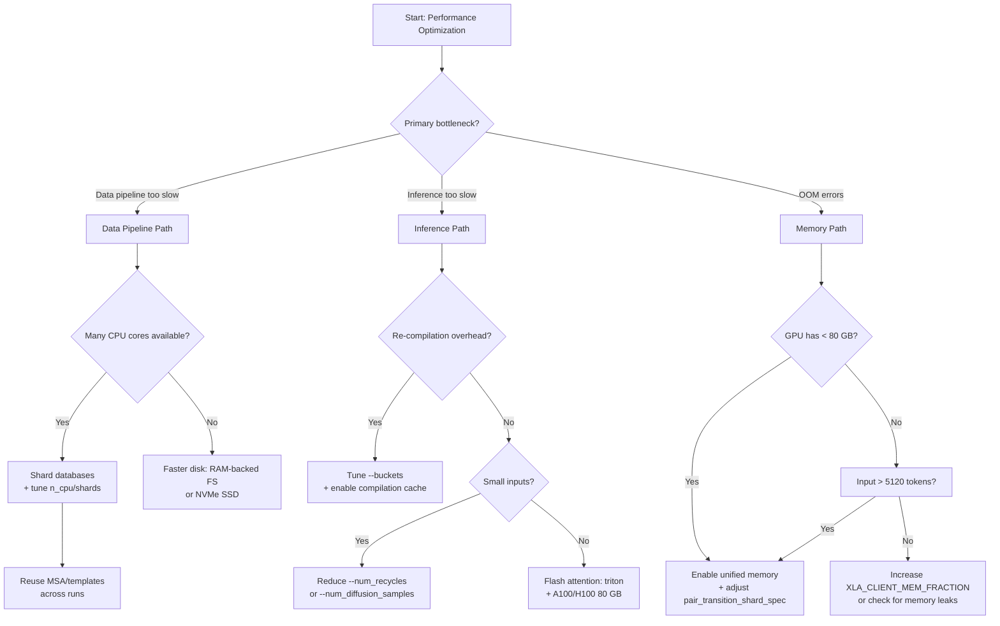

AlphaFold 3's performance landscape spans two fundamentally different compute regimes: the **CPU-bound data pipeline** (MSA/template search) and the **GPU-bound model inference** (Evoformer trunk + Diffusion head). Understanding the cost profile of each stage—and the architectural knobs that control them—is essential for achieving high throughput, controlling cloud spend, and scaling beyond default configurations. This page provides a systematic guide to every optimization axis available in the repository, from staged execution and database sharding to GPU memory management and JAX compilation caching.

Sources: [performance.md](docs/performance.md#L1-L362), [run_alphafold.py](run_alphafold.py#L1-L450)

## Execution Model: Staged Pipeline

The `run_alphafold.py` script supports decoupling the data pipeline from model inference via two boolean flags. This is the single most impactful architectural decision for resource optimization, because the data pipeline is CPU/RAM-intensive (often taking hours for deep MSAs) while inference is GPU-bound. Splitting these stages allows you to right-size each compute environment and avoid paying for idle GPUs during MSA search or for idle CPUs during inference.



### Data Pipeline Only

Run with `--run_inference=false` to produce JSON files augmented with MSAs and templates, without performing featurisation or model inference. The output JSONs can then be fed directly into inference-only runs.

### Inference Only

Run with `--run_data_pipeline=false` to skip MSA/template search entirely. The input JSON must contain pre-computed `unpairedMsa`, `pairedMsa`, and `templates` fields (or they must be explicitly set to `null` for MSA/template-free prediction).

### Pre-computing and Reusing MSA/Template Data

When folding multiple candidate chains against a set of fixed chains, you can compute the MSA and templates for the fixed chains **once** and reuse them across runs. This transforms the computational complexity from O(n × m) full pipeline runs to O(n + m) data pipeline runs plus O(n × m) inference-only runs:

1. Run the data pipeline (`--run_inference=false`) for each fixed chain and each candidate chain independently.
2. Assemble multimer input JSONs by copying the `unpairedMsa`, `pairedMsa`, and `templates` fields from the pre-computed fixed-chain JSONs, leaving the candidate-chain fields unset (or `null`).
3. Run inference only (`--run_data_pipeline=false`) on each assembled JSON.

This technique was discussed extensively in [GitHub issue #171](https://github.com/google-deepmind/alphafold3/issues/171) and related threads.

Sources: [performance.md](docs/performance.md#L5-L47), [run_alphafold.py](run_alphafold.py#L267-L280)

## Data Pipeline Optimization

The data pipeline runtime is dominated by genetic sequence search (Jackhmmer for proteins, Nhmmer for RNA) and template search (Hmmsearch). Its performance is governed by three factors: **disk I/O speed**, **CPU core count**, and **database sharding strategy**.

### CPU Parallelism

AlphaFold 3 searches **4 protein databases** (UniRef90, MGnify, small BFD, UniProt) and **3 RNA databases** (NT-RNA, Rfam, RNAcentral) in parallel using `ThreadPoolExecutor`. The optimal CPU core allocation follows this formula:

| Parameter | Flag | Default | Notes |
|-----------|------|---------|-------|
| Jackhmmer CPUs per process | `--jackhmmer_n_cpu` | min(cpu_count, 8) | Marginal returns beyond 8 |
| Nhmmer CPUs per process | `--nhmmer_n_cpu` | min(cpu_count, 8) | Marginal returns beyond 8 |
| Hmmsearch CPUs per process | `--hmmsearch_n_cpu` | min(cpu_count, 8) | Used for template search |
| Max parallel Jackhmmer shards | `--jackhmmer_max_parallel_shards` | None (1 per shard) | Only for sharded databases |
| Max parallel Nhmmer shards | `--nhmmer_max_parallel_shards` | None (1 per shard) | Only for sharded databases |

For protein chains with sharded databases, total core utilization = `jackhmmer_n_cpu × jackhmmer_max_parallel_shards × 4`. For RNA chains, total = `nhmmer_n_cpu × nhmmer_max_parallel_shards × 3`.

Sources: [performance.md](docs/performance.md#L70-L99), [run_alphafold.py](run_alphafold.py#L294-L330), [pipeline.py](src/alphafold3/data/pipeline.py#L103-L180)

### Sharded Genetic Databases

The most significant data pipeline speedup comes from **database sharding**—splitting each genetic database into multiple smaller files that can be searched in parallel across CPU cores. This technique is especially effective when databases reside on fast SSDs or RAM-backed filesystems.

**Sharding workflow:**

1. **Shuffle** the sequences to ensure uniform length distribution across shards: `seqkit shuffle --two-pass <db.fasta>`
2. **Split** into *s* shards: `seqkit split2 --by-part <s> <db.fasta>`
3. **Name** each shard following the pattern `prefix-<shard_index>-of-<total_shards>` with 5-digit zero-padded indices (e.g., `uniprot.fasta-00000-of-00003`).
4. **Reference** the shard set using the spec `prefix@<total_shards>` (e.g., `uniprot.fasta@3`).
5. **Set Z-values** for each database to correctly scale e-values across shards.

The Z-value represents the total number of sequences (for protein databases) or total number of megabases (for RNA databases) across **all** shards combined. This must be provided via flags like `--uniref90_z_value`, `--ntrna_z_value`, etc.

**Example invocation with 16 shards per database:**

```bash
python run_alphafold.py \
    --small_bfd_database_path="bfd-first_non_consensus_sequences.fasta@64" \
    --small_bfd_z_value=65984053 \
    --mgnify_database_path="mgy_clusters_2022_05.fa@512" \
    --mgnify_z_value=623796864 \
    --uniprot_cluster_annot_database_path="uniprot_cluster_annot_2021_04.fasta@256" \
    --uniprot_cluster_annot_z_value=225619586 \
    --uniref90_database_path="uniref90_2022_05.fasta@128" \
    --uniref90_z_value=153742194 \
    --ntrna_database_path="nt_rna_2023_02_23_clust_seq_id_90_cov_80_rep_seq.fasta@256" \
    --ntrna_z_value=76752.808514 \
    --rfam_database_path="rfam_14_9_clust_seq_id_90_cov_80_rep_seq.fasta@16" \
    --rfam_z_value=138.115553 \
    --rna_central_database_path="rnacentral_active_seq_id_90_cov_80_linclust.fasta@64" \
    --rna_central_z_value=13271.415730 \
    --jackhmmer_n_cpu=2 \
    --jackhmmer_max_parallel_shards=16 \
    --nhmmer_n_cpu=2 \
    --nhmmer_max_parallel_shards=16
```

This configuration utilizes **128 cores** for protein chains (2 × 16 × 4) and **96 cores** for RNA chains (2 × 16 × 3). **Tuning principle:** aim for consistent shard sizes across databases—if database A has 16 shards and database B is 3× larger, database B should have ~48 shards.

> [!TIP]
> For deep MSAs (sequences with many homologs), Jackhmmer/Nhmmer may require substantially more than the recommended 64 GB of RAM. Monitor memory usage carefully and consider increasing available RAM or reducing `--jackhmmer_n_cpu` to lower per-process memory pressure.

Sources: [performance.md](docs/performance.md#L101-L180), [shards.py](src/alphafold3/data/tools/shards.py#L1-L104)

### Disk I/O

Disk speed is a critical bottleneck for genetic search. The recommendation hierarchy is: **RAM-backed filesystem** > **NVMe SSD** > **SATA SSD** > **HDD** (not recommended). Using a RAM-backed filesystem (e.g., `tmpfs` on Linux) can dramatically reduce search time, particularly for sharded databases where I/O parallelism is high.

Sources: [performance.md](docs/performance.md#L70-L78)

### Homomer MSA/Template Caching

The data pipeline automatically caches MSA and template computations for identical sequences within homomers using `@functools.cache` decorators. This means that if a homomer contains identical chains (e.g., a homodimer), the expensive MSA/template search runs only **once** per unique sequence rather than once per chain.

Sources: [pipeline.py](src/alphafold3/data/pipeline.py#L36-L38), [pipeline.py](src/alphafold3/data/pipeline.py#L80-L82)

## Model Inference Optimization

Model inference is GPU-bound and its performance is controlled by GPU memory capacity, flash attention implementation, memory sharding, and compilation strategy.

### Accelerator Hardware and Throughput

The officially supported and extensively tested configurations are **1× NVIDIA A100 (80 GB)** and **1× NVIDIA H100 (80 GB)**. The repository is optimized for single-device throughput, which is significantly more efficient than the 16-device configuration described in the AlphaFold 3 paper:

| Num Tokens | 1× A100 80 GB (GPU secs) | 16× A100 40 GB (GPU secs) | Speedup |
|-----------:|------------------------:|--------------------------:|--------:|
| 1024       | 62                      | 352                       | 5.7×    |
| 2048       | 275                     | 1136                      | 4.1×    |
| 3072       | 703                     | 2016                      | 2.9×    |
| 4096       | 1434                    | 3648                      | 2.5×    |
| 5120       | 2547                    | 5552                      | 2.2×    |

The single-device advantage ranges from **2.2× to 5.7×** in GPU-seconds, making it strongly preferable for high-throughput applications.

A100 vs. H100 comparison on a single device:

| Num Tokens | 1× A100 80 GB (secs) | 1× H100 80 GB (secs) |
|-----------:|---------------------:|---------------------:|
| 1024       | 62                   | 34                   |
| 2048       | 275                  | 144                  |
| 3072       | 703                  | 367                  |
| 4096       | 1434                 | 774                  |
| 5120       | 2547                 | 1416                 |

Sources: [performance.md](docs/performance.md#L182-L225)

### Flash Attention Implementation

The flash attention implementation directly impacts both compilation time and runtime throughput. Controlled by `--flash_attention_implementation`:

| Implementation | Flag Value | Requirements | Performance |
|---------------|-----------|-------------|-------------|
| **Triton** (default) | `triton` | Ampere GPUs or later (A100, H100) | **Fastest**, most thoroughly tested |
| cuDNN | `cudnn` | Ampere GPUs or later | Fast, alternative kernel |
| XLA (no flash attention) | `xla` | Any GPU device | Portable but slowest; required for CPU/MPS backends |

For CPU-only or Apple Silicon (MPS) inference, you **must** set `--flash_attention_implementation=xla` alongside `--jax_backend=cpu` or `--jax_backend=mps`.

Sources: [run_alphafold.py](run_alphafold.py#L373-L388), [model_config.py](src/alphafold3/model/model_config.py#L37-L40)

### GPU Memory Management

GPU memory is the primary constraint on maximum input size. The default configuration supports inputs up to **5,120 tokens** on an A100/H100 80 GB:

```sh
ENV XLA_PYTHON_CLIENT_PREALLOCATE=true
ENV XLA_CLIENT_MEM_FRACTION=0.95
```

These settings pre-allocate 95% of GPU memory at startup, preventing fragmentation and maximizing usable VRAM.

#### Unified Memory for Larger Inputs or Smaller GPUs

**Unified memory** allows the GPU to spill to host RAM when VRAM is exhausted, preventing OOM errors at the cost of slower host-memory access. Enable it with:

```sh
ENV XLA_PYTHON_CLIENT_PREALLOCATE=false
ENV TF_FORCE_UNIFIED_MEMORY=true
ENV XLA_CLIENT_MEM_FRACTION=3.2
```

This is required for:
- Inputs larger than 5,120 tokens on A100/H100 80 GB
- Running on GPUs with less than 80 GB VRAM

Sources: [performance.md](docs/performance.md#L296-L330), [Dockerfile](docker/Dockerfile#L83-L86)

### Memory Sharding: Pair Transition and Attention Chunking

AlphaFold 3 implements **memory sharding** to fit the pair representation (which scales as O(n²) in tokens) within GPU memory limits. Two sharding specifications control this behavior, defined in [model_config.py](src/alphafold3/model/model_config.py):

**`pair_attention_chunk_size`** — controls sub-batching of the pair self-attention computation. Default: `((1536, 128), (None, 32))`, meaning inputs up to 1,536 tokens use a chunk size of 128, and larger inputs use 32.

**`pair_transition_shard_spec`** — controls sharding of the pair transition layer. Default: `((2048, None), (None, 1024))`, meaning inputs up to 2,048 tokens run unsharded, and larger inputs shard in chunks of 1,024.

The format of each entry is `(num_tokens_upper_bound, shard_size)`, where `shard_size=None` means no sharding (full materialization). For constrained-memory GPUs like the A100 40 GB, the recommended configuration is:

```python
pair_transition_shard_spec: Sequence[_Shape2DType] = (
    (2048, None),
    (3072, 1024),
    (None, 512),
)
```

This modification, combined with unified memory, enables inputs up to **4,352 tokens** on a single A100 40 GB.

Sources: [model_config.py](src/alphafold3/model/model_config.py#L31-L36), [performance.md](docs/performance.md#L231-L258), [modules.py](src/alphafold3/model/network/modules.py#L38-L48)

### Diffusion Head Batch Sharding

The diffusion head applies its own batch-dimension sharding via the `eval_batch_dim_shard_size` config parameter (default: 5). This controls how many of the `--num_diffusion_samples` (default: 5) diffusion samples are processed simultaneously, directly trading GPU memory for throughput. The `eval_batch_size` parameter (default: 5) sets the total batch size for diffusion sampling at inference time.

Sources: [diffusion_head.py](src/alphafold3/model/network/diffusion_head.py#L130-L133)

## Compilation Optimization

JAX compiles the model for each unique input shape, which can be extremely expensive (tens of minutes for large inputs). Two mechanisms mitigate this: **compilation buckets** and **persistent compilation caching**.

### Compilation Buckets

Compilation buckets define ranges of input token sizes that share a single compilation. When featurising an input, AlphaFold 3 determines the smallest bucket the input fits into and pads to that size. The trade-off: **more buckets** → less padding waste but more re-compilations; **fewer buckets** → more padding but fewer re-compilations.

Default bucket sizes (controlled by `--buckets`):

```
128, 256, 384, 512, 768, 1024, 1280, 1536, 2048, 2560, 3072, 3584, 4096, 4608, 5120
```

Any input exceeding the largest bucket triggers a new compilation for exactly that token count. For workloads with inputs larger than 5,120 tokens, extend the bucket list. For example, if processing inputs of size 5,132, 5,280, and 5,342, the default buckets trigger **three** separate compilations. Adding `--buckets 5376` (or a full extended list) collapses these into **one** compilation at the cost of minor padding.

> [!TIP]
> When running batches of similar-sized inputs, align your bucket boundaries to cluster those inputs into the same bucket. A single well-placed bucket can eliminate multiple compilations, each of which may take 10–30 minutes on large token counts.

Sources: [performance.md](docs/performance.md#L261-L300), [run_alphafold.py](run_alphafold.py#L355-L370)

### JAX Persistent Compilation Cache

Enable cross-run compilation caching with `--jax_compilation_cache_dir <DIRECTORY>`. This stores compiled XLA programs to disk, allowing subsequent runs with identical input shapes to skip compilation entirely. This is especially valuable for:

- Iterative workflows where the same input sizes are run repeatedly
- Pre-warming a cache before production runs
- Sharing compilations across container restarts

For non-local filesystems (e.g., Google Cloud Storage), install the `etils` package. See the [JAX persistent compilation cache documentation](https://jax.readthedocs.io/en/latest/persistent_compilation_cache.html) for details.

Sources: [performance.md](docs/performance.md#L332-L362), [run_alphafold.py](run_alphafold.py#L347-L353)

### XLA Flag Workarounds

Two XLA flags are critical for correct and performant compilation:

**Triton GEMM disabling** (set by default in the Dockerfile) — works around a known XLA issue that causes compilation time to greatly increase:

```sh
ENV XLA_FLAGS="--xla_gpu_enable_triton_gemm=false"
```

**CUDA Capability 7.x fix** — for V100 and other CC 7.x GPUs, there are known numerical issues. Replace the above with:

```sh
ENV XLA_FLAGS="--xla_disable_hlo_passes=custom-kernel-fusion-rewriter"
```

Note: Triton GEMM kernels are not supported on CC 7.x GPUs, so disabling them separately is unnecessary.

Sources: [performance.md](docs/performance.md#L302-L320), [Dockerfile](docker/Dockerfile#L80-L82)

## Hardware Compatibility Matrix

| GPU | Max Tokens | Config Changes Required | Notes |
|-----|-----------:|------------------------|-------|
| **A100 80 GB** | 5,120 | None (default) | Officially supported, primary target |
| **H100 80 GB** | 5,120 | None (default) | Officially supported, ~2× faster than A100 |
| **A100 40 GB** | 4,352 | Unified memory + adjusted `pair_transition_shard_spec` | Lower throughput than 80 GB |
| **V100 32 GB** | 1,280 | Unified memory + XLA CC 7.x fix | Numerically accurate with workaround |
| **P100 16 GB** | 1,024 | None | No config changes needed |
| **Other GPUs** | Varies | CC 7.x fix if applicable | Not extensively tested for numerical accuracy |

Sources: [performance.md](docs/performance.md#L227-L290)

## Inference Parameter Tuning

Several runtime parameters directly affect inference cost and quality:

| Parameter | Flag | Default | Impact |
|-----------|------|---------|--------|
| Recycles | `--num_recycles` | 10 | Each recycle runs the full Evoformer trunk; reducing to 5–8 can halve inference time with modest quality loss |
| Diffusion samples | `--num_diffusion_samples` | 5 | Each sample runs the full diffusion denoising loop (200 steps by default); reducing to 1–3 dramatically cuts time |
| Seeds | `--num_seeds` | (from JSON) | Each seed is a full independent inference run; set via JSON or `--num_seeds` |
| GPU device | `--gpu_device` | 0 | Pin to specific GPU on multi-GPU systems (zero-based, post-CUDA_VISIBLE_DEVICES filtering) |
| JAX backend | `--jax_backend` | `gpu` | Set to `cpu` or `mps` for testing (requires `--flash_attention_implementation=xla`) |
| Save embeddings | `--save_embeddings` | false | Embeddings are large float16 arrays: `num_tokens × 384 + num_tokens² × 128` |
| Save distogram | `--save_distogram` | false | Distogram is a large float16 array: `num_tokens² × 64` |
| Compress output | `--compress_large_output_files` | false | Compresses mmCIF and confidences JSON with zstandard |

Sources: [run_alphafold.py](run_alphafold.py#L389-L435)

## Optimization Decision Flowchart



Sources: [performance.md](docs/performance.md#L1-L362), [run_alphafold.py](run_alphafold.py#L1-L450), [model_config.py](src/alphafold3/model/model_config.py#L1-L45)

## Next Steps

- For the full data pipeline architecture, see [MSA Search Pipeline](8-msa-search-pipeline) and [Template Search](9-template-search).
- For GPU/Docker setup details, see [Docker and GPU Setup](18-docker-and-gpu-setup).
- For model architecture that drives these performance characteristics, see [Evoformer Trunk](11-evoformer-trunk) and [Diffusion Head](12-diffusion-head).