AlphaFold 3's input JSON format is a versatile schema that accommodates everything from single monomeric proteins to covalently bonded protein–ligand complexes, modified nucleic acids, and branched glycans. This page dissects the **12 official examples** shipped in the repository, classifies them into recurring structural patterns, and maps each pattern back to the JSON fields that enable it. By the end, you'll be able to read any example at a glance and compose new inputs by combining these patterns.

## Pattern Taxonomy at a Glance

The examples cluster into **six distinct input patterns**, each exercising a specific subset of the JSON schema:

| Pattern | Examples | Key Fields Exercised | Complexity |
|---|---|---|---|
| **Single-chain monomer** | `ubiquitin_monomer` | `protein`, `id: str` | ★☆☆☆☆ |
| **Protein–protein complex** | `barnase_barstar`, `tetr_homodimer` | `protein` × N, `id: list[str]` for homomers | ★★☆☆☆ |
| **Protein–ligand (CCD)** | `calmodulin_4calcium`, `tetr_dimer_tetracycline` | `ligand.ccdCodes`, multi-copy `id` | ★★☆☆☆ |
| **Protein–ligand (SMILES)** | `streptavidin_biotin_smiles` | `ligand.smiles` | ★★☆☆☆ |
| **Covalent bonds & glycans** | `kras_g12c_sotorasib`, `rnaseb_glycosylated` | `bondedAtomPairs` | ★★★★☆ |
| **Modified polymers** | `erk2_phosphorylated`, `methylated_dna`, `modified_rna`, `u1a_rna_hairpin` | `modifications` (PTM / DNA / RNA) | ★★★☆☆ |

Sources: [docs/input.md](docs/input.md#L1-L200), [examples/](examples/)

## The Scaffolding: Every Example's Shared Top-Level Structure

Before examining patterns, note that **every** example shares the same top-level envelope. This is the invariant skeleton:

```json
{
  "name": "<descriptive job name>",
  "modelSeeds": [42],
  "sequences": [ ... ],
  "dialect": "alphafold3",
  "version": 4
}
```

The fields `dialect` and `version` are **mandatory** — the pipeline validates them on entry. All 12 examples use `"dialect": "alphafold3"` and `"version": 4` (the latest, which adds the optional `description` field for chains). The `modelSeeds` list controls how many structural samples you receive; each seed produces one full prediction. The `name` is sanitized and used as the output file prefix.

Sources: [docs/input.md](docs/input.md#L120-L155), [examples/ubiquitin_monomer.json](examples/ubiquitin_monomer.json#L1-L16)

---

## Pattern 1: Single-Chain Monomer

The simplest possible input — one protein chain, no modifications, no ligands. The `ubiquitin_monomer` example is the canonical starting point:

```json
{
  "protein": {
    "id": "A",
    "sequence": "MQIFVKTLTGKTITLEVEPSDTIENVKAKIQDKEGIPPDQQRLIFAGKQLEDGRTLSDYNIQKESTLHLVLRLRGG",
    "description": "Human ubiquitin, 76 residues (UniProt P0CG48)"
  }
}
```

**Key observations:**

- **`id` is a single string** (`"A"`), not a list — this signals exactly one copy of the chain.
- **No `modifications`, `templates`, or MSA fields** — when omitted, AlphaFold 3 runs the full genetic search pipeline automatically.
- **`description`** (version 4+) is purely informational; it never influences prediction.

This pattern applies identically to single RNA or DNA chains by swapping the `"protein"` key for `"rna"` or `"dna"` and providing the appropriate sequence alphabet.

Sources: [examples/ubiquitin_monomer.json](examples/ubiquitin_monomer.json#L1-L16), [docs/input.md](docs/input.md#L200-L260)

---

## Pattern 2: Protein–Protein Complexes (Heterodimer & Homodimer)

### Heterodimer: Barnase–Barstar

Two *different* protein chains are simply two entries in the `sequences` array, each with a unique `id`:

```json
"sequences": [
  {"protein": {"id": "A", "sequence": "AQVINTFD...", "description": "Barnase..."}},
  {"protein": {"id": "B", "sequence": "KKAVINGEQ...", "description": "Barstar..."}}
]
```

Each chain gets its own MSA during the genetic search, and AlphaFold 3 internally handles MSA pairing across chains. The chain IDs (`"A"`, `"B"`) propagate directly into the output mmCIF.

### Homodimer: TetR Repressor

When multiple chains share the **same sequence**, use a **list of IDs** instead of separate entries:

```json
{"protein": {"id": ["A", "B"], "sequence": "MARLNRESVID...", "description": "TetR..."}}
```

This is semantically equivalent to writing the same protein entry twice with IDs `"A"` and `"B"`, but it signals to the pipeline that these are **symmetrical copies** of the same entity. The pipeline can exploit this symmetry during MSA construction and pairing.

> [!TIP]
> For homomeric complexes, always prefer `id: ["A", "B", ...]` over duplicated entries — it ensures the pipeline generates a single MSA shared across all copies, which is both faster and biologically more correct than running independent MSAs.

Sources: [examples/barnase_barstar.json](examples/barnase_barstar.json#L1-L23), [examples/tetr_homodimer.json](examples/tetr_homodimer.json#L1-L16), [docs/input.md](docs/input.md#L260-L275)

---

## Pattern 3: Protein–Ligand via CCD Codes

Ligands specified by **Chemical Component Dictionary (CCD) codes** are the most common and best-supported route. Two examples demonstrate different facets:

### Ionic Ligands with Multiple Copies: Calmodulin + 4 Ca²⁺

```json
"sequences": [
  {"protein": {"id": "A", "sequence": "MADQLTEEQI...", ...}},
  {"ligand": {"id": ["B", "C", "D", "E"], "ccdCodes": ["CA"], ...}}
]
```

The ligand `id` is a **list of four IDs**, creating four independent copies of the calcium ion (CCD code `"CA"`), each free to dock into a different EF-hand site. The single `"CA"` entry in `ccdCodes` is the *template*; the list length in `id` determines how many copies appear in the structure.

### Multi-Copy Ligand in a Homodimer: TetR + 2 Tetracycline

```json
"sequences": [
  {"protein": {"id": ["A", "B"], "sequence": "MARLNR...", ...}},
  {"ligand": {"id": ["C", "D"], "ccdCodes": ["TAC"], ...}}
]
```

Here two tetracycline molecules (CCD: `"TAC"`) are placed, one per TetR monomer. The model learns the correct placement from the genetic search and structural priors — no explicit bonding is required for non-covalent ligands.

Sources: [examples/calmodulin_4calcium.json](examples/calmodulin_4calcium.json#L1-L23), [examples/tetr_dimer_tetracycline.json](examples/tetr_dimer_tetracycline.json#L1-L23), [docs/input.md](docs/input.md#L375-L430)

---

## Pattern 4: Protein–Ligand via SMILES

When a ligand is **not in the CCD** and doesn't need covalent bonds, SMILES is the simplest alternative. The `streptavidin_biotin_smiles` example:

```json
{"ligand": {
  "id": "B",
  "smiles": "OC(=O)CCCC[C@@H]1SC[C@@H]2NC(=O)N[C@H]12",
  "description": "D-Biotin (vitamin B7), specified by SMILES"
}}
```

**Critical constraint:** SMILES-defined ligands **cannot participate in `bondedAtomPairs`** because SMILES provides no uniquely named atoms — only a connectivity graph. If you need covalent bonds to a custom ligand, you must use the **user-provided CCD** format instead.

> [!TIP]
> SMILES strings must be **JSON-escaped**: every backslash `\` becomes `\\`. For example, the SMILES `C\C=C\C` must be written as `"C\\C=C\\C"` in the JSON. Failure to escape causes a `JSONDecodeError` at parse time.

Sources: [examples/streptavidin_biotin_smiles.json](examples/streptavidin_biotin_smiles.json#L1-L23), [docs/input.md](docs/input.md#L430-L470)

---

## Pattern 5: Covalent Bonds — Ligands and Glycans

The `bondedAtomPairs` field is the mechanism for specifying covalent bonds. Each bond is a pair of **atom addresses** of the form `[entityId, residueId, atomName]`.

### Covalent Inhibitor: KRAS G12C + Sotorasib

```json
"bondedAtomPairs": [
  [["A", 12, "SG"], ["B", 1, "C25"]]
]
```

This single bond links **chain A, residue 12, atom SG** (the cysteine sulfur in KRAS) to **chain B, residue 1, atom C25** (the electrophilic carbon in sotorasib, CCD code `"MOV"`). Note that residue IDs are **1-based** and the atom names (`"SG"`, `"C25"`) must match the CCD exactly.

### Branched Glycan: RNase B + Man₃GlcNAc₂

Glycans are modeled as a **single ligand entity with multiple CCD components**, connected by an internal bond graph. The `rnaseb_glycosylated` example defines 5 CCD codes (`NAG`, `NAG`, `BMA`, `MAN`, `MAN`) as one ligand, then specifies 5 bonds:

```json
"sequences": [
  {"protein": {"id": "A", "sequence": "KETAAAK...", ...}},
  {"ligand": {"id": "B", "ccdCodes": ["NAG", "NAG", "BMA", "MAN", "MAN"], ...}}
],
"bondedAtomPairs": [
  [["A", 34, "ND2"], ["B", 1, "C1"]],    // Asn34 → first GlcNAc
  [["B", 1, "O4"],   ["B", 2, "C1"]],    // GlcNAc1 → GlcNAc2
  [["B", 2, "O4"],   ["B", 3, "C1"]],    // GlcNAc2 → β-Man
  [["B", 3, "O3"],   ["B", 4, "C1"]],    // β-Man → Man(α1,3)
  [["B", 3, "O6"],   ["B", 5, "C1"]]     // β-Man → Man(α1,6)
]
```

The resulting topology forms the classic N-linked glycan tree:

```
                     Man4 (α1,3)
                      |
Protein-Asn34 — NAG1 — NAG2 — BMA3 — Man5 (α1,6)
```

The **residue ID within the ligand** increments sequentially through the `ccdCodes` list: `NAG` is residue 1, the second `NAG` is residue 2, `BMA` is residue 3, and so on. This is why bonds like `["B", 1, "O4"], ["B", 2, "C1"]` connect the O4 of the first GlcNAc to the C1 of the second.

Sources: [examples/kras_g12c_sotorasib.json](examples/kras_g12c_sotorasib.json#L1-L26), [examples/rnaseb_glycosylated.json](examples/rnaseb_glycosylated.json#L1-L30), [docs/input.md](docs/input.md#L600-L750)

---

## Pattern 6: Modified Polymers — PTMs, Methylated DNA, and Modified RNA

Post-translational and post-transcriptional modifications are specified via the `modifications` array within a chain definition. The key difference across polymer types is the **field name for the position**:

| Polymer Type | Modification Key | Position Key | Example CCD Codes |
|---|---|---|---|
| Protein | `ptmType` | `ptmPosition` | `TPO`, `PTR`, `HY3`, `P1L` |
| RNA | `modificationType` | `basePosition` | `PSU`, `5MC`, `OMG`, `2MG` |
| DNA | `modificationType` | `basePosition` | `5CM`, `6OG`, `6MA` |

All positions are **1-based**.

### Dual Phosphorylation: ERK2 (pThr185 + pTyr187)

```json
"modifications": [
  {"ptmType": "TPO", "ptmPosition": 185},
  {"ptmType": "PTR", "ptmPosition": 187}
]
```

The CCD code `"TPO"` replaces the original threonine at position 185 with phosphothreonine; `"PTR"` replaces tyrosine 187 with phosphotyrosine. The original residue in the `sequence` string is **not** changed — the modification overlay is applied by the data pipeline.

### Methylated CpG Double-Stranded DNA

```json
{"dna": {
  "id": "A",
  "sequence": "AGATCGATCGATCGATCGAT",
  "modifications": [
    {"modificationType": "5CM", "basePosition": 5},
    {"modificationType": "5CM", "basePosition": 9},
    {"modificationType": "5CM", "basePosition": 13},
    {"modificationType": "5CM", "basePosition": 17}
  ]
}}
```

The `"5CM"` code (5-methylcytosine) is applied at every CpG site on both strands. The two DNA chains are modeled as **separate entities** (IDs `"A"` and `"B"`) with their own sequences and modification lists — AlphaFold 3 does not auto-generate the complement.

### Modified RNA: Pseudouridine, 5-Methylcytidine, 2′-O-Methylguanosine

```json
{"rna": {
  "id": "A",
  "sequence": "GGCCCGAUAGCUCAGUCGGUAGAGC",
  "modifications": [
    {"modificationType": "PSU", "basePosition": 13},
    {"modificationType": "5MC", "basePosition": 18},
    {"modificationType": "OMG", "basePosition": 4}
  ]
}}
```

Three distinct RNA modifications are applied simultaneously. The CCD code `"PSU"` (pseudouridine) is the most common RNA modification; `"OMG"` (2′-O-methylguanosine) affects the ribose rather than the base.

Sources: [examples/erk2_phosphorylated.json](examples/erk2_phosphorylated.json#L1-L20), [examples/methylated_dna.json](examples/methylated_dna.json#L1-L35), [examples/modified_rna.json](examples/modified_rna.json#L1-L21), [docs/input.md](docs/input.md#L260-L370)

---

## Pattern 7: Protein–Nucleic Acid Complexes

Two examples demonstrate protein–nucleic acid interactions:

- **`u1a_rna_hairpin`**: Protein chain A (U1A spliceosomal protein) + RNA chain B (U1 snRNA stem-loop II). No modifications needed — just two entities in the `sequences` array.
- **`tetr_dimer_dna`**: Homodimeric protein (`id: ["A", "B"]`) + double-stranded DNA (two separate `dna` entities, IDs `"C"` and `"D"`).

Both follow the same structural principle: **each biopolymer is an independent entity**. AlphaFold 3 learns the interface from co-evolutionary signals and geometric priors.

Sources: [examples/u1a_rna_hairpin.json](examples/u1a_rna_hairpin.json#L1-L23), [examples/tetr_dimer_dna.json](examples/tetr_dimer_dna.json#L1-L30)

---

## Composing Patterns: The Assembly Diagram

Real-world inputs frequently combine multiple patterns. The diagram below shows how patterns compose into the complete examples:

```mermaid
graph TD
    subgraph Atomic Patterns
        P1["① Monomer<br/>id: str"]
        P2["② Homomeric chains<br/>id: list[str]"]
        P3["③ CCD Ligand<br/>ccdCodes"]
        P4["④ SMILES Ligand<br/>smiles"]
        P5["⑤ Covalent Bonds<br/>bondedAtomPairs"]
        P6["⑥ Modifications<br/>modifications"]
    end

    subgraph Examples
        E1[ubiquitin_monomer]
        E2[barnase_barstar]
        E3[tetr_homodimer]
        E4[calmodulin_4calcium]
        E5[tetr_dimer_tetracycline]
        E6[streptavidin_biotin_smiles]
        E7[kras_g12c_sotorasib]
        E8[rnaseb_glycosylated]
        E9[erk2_phosphorylated]
        E10[methylated_dna]
        E11[modified_rna]
        E12[u1a_rna_hairpin]
        E13[tetr_dimer_dna]
    end

    P1 --> E1
    P1 --> E2
    P2 --> E3
    P1 --> E4
    P3 --> E4
    P2 --> E5
    P3 --> E5
    P1 --> E6
    P4 --> E6
    P1 --> E7
    P3 --> E7
    P5 --> E7
    P1 --> E8
    P3 --> E8
    P5 --> E8
    P1 --> E9
    P6 --> E9
    P6 --> E10
    P6 --> E11
    P1 --> E12
    P2 --> E13
```



Sources: [examples/](examples/), [docs/input.md](docs/input.md#L900-L1056)

---

## Quick-Reference: Atom Addressing for Bonds

When composing the covalent-bond pattern, atom addresses must be exact. Here is the resolution logic:

| Component | Entity ID | Residue ID | Atom Name Source |
|---|---|---|---|
| Protein chain | `"A"`, `"B"`, etc. | 1-based position in `sequence` | CCD entry for the amino acid (e.g. `SG` for CYS) |
| DNA/RNA chain | `"C"`, `"D"`, etc. | 1-based position in `sequence` | CCD entry for the nucleotide (e.g. `P` for phosphate) |
| CCD ligand | Ligand `id` | Sequential index into `ccdCodes` (1-based) | CCD entry for that component (e.g. `C25` for MOV) |
| SMILES ligand | Ligand `id` | Always `1` | **Not addressable** — cannot use in bonds |

For example, in `kras_g12c_sotorasib.json`, the bond `[["A", 12, "SG"], ["B", 1, "C25"]]` resolves to: chain A residue 12 (Cys12) atom SG → chain B residue 1 (first CCD component, `"MOV"`) atom C25.

Sources: [docs/input.md](docs/input.md#L600-L710), [examples/kras_g12c_sotorasib.json](examples/kras_g12c_sotorasib.json#L19-L22)

---

## Version Compatibility Across Examples

All 12 examples use `"version": 4`, but the version field controls which features are available:

| Version | Features Added | Examples Using Feature |
|---|---|---|
| 1 | Base format (protein, RNA, DNA, ligand via CCD/SMILES, bonds) | All |
| 2 | External MSA and templates via `*Path` fields | None in examples (expert usage) |
| 3 | External user-provided CCD via `userCCDPath` | None in examples (expert usage) |
| 4 | Optional `description` field on all chain types | All 12 examples |

Sources: [docs/input.md](docs/input.md#L155-L170)

---

## Where to Go Next

- For the **full field-by-field specification**, see [Input JSON Format](3-input-json-format).
- To understand **how MSA and templates integrate with these inputs**, see [MSA Search Pipeline](8-msa-search-pipeline) and [Template Search](9-template-search).
- For **output interpretation**, see [Output Format and Metrics](15-output-format-and-metrics).
- For **running predictions with these examples**, see [Quick Start](2-quick-start).