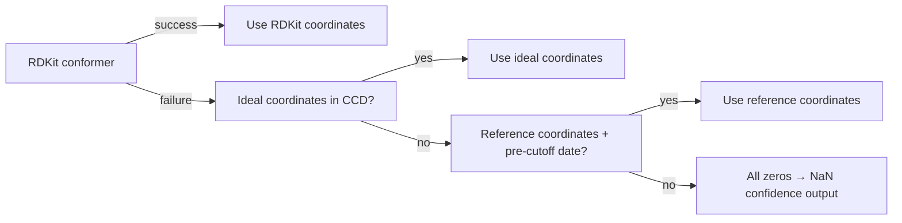

AlphaFold 3 accepts a **custom JSON input format** that provides fine-grained control over every molecular entity in your prediction — from protein chains with post-translational modifications to covalently bonded ligands defined via SMILES or the Chemical Component Dictionary (CCD). This page is your definitive reference for constructing valid input JSONs, understanding every field, and avoiding common pitfalls like SMILES escaping, MSA pairing semantics, and template index offsets.

Sources: [input.md](docs/input.md#L1-L1056), [run_alphafold.py](run_alphafold.py#L1-L200)

## Specifying Input to `run_alphafold.py`

You provide inputs via one of two CLI flags:

| Flag | Behavior | Path Type |
|---|---|---|
| `--json_path <file>` | Process a single JSON file | Local path or `gs://` GCS path |
| `--input_dir <dir>` | Process every JSON file in a directory | Local dir or `gs://` GCS path |

Within any input JSON, fields ending in `Path` (e.g. `pairedMsaPath`, `userCCDPath`) also accept GCS paths if the optional `gcsfs` dependency is installed. Paths in `*Path` fields may be **absolute** or **relative to the input JSON file's location**.

Sources: [input.md](docs/input.md#L5-L18), [run_alphafold.py](run_alphafold.py#L82-L92)

## Top-Level Schema

Every input JSON is a single object with the following structure:

```json
{
  "name": "My complex",
  "modelSeeds": [1, 2],
  "sequences": [
    {"protein": {...}},
    {"rna": {...}},
    {"dna": {...}},
    {"ligand": {...}}
  ],
  "bondedAtomPairs": [],
  "userCCD": "...",
  "dialect": "alphafold3",
  "version": 4
}
```

The following table defines every top-level field:

| Field | Type | Required | Description |
|---|---|---|---|
| `name` | `str` | ✅ | Job name; a sanitized version is used for output filenames |
| `modelSeeds` | `list[int]` | ✅ | Random seeds — one prediction per seed; at least one required |
| `sequences` | `list[Entity]` | ✅ | Ordered list of molecular entities (protein, RNA, DNA, ligand) |
| `bondedAtomPairs` | `list[Bond]` | ❌ | Covalent bonds between atoms (within or across entities) |
| `userCCD` | `str` | ❌ | Inline user-provided CCD (mutually exclusive with `userCCDPath`) |
| `userCCDPath` | `str` | ❌ | Path to user-provided CCD file (mutually exclusive with `userCCD`) |
| `dialect` | `str` | ✅ | Must be `"alphafold3"` |
| `version` | `int` | ✅ | Format version — `1`, `2`, `3`, or `4` |

> [!TIP]
> The `version` field gates feature availability. Use `4` (the latest) to unlock all features including the `description` field on all entity types. Version `2` adds external MSA/template path fields; version `3` adds `userCCDPath`; version `4` adds `description`.

Sources: [input.md](docs/input.md#L162-L210), [input.md](docs/input.md#L212-L224)

### Version History

| Version | Feature Added |
|---|---|
| `1` | Initial AlphaFold 3 input format |
| `2` | External MSA and templates via `unpairedMsaPath`, `pairedMsaPath`, `mmcifPath` |
| `3` | External user-provided CCD via `userCCDPath` |
| `4` | Textual `description` field on all entity types |

Sources: [input.md](docs/input.md#L212-L224)

## Sequence Entities

The `sequences` array defines every molecular chain in your complex. Each entry is a dictionary with **exactly one** key — `"protein"`, `"rna"`, `"dna"`, or `"ligand"` — mapping to that entity's specification. Every entity must have a **unique** `id` (an uppercase letter or list of letters). IDs do not need to be alphabetically sorted.

The entity hierarchy and its relationships are illustrated below:

```mermaid
graph TD
    Root["sequences (list)"] --> P["protein"]
    Root --> R["rna"]
    Root --> D["dna"]
    Root --> L["ligand"]

    P --> P_id["id: str | list[str]"]
    P --> P_seq["sequence: str (1-letter AA)"]
    P --> P_mod["modifications (optional)"]
    P --> P_msa["unpairedMsa / pairedMsa (optional)"]
    P --> P_tpl["templates (optional)"]
    P --> P_desc["description (optional, v4+)"]

    R --> R_id["id: str | list[str]"]
    R --> R_seq["sequence: str (A,C,G,U)"]
    R --> R_mod["modifications (optional)"]
    R --> R_msa["unpairedMsa (optional)"]
    R --> R_desc["description (optional, v4+)"]

    D --> D_id["id: str | list[str]"]
    D --> D_seq["sequence: str (A,C,G,T)"]
    D --> D_mod["modifications (optional)"]
    D --> D_desc["description (optional, v4+)"]

    L --> L_id["id: str | list[str]"]
    L --> L_ccd["ccdCodes (optional)"]
    L --> L_smiles["smiles (optional)"]
    L --> L_desc["description (optional, v4+)"]

    L_ccd -.->|mutually exclusive| L_smiles
```



### Homomeric Chains via `id` Lists

When `id` is a list of IDs (e.g. `["A", "B"]`), it creates **multiple copies of the same chain** — a homomeric oligomer. Each ID appears as a separate chain in the output mmCIF.

Sources: [input.md](docs/input.md#L230-L280)

## Protein Entity

```json
{
  "protein": {
    "id": "A",
    "sequence": "PVLSCGEWQL",
    "modifications": [
      {"ptmType": "HY3", "ptmPosition": 1},
      {"ptmType": "P1L", "ptmPosition": 5}
    ],
    "description": "Example protein chain",
    "unpairedMsa": "...",
    "unpairedMsaPath": "...",
    "pairedMsa": "...",
    "pairedMsaPath": "...",
    "templates": [...]
  }
}
```

| Field | Type | Description |
|---|---|---|
| `id` | `str \| list[str]` | Unique chain ID(s); used in output mmCIF and bond references |
| `sequence` | `str` | Amino acid sequence using standard 1-letter codes |
| `modifications` | `list[ProteinMod]` | Optional post-translational modifications (CCD code + 1-based position) |
| `description` | `str` | Optional comment (v4+; not used by the model) |
| `unpairedMsa` | `str` | Inline A3M format MSA (mutually exclusive with `unpairedMsaPath`) |
| `unpairedMsaPath` | `str` | Path to A3M file (mutually exclusive with `unpairedMsa`) |
| `pairedMsa` | `str` | Inline paired A3M MSA (mutually exclusive with `pairedMsaPath`) |
| `pairedMsaPath` | `str` | Path to paired A3M file (mutually exclusive with `pairedMsa`) |
| `templates` | `list[Template]` | Optional structural templates |

**Modification format**: Each entry has `ptmType` (CCD code, e.g. `"TPO"` for phosphothreonine, `"PTR"` for phosphotyrosine) and `ptmPosition` (1-based residue index). The original residue at that position is **replaced** by the modification.

Sources: [input.md](docs/input.md#L230-L260), [erk2_phosphorylated.json](examples/erk2_phosphorylated.json#L1-L20)

### Protein MSA Field Combinations

The `unpairedMsa` and `pairedMsa` fields must be **both set or both unset**. The valid combinations are:

| `unpairedMsa` | `pairedMsa` | Behavior |
|---|---|---|
| unset / `null` | unset / `null` | Auto-build both MSAs via database search (**recommended default**) |
| non-empty A3M | `""` (empty) | Use provided MSA, run paired-MSA-free (**recommended for custom MSA**) |
| `""` | non-empty A3M | Use paired MSA only, run unpaired-MSA-free (**not recommended**) |
| `""` | `""` | Fully MSA-free (query sequence only) |
| non-empty A3M | non-empty A3M | Use both provided MSAs (expert mode) |

> [!TIP]
> When providing a custom `unpairedMsa`, always set `pairedMsa` to `""` and run with `--resolve_msa_overlaps=false` to prevent deduplication from destroying your carefully crafted MSA positioning.

Sources: [input.md](docs/input.md#L452-L530)

## RNA Entity

```json
{
  "rna": {
    "id": "A",
    "sequence": "AGCU",
    "modifications": [
      {"modificationType": "2MG", "basePosition": 1},
      {"modificationType": "5MC", "basePosition": 4}
    ],
    "description": "Modified RNA",
    "unpairedMsa": "...",
    "unpairedMsaPath": "..."
  }
}
```

| Field | Type | Description |
|---|---|---|
| `id` | `str \| list[str]` | Unique chain ID(s) |
| `sequence` | `str` | RNA sequence using only `A`, `C`, `G`, `U` |
| `modifications` | `list[RnaMod]` | Optional modifications (CCD code + 1-based base position) |
| `description` | `str` | Optional comment (v4+) |
| `unpairedMsa` | `str` | Inline A3M MSA (mutually exclusive with `unpairedMsaPath`) |
| `unpairedMsaPath` | `str` | Path to A3M file (mutually exclusive with `unpairedMsa`) |

**RNA MSA semantics**: Unset/`null` = auto-build; `""` = MSA-free (query only); non-empty = use provided A3M.

Sources: [input.md](docs/input.md#L262-L290), [modified_rna.json](examples/modified_rna.json#L1-L21)

## DNA Entity

```json
{
  "dna": {
    "id": "A",
    "sequence": "GACCTCT",
    "modifications": [
      {"modificationType": "6OG", "basePosition": 1},
      {"modificationType": "6MA", "basePosition": 2}
    ],
    "description": "Modified DNA strand"
  }
}
```

| Field | Type | Description |
|---|---|---|
| `id` | `str \| list[str]` | Unique chain ID(s) |
| `sequence` | `str` | DNA sequence using only `A`, `C`, `G`, `T` |
| `modifications` | `list[DnaMod]` | Optional modifications (CCD code + 1-based base position) |
| `description` | `str` | Optional comment (v4+) |

DNA entities do **not** support custom MSA or templates — AlphaFold 3 handles DNA without external evolutionary information.

Sources: [input.md](docs/input.md#L292-L318), [methylated_dna.json](examples/methylated_dna.json#L1-L35)

## Ligand Entity

Ligands are the most flexible entity type, supporting three specification modes:

| Mode | When to Use | Supports Bonds? | Field |
|---|---|---|---|
| **CCD codes** | Standard or user-CCD ligands (e.g. ATP, NAG, MG) | ✅ Yes | `ccdCodes` |
| **SMILES** | Custom ligands not in CCD, no bonds needed | ❌ No | `smiles` |
| **User CCD + codes** | Custom ligands requiring bonds or reference conformers | ✅ Yes | `ccdCodes` + `userCCD`/`userCCDPath` |

```json
{"ligand": {"id": "B", "ccdCodes": ["ATP"], "description": "ATP via CCD code"}},
{"ligand": {"id": "C", "ccdCodes": ["NAG", "NAG", "BMA", "MAN", "MAN"], "description": "Glycan (5 CCD components)"}},
{"ligand": {"id": "D", "smiles": "OC(=O)CCCC[C@@H]1SC[C@@H]2NC(=O)N[C@H]12", "description": "D-Biotin via SMILES"}}
```

| Field | Type | Description |
|---|---|---|
| `id` | `str \| list[str]` | Unique chain ID(s); list implies multiple copies |
| `ccdCodes` | `list[str]` | CCD codes (standard or user-defined); mutually exclusive with `smiles` |
| `smiles` | `str` | SMILES string (must be JSON-escaped); mutually exclusive with `ccdCodes` |
| `description` | `str` | Optional comment (v4+) |

**Ions are ligands** — a magnesium ion is simply `{"ligand": {"id": "X", "ccdCodes": ["MG"]}}`.

Sources: [input.md](docs/input.md#L320-L390), [calmodulin_4calcium.json](examples/calmodulin_4calcium.json#L1-L23), [streptavidin_biotin_smiles.json](examples/streptavidin_biotin_smiles.json#L1-L23)

### SMILES JSON Escaping

Backslashes in SMILES must be **doubled** in JSON. For example, the SMILES `CCC[C@@H](O)CC\C=C\C=C\C#CC#C\C=C\CO` must be written as:

```json
{"ligand": {"id": "A", "smiles": "CCC[C@@H](O)CC\\C=C\\C=C\\C#CC#C\\C=C\\CO"}}
```

Quick escaping methods:

```bash
# Using jq
jq -R . <<< 'CCC[C@@H](O)CC\C=C\C=C\C#CC#C\C=C\CO'
```

```python
# Using Python
import json
smiles = r'CCC[C@@H](O)CC\C=C\C=C\C#CC#C\C=C\CO'
print(json.dumps(smiles))
```

If RDKit conformer generation fails (indicated by `Failed to construct RDKit reference structure`), either provide a reference structure via [user-provided CCD](#user-provided-ccd) or increase iterations with `--conformer_max_iterations=...`.

Sources: [input.md](docs/input.md#L392-L430)

## Covalent Bonds (`bondedAtomPairs`)

The `bondedAtomPairs` field specifies covalent bonds between atoms. Each bond is a pair of atom references, and each atom is addressed by a 3-tuple: **[entity ID, residue index, atom name]**.

```json
"bondedAtomPairs": [
  [["A", 145, "SG"], ["L", 1, "C04"]],
  [["J", 1, "O6"],   ["J", 2, "C1"]]
]
```

| Component | Type | Description |
|---|---|---|
| Entity ID | `str` | The `id` of the entity (e.g. `"A"`, `"B"`) |
| Residue ID | `int` | 1-based index within the chain; for single-residue ligands, always `1` |
| Atom name | `str` | Unique atom name within the residue (lookup in CCD) |

The first example above bonds chain A residue 145 atom SG to chain L residue 1 atom C04 — a typical **covalent ligand** bond. The second bonds two residues within the same entity — typical for **glycan linkages**.

> [!TIP]
> SMILES-defined ligands **cannot** participate in bonds because SMILES provides no atom naming scheme. Use user-provided CCD instead if you need to bond a custom ligand to other entities.

Sources: [input.md](docs/input.md#L600-L640), [kras_g12c_sotorasib.json](examples/kras_g12c_sotorasib.json#L1-L26), [rnaseb_glycosylated.json](examples/rnaseb_glycosylated.json#L1-L30)

### Defining Glycans

Glycans are multi-component ligands bound to a protein. The pattern is: define a single ligand entity with all CCD components, then specify the bond from protein to the first glycan component plus all intra-glycan bonds.

For a glycan with 4 components (CMP1–CMP4) branching off an asparagine:

```
 ⋮
ALA            CMP4
 |              |
ASN ―― CMP1 ―― CMP2
 |              |
ALA            CMP3
 ⋮
```

You need: (1) protein chain A, (2) ligand chain B with `["CMP1","CMP2","CMP3","CMP4"]`, and (3) bonds for ASN→CMP1, CMP1→CMP2, CMP2→CMP3, CMP2→CMP4.

A real example — the **Man₃GlcNAc₂** N-linked core glycan on RNase B:

```json
"sequences": [
  {"protein": {"id": "A", "sequence": "KETAAAKFERQ..."}},
  {"ligand": {"id": "B", "ccdCodes": ["NAG","NAG","BMA","MAN","MAN"]}}
],
"bondedAtomPairs": [
  [["A", 34, "ND2"], ["B", 1, "C1"]],
  [["B", 1, "O4"],   ["B", 2, "C1"]],
  [["B", 2, "O4"],   ["B", 3, "C1"]],
  [["B", 3, "O3"],   ["B", 4, "C1"]],
  [["B", 3, "O6"],   ["B", 5, "C1"]]
]
```

Sources: [input.md](docs/input.md#L641-L670), [rnaseb_glycosylated.json](examples/rnaseb_glycosylated.json#L1-L30)

## Structural Templates

Templates are supported **only for protein chains**. Each template maps query residues to residues in a structural template mmCIF:

```json
"templates": [
  {
    "mmcif": "...",
    "mmcifPath": "template.cif",
    "queryIndices": [0, 1, 2, 4, 5, 6],
    "templateIndices": [0, 1, 2, 3, 4, 8]
  }
]
```

| Field | Type | Description |
|---|---|---|
| `mmcif` | `str` | Inline mmCIF string (mutually exclusive with `mmcifPath`) |
| `mmcifPath` | `str` | Path to mmCIF file (mutually exclusive with `mmcif`) |
| `queryIndices` | `list[int]` | 0-based indices in the query sequence |
| `templateIndices` | `list[int]` | 0-based indices in the template (accounting for unresolved residues) |

**Critical**: `templateIndices` must account for **unresolved residues** in the mmCIF. If the template has unresolved residues 1–3 followed by resolved residues 4–7, aligning query residues to 4–7 requires template indices `3, 4, 5, 6` (0-based). The mmCIF must contain exactly **one chain** — multi-chain mmCIFs will raise an error.

### Template-Free and MSA-Only Modes

| Goal | Configuration |
|---|---|
| Template-free (still auto-build MSA) | `"templates": []` |
| Template-free + custom MSA | `"unpairedMsa": "...", "pairedMsa": "", "templates": []` |
| Custom MSA, let AF3 search templates | `"unpairedMsa": "...", "pairedMsa": ""` (omit `templates` or set to `null`) |

Sources: [input.md](docs/input.md#L535-L598)

## MSA Pairing Strategy

MSA pairing matters only for **multimers** — it determines how sequences from different chains are aligned into the same MSA row. Naive concatenation can place sequences from different organisms in the same row, producing incorrect evolutionary coupling signals.

AlphaFold 3 internally pairs sequences by matching **UniProt organism IDs** in the `pairedMsa`. However, the **recommended approach** for custom MSAs is:

1. Manually pair sequences (or use pairing software) and provide them via `unpairedMsa` only.
2. Set `pairedMsa` to `""`.
3. Run with `--resolve_msa_overlaps=false`.

This gives you exact control over sequence placement, rather than relying on name-matching heuristics. For example, to pair chains `DEEP` and `MIND` on organisms A and C:

```
> query          > query
DEEP             MIND
> match 1 (org A)  > match 1 (org A)
D--P             M--D
> match 2 (org B)  ----          ← padding for unpaired row
DD-P             ----
> match 3 (org C)  > match 2 (org C)
DD-P             MIN-
```

The concatenated result preserves organism-level pairing:

```
> query
DEEPMIND
> match 1 + match 1      ← organism A (paired)
D--PM--D
> match 2 + padding      ← organism B (unpaired)
DD-P----
> match 3 + match 2      ← organism C (paired)
DD-PMIN-
```

Sources: [input.md](docs/input.md#L530-L590)

## User-Providved CCD

When SMILES is insufficient (you need bonds, custom atom names, or reference coordinates), define custom molecules in [CCD mmCIF format](https://www.wwpdb.org/data/ccd#mmcifFormat):

| Delivery Method | Field | Notes |
|---|---|---|
| Inline string | `userCCD` | Newlines must be `\n`; single quotes around values |
| External file | `userCCDPath` | Plain text, gzip, xz, or zstd compressed |

Assign a **non-clashing name** (e.g. `"LIG-1"`) — avoid underscores. The custom component is then referenced via `ccdCodes` in a ligand entity or `ptmType`/`modificationType` in polymer modifications.

### User CCD for Polymer Modifications

Custom components can also replace residues in polymer chains:

```json
{
  "protein": {
    "id": "A",
    "sequence": "MDQHQAFKEATELLEKMKTSSDEERVEYLRKAVRLFNLTSEGQQGELVGKFKEAGVLIRAVDLS",
    "modifications": [{"ptmType": "MYMOD", "ptmPosition": 30}]
  }
}
```

The user CCD entry for `MYMOD` should describe a **peptide-linking** component with the correct backbone atoms and bond graph for its position (mid-chain vs. terminal).

### Mandatory CCD mmCIF Fields

**Singular fields** (single value per component):

| Field | Required | Description |
|---|---|---|
| `_chem_comp.id` | ✅ | Must match `_data` record; no `_` or `#` characters |
| `_chem_comp.name` | ❌ | Full name or `?` |
| `_chem_comp.type` | ✅ | Typically `non-polymer` |
| `_chem_comp.formula` | ❌ | Chemical formula or `?` |
| `_chem_comp.mon_nstd_parent_comp_id` | ❌ | Parent ID or `?` |
| `_chem_comp.pdbx_synonyms` | ❌ | Synonyms or `?` |
| `_chem_comp.formula_weight` | ❌ | Molecular weight or `?` |

**Per-atom fields** (`_chem_comp_atom` loop):

| Field | Description |
|---|---|
| `comp_id`, `atom_id`, `type_symbol`, `charge` | Atom identity and element |
| `pdbx_leaving_atom_flag` | Leaving atom flag (default `N`) |
| `pdbx_model_Cartn_{x,y,z}_ideal` | Ideal coordinates (fallback if RDKit conformer fails) |

**Per-bond fields** (`_chem_comp_bond` loop):

| Field | Description |
|---|---|
| `atom_id_1`, `atom_id_2` | Bonded atom pair |
| `value_order` | Bond order (`SING`, `DOUB`, `TRIP`, etc.) |
| `pdbx_aromatic_flag` | Aromatic flag (`Y`/`N`) |

Sources: [input.md](docs/input.md#L730-L870)

### Conformer Generation Fallback Chain



If conformer generation fails, try increasing `--conformer_max_iterations=...` before resorting to ideal coordinates.

Sources: [input.md](docs/input.md#L680-L710)

## AlphaFold Server JSON Compatibility

The [AlphaFold Server](https://alphafoldserver.com/) uses a different JSON format (top-level is a **list**, not an object). `run_alphafold.py` auto-detects the dialect and converts `alphafoldserver` → `alphafold3`.

| Aspect | `alphafold3` | `alphafoldserver` |
|---|---|---|
| Top-level | Single object | List of objects |
| Seeds | Required explicitly | `"modelSeeds": []` → random seed |
| Glycans | Full support | **Converter raises error** |
| Ions | `ligand` with `ccdCodes: ["MG"]` | Separate `ion` entity type |
| Entity IDs | User-specified `id` field | Auto-assigned (A, B, …, Z, AA, BA, …) |
| Covalent bonds | `bondedAtomPairs` | Not supported |

**Important**: If you pass an `alphafoldserver`-style JSON **without** a top-level list, `run_alphafold.py` will raise an error — the list wrapper is the detection signal.

Sources: [input.md](docs/input.md#L40-L100)

## Complete Reference Example

This annotated example shows every feature in a single JSON (sequences are abbreviated for clarity):

```json
{
  "name": "Hello fold",
  "modelSeeds": [10, 42],
  "sequences": [
    {
      "protein": {
        "id": "A",
        "sequence": "PVLSCGEWQL",
        "modifications": [
          {"ptmType": "HY3", "ptmPosition": 1},
          {"ptmType": "P1L", "ptmPosition": 5}
        ],
        "description": "Protein with PTMs and custom MSA",
        "unpairedMsa": ">query\nPVLSCGEWQL\n>hit\nPVLS-GEWQL",
        "pairedMsa": ""
      }
    },
    {
      "protein": {
        "id": "B",
        "sequence": "RPACQLW",
        "templates": [{
          "mmcifPath": "template_b.cif",
          "queryIndices": [0, 1, 2, 4, 5, 6],
          "templateIndices": [0, 1, 2, 3, 4, 8]
        }]
      }
    },
    {
      "dna": {
        "id": "C",
        "sequence": "GACCTCT",
        "modifications": [{"modificationType": "6OG", "basePosition": 1}]
      }
    },
    {
      "rna": {
        "id": "E",
        "sequence": "AGCU",
        "modifications": [{"modificationType": "2MG", "basePosition": 1}],
        "unpairedMsa": ">query\nAGCU"
      }
    },
    {
      "ligand": {"id": ["F","G","H"], "ccdCodes": ["ATP"]}
    },
    {
      "ligand": {"id": "I", "ccdCodes": ["NAG", "FUC"]}
    },
    {
      "ligand": {"id": "Z", "smiles": "CC(=O)OC1C[NH+]2CCC1CC2"}
    }
  ],
  "bondedAtomPairs": [
    [["A", 1, "CA"], ["G", 1, "CHA"]],
    [["I", 1, "O6"], ["I", 2, "C1"]]
  ],
  "dialect": "alphafold3",
  "version": 4
}
```

Sources: [input.md](docs/input.md#L960-L1056)

## Real-World Example Gallery

The `examples/` directory contains 12 ready-to-run input JSONs covering the major use cases:

| Example File | Complex Type | Key Features |
|---|---|---|
| `ubiquitin_monomer.json` | Single protein | Minimal input — just sequence + seed |
| `barnase_barstar.json` | Protein–protein dimer | Two protein chains, no modifications |
| `tetr_homodimer.json` | Homodimer | `id: ["A","B"]` for symmetric dimer |
| `erk2_phosphorylated.json` | Phosphorylated protein | `modifications` with TPO/PTR |
| `calmodulin_4calcium.json` | Protein + ions | 4 Ca²⁺ ligands via `id: ["B","C","D","E"]` |
| `u1a_rna_hairpin.json` | Protein–RNA complex | Protein chain + RNA chain |
| `modified_rna.json` | Modified RNA | PSU, 5MC, OMG modifications |
| `methylated_dna.json` | Methylated dsDNA | Two DNA strands with 5CM at CpG sites |
| `tetr_dimer_dna.json` | Protein–DNA complex | Homodimer + two DNA strands |
| `tetr_dimer_tetracycline.json` | Protein + drug | Homodimer + 2 tetracycline (TAC) ligands |
| `kras_g12c_sotorasib.json` | Covalent inhibitor | `bondedAtomPairs` linking protein SG to ligand C25 |
| `rnaseb_glycosylated.json` | Glycosylated protein | N-linked glycan with 5 `bondedAtomPairs` |
| `streptavidin_biotin_smiles.json` | SMILES ligand | Biotin defined via SMILES string |

Sources: [ubiquitin_monomer.json](examples/ubiquitin_monomer.json#L1-L16), [barnase_barstar.json](examples/barnase_barstar.json#L1-L23), [tetr_homodimer.json](examples/tetr_homodimer.json#L1-L16), [erk2_phosphorylated.json](examples/erk2_phosphorylated.json#L1-L20), [calmodulin_4calcium.json](examples/calmodulin_4calcium.json#L1-L23), [u1a_rna_hairpin.json](examples/u1a_rna_hairpin.json#L1-L23), [modified_rna.json](examples/modified_rna.json#L1-L21), [methylated_dna.json](examples/methylated_dna.json#L1-L35), [tetr_dimer_dna.json](examples/tetr_dimer_dna.json#L1-L30), [tetr_dimer_tetracycline.json](examples/tetr_dimer_tetracycline.json#L1-L23), [kras_g12c_sotorasib.json](examples/kras_g12c_sotorasib.json#L1-L26), [rnaseb_glycosylated.json](examples/rnaseb_glycosylated.json#L1-L30), [streptavidin_biotin_smiles.json](examples/streptavidin_biotin_smiles.json#L1-L23)

---

**Next steps**: Once your input JSON is ready, proceed to [Quick Start](2-quick-start) to run your first prediction, or explore [Input Examples and Patterns](22-input-examples-and-patterns) for more advanced composition patterns. For understanding what the model produces, see [Output Format and Metrics](15-output-format-and-metrics).