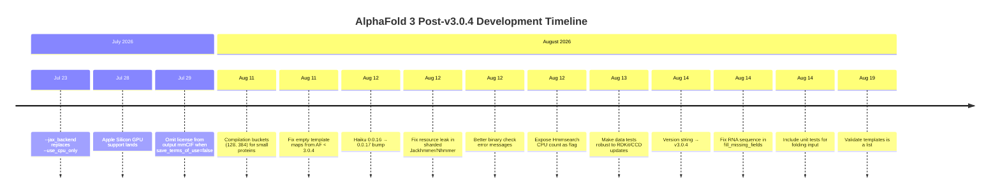

AlphaFold 3 is iterating fast. Since the landmark [v3.0.4 release](https://github.com/google-deepmind/alphafold3/releases) in late July 2026, a steady stream of patches has landed — driven largely by one engineer, [Augustin Zidek](https://github.com/google-deepmind/alphafold3/commit/c0f97eda2f1f482fd94d3a38bece18c7069b4a5c), and a surprising number of community PRs and issue reports. Here's what changed, what matters, and what's still rough around the edges.

## v3.0.4: The "Runs Everywhere" Release

The official [v3.0.4 changelog](https://github.com/google-deepmind/alphafold3/releases/tag/v3.0.4) frames the release around two headline features: **CPU-only execution** and **Apple Silicon GPU support**. The practical impact is real but nuanced.

### Apple Silicon Arrives

The [commit adding Apple Silicon GPU support](https://github.com/google-deepmind/alphafold3/commit/85c4d20505fd5cef05eac22b534d4e793971ae69) was heavily inspired by [PR #699](https://github.com/google-deepmind/alphafold3/pull/699) from @SuhasSrinivasan, and the release notes claim **roughly 3x faster inference than CPU on a MacBook Pro M3**. That's a meaningful speedup for a laptop, but it's worth keeping perspective: a data-center H100 still obliterates it. The real win is accessibility — researchers who don't have queue access to an A100 can now iterate on inputs and validate pipelines locally.

The JAX backend was refactored to make this possible. The old `--use_cpu_only` flag was [replaced with `--jax_backend`](https://github.com/google-deepmind/alphafold3/commit/98a15dcf0cf09f8e5e2b08410b0c4e8be5308e05), which is explicitly designed for "future expandability." This is the right structural call — a boolean flag for CPU-only was already a leaky abstraction once Metal entered the picture. Expect `--jax_backend` to grow more accepted values as JAX's backend landscape evolves.

### CPU-Only: Useful, Not Fast

CPU-only mode works. It's documented as slow. If you're running anything beyond a tiny peptide on CPU, "slow" undersells it — think hours where a GPU takes minutes. The value proposition is CI/CD validation, input testing, and environments where no GPU exists at all. For actual research workloads, this is a last resort.

### JAX and Haiku Bumps

v3.0.4 updated **JAX from 0.9.1 to 0.10.2** and **Tokamax from 0.0.11 to 0.0.12**. Per the release notes, this should "significantly speed up inference times and fix unified memory support on Blackwell GPUs." However, post-release, a [Haiku dependency was bumped from 0.0.16 to 0.0.17](https://github.com/google-deepmind/alphafold3/commit/e82e974eebffd0408a409f1cb61a0fbca56e4046), specifically addressing [Issue #715](https://github.com/google-deepmind/alphafold3/issues/715). Dependency versioning in the JAX ecosystem remains fragile — a minor Haiku bump was enough to break things for users on the previous version. If you're running custom environments outside Docker, pin your versions.

### Other v3.0.4 Highlights

| Area | Change | Credit |
|---|---|---|
| Performance | Reduced memory for outer product mean (2 einsums → 1) | @mooreneural |
| Output | Chain IDs added to summary confidence JSON | @ntnn19 |
| Validation | Early RNG seed validation as uint32 | @ntnn19 |
| Storage | Google Cloud Storage (`gs://`) path support via `etils.epath` | — |
| Docs | User-provided CCD for custom modified residues | @Fred-Jing |

## Post-v3.0.4 Commits: Robustness and Performance

Since the v3.0.4 tag, the repository has seen continued patching — almost entirely from Augustin Zidek, often incorporating or adapting community contributions. The activity cluster from August 11–19, 2026 is particularly dense.

### Small Protein Compilation Buckets

[This commit](https://github.com/google-deepmind/alphafold3/commit/29596b97021cfc941b1993249969c4f268efdbab) adds compilation buckets of size 128 and 384, inspired by [PR #706](https://github.com/google-deepmind/alphafold3/pull/706) from @teerthsharma. AlphaFold 3 compiles XLA kernels per bucket size, and previously the smallest bucket was too large for short peptides — meaning a 50-residue protein paid the compilation cost of a much larger one. This is a real quality-of-life improvement for anyone doing large-scale screening of small proteins or peptides.

### Resource Leak Fix

The [fix for leaked resources in sharded Jackhmmer/Nhmmer](https://github.com/google-deepmind/alphafold3/commit/039eb598b4bbe773b0d434769a963b777a5522cc) was inspired by [PR #705](https://github.com/google-deepmind/alphafold3/pull/705). When a sharded subprocess errored out, resources weren't being cleaned up. In HPC environments running hundreds of folds in sequence, leaked file descriptors and subprocess handles eventually bite you. This is the kind of bug that's invisible in single-run testing but catastrophic in batch pipelines.

### Hmmsearch CPU Control

Two commits — [exposing the Hmmsearch CPU count](https://github.com/google-deepmind/alphafold3/commit/c1ca92891b2904a69b1605fbe92d812edd5da390) and [exposing it as a flag](https://github.com/google-deepmind/alphafold3/commit/e2de24b52bd6b71afee062ddd1189dad9717043c) — give users explicit control over Hmmsearch parallelism. On shared SLURM nodes where you've requested `--cpus-per-task=32`, you probably don't want Hmmsearch silently consuming all of them. This is a small but important operational control.

### Template and Input Validation Fixes

Several commits target input robustness:

- **[Templates validated as a list](https://github.com/google-deepmind/alphafold3/commit/c0f97eda2f1f482fd94d3a38bece18c7069b4a5c)** — directly addresses the crash reported in [Issue #720](https://github.com/google-deepmind/alphafold3/issues/720), where passing a string instead of a dict for a template caused an `AttributeError: 'str' object has no attribute 'keys'`.
- **[Empty template maps from AF < 3.0.4](https://github.com/google-deepmind/alphafold3/commit/25461454b174c2a21f509554c086bd3c26e8e06a)** — inspired by [PR #710](https://github.com/google-deepmind/alphafold3/pull/710), handles backward compatibility when loading template maps written by earlier versions.
- **[RNA sequence fix in fill_missing_fields](https://github.com/google-deepmind/alphafold3/commit/97d20234c6eb89e8d05376e9eecc9321e60a559b)** — adapted from [PR #704](https://github.com/google-deepmind/alphafold3/pull/704), ensures the original (unmodified) RNA sequence is used.

### Better Error Messages

The [binary check improvement](https://github.com/google-deepmind/alphafold3/commit/501f7a9056f1ce20580c45ce588a9a4a4a01dc1b) makes `shutil.which` failures more informative. When a required binary (like `jackhmmer` or `hmmsearch`) isn't found on PATH, the error now tells you what's missing instead of failing with a cryptic traceback. Small change, outsized impact on first-time users.

## Active Issues Worth Watching

The open issue tracker reveals where the project's growing pains are concentrated: **GPU compatibility**, **performance regressions**, and **model correctness questions**.

### Autotuning Cache Miss and Inference Slowdown (Issue #742)

[Issue #742](https://github.com/google-deepmind/alphafold3/issues/742) reports that after updating to the latest code, running on an RTX A6000 triggers an `Autotuning cache miss for PallasTritonGatedLinearUnit` warning, and **GPU inference time increased by at least 80 seconds** for an 898-residue protein compared to v3.0.1. This is a concrete performance regression that likely stems from the JAX/Tokamax update path. If Pallas Triton kernels can't find their autotuning cache, they fall back to slower compilation or execution paths. Anyone on non-H100 GPUs should benchmark before upgrading.

### Segmentation Fault on RTX PRO 6000 (Issue #735)

[Issue #735](https://github.com/google-deepmind/alphafold3/issues/735) documents a segfault in `jax._src.compiler.backend_compile_and_load` on an RTX PRO 6000. The traceback is entirely within JAX/XLA compilation — AlphaFold 3's code never gets control. This is almost certainly a JAX/GPU driver compatibility issue, not an AlphaFold bug per se, but it illustrates how the JAX ecosystem's hardware support matrix remains a source of pain for anyone not on the blessed A100/H100 configuration.

### Potential Model Correctness Issue: ref_space_uid Layout (Issue #730)

[Issue #730](https://github.com/google-deepmind/alphafold3/issues/730) raises a more serious concern: in `atom_cross_attention.py`, `ref_space_uid` is in token layout but is being converted using `queries_to_keys`, which may produce incorrect `offsets_valid` masks. The reporter found that for a 1171-atom input, only 45 rows in `offsets_valid` contained nonzero values. If confirmed, this is a **model correctness bug**, not just a performance issue — it would mean the atom cross-attention is masking out positions it shouldn't. The issue is open and awaiting confirmation from the maintainers.

### Feature Proposal: Preflight Validation (Issue #732)

[Issue #732](https://github.com/google-deepmind/alphafold3/issues/732) proposes a `--validate_input_only` flag that would parse and validate input JSON without launching the data pipeline or inference. The motivation is solid: on shared clusters, you don't want to discover an input error after your job has waited 4 hours in the queue and then burned 30 minutes of H100 time on the data pipeline. The proposal is deliberately narrow — reuse existing validation, add a single CLI flag, no new schema. This fits the project's stated preference for small, incremental changes.

## The Bigger Picture

The trajectory of AlphaFold 3 post-v3.0.4 is clear: **democratize access and harden the operational experience**. The Apple Silicon and CPU-only support lower the hardware barrier. The compilation buckets, Hmmsearch CPU flags, and resource leak fixes address the operational realities of running at scale. The input validation improvements (and proposals) target the most common class of user error.

But the GPU compatibility issues (#735, #742) are a reminder that AlphaFold 3's relationship with JAX and XLA is a double-edged sword. JAX provides hardware portability in theory; in practice, the autotuning caches, compilation paths, and driver compat requirements mean that **"runs on NVIDIA" is not a monolithic guarantee** — it runs reliably on A100/H100, less so on consumer and professional GPUs. And the potential correctness issue in #730, if confirmed, would be the most significant finding since release, since it touches the core model's attention mechanism.

The community contribution pattern is also notable. Many of the post-release fixes are "inspired by" external PRs (#704, #705, #706, #710) rather than direct merges. This suggests the internal Google Piper workflow re-implements community suggestions rather than merging them directly — standard for Google-scale repos, but it means contributor credit flows through commit messages rather than the GitHub PR graph.

| Version | Key Theme | Hardware Impact |
|---|---|---|
| v3.0.0 | Initial release | NVIDIA A100/H100 only |
| v3.0.1 | Operational flags, template control | Same |
| v3.0.2 | Sharded MSA, Blackwell support, Tokamax | NVIDIA Blackwell added |
| v3.0.3 | Apache 2.0 license, Python 3.14 | Same |
| **v3.0.4** | **CPU-only, Apple Silicon, JAX 0.10.2** | **x86 CPU, Apple M-series GPU** |
| Post-v3.0.4 | Robustness patches, small-protein perf | Stabilization |

If you're upgrading, the practical advice is straightforward: **pin to v3.0.4, benchmark your GPU**, and watch [Issue #730](https://github.com/google-deepmind/alphafold3/issues/730) and [Issue #742](https://github.com/google-deepmind/alphafold3/issues/742) for resolution. The codebase is moving fast, but the edges are still sharp.