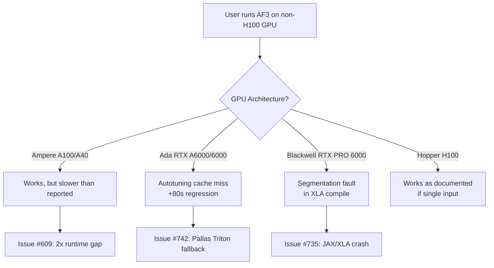
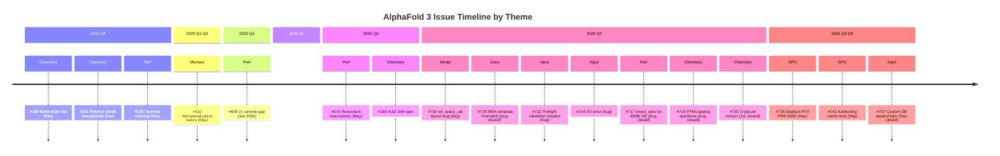

The AlphaFold 3 open-source repository has accumulated a revealing set of issues since its release. They paint a picture of a system that delivers remarkable structural predictions but operates under significant hardware constraints, has rough edges in its chemistry support, and leaves its most demanding users -- those pushing beyond the standard single-protein-on-H100 workflow -- to navigate undocumented territory. Below is a structured analysis of the recurring pain points, with direct links to the original issues and relevant commits.

## The Pain Map at a Glance

| Category | Key Issue | Severity | Status |
|---|---|---|---|
| GPU Performance | Runtime 2x reported on H100 | High | Open |
| GPU Compatibility | Segfault on RTX PRO 6000 | High | Open |
| GPU Performance | Autotuning cache miss, +80s on A6000 | Medium | Open |
| Memory / OOM | Rematerialization failure at 5000+ tokens | High | Open |
| Memory / OOM | `pair_transition_shard_spec` undocumented for non-40/80 GB | Medium | Closed |
| Model Correctness | `ref_space_uid` layout bug in atom cross-attention | High | Open |
| Model Correctness | Documentation mismatch: MSA used for template search | Low | Closed |
| Input / Pipeline | Preflight validation mode requested | Medium | Open |
| Input / Pipeline | Internal I/O error during template parsing | Medium | Open |
| Input / Pipeline | Template JSON parsing `AttributeError` | Medium | Closed |
| Chemistry | Bond order lost in output mmCIF | Medium | Open |
| Chemistry | Polymer-polymer covalent bonds unsupported | Medium | Open |
| Chemistry | O-glycan glycosidic torsion unconstrained | Medium | Closed |
| Chemistry | PTM and terminal capping ambiguity | Low | Closed |
| Perf Optimization | Redundant featurization across seeds | Medium | Open |
| Perf Optimization | Custom database/template appending fails | Medium | Closed |

---

## GPU Performance: The Gap Between Reported and Actual Runtime

This is arguably the most impactful open issue cluster. Users consistently report that real-world inference times substantially exceed the numbers in the [performance documentation](https://github.com/google-deepmind/alphafold3/blob/main/docs/performance.md).

### Runtime 2x Higher Than Documented

[Issue #609](https://github.com/google-deepmind/alphafold3/issues/609) reports that on an H100 with pools of 20-35 proteins near the 5000-token limit, inference takes **~45 minutes** -- roughly **twice** the documented runtime for that token count. The user is using a properly configured SLURM environment with `--cpus-per-task=32` and 193 GB mem-per-gpu. The issue has been open since January 2026 and last updated September 2026, suggesting this is a persistent, unresolved discrepancy.

This matters because the performance doc is the primary reference users consult for capacity planning. If those numbers are only achievable under idealized (single-input, warm cache?) conditions, the documentation should say so explicitly.

### Autotuning Cache Miss and Regression from v3.0.1

[Issue #742](https://github.com/google-deepmind/alphafold3/issues/742) identifies a **regression**: after updating to the latest version, an RTX A6000 produces `Autotuning cache miss for PallasTritonGatedLinearUnit` warnings, and **inference for a single seed on an 898-residue protein is at least 80 seconds slower** compared to v3.0.1. This suggests a JAX/Pallas Triton kernel autotuning change introduced a performance regression for non-H100/A100 GPUs. The fact that autotuning cache misses occur means the Pallas Triton kernels are falling back to slower paths or recompiling on every run.

### Segmentation Fault on RTX PRO 6000

[Issue #735](https://github.com/google-deepmind/alphafold3/issues/735) reports a hard segfault in `jax._src.compiler.backend_compile_and_load` on an RTX PRO 6000 (Blackwell, 96 GB VRAM). The traceback terminates in XLA's compilation path, which points to a JAX/XLA compatibility issue rather than an AlphaFold 3 logic bug. This is notable because the [official system requirements](https://google-deepmind-alphafold3.mintlify.app) specify Compute Capability 8.0+ (Ampere), and Blackwell (CC 9.0+) should theoretically be supported -- but the segfault suggests otherwise.



**Takeaway:** AlphaFold 3 is effectively a first-class citizen only on H100/A100. Users on consumer or workstation GPUs face a spectrum from "slower than advertised" to "hard crash." The [Apple Silicon GPU support](https://github.com/google-deepmind/alphafold3/commit/85c4d20505fd5cef05eac22b534d4e793971ae69) added in v3.0.4 (roughly 3x faster than CPU on M3) shows the team is willing to broaden hardware support, but NVIDIA workstation GPUs remain poorly validated.

---

## Memory and OOM: The Frontier of Large Systems

### Rematerialization Failure

[Issue #432](https://github.com/google-deepmind/alphafold3/issues/432) captures the experience of running systems with **>5000 residues** using unified memory. The XLA rematerialization pass emits:

```
Can't reduce memory use below -20.61GiB by rematerialization;
only reduced to 28.35GiB, down from 28.35GiB originally
```

The user is on an H100 with `TF_FORCE_UNIFIED_MEMORY=true` and `XLA_CLIENT_MEM_FRACTION=3.2`. The negative target (`-20.61GiB`) suggests XLA's cost model has fundamentally miscalculated the memory budget. This issue has been open since May 2025 with only limited guidance from maintainers.

### Undocumented `pair_transition_shard_spec` for Non-Standard VRAM

[Issue #717](https://github.com/google-deepmind/alphafold3/issues/717) (closed) raises a practical concern: the performance doc only provides `pair_transition_shard_spec` recommendations for 40 GB and 80 GB VRAM. Users with 32 GB, 48 GB, or 96 GB GPUs are left to guess. The user's intuition -- first find the max token count without sharding, then choose a sharding spec -- is reasonable but undocumented. The issue was closed without a concrete recommendation, which is itself informative: the team likely hasn't benchmarked these configurations.

### The `RuntimeWarning: overflow` Canary

[Issue #236](https://github.com/google-deepmind/alphafold3/issues/236) reports `RuntimeWarning: overflow encountered in reduce` during featurization of large inputs (5878 tokens) on an A40 with unified memory. The user notes that outputs appear reasonable despite the warning. This issue has been open since December 2024 -- making it one of the oldest open issues -- suggesting the overflow is a known but low-priority edge case in NumPy reduction operations during featurization.

---

## Model Correctness: A Layout Bug and a Documentation Mismatch

### `ref_space_uid` Layout Conversion Bug

[Issue #730](https://github.com/google-deepmind/alphafold3/issues/730) identifies what appears to be a **real correctness bug** in [`atom_cross_attention.py`](https://github.com/google-deepmind/alphafold3/blob/main/src/alphafold3/model/network/atom_cross_attention.py). The code converts `batch.ref_structure.ref_space_uid` using `queries_to_keys` layout conversion, but `ref_space_uid` is in token layout. This causes `offsets_valid` to mask out almost all positions -- in a test with 1171 atoms, only 45 rows contained nonzero values. The reporter suggests the fix is to use `queries_ref_space_uid` as the source tensor instead.

This is significant because the atom cross-attention module is central to AlphaFold 3's structure prediction. If `offsets_valid` is incorrectly masking valid positions, the model is effectively ignoring most reference structure information during cross-attention. Whether this meaningfully impacts prediction quality is unclear, but the bug warrants investigation.

### MSA-Template Documentation Mismatch (Resolved)

[Issue #729](https://github.com/google-deepmind/alphafold3/issues/729) (closed) correctly identified that the documentation states only UniRef90 MSA is used for the template search HMM profile, while the implementation actually uses the **merged UniRef90 + small BFD + MGnify** unpaired MSA. This was a documentation-only issue, but it highlights a pattern: the pipeline's actual behavior diverges from what the docstrings describe, which matters for users who need to reason about what information their templates are derived from.

---

## Input Pipeline: Robustness and Usability Gaps

### Preflight Validation Mode Request

[Issue #732](https://github.com/google-deepmind/alphafold3/issues/732) proposes adding `--validate_input_only` to `run_alphafold.py` -- a flag that validates input JSON and exits before allocating GPU time or launching the data pipeline. The motivation is solid: for complex inputs with custom CCD components, user-provided MSAs, bonded atom pairs, and modifications, input errors currently surface only after expensive computation has begun. The proposal is deliberately narrow (reuse existing validation, add a CLI entry point) and consistent with the repository's preference for small changes.

This is a quality-of-life improvement that would particularly benefit batch processing on shared HPC clusters where GPU-hours are scarce and job scheduling overhead is high. As of this writing, the maintainers have not responded.

### Internal I/O Error During Template Parsing

[Issue #714](https://github.com/google-deepmind/alphafold3/issues/714) demonstrates a fragile failure mode: AlphaFold 3 processes several inputs successfully, then crashes on a specific input with `OSError: [Errno 5] Input/output error` while reading an mmCIF template file. The error originates in `structure_stores.py` calling `filepath.read_text()`. This could be a filesystem issue (NFS, Lustre, or scratch disk corruption) or a race condition in template file access. The user notes the same input *always* fails on retry, which rules out transient I/O errors and suggests either a corrupted template file or a systematic path resolution bug for certain PDB IDs.

### Template JSON Parsing Error (Resolved)

[Issue #720](https://github.com/google-deepmind/alphafold3/issues/720) (closed) exposed an `AttributeError: 'str' object has no attribute 'keys'` when parsing template data in `folding_input.py`. The user had formatted templates as strings rather than dicts. This was addressed by [commit c0f97ed](https://github.com/google-deepmind/alphafold3/commit/c0f97eda2f1f482fd94d3a38bece18c7069b4a5c), which added validation that templates must be a list. The fix is good, but the original error message was unhelpful -- a case where the preflight validation proposed in #732 would have caught the problem immediately.

---

## Chemistry Limitations: Where AlphaFold 3's Reach Exceeds Its Grasp

### Bond Order Lost in Output

[Issue #189](https://github.com/google-deepmind/alphafold3/issues/189), open since December 2024, reports that output mmCIF files omit `_chem_comp_bond.*` fields, so double bonds specified in the input (e.g., C5B=C7B in CCD residue AC1) are **lost**. In visualization tools like PyMOL and Chimera, the double bond disappears. The user asks whether this undermines inference accuracy -- a fair question, since incorrect bond order information could affect the diffusion module's atom position refinement. This remains unanswered.

### Polymer-Polymer Covalent Bonds Unsupported

[Issue #152](https://github.com/google-deepmind/alphafold3/issues/152) documents that covalent bonds between polymer entities (protein-DNA, protein-RNA) are explicitly **not supported**. The code silently reduces such bonds:

```
Reducing number of bonds for top1_dna_topotecan_hg from 1 to 0,
of which 1 are polymer-polymer bonds and 0 are bad bonds.
```

The user's workaround -- treating a single DNA residue as a ligand -- is creative but unvalidated. This is a hard limitation of the current architecture, not a bug, but it significantly constrains AlphaFold 3's applicability to covalent drug-target complexes.

### O-Glycan Glycosidic Torsion Geometry

[Issue #701](https://github.com/google-deepmind/alphafold3/issues/701) (closed) provides a detailed quantitative analysis: when modeling O-linked GalNAc glycosylation via `bondedAtomPairs`, the glycosidic phi dihedral (O5-C1-OG-CB) is **unconstrained** across seeds, with standard deviations of 36-110 degrees per site. The expected range for alpha-O-GalNAc is -40 to -80 degrees (exo-anomeric effect). Zero out of 14 sites had >=80% of models in the correct alpha range. The user is working around this with post-hoc GlycoShape refinement.

This isn't a bug per se -- AlphaFold 3's diffusion module has no explicit torsion potentials for glycosidic linkages -- but it's a significant limitation for the glycobiology community that the output gives no warning about.

### PTM and Terminal Capping Ambiguity

[Issue #716](https://github.com/google-deepmind/alphafold3/issues/716) (closed) raises three practical questions about using PTMs and terminal caps: (1) should the MSA step use the unmodified residue? (2) can AF3 ignore a residue's identity during MSA/template search? (3) how to model terminal capping groups like acetyl (ACE) that lack CA/CB atoms? These are workflow-level questions that the documentation doesn't address, leaving users to discover the answers experimentally.

---

## Performance Optimization Opportunities

### Redundant Featurization Across Seeds

[Issue #675](https://github.com/google-deepmind/alphafold3/issues/675) points out a clear inefficiency: when running inference with multiple seeds, `featurisation.featurise_input` calls `data_pipeline.process_item` repeatedly on the same inputs. Within `WholePdbPipeline.process_structure`, the random seed is only used once at the end (in `RefStructure.compute_features`). The user proposes factoring out the seed-independent computation from the loop, which could significantly reduce data pipeline overhead for multi-seed runs. The user offered to draft a PR but received no response as of this writing.

### Small-Protein Compilation Buckets

[Commit 29596b9](https://github.com/google-deepmind/alphafold3/commit/29596b97021cfc941b1993249969c4f268efdbab) added compilation buckets of size 128 and 384 to make running small proteins faster by default. This was inspired by [PR #706](https://github.com/google-deepmind/alphafold3/pull/706) from community contributor @teerthsharma. This is a meaningful optimization because JAX's JIT compilation cost is amortized over the bucket, and small proteins were previously bucketed into sizes designed6144, paying a disproportionate compilation overhead.

### Custom Database Extension Fails

[Issue #737](https://github.com/google-deepmind/alphafold3/issues/737) (closed) reports that appending custom CIF files to the template directory and their sequences to `pdb_seqres_2022_09_28.fasta` does not work. This is a common use case for users who want to fold against templates not in the static 2022-09-28 PDB snapshot. The issue was closed but the resolution is unclear -- if the approach is simply unsupported, the documentation should state this explicitly rather than letting users discover it through errors.

---

## What the Issue Patterns Reveal



The timeline reveals a clear pattern: **the foundational chemistry limitations (#152, #189) have been open the longest** -- nearly two years -- while **hardware compatibility issues accumulate as the user base expands beyond H100/A100 environments**. The most recent wave of issues (August-September 2026) focuses on correctness (#730), usability (#732, #714), and GPU diversity (#735, #742).

**Three structural observations:**

1. **The H100/A100 mono-culture is a liability.** Google DeepMind internally runs on TPUs and a narrow set of NVIDIA data-center GPUs. The open-source release exposes a much wider hardware surface, and issues like #735 (segfault on Blackwell) and #742 (autotuning regression on A6000) show that JAX/XLA compatibility with non-target GPUs is poorly tested. The [v3.0.4 Apple Silicon support](https://github.com/google-deepmind/alphafold3/commit/85c4d20505fd5cef05eac22b534d4e793971ae69) is a positive signal but doesn't address the NVIDIA workstation gap.

2. **Chemistry support is the long pole in the tent.** Bond orders, polymer-polymer covalent bonds, and glycosidic torsion constraints are not edge cases for structural biology -- they are central to drug design and glycobiology. The fact that these issues remain open after 18+ months suggests they require architectural changes to the model or output pipeline, not just bug fixes.

3. **The feedback loop is slow.** Many well-articulated issues (#675 on redundant featurization, #732 on preflight validation, #609 on runtime discrepancy) receive no maintainer response for months. Community PRs like [#704](https://github.com/google-deepmind/alphafold3/pull/704) (RNA sequence fix), [#705](https://github.com/google-deepmind/alphafold3/pull/705) (resource leak fix), [#706](https://github.com/google-deepmind/alphafold3/pull/706) (compilation buckets), and [#699](https://github.com/google-deepmind/alphafold3/pull/699) (Apple Silicon GPU) are eventually absorbed into internal commits with "Inspired by" acknowledgments, but the latency between community contribution and integration is measured in weeks to months. This is consistent with Google's internal-first development workflow (PiperOrigin-RevId commits), but it can be demotivating for external contributors.