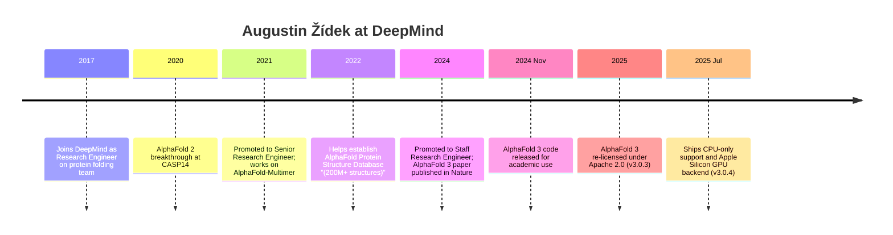
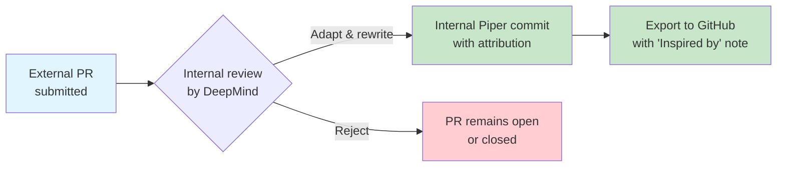
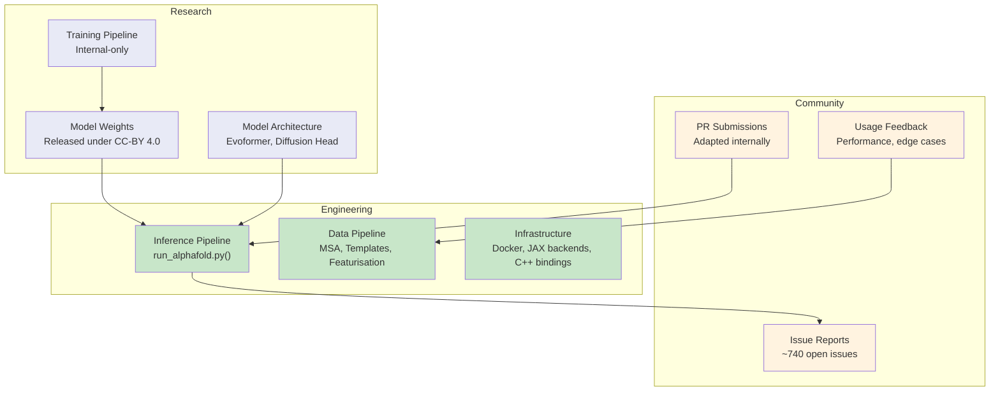

AlphaFold 3 is not a community patchwork — it is, at its core, a Google DeepMind product. But looking at who actually ships the code, reviews the PRs, and shepherds the releases reveals a surprisingly lean operation for a project with this much scientific impact. This page takes you behind the curtain: who are the people committing, what is their background, and how does the external contributor ecosystem actually function?

## The Primary Maintainer: Augustin Žídek

If you have interacted with the [google-deepmind/alphafold3](https://github.com/google-deepmind/alphafold3) repository in any capacity — filed an issue, read a commit log, or waited for a release — you have encountered **Augustin Žídek**. He is the dominant presence in the commit history, responsible for virtually every recent change landing on `main`.

### Career Timeline

Žídek has been at DeepMind since 2017, making him one of the longest-tenured members of the protein folding team. His trajectory mirrors the evolution of AlphaFold itself:

| Period | Role | Focus |
|--------|------|-------|
| 2017–2021 | Research Engineer | Joined the protein folding team; early AlphaFold research |
| 2021–2024 | Senior Research Engineer | AlphaFold-Multimer, AlphaFold Protein Structure Database |
| 2024–Present | Staff Research Engineer | AlphaFold 3 inference pipeline, open-source releases |

On his [personal website](https://augustin.zidek.eu), Žídek describes himself succinctly:

> "I am a Staff Research Engineer working at DeepMind on AlphaFold – computational protein folding. **I enjoy working at the edge of research and engineering.**"

That last sentence is telling. The AlphaFold 3 open-source repo is fundamentally an **engineering** artifact — inference pipeline, data pipeline, Docker setup, CLI flags — not a research artifact. Žídek sits exactly at the seam where the research model meets production infrastructure, which is why his name is on nearly every commit.

### Research Beyond AlphaFold

Žídek's contributions are not limited to protein folding. His publication record on [alphaXiv](https://www.alphaxiv.org/@augustin-zidek) reveals a researcher with genuine breadth:

- **Transfer in Deep Reinforcement Learning Using Successor Features and Generalised Policy Improvement** — extending the SFs & GPI framework for transfer across RL tasks, published at ICML 2019 ([paper](https://arxiv.org/abs/1901.08860))
- **Kickstarting Deep Reinforcement Learning** — using pre-trained teacher agents to accelerate student training via policy distillation, published at ICLR 2018 ([paper](https://arxiv.org/abs/1803.03835))
- **Unicorn: Continual Learning with a Universal, Off-policy Agent** — an architecture for continual learning without explicit task boundaries, published at ICML 2018 ([paper](https://arxiv.org/abs/1802.08240))
- **AlphaQubit 2: A scalable and real-time neural decoder for topological quantum codes** — a neural-network decoder for quantum error correction on surface and color codes, Dec 2025

He also contributed to data infrastructure for structural biology, including the **3D-Beacons network** and **ModelCIF** for representing computed structure models — unglamorous but critical standards work that makes AlphaFold outputs interoperable with the broader PDB ecosystem.

### Public Presence and Release Advocacy

Žídek is the public-facing voice for AlphaFold 3 releases. On LinkedIn, he personally announced both major recent releases:

- **[v3.0.3](https://www.linkedin.com/posts/augustinzidek_release-alphafold-v303-google-deepmind-activity-7470089766227648512-ITkY)** — the Apache 2.0 relicensing, with 416 reactions and community questions about training code
- **[v3.0.4](https://www.linkedin.com/posts/augustinzidek_release-alphafold-v304-google-deepmind-activity-7487915741766344704-mp9J)** — CPU-only support and Apple Silicon GPU, with 728 reactions. His post read: *"I really like this release because you can now run AlphaFold 3 on machines without a GPU, using only the CPU. It is slow, but you no longer need fancy hardware to fold."*

The v3.0.4 announcement drew a notably thoughtful comment from Gianluca Mondillo, MD:

> "This is a genuinely meaningful accessibility release. CPU-only support will not make AlphaFold 3 lightweight or suitable for high-throughput work, but it removes the hard dependency on specialized GPU infrastructure. That matters for teaching, prototyping, reproducibility and smaller labs that need occasional local runs."

## The Broader DeepMind Team

While Žídek is the primary committer visible in the public repository, AlphaFold 3 is the product of a much larger team. The [Nature paper](https://www.nature.com/articles/s41586-024-07487-w) lists dozens of authors spanning both **Google DeepMind** and **Isomorphic Labs** (DeepMind's drug discovery spinoff). The key architectural contributions include:

- **The Evoformer trunk** — an improved version of the deep learning architecture from AlphaFold 2
- **The diffusion module** — replacing the structure module of AF2 with a diffusion network that converges from a cloud of atoms to the final structure
- **The confidence head** — predicting per-atom pLDDT scores and the predicted aligned error (PAE)

These research contributions were made by the internal team; the open-source repository primarily exposes the **inference pipeline** that wraps these trained components.

## Hana Joo: Internal Tooling Contributions

The only other committer visible in recent history is **Hana Joo** ([GitHub: h-joo](https://github.com/h-joo)), who authored a commit on 2026-07-26 adding ["Suppressions for pyrefly"](https://github.com/google-deepmind/alphafold3/commit/01bd8d1f816a95fbf0528e51fa5debabea4f9e69). Pyrefly is an internal Python type-checking tool used at Google. This commit is characteristic of internal infrastructure maintenance — the kind of invisible work that keeps the codebase passing CI in Google's monorepo before it gets exported to GitHub via Piper.

Hana Joo's presence illustrates an important structural fact: **the public GitHub repo is a downstream export of Google's internal monorepo**. Every commit message contains a `PiperOrigin-RevId` and a `Change-Id`, which are Gerrit/Piper identifiers. The contributors you see on GitHub are those whose internal changes happened to be exported in the most recent sync window. The actual set of people working on the code internally is larger.

## External Contributors: The "Inspired By" Pipeline

This is where the contributor story gets structurally interesting. The AlphaFold 3 repo operates under a model where **external contributions are typically absorbed as inspiration rather than merged directly**. The commit messages are remarkably transparent about this:

| Commit | What Changed | External Contributor |
|--------|-------------|---------------------|
| [85c4d2](https://github.com/google-deepmind/alphafold3/commit/85c4d20505fd5cef05eac22b534d4e793971ae69) | Apple Silicon GPU support (~3x faster on M3) | @SuhasSrinivasan via [PR #699](https://github.com/google-deepmind/alphafold3/pull/699) |
| [501f7a](https://github.com/google-deepmind/alphafold3/commit/501f7a9056f1ce20580c45ce588a9a4a4a01dc1b) | Better error when binary not found | @Ayush7614 via [PR #705](https://github.com/google-deepmind/alphafold3/pull/705) |
| [039eb5](https://github.com/google-deepmind/alphafold3/commit/039eb598b4bbe773b0d434769a963b777a5522cc) | Don't leak resources when sharded Jackhmmer errors | Inspired by [PR #705](https://github.com/google-deepmind/alphafold3/pull/705) |
| [29596b](https://github.com/google-deepmind/alphafold3/commit/29596b97021cfc941b1993249969c4f268efdbab) | Compilation buckets of size 128 and 384 for small proteins | @teerthsharma via [PR #706](https://github.com/google-deepmind/alphafold3/pull/706) |
| [254614](https://github.com/google-deepmind/alphafold3/commit/25461454b174c2a21f509554c086bd3c26e8e06a) | Fix loading empty template maps from AF < 3.0.4 | Via [PR #710](https://github.com/google-deepmind/alphafold3/pull/710) |
| [97d202](https://github.com/google-deepmind/alphafold3/commit/97d20234c6eb89e8d05376e9eecc9321e60a559b) | Use original RNA sequence in fill_missing_fields | Via [PR #704](https://github.com/google-deepmind/alphafold3/pull/704) |

This pattern — **acknowledging the external contributor in the commit message but implementing the change internally** — is a deliberate consequence of Google's Piper/Mercurial workflow. External PRs cannot be directly merged into the internal monorepo; they must be reimplemented internally, and the result is then exported back to GitHub. The commit messages consistently credit the original author ("thanks @username!"), which is transparent but also means **the contributor's name won't appear in GitHub's contributor graph**.

This is a structural tension. The project accepts community improvements, but the mechanics of Google's monorepo make true collaborative development impossible. Contributors like **@SuhasSrinivasan** (Apple Silicon GPU), **@Ayush7614** (resource leak fixes), and **@teerthsharma** (compilation bucket sizes) have materially improved the project, yet their GitHub profiles won't show these contributions.

## Notable Community Contributors

Several external developers have made significant impact through issues and PRs:

- **@SuhasSrinivasan** — Proposed [Apple Silicon GPU support via JAX-MPS](https://github.com/google-deepmind/alphafold3/pull/699), which was adapted and shipped in v3.0.4. This was one of the most impactful community contributions, delivering roughly **3x faster inference** on MacBook Pro M3 compared to CPU-only mode.

- **@Ayush7614** — Submitted [PR #705](https://github.com/google-deepmind/alphafold3/pull/705) improving error handling and resource cleanup in the subprocess utilities. Two separate commits were inspired by this single PR.

- **@teerthsharma** — Proposed [PR #706](https://github.com/google-deepmind/alphafold3/pull/706) adding smaller compilation buckets (128 and 384 tokens) to make running small proteins faster by default, avoiding the overhead of the standard 512-token bucket.

## The Research-to-Engineering Pipeline

Understanding the contributor structure of AlphaFold 3 requires understanding how Google DeepMind works internally. The people who designed the diffusion module, the atom cross-attention layers, and the pair representation are **research scientists**. The person who packages all of that into a runnable pipeline, handles the CLI flags, fixes the subprocess resource leaks, and shepherds the Apache 2.0 relicensing is **Augustin Žídek** — a research engineer.

This division of labor is standard at DeepMind but creates a public-perception problem: the open-source repository appears to be a one-person project, when in reality a large internal team produced the model architecture, trained the weights, and maintains the internal codebase. Žídek is the **bridge** — the person who translates internal research artifacts into external engineering artifacts.

## What This Means for Contributors

If you are considering contributing to AlphaFold 3, understand the structural reality:

1. **Your PR will likely be "inspired by" rather than directly merged.** This is not a value judgment — it is a consequence of Piper. Your contribution will be credited in commit messages but not in GitHub's contributor stats.

2. **The most impactful contributions are ones that address real operational pain points** — resource leaks, better error messages, hardware support (like Apple Silicon), performance tuning for non-standard GPU sizes. These are the changes most likely to be adapted internally because they don't require changes to the model architecture.

3. **The project has a healthy issue culture.** Žídek is responsive to well-structured issues, and the commit log shows that community-reported problems (like the [Haiku version bump for #715](https://github.com/google-deepmind/alphafold3/issues/715)) do get addressed. The bottleneck is the internal review and export cycle, not indifference.

4. **Training code and training infrastructure are not part of this repository** and likely never will be, given Isomorphic Labs' commercial interests in drug discovery. This was [explicitly acknowledged](https://fraserlab.com/2024/05/22/AlphaFold3) during the initial controversy around the delayed code release.

---

The contributor story of AlphaFold 3 is, at its heart, a story about the gap between open-source *code* and open-source *development*. The code is Apache 2.0. The weights are CC-BY 4.0. But the development process is Google-internal, and the bridge between those worlds is one Staff Research Engineer who genuinely seems to enjoy the work.