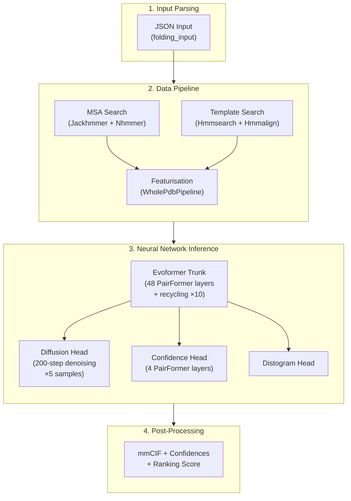
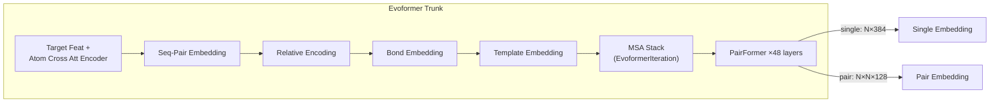

AlphaFold 3 represents a fundamental architectural redesign from its predecessor, replacing the structure module with a **score-based diffusion model** and introducing **per-atom cross attention** as a first-class mechanism for bridging token-level and atom-level representations. The system is built on **JAX + Haiku** for differentiable computation, with Triton flash attention via `tokamax` for GPU efficiency. This page provides a structural map of the entire pipeline—from JSON input through data processing, neural network inference, and post-processing to final mmCIF output—so you can navigate the codebase with precision.

Sources: [run_alphafold.py](/run_alphafold.py#L1-L200), [model.py](/src/alphafold3/model/model.py#L1-L200)

## End-to-End Pipeline Architecture

The full prediction pipeline executes in three sequential stages, each independently controllable via CLI flags (`--run_data_pipeline`, `--run_inference`):



The orchestrator `ModelRunner` in [run_alphafold.py](/run_alphafold.py#L462-L510) JIT-compiles the entire forward pass via `jax.jit`, loads parameters through `params.get_model_haiku_params`, and dispatches to the appropriate JAX device. Each RNG seed produces independent diffusion samples, and results are ranked by a composite confidence score.

Sources: [run_alphafold.py](/run_alphafold.py#L462-L510), [model.py](/src/alphafold3/model/model.py#L230-L330)

## Project Structure Map

```
src/alphafold3/
├── common/                  # Shared abstractions
│   ├── folding_input.py     #   Input JSON → Python data model
│   ├── base_config.py       #   Auto-creating config dataclasses
│   └── resources.py         #   Resource path resolution
├── constants/               # Chemistry constants
│   ├── chemical_components.py  # CCD (Chemical Component Dictionary)
│   ├── atom_types.py        #   Atom type definitions
│   └── residue_names.py     #   Residue name constants
├── data/                    # Data pipeline (MSA + templates + featurisation)
│   ├── pipeline.py          #   MSA/template orchestration per chain
│   ├── featurisation.py     #   Top-level featurise_input()
│   ├── msa.py               #   MSA data class + merging
│   ├── msa_features.py      #   MSA → feature arrays
│   ├── templates.py         #   Template search + realignment
│   └── tools/               #   External tool wrappers (jackhmmer, nhmmer, etc.)
├── model/                   # Neural network core
│   ├── model.py             #   Model class: recycling loop + head dispatch
│   ├── model_config.py      #   GlobalConfig (bfloat16, flash attn, sharding)
│   ├── features.py          #   Feature definitions + BatchDict
│   ├── feat_batch.py        #   Batch dataclass with atom layout info
│   ├── post_processing.py   #   mmCIF output + confidence serialization
│   ├── network/             #   All network modules
│   │   ├── evoformer.py     #     Evoformer trunk (PairFormer + MSA + templates)
│   │   ├── diffusion_head.py#     Score-based diffusion for atom positions
│   │   ├── atom_cross_attention.py  #  Per-atom cross attention encoder/decoder
│   │   ├── confidence_head.py#    Confidence prediction (pLDDT, PAE, pTM)
│   │   ├── diffusion_transformer.py #  Transformer with Adaptive LayerNorm
│   │   ├── modules.py       #     PairFormerIteration, TriangleMult, OuterProduct
│   │   ├── template_modules.py  #  Template embedding
│   │   └── distogram_head.py#    Distogram prediction
│   └── pipeline/            #   Model-side featurisation pipeline
│       ├── pipeline.py      #     WholePdbPipeline (structure → features)
│       └── structure_cleaning.py  #  Structure sanitization
├── structure/               # Structure I/O (mmCIF parsing/writing)
├── jax/geometry/            #   JAX-native rigid body geometry
└── parsers/                 #   C++ accelerated parsers (via pybind11)
```

Sources: [run_alphafold.py](/run_alphafold.py#L37-L55), [model.py](/src/alphafold3/model/model.py#L25-L38)

## Stage 1: Data Pipeline

The data pipeline is orchestrated by [pipeline.py](/src/alphafold3/data/pipeline.py) and runs **MSA search** and **template search** per chain in parallel using `ThreadPoolExecutor` (sub-shelled tools bypass the GIL). Protein chains query UniRef90, MGnify, and SmallBFD via **Jackhmmer**, plus UniProt for paired MSA; RNA chains query NT-RNA, Rfam, and RNAcentral via **Nhmmer**. Template search uses **Hmmsearch** against the PDB with date filtering. All results are deduplicated and merged before passing to featurisation.

| Component | Tool | Database(s) | Chain Type |
|---|---|---|---|
| Unpaired MSA | Jackhmmer | UniRef90, MGnify, SmallBFD | Protein |
| Paired MSA | Jackhmmer | UniProt | Protein |
| Template Search | Hmmsearch + Hmmalign | PDB | Protein |
| RNA MSA | Nhmmer | NT-RNA, Rfam, RNAcentral | RNA |

> [!TIP]
> The data pipeline results are cached per sequence via `@functools.cache`, so identical sequences in homomers do not trigger redundant searches.

Sources: [pipeline.py](/src/alphafold3/data/pipeline.py#L40-L155)

## Stage 2: Featurisation and Batching

The `WholePdbPipeline` in [model/pipeline/pipeline.py](/src/alphafold3/model/pipeline/pipeline.py#L103-L200) converts the cleaned structure, MSAs, and templates into a `BatchDict` of NumPy arrays. Key responsibilities include: structure cleaning (hydrogen removal, leaving-atom filtering, glycan handling), tokenisation (each residue becomes a token with up to **24 atom slots**), MSA cropping (max 16,384 sequences), template featurisation (max 4 templates), inter-chain bond computation, and bucket-based padding to avoid JIT recompilation. The Chemical Component Dictionary (CCD) provides reference conformers for ligands via RDKit.

Sources: [pipeline.py](/src/alphafold3/model/pipeline/pipeline.py#L103-L200), [featurisation.py](/src/alphafold3/data/featurisation.py#L43-L122)

## Stage 3: Neural Network Core

The `Model.__call__` method in [model.py](/src/alphafold3/model/model.py#L280-L330) implements the full forward pass with three sub-stages executed sequentially:

### 3.1 Evoformer Trunk

The Evoformer ([evoformer.py](/src/alphafold3/model/network/evoformer.py)) is the central representation-learning engine. It produces two outputs: a **single embedding** (per-token, 384 channels) and a **pair embedding** (token-pair, 128 channels). Internally it executes:

1. **Target feature embedding** — one-hot residue features concatenated with per-atom conditioning from `atom_cross_att_encoder`
2. **Sequence-pair embedding** — outer product of single projections forming initial pair activations
3. **Relative position encoding** — relative index and chain encodings added to pair
4. **Bond embedding** — polymer-ligand and ligand-ligand bond contact matrices projected into pair space
5. **Template embedding** — intra-chain template features processed through a template stack
6. **MSA stack** — EvoformerIteration (MSA attention + outer product mean + triangle multiplication) updating both MSA and pair representations
7. **PairFormer stack** — **48 layers** of `PairFormerIteration`, each containing:
   - Pair attention (with pair bias, gated)
   - Single attention (with pair bias)
   - Triangle multiplication (outgoing + incoming)
   - Triangle attention (starting + ending)
   - Single transition + Pair transition



### 3.2 Recycling Loop

The Evoformer trunk is wrapped in a **recycling loop** (default 10 recycles) implemented via `hk.fori_loop` for JAX compatibility. On the first pass, single and pair embeddings are zero-initialized. On subsequent passes, the previous cycle's embeddings are fed back as `prev` inputs, allowing the model to iteratively refine its representations. This is the critical mechanism that enables progressive improvement of predictions.

### 3.3 Diffusion Head

The Diffusion Head ([diffusion_head.py](/src/alphafold3/model/network/diffusion_head.py)) replaces AlphaFold 2's structure module entirely. It generates atom coordinates through **score-based denoising diffusion**:

- **Conditioning**: Single and pair embeddings from the trunk are projected and augmented with relative encodings and noise-level embeddings
- **Atom Cross Attention Encoder**: Converts token-level conditioning into per-atom queries using reference structure (positions, elements, charges, atom names)
- **Denoising Transformer**: A 24-block Transformer with Adaptive LayerNorm (AdaLN-Zero) processes atom-level representations
- **Atom Cross Attention Decoder**: Maps per-atom outputs back to token space
- **Sampling**: 200 denoising steps with noise schedule σ(t), producing **5 independent samples** by default

The noise schedule follows σ(t) = σ_data · (s_max^(1/p) + t·(s_min^(1/p) − s_max^(1/p)))^p with σ_data=16.0, p=7. Random rigid augmentations (rotation + translation) are applied during training for SE(3) equivariance.

### 3.4 Confidence Head

The Confidence Head ([confidence_head.py](/src/alphafold3/model/network/confidence_head.py)) runs **after** diffusion sampling, evaluating all 5 samples. It uses a lightweight **4-layer PairFormer** to refine the pair representation with distance features from predicted atom positions, then outputs:

| Output | Description | Shape |
|---|---|---|
| pLDDT | Per-atom predicted LDDT confidence | (N_atoms,) |
| PAE | Predicted Aligned Error (token-pair) | (N_tokens, N_tokens) |
| pTM | Predicted TM-score (global) | scalar |
| ipTM | Interface pTM (chain-pair) | scalar |

### 3.5 Distogram Head

A lightweight head that produces a token-level distogram from the pair embeddings, useful for downstream analysis but not used for structure generation.

Sources: [model.py](/src/alphafold3/model/model.py#L230-L330), [evoformer.py](/src/alphafold3/model/network/evoformer.py#L33-L115), [diffusion_head.py](/src/alphafold3/model/network/diffusion_head.py#L33-L110), [confidence_head.py](/src/alphafold3/model/network/confidence_head.py#L33-L85)

## Neural Network Architecture Summary

| Component | Layers | Key Dimensions | Output |
|---|---|---|---|
| Evoformer PairFormer | 48 | single: 384, pair: 128 | Single + Pair embeddings |
| Evoformer MSA Stack | configurable | msa: 64 | Updated MSA + Pair |
| Diffusion Transformer | 24 blocks | AdaLN-Zero | Atom positions |
| Confidence PairFormer | 4 | Reuses trunk dims | pLDDT, PAE, pTM |
| Recycling | 10 iterations | — | Refined embeddings |
| Diffusion Sampling | 200 steps × 5 samples | σ_data=16 | 5 candidate structures |

Sources: [evoformer.py](/src/alphafold3/model/network/evoformer.py#L50-L80), [diffusion_transformer.py](/src/alphafold3/model/network/diffusion_transformer.py#L1-L50), [model_config.py](/src/alphafold3/model/model_config.py#L27-L44)

## Stage 4: Post-Processing and Output

Post-processing in [post_processing.py](/src/alphafold3/model/post_processing.py#L60-L110) converts each `InferenceResult` into final output files. Atom coordinates are rearranged from the model's internal layout to the flat output layout via `atom_layout.convert`, then assembled into a `Structure` object with B-factors set to pLDDT scores. The pipeline produces:

- **`model.cif`** — mmCIF file with predicted coordinates, B-factors, and metadata
- **`confidences.json`** — Full confidence data (pLDDT, PAE, pTM, ipTM, ranking score)
- **`summary_confidences.json`** — Summary confidence metrics

Multiple samples are ranked by a composite `ranking_score`, and the best-ranked sample is typically used as the final prediction.

Sources: [post_processing.py](/src/alphafold3/model/post_processing.py#L60-L110), [model.py](/src/alphafold3/model/model.py#L80-L130)

## Infrastructure and Acceleration

The system employs several key infrastructure choices for performance:

| Technology | Purpose | Configuration |
|---|---|---|
| **JAX + Haiku** | Differentiable computation, JIT compilation | `jax.jit` on full forward pass |
| **Bfloat16** | Reduced-precision computation | `global_config.bfloat16 = 'all'` |
| **Triton Flash Attention** | Memory-efficient attention | `tokamax` with `flash_attention_implementation = 'triton'` |
| **tokamax GLU kernel** | Fused Gated Linear Unit | Used in TransitionBlock, TriangleMult |
| **C++ pybind11** | Fast parsers and MSA profiling | `cpp.cc`, `parsers/cpp/`, `data/cpp/` |
| **Sharded inference** | Memory-efficient batched diffusion | `mapping.sharded_map` for confidence head |
| **Gradient remat** | Recomputation vs. memory trade-off | `block_remat` in PairFormer |

> [!TIP]
> The `ModelRunner` caches both model parameters (`@functools.cached_property`) and the JIT-compiled forward pass, so repeated predictions on the same device reuse the compiled XLA program without recompilation.

Sources: [model_config.py](/src/alphafold3/model/model_config.py#L27-L44), [run_alphafold.py](/run_alphafold.py#L483-L503)

## What's Different from AlphaFold 2

| Aspect | AlphaFold 2 | AlphaFold 3 |
|---|---|---|
| Structure generation | IPA (Invariant Point Attention) module | Score-based diffusion model |
| Molecule types | Proteins only | Proteins, RNA, DNA, ligands, ions |
| Attention at atom level | None (residue-centric) | Atom Cross Attention (encoder + decoder) |
| Recycling | 3 recycles | 10 recycles |
| Confidence | single pLDDT + PAE | pLDDT + PAE + pTM + ipTM + ranking |
| Template usage | Per-chain templates | Per-chain templates with bond embedding |
| Framework | JAX + Haiku | JAX + Haiku (same, extended) |
| Flash attention | None | Triton via tokamax |

Sources: [diffusion_head.py](/src/alphafold3/model/network/diffusion_head.py#L33-L110), [atom_cross_attention.py](/src/alphafold3/model/network/atom_cross_attention.py#L1-L50), [evoformer.py](/src/alphafold3/model/network/evoformer.py#L50-L80)

## Navigation Guide

To deepen your understanding of specific subsystems, follow this reading path:

1. **[MSA Search Pipeline](8-msa-search-pipeline)** — How Jackhmmer and Nhmmer construct multiple sequence alignments
2. **[Template Search](9-template-search)** — How Hmmsearch finds and realigns structural templates
3. **[Featurisation and Batching](10-featurisation-and-batching)** — How raw data becomes model-ready feature arrays
4. **[Evoformer Trunk](11-evoformer-trunk)** — Deep dive into the 48-layer PairFormer and MSA processing
5. **[Diffusion Head](12-diffusion-head)** — The score-based diffusion model for atom position generation
6. **[Atom Cross Attention](13-atom-cross-attention)** — The token-to-atom bridge mechanism
7. **[Confidence Head](14-confidence-head)** — How pLDDT, PAE, and pTM are computed
8. **[Output Format and Metrics](15-output-format-and-metrics)** — mmCIF structure and confidence score interpretation