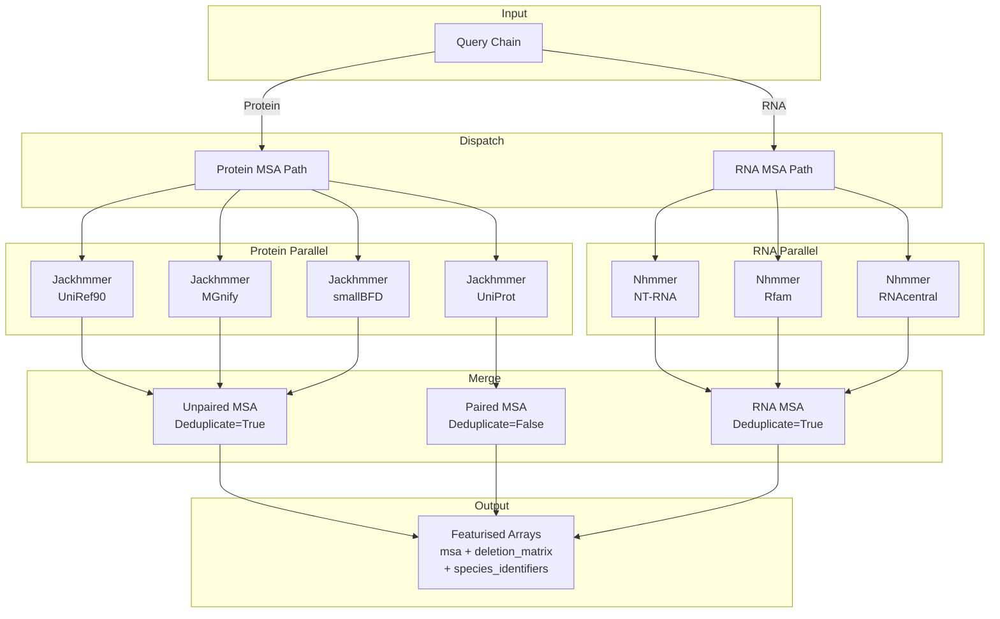

The MSA (Multiple Sequence Alignment) Search Pipeline is AlphaFold 3's evolutionary intelligence layer — the stage where query sequences are matched against massive biological databases to uncover homologous relationships. These alignments encode the co-evolutionary signals that the Evoformer trunk later exploits to infer structural contacts. The pipeline orchestrates two distinct HMMER-family tools across seven specialised databases, merges results with deduplication, and produces featurised arrays ready for the neural network.

## Architecture Overview

The MSA search pipeline follows a **per-chain dispatch pattern**: protein chains are routed to Jackhmmer against four databases, while RNA chains are routed to Nhmmer against three databases. Both paths execute database queries in parallel via `ThreadPoolExecutor`, merge and deduplicate results, then hand off to the featurisation stage.

The **unpaired MSA** (UniRef90 + smallBFD + MGnify) captures diverse evolutionary depth. The **paired MSA** (UniProt cluster annotations) captures co-evolution between chains that appear together in the same organism — a critical signal for multimeric complex prediction. RNA chains produce a single merged MSA since pairing logic is not applicable.

Sources: [pipeline.py](src/alphafold3/data/pipeline.py#L80-L161), [pipeline.py](src/alphafold3/data/pipeline.py#L166-L210)

## Tool Dispatch and the MsaTool Protocol

Both Jackhmmer and Nhmmer conform to the `MsaTool` protocol — a minimal interface requiring a single `query(target_sequence) → MsaToolResult` method. The `get_msa_tool` factory function uses Python's `match` statement to instantiate the correct tool from the config type, and `get_msa` orchestrates the full query-to-`Msa` object lifecycle.

| Component | Responsibility | Key Method |
|---|---|---|
| `MsaTool` (Protocol) | Interface contract for all MSA tools | `query(target_sequence) → MsaToolResult` |
| `MsaToolResult` | Immutable result container | Holds `a3m`, `e_value`, `target_sequence`, `tblout` |
| `get_msa_tool()` | Factory dispatching config → tool instance | Pattern matches `JackhmmerConfig` / `NhmmerConfig` |
| `get_msa()` | End-to-end: tool query → `Msa` construction | Calls `Msa.from_a3m()` with crop and dedup |

The `MsaToolResult` dataclass carries both the alignment in **A3M format** (uppercase residues + lowercase insertions) and an optional `tblout` string containing tabular hit statistics — needed only when merging results across sharded databases.

Sources: [msa_tool.py](src/alphafold3/data/tools/msa_tool.py#L26-L48), [msa.py](src/alphafold3/data/msa.py#L296-L356)

## Jackhmmer: Protein MSA Search

**Jackhmmer** is an iterative profile HMM search tool from the HMMER3 suite. AlphaFold 3 runs it against **four protein databases** simultaneously using a `ThreadPoolExecutor(max_workers=4)`, sidestepping the GIL since the tool is sub-shelled out as an external process.

### Protein Database Configuration

| Database | Tool | E-value | Max Sequences | Role | MSA Type |
|---|---|---|---|---|---|
| UniRef90 | Jackhmmer | 1e-4 | 10,000 | Primary diverse homologs; feeds template search | Unpaired |
| smallBFD | Jackhmmer | 1e-4 | 5,000 | Broad fold-level diversity | Unpaired |
| MGnify | Jackhmmer | 1e-4 | 5,000 | Metagenomic sequences (novel folds) | Unpaired |
| UniProt Cluster Annot | Jackhmmer | 1e-4 | 50,000 | Inter-chain co-evolution (paired MSA) | Paired |

All four Jackhmmer instances use `n_iter=1` — a single search pass rather than the default iterative refinement. This is a deliberate trade-off: iterative searches are slower and can amplify noise, while the large database breadth compensates for the reduced per-database depth.

### Sharded Database Execution

When a database path contains a shard specifier (e.g. `<db_path>@<num_shards>`), Jackhmmer runs each shard as a separate subprocess in parallel. The `Z-value` and `domZ-value` must be set to the full (unsharded) database size to ensure e-values are correctly scaled across shards. Results are merged via `_merge_jackhmmer_results`, which:

1. Parses the `tblout` from each shard to extract per-hit e-values and bit scores
2. Creates a lazy iterator over each shard's A3M, cross-referencing with tblout data
3. Merges all iterators via `heapq.merge` sorted by `(e-value, -bit_score, name)`
4. Truncates to `max_sequences`, preserving the top-scoring hits globally

> [!TIP]
> Sharded search results may contain near-duplicates that Jackhmmer's internal deduplication cannot detect across shard boundaries. This is intentional and bounded — the downstream `Msa` deduplication step cleans these up.

Sources: [jackhmmer.py](src/alphafold3/data/tools/jackhmmer.py#L37-L196), [pipeline.py](src/alphafold3/data/pipeline.py#L309-L382)

## Nhmmer: RNA MSA Search

**Nhmmer** performs profile HMM search against nucleotide databases, specialised for RNA sequence alignment. Unlike Jackhmmer, Nhmmer requires a **two-step alignment process** because its hits are typically shorter than the query sequence:

1. **Search**: Nhmmer queries the database, producing Stockholm-format hits
2. **Profile alignment**: `hmmbuild` constructs a profile HMM from the query, then `hmmalign` re-aligns Nhmmer's hits against this full-length profile

This ensures the output MSA has consistent width matching the query sequence — a requirement for downstream featurisation.

### RNA Database Configuration

| Database | Tool | E-value | Max Sequences | Alphabet |
|---|---|---|---|---|
| NT-RNA | Nhmmer | 1e-3 | 10,000 | rna |
| Rfam | Nhmmer | 1e-3 | 10,000 | rna |
| RNAcentral | Nhmmer | 1e-3 | 10,000 | rna |

Nhmmer applies a **relaxed F3 filter** (0.02) for short RNA sequences (< 50 residues), as recommended by RNAcentral — the default aggressive filtering would discard many valid short-RNA hits. Sharded merging follows the same `heapq.merge` strategy as Jackhmmer, but uses column 12 (e-value) from nucleotide tblout format rather than column 5.

Sources: [nhmmer.py](src/alphafold3/data/tools/nhmmer.py#L43-L300), [pipeline.py](src/alphafold3/data/pipeline.py#L383-L439)

## Msa Container: Deduplication and Merging

The `Msa` class is the central data structure — a validated, optionally deduplicated container for alignment sequences and their descriptions. It enforces a critical invariant: **the first sequence must be feature-equivalent to the query sequence**, verified via `_featurize` which maps residues through the same encoding used by the neural network.

### Deduplication Strategy

Deduplication strips lowercase characters (insertions) from each sequence using `str.maketrans` for O(n) performance, then tracks unique uppercase-only sequences in a set. This is applied at two levels:

| Merge Operation | Deduplicate | Rationale |
|---|---|---|
| Unpaired protein MSA (`from_multiple_msas`) | **True** | UniRef90, smallBFD, and MGnify overlap significantly |
| Paired protein MSA (`from_multiple_msas`) | **False** | UniProt is the sole source; no cross-DB duplicates |
| RNA MSA (`from_multiple_msas`) | **True** | Rfam, RNAcentral, and NT-RNA share entries |

### Construction Pathways

The `Msa` class provides three class methods for different construction scenarios:

- **`from_a3m(query_sequence, chain_poly_type, a3m, max_depth)`** — parses a single A3M string, optionally cropping to `max_depth` sequences
- **`from_multiple_a3ms(a3ms, chain_poly_type)`** — merges multiple raw A3M strings, validating that query sequences match
- **`from_multiple_msas(msas)`** — merges already-constructed `Msa` objects, the primary path used by `DataPipeline`

The empty MSA (`from_empty`) is used when a chain provides pre-computed MSAs or when MSA search is intentionally skipped.

Sources: [msa.py](src/alphafold3/data/msa.py#L61-L262)

## Featurisation: MSA to Neural Network Input

The `Msa.featurize()` method converts the raw sequence alignment into the numerical arrays consumed by the Evoformer. It calls two extraction functions:

**`extract_msa_features(msa_sequences, chain_poly_type)`** produces two arrays of shape `(num_seq, num_res)`:

| Output Array | Content | Encoding |
|---|---|---|
| `msa` | Uppercase residues and gaps | Protein: 0–21 (20 AA + gap), RNA: 22–25 + 21 (gap), DNA: 26–29 + 21 (gap) |
| `deletion_matrix` | Count of lowercase insertions left of each residue | Integer counts |

The encoding is **non-overlapping across polymer types**: protein residues occupy indices 0–20, RNA nucleotides start at 22, and DNA nucleotides at 26 — with gap (`-`) consistently at 21 and unknown nucleic residues at 30. Lowercase characters in the A3M (representing insertions relative to the query) are stripped from the MSA array but their counts are recorded in the deletion matrix.

**`extract_species_ids(msa_descriptions)`** parses UniProtKB-style description headers using a regex matching the pattern `(tr|sp)|Accession|EntryName_SpeciesId`, extracting the 1–5 character species code. Species identifiers enable the pairing algorithm to identify sequences from the same organism across different chains.

Sources: [msa.py](src/alphafold3/data/msa.py#L263-L293), [msa_features.py](src/alphafold3/data/msa_features.py#L80-L169), [msa_features.py](src/alphafold3/data/msa_features.py#L175-L200)

## DataPipeline Orchestration

The `DataPipeline` class wires everything together. Its `__init__` constructs all `RunConfig` objects from `DataPipelineConfig`, and its `process()` method iterates over chains with type-based dispatch:

| Chain Type | Method | MSA Search | Template Search |
|---|---|---|---|
| `ProteinChain` | `process_protein_chain()` | 4× Jackhmmer in parallel | Hmmsearch on UniRef90 MSA |
| `RnaChain` | `process_rna_chain()` | 3× Nhmmer in parallel | Not applicable |

> [!TIP]
> The pipeline uses `@functools.cache` on `_get_protein_msa_and_templates` and `_get_rna_msa` to avoid redundant searches for identical sequences in homomers (e.g., a homodimer with the same chain sequence). This is a significant optimisation for symmetric complexes.

### Pre-computed MSA Handling

The pipeline respects user-supplied MSAs through a three-way branching logic in `process_protein_chain()`:

1. **No MSA provided** → Run full MSA + template search
2. **MSA provided, no templates** → Run template search only (using supplied MSA to build the HMM profile)
3. **Both MSA and templates provided** → Skip all search, use supplied data directly

This enables users to pre-compute MSAs offline (e.g., on a cluster) and supply them at inference time, dramatically reducing runtime for repeated predictions.

Sources: [pipeline.py](src/alphafold3/data/pipeline.py#L304-L558), [pipeline.py](src/alphafold3/data/pipeline.py#L591-L610)

## Configuration Reference

The complete MSA search configuration is expressed through frozen dataclasses in `msa_config.py`, ensuring immutability and validation at construction time:

| Config Class | Purpose | Key Fields |
|---|---|---|
| `DatabaseConfig` | Database identity | `name`, `path` |
| `JackhmmerConfig` | Jackhmmer invocation | `binary_path`, `database_config`, `n_cpu`, `n_iter`, `e_value`, `z_value`, `dom_z_value`, `max_sequences`, `max_parallel_shards` |
| `NhmmerConfig` | Nhmmer invocation | `binary_path`, `hmmalign_binary_path`, `hmmbuild_binary_path`, `database_config`, `n_cpu`, `e_value`, `z_value`, `max_sequences`, `alphabet`, `max_parallel_shards` |
| `RunConfig` | Single MSA run | `config` (Jackhmmer or Nhmmer), `chain_poly_type`, `crop_size` |
| `DataPipelineConfig` | Full pipeline | All binary paths, all database paths, Z-values, CPU counts, `max_template_date` |

`RunConfig.__post_init__` validates that `crop_size ≥ 2` (since the query itself always occupies one slot) and that `chain_poly_type` is a recognised standard polymer type.

Sources: [msa_config.py](src/alphafold3/data/msa_config.py#L36-L131), [pipeline.py](src/alphafold3/data/pipeline.py#L213-L301)

## Key Design Patterns

**Parallel sub-shelling**: Since HMMER tools are external C binaries, they release the GIL. `ThreadPoolExecutor` achieves true parallelism without multiprocessing overhead. Protein chains use `max_workers=4` for the four simultaneous Jackhmmer searches.

**Lazy merging**: The sharded merge functions use `heapq.merge` over lazy iterators — only parsing as many A3M sequences as needed to fill `max_sequences`, avoiding the memory cost of loading all hits from all shards simultaneously.

**Homomer caching**: `@functools.cache` on `_get_protein_msa_and_templates` and `_get_rna_msa` ensures identical sequences in symmetric assemblies trigger a single database search. The cache key is the sequence string itself, so this optimisation is exact for homomers and approximate for near-identical chains.

**Feature-equivalence validation**: The first MSA sequence is validated against the query using the same featurisation pipeline that feeds the neural network, not raw string equality. This accounts for Jackhmmer occasionally mutating residues (e.g., ambiguous codes) while preserving semantic equivalence.

---

**Next steps**: The MSA output flows directly into template search, which uses the UniRef90 alignment to construct an HMM profile for Hmmsearch against the PDB. See [Template Search](9-template-search) for that pipeline, or [Featurisation and Batching](10-featurisation-and-batching) for how the MSA arrays are assembled into model inputs.