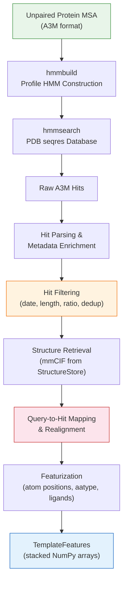

Template search is the second stage of AlphaFold 3's data pipeline, responsible for discovering structurally resolved homologs in the PDB and extracting their atomic coordinates as structural priors for the neural network. The pipeline transforms an MSA-derived sequence profile into a set of template features — atom positions, residue types, and ligand coordinates — that the Evoformer trunk can attend to alongside the MSA. This stage operates exclusively on **protein chains**; RNA and DNA chains do not undergo template search in the current implementation.

## Architectural Overview

The template search pipeline comprises four sequential phases: **profile construction**, **database search**, **hit filtering**, and **featurization**. Each phase is orchestrated by the `Templates` class, which serves as the central container and coordinator for all template-related state.



The pipeline is invoked from `DataPipeline` after MSA construction completes. The UniRef90-derived unpaired MSA (in A3M format) serves as the input profile for the template search — this is a deliberate design choice, as UniRef90 provides broad evolutionary coverage that improves HMM sensitivity against the PDB sequence database.

Sources: [pipeline.py](/src/alphafold3/data/pipeline.py#L40-L76), [templates.py](/src/alphafold3/data/templates.py#L438-L492)

## Profile Construction and Database Search

The search begins by converting the unpaired protein MSA into a **Hidden Markov Model (HMM) profile** using HMMer's `hmmbuild` tool. The MSA is first converted from A3M to Stockholm format, which enables reference column annotation — critical for the `--hand` model construction strategy that preserves the query's consensus columns rather than letting `hmmbuild` auto-detect them.

```
A3M MSA → Stockholm → hmmbuild --hand → HMM profile → hmmsearch → A3M hits
```

The `Hmmsearch` wrapper orchestrates this two-step process. It constructs the profile via `Hmmbuild.build_profile_from_sto()` with `model_construction='hand'`, then searches the PDB seqres database (a FASTA file of all PDB chain sequences) using the resulting HMM. The search output is captured in Stockholm format (`-A` flag) and converted back to A3M for downstream parsing.

The `HmmsearchConfig` dataclass exposes fine-grained control over the search:

| Parameter | Default | Purpose |
|-----------|---------|---------|
| `e_value` | (required) | Reporting E-value threshold for inclusion in output |
| `inc_e` | (required) | Inclusion E-value for next-round search |
| `dom_e` | (required) | Domain E-value threshold for reporting |
| `incdom_e` | (required) | Domain E-value for inclusion |
| `n_cpu` | 8 | Number of CPU threads |
| `alphabet` | `'amino'` | HMM alphabet (`amino`, `rna`, `dna`) |
| `filter_f1` / `f2` / `f3` | `None` | MSV, Viterbi, and Forward pre-filter thresholds |
| `filter_max` | `False` | Disables all filters (`--max` flag) |

Setting `filter_max=True` removes all pre-filters, which is slower but avoids missing distant homologs that the cascade filters might discard.

> [!TIP]
> The `max_a3m_query_sequences` parameter (default 300 in `TemplateToolConfig`) limits how many MSA sequences are used to build the HMM profile. This caps computational cost while retaining sufficient evolutionary signal for sensitive searches.

Sources: [hmmsearch.py](/src/alphafold3/data/tools/hmmsearch.py#L31-L162), [hmmbuild.py](/src/alphafold3/data/tools/hmmbuild.py#L61-L77), [templates.py](/src/alphafold3/data/templates.py#L968-L993), [msa_config.py](/src/alphafold3/data/msa_config.py#L133-L176)

## Hit Data Model and Alignment Mapping

Each template hit is represented by the **`Hit` dataclass**, a frozen, slot-optimized container that captures both the search result and its structural metadata:

| Attribute | Type | Description |
|-----------|------|-------------|
| `pdb_id` | `str` | Lowercase PDB identifier (e.g., `"4pqx"`) |
| `auth_chain_id` | `str` | Author chain ID from the PDB |
| `hmmsearch_sequence` | `str` | Raw aligned sequence from hmmsearch (uppercase = match, lowercase = deletion, `-` = gap) |
| `structure_sequence` | `str` | Actual sequence from the mmCIF structure |
| `query_sequence` | `str` | The original query sequence |
| `start_index` / `end_index` | `int` | 0-based half-open interval of the hit within the full PDB seqres sequence |
| `full_length` | `int` | Length of the full PDB seqres sequence |
| `release_date` | `datetime.date` | PDB release date |
| `chain_poly_type` | `str` | Polymer type (`protein`, `rna`, `dna`) |
| `unresolved_res_indices` | `Sequence[int]` | 0-based indices of structurally unresolved residues |

The most critical derived property is **`query_to_hit_mapping`**, a `Mapping[int, int]` that maps each query residue index to its corresponding position in the hit structure. This mapping is computed by parsing the hmmsearch A3M alignment encoding:

- **Uppercase residues** → aligned in both query and template (added to mapping)
- **Lowercase residues** → deletions in the template (advance hit index only)
- **Hyphens (`-`)** → insertions in the template (advance query index only)

This mapping is the foundation for all downstream featurization — it determines which template atom positions correspond to which query positions.

Sources: [templates.py](/src/alphafold3/data/templates.py#L166-L306)

## Sequence Realignment

A subtle but important edge case arises when the **PDB seqres sequence** (the theoretical full sequence from the PDB header) differs from the **actual structure sequence** (the sequence extracted from atomic coordinates in the mmCIF). This discrepancy occurs because some residues may lack coordinates due to experimental limitations. When `full_length != len(structure_sequence)`, the original query-to-hit mapping (derived from the seqres sequence) must be **realigned to the actual structure sequence**.

The `realign_hit_to_structure()` function implements a greedy alignment algorithm that:

1. Determines the maximum number of gaps (`full_length - len(structure_sequence)`)
2. Iterates over possible gap placements before the hit subsequence region
3. For each candidate alignment, computes a score (number of matching aligned residues)
4. Selects the alignment with the highest score

The inner `_remap_to_struc_seq()` function walks both sequences simultaneously, shifting the hit index forward when residues don't match (consuming gaps from the budget) and remapping the original query-to-hit indices through the resulting hit-to-structure mapping.

```
Example:
  hit_sequence   : ---DEFGHIJK-    (seqres)
  struc_sequence : --XDEFGH--KL    (actual mmCIF)
  Result mapping : {3:1, 4:2, 5:3, 6:4, 7:5, 10:6}
```

If realignment fails, an `AlignmentError` is raised, and the hit is excluded during filtering.

Sources: [template_realign.py](/src/alphafold3/data/template_realign.py#L29-L177), [templates.py](/src/alphafold3/data/templates.py#L220-L247)

## Hit Filtering Pipeline

Raw hmmsearch results can contain hundreds of hits, many of which are redundant, too recent, or poorly aligned. The `_filter_hits()` function applies a cascading sequence of filters to produce a high-quality, diverse template set:

| Filter | Config Parameter | Logic |
|--------|-----------------|-------|
| **Release date** | `max_template_date` | Excludes hits released after cutoff; prevents ground truth leakage during training |
| **Subsequence ratio** | `max_subsequence_ratio` | Excludes hits where `length_ratio > threshold` AND the hit sequence is an exact subsequence of the query (catches near-duplicates) |
| **Minimum hit length** | `min_hit_length` | Excludes hits with fewer aligned residues than threshold |
| **Validity check** | (automatic) | Excludes hits where all aligned positions map to unresolved residues (`is_valid` property) |
| **Alignment ratio** | `min_align_ratio` | Excludes hits where `align_ratio ≤ threshold` (too few residues aligned relative to query length) |
| **Deduplication** | `deduplicate_sequences` | Keeps only the first hit with a given `output_templates_sequence` |
| **Maximum hits** | `max_hits` | Caps the total number of retained hits |

The **release date cutoff** is computed as `min(max_template_date, query_release_date - 60 days)`. The 60-day buffer (`_DAYS_BEFORE_QUERY_DATE`) provides an additional safety margin against temporal leakage when the query's own release date is known.

Filtering can occur at two points: **eagerly** during `Templates.from_hmmsearch_a3m()` (when `filter_config` is provided), or **lazily** via the `Templates.filter()` method after construction. Eager filtering is more performant because it avoids fetching mmCIF files for hits that will be discarded.

Sources: [templates.py](/src/alphafold3/data/templates.py#L311-L402), [templates.py](/src/alphafold3/data/templates.py#L610-L651), [msa_config.py](/src/alphafold3/data/msa_config.py#L179-L200)

## Structure Retrieval and Featurization

### Structure Store

The `StructureStore` class provides a unified interface for retrieving mmCIF files from three backend types:

| Backend | Initialization | Use Case |
|---------|---------------|----------|
| **Directory** | `StructureStore(path_to_dir/)` | Local filesystem with `{pdb_id}.cif` files |
| **TAR archive** | `StructureStore(path_to.tar)` | Packed mmCIF archive (lazy member index via `@cached_property`) |
| **In-memory mapping** | `StructureStore({"pdb_id": mmcif_string})` | Testing and programmatic use |

If a requested PDB ID is not found, a `NotFoundError` is raised, and the hit is logged as a warning and skipped during parsing.

### Featurization

The `Templates.featurize()` method converts filtered hits into the numerical features consumed by the neural network. For each hit, it:

1. **Retrieves the mmCIF** from the StructureStore (deduplicated by PDB ID — structures shared across multiple hits are loaded once)
2. **Filters to the hit's chain** using `structure.filter(chain_id=label_chain_id)`
3. **Computes polymer features** via `get_polymer_features()`:
   - `template_all_atom_positions`: shape `(query_len, num_atom_types, 3)` — 3D coordinates mapped from hit positions to query positions using `query_to_hit_mapping`
   - `template_all_atom_masks`: shape `(query_len, num_atom_types)` — binary mask indicating which atoms have coordinates
   - `template_aatype`: shape `(query_len,)` — integer-encoded residue types
   - `template_sequence`: the aligned template sequence (with `-` for unaligned positions)
   - `template_domain_names`: hit identifier (e.g., `"4pqx_A"`)
   - `template_release_date`: ISO-format date string

4. **Computes ligand features** (if `include_ligand_features=True`) via `_get_ligand_features()`:
   - `ligand_atom_positions`, `ligand_atom_names`, `ligand_atom_occupancies`, `ccd_id` — per-ligand-chain dictionaries of atom-level data

5. **Stacks all polymer features** across hits using `np.stack(axis=0)`, while ligand features remain as an unstacked list of dictionaries

The polymer-specific atom type count depends on chain type: proteins use 37 atom types (`ATOM37`), while DNA and RNA use 29 (`ATOM29`). The minimum atom count thresholds for validity are 5 for protein, 21 for DNA, and 20 for RNA.

> [!TIP]
> Template featurization is the most I/O-intensive stage because it loads full mmCIF files from disk. Eager filtering (passing `filter_config` to `from_hmmsearch_a3m`) dramatically reduces the number of mmCIF reads by eliminating invalid hits before structure retrieval.

Sources: [structure_stores.py](/src/alphafold3/data/structure_stores.py#L32-L122), [templates.py](/src/alphafold3/data/templates.py#L671-L727), [templates.py](/src/alphafold3/data/templates.py#L829-L954)

## Pipeline Integration

Template search is embedded within `DataPipeline._get_protein_templates()`, which is called from `_get_protein_msa_and_templates()`. The execution order is:

1. **MSA search** runs first (UniRef90, MGnify, SmallBFD, UniProt — in parallel via `ThreadPoolExecutor`)
2. **MSA deduplication** produces the unpaired and paired MSA
3. **Template search** runs on the unpaired MSA's A3M representation

Both `_get_protein_templates` and `_get_protein_msa_and_templates` are decorated with `@functools.cache`, ensuring that identical sequences in homomeric inputs share the same template search results without redundant computation.

When `run_template_search=False`, an empty `Templates` object is constructed with no hits — this allows running AlphaFold 3 in MSA-only mode without external database dependencies.

Sources: [pipeline.py](/src/alphafold3/data/pipeline.py#L39-L161)

## Configuration Reference

The template search pipeline is configured through three nested dataclasses within `msa_config.py`:

| Dataclass | Key Fields | Role |
|-----------|-----------|------|
| `HmmsearchConfig` | `hmmsearch_binary_path`, `hmmbuild_binary_path`, `e_value`, `inc_e`, `dom_e`, `incdom_e`, `alphabet`, `filter_*` | hmmsearch tool parameters |
| `TemplateToolConfig` | `database_path`, `chain_poly_type`, `hmmsearch_config`, `max_a3m_query_sequences` (default 300) | Search target and profile limits |
| `TemplateFilterConfig` | `max_subsequence_ratio`, `min_align_ratio`, `min_hit_length`, `deduplicate_sequences`, `max_hits`, `max_template_date` | Hit selection criteria |

At the `DataPipelineConfig` level, the two database paths that govern template search are `seqres_database_path` (the FASTA file of PDB chain sequences that hmmsearch queries against) and `pdb_database_path` (the directory or TAR archive of mmCIF files that StructureStore reads from).

Sources: [msa_config.py](/src/alphafold3/data/msa_config.py#L133-L200), [pipeline.py](/src/alphafold3/data/pipeline.py#L213-L301)

## What Comes Next

After template search completes, the resulting `TemplateFeatures` are merged with MSA features and passed into the featurisation and batching stage, which prepares the final NumPy arrays for the neural network. To understand how template features are assembled into model inputs, see [Featurisation and Batching](10-featurisation-and-batching). For the MSA construction that precedes template search, see [MSA Search Pipeline](8-msa-search-pipeline).