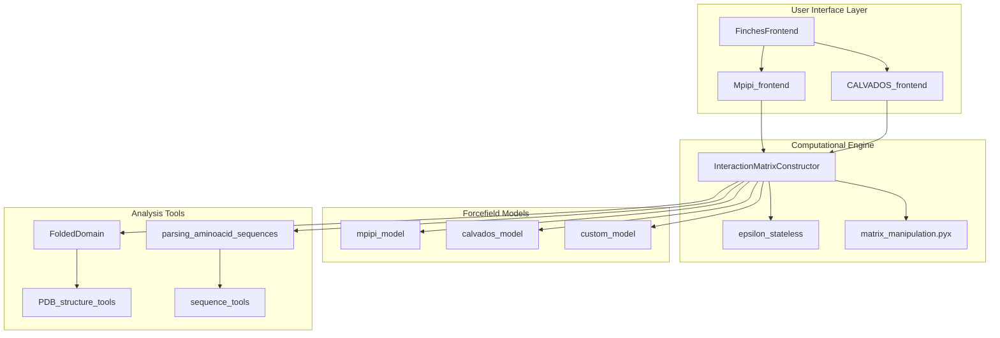
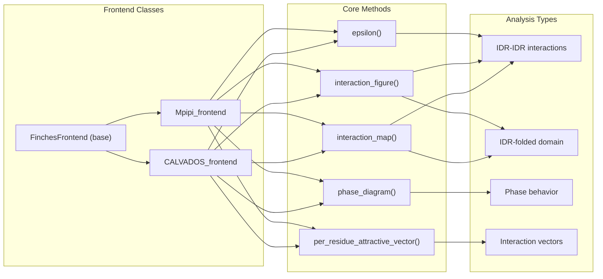
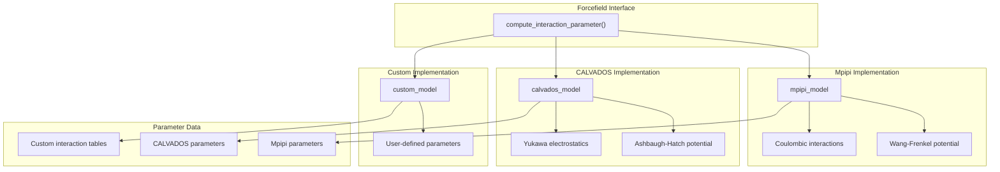
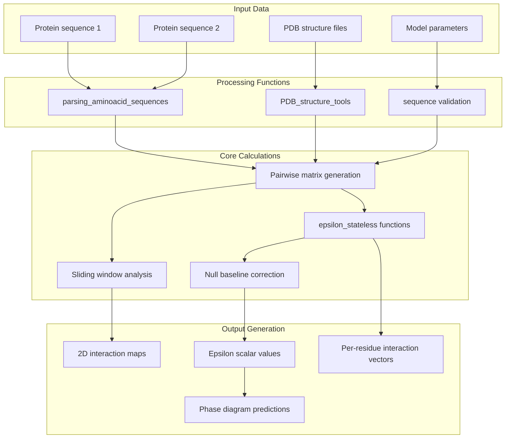
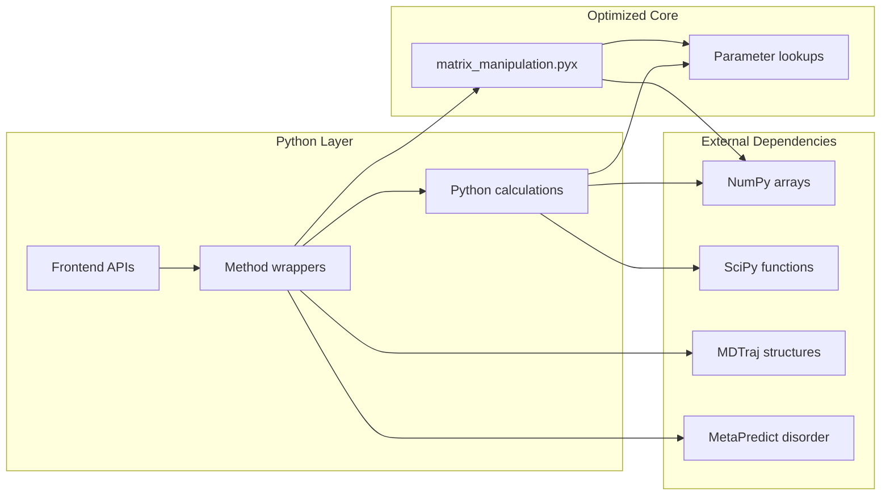

# Overview

Relevant source files

The following files were used as context for generating this wiki page:

- [README.md](README.md)
- [changelog.md](changelog.md)
- [docs/index.rst](docs/index.rst)
- [finches/__init__.py](finches/__init__.py)

## Purpose and Scope

This document provides a high-level introduction to the FINCHES software system, its core architecture, and primary capabilities. FINCHES (**F**irst-principle **I**nteractions via **CHE**mical **S**pecificity) is a Python package for predicting intermolecular interactions driven by intrinsically disordered regions (IDRs) in proteins using chemical physics principles extracted from coarse-grained force fields.

For detailed installation and setup instructions, see [Getting Started](#2). For comprehensive usage examples, see [User Guide](#3). For complete API documentation, see [API Reference](#5).

## What is FINCHES

FINCHES enables computational prediction of IDR-mediated interactions through sequence-based analysis. The system transforms amino acid sequences into quantitative interaction predictions using established forcefield parameters, supporting multiple analysis modes including pairwise interaction maps, mean-field interaction parameters (epsilon values), and phase behavior predictions.

**Sources:** [README.md:7-8](), [docs/index.rst:9-23]()

## System Architecture

The FINCHES system follows a layered architecture with distinct separation between user interfaces, computational engines, and underlying forcefield models:

**Sources:** [finches/__init__.py:16-17](), [README.md:25-34]()

## User Interface Layer

FINCHES provides two primary frontend classes that implement identical interfaces for different forcefield models:

**Sources:** [finches/__init__.py:16-17](), [README.md:36-43]()

## Core Capabilities

FINCHES provides four primary analysis capabilities, each accessible through the frontend interfaces:

| Capability | Output | Use Case |
|------------|--------|----------|
| **Epsilon Calculation** | Scalar interaction parameter | Quantifying overall interaction strength between sequence pairs |
| **Interaction Maps** | 2D heatmap matrices | Visualizing residue-specific interaction patterns |
| **IDR-Folded Domain Analysis** | Surface interaction profiles | Analyzing IDR interactions with structured protein domains |
| **Phase Diagrams** | Concentration-temperature plots | Predicting liquid-liquid phase separation behavior |

**Sources:** [docs/index.rst:13-22]()

## Computational Models

FINCHES implements multiple forcefield models through a unified interface, enabling comparative analysis using different physical frameworks:

**Sources:** [README.md:62-71](), [changelog.md:26-30]()

## Data Processing Pipeline

The system processes biological sequence and structural data through a standardized pipeline that transforms input data into quantitative interaction predictions:

**Sources:** [docs/index.rst:14-21](), [README.md:36-43]()

## Performance Architecture

FINCHES employs strategic performance optimizations through Cython compilation for computationally intensive matrix operations:

**Sources:** [README.md:94-108](), [changelog.md:145]()

## Current Status and Availability

FINCHES is available in multiple deployment formats to accommodate different user preferences and computational environments:

| Deployment | Access Method | Target Users |
|------------|---------------|--------------|
| **Python Package** | `pip install` from GitHub | Developers, power users |
| **Google Colab** | Pre-configured notebooks | Educational, quick analysis |
| **Web Interface** | https://finches-online.com | General users, demonstrations |

The software is currently in public beta status, with active development focused on performance improvements and feature additions.

**Sources:** [README.md:12-17](), [README.md:16-17](), [changelog.md:4-6]()

---