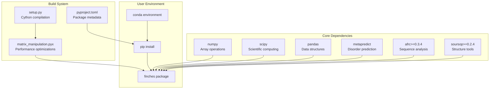
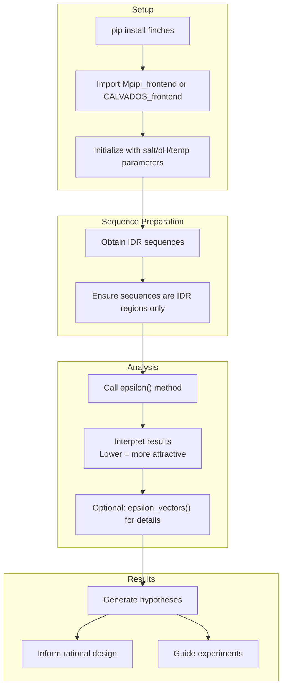

# Getting Started

<details>
<summary>Relevant source files</summary>

The following files were used as context for generating this wiki page:

- [MANIFEST.in](MANIFEST.in)
- [demo/overview_uses/basic_uses.ipynb](demo/overview_uses/basic_uses.ipynb)
- [docs/getting_started.rst](docs/getting_started.rst)
- [docs/idr_idr.rst](docs/idr_idr.rst)
- [docs/phase_diagrams.rst](docs/phase_diagrams.rst)
- [pyproject.toml](pyproject.toml)
- [setup.cfg](setup.cfg)
- [setup.py](setup.py)

</details>


This document provides installation instructions and basic usage patterns for FINCHES, guiding users through their first epsilon calculations and core concepts needed to predict chemical specificity in intrinsically disordered regions (IDRs). For detailed API documentation, see [API Reference](#5). For comprehensive examples and tutorials, see [Examples and Tutorials](#6).

## Installation

FINCHES can be installed directly from GitHub using pip. The package includes Cython extensions for performance optimization and handles all dependencies automatically.

```bash
# Create a new conda environment (recommended)
conda create -n finches python=3.11 -y
conda activate finches

# Install directly from GitHub
pip install git+https://git@github.com/idptools/finches.git
```

To verify the installation:

```bash
python -c "import finches; print(finches.__version__)"
```

**Note:** The first import takes 60-90 seconds to initialize the environment, but subsequent imports are fast.

### Installation Architecture



Sources: [pyproject.toml:1-76](), [setup.py:1-32]()

## Core Frontend Classes

FINCHES provides two main frontend classes that implement different forcefield models for predicting IDR interactions. Both classes provide identical APIs but use different underlying physics models.

```mermaid
graph TB
    subgraph "Frontend Layer"
        base["FinchesFrontend<br/>Base class interface"]
        mpipi["Mpipi_frontend<br/>Mpipi-GG forcefield"]
        calvados["CALVADOS_frontend<br/>CALVADOS2 forcefield"]
    end
    
    subgraph "Core Methods"
        epsilon["epsilon()<br/>Calculate interaction values"]
        vectors["epsilon_vectors()<br/>Per-residue interactions"]
        matrix["intermolecular_idr_matrix()<br/>2D interaction matrix"]
        figure["interaction_figure()<br/>Generate intermaps"]
    end
    
    subgraph "Backend Engine"
        constructor["InteractionMatrixConstructor<br/>Computation engine"]
        models["Forcefield Models<br/>Physics parameters"]
    end
    
    base --> mpipi
    base --> calvados
    
    mpipi --> epsilon
    mpipi --> vectors
    mpipi --> matrix
    mpipi --> figure
    
    calvados --> epsilon
    calvados --> vectors
    calvados --> matrix
    calvados --> figure
    
    epsilon --> constructor
    vectors --> constructor
    matrix --> constructor
    figure --> constructor
    
    constructor --> models
```

Sources: [demo/overview_uses/basic_uses.ipynb:64-68](), [demo/overview_uses/basic_uses.ipynb:94-107]()

## Basic Usage Pattern

### Initialize Frontend Objects

```python
from finches.frontend.mpipi_frontend import Mpipi_frontend
from finches.frontend.calvados_frontend import CALVADOS_frontend

# Initialize with default parameters (physiological conditions)
mf = Mpipi_frontend(salt=0.150, dielectric=80.0)  # Salt in M, dielectric constant
cf = CALVADOS_frontend(salt=0.150, pH=7.4, temp=288)  # Salt in M, pH, temperature in K
```

### First Epsilon Calculation

Epsilon values quantify the overall attractive or repulsive nature of IDR-IDR interactions. Lower values indicate stronger attraction.

```python
# Example IDR sequences
med1_idr = 'KSQASVSDPMNALQSLTGGPAAGAAGIGMPPRGPGQSLGGMGSLGAMGQPMSLSGQPPPGTSGMAPHSMAVVSTATPQTQLQLQQVALQQQQQQQQFQQQQQAALQQQQQQQQQQQFQAQQSAMQQQFQAVVQQQQQLQQQQQQQQHLIKLHHQNQQQIQQQQQQLQRIAQLQLQQQQQQQQQQQQQQQQALQAQPPIQQPPMQQPQPPPSQALPQQLQQMHHTQHHQPPPQPQQPPVAQNQPSQLPPQSQTQPLVSQAQALPGQMLYTQPPLKFVRAPMVVQQPPVQPQVQQQQTAVQTAQAAQMVAPGVQMITEALAQGGMHIRARFPPTTAVSAIPSSSIPLGRQPMAQVSQSSLPMLSSPSPGQQVQTPQSMPPPPQPSPQPGQPSSQPNSNVSSGPAPSPSSFLPSPSPQPSQSPVTARTPQNFSVPSPGPLNTPVNPSSVMSPAGSSQA'
med14_idr = 'QDARRRSVNEDDNPPSPIGGDMMDSLISQLQPPPQQQPFPKQPGTSGAYPLTSPPTSYHSTVNQSPSMMHTQSPGNLHAASSPSGALRAPSPASFVPTPPPSSHGISIGPGASFASPHGTLDPSSPYTMVSPSGRAGNWPGSPQVSGPSPAARMPGMSPANPSLHSPVPDASHSPRAGTSSQTMPTNMPPPRKLPQRSWAAS'

# Calculate epsilon value
epsilon_value = mf.epsilon(med1_idr, med14_idr)
print(f"Epsilon value: {epsilon_value}")
```

### Understanding Epsilon Properties

#### Order Dependency (Extrinsic Calculation)
Epsilon calculations are order-dependent because they represent "bathing" the first sequence in the second sequence:

```python
# Order matters
epsilon_1_to_2 = mf.epsilon(med1_idr, med14_idr)  # med1 bathed in med14
epsilon_2_to_1 = mf.epsilon(med14_idr, med1_idr)  # med14 bathed in med1

# These values will be different
print(f"med1 in med14: {epsilon_1_to_2}")
print(f"med14 in med1: {epsilon_2_to_1}")
```

#### Intrinsic vs Extrinsic Values
To obtain order-independent intrinsic values, divide by the length of the first sequence:

```python
intrinsic_1 = epsilon_1_to_2 / len(med1_idr)
intrinsic_2 = epsilon_2_to_1 / len(med14_idr)
# These values will be identical
```

### Baseline Calibration

Epsilon values are calibrated such that GS linker self-interactions return approximately zero:

```python
gs_linker = 20 * 'GS'  # 40-residue GS linker
baseline_value = mf.epsilon(gs_linker, gs_linker)
print(f"GS baseline: {baseline_value}")  # Should be ~0
```

Sources: [demo/overview_uses/basic_uses.ipynb:122-202](), [demo/overview_uses/basic_uses.ipynb:227-267]()

## Correction Terms

FINCHES includes correction terms to account for limitations in simple two-body interaction schemes:

### Aliphatic Correction
Accounts for the hydrophobic effect in aliphatic residue clusters:

```python
# With corrections (default)
with_correction = mf.epsilon(seq1, seq2)

# Without aliphatic correction
without_aliphatic = mf.epsilon(seq1, seq2, use_aliphatic_weighting=False)
```

### Charge Correction
Accounts for side chain orientation effects in charged residue clusters:

```python
# Without charge correction
without_charge = mf.epsilon(seq1, seq2, use_charge_weighting=False)

# Without both corrections
without_both = mf.epsilon(seq1, seq2, 
                         use_aliphatic_weighting=False, 
                         use_charge_weighting=False)
```

**Recommendation:** Keep both corrections enabled unless you have specific reasons to disable them.

Sources: [demo/overview_uses/basic_uses.ipynb:295-310]()

## Epsilon Vector Analysis

For residue-level interaction analysis, use `epsilon_vectors()`:

```python
# Returns tuple: (attractive_array, repulsive_array)
attractive, repulsive = mf.epsilon_vectors(seq1, seq2)

# Each array has length equal to first sequence
print(f"Attractive interactions shape: {attractive.shape}")
print(f"First 10 attractive values: {attractive[:10]}")
```

This provides per-residue interaction strengths for detailed analysis of interaction patterns.

Sources: [demo/overview_uses/basic_uses.ipynb:595-598]()

## Basic Workflow



Sources: [demo/overview_uses/basic_uses.ipynb:94-107](), [demo/overview_uses/basic_uses.ipynb:163-175]()

## Key Configuration Parameters

| Frontend Class | Parameters | Description |
|---------------|------------|-------------|
| `Mpipi_frontend` | `salt` (float) | Salt concentration in Molar |
| | `dielectric` (float) | Dielectric constant (default: 80.0) |
| `CALVADOS_frontend` | `salt` (float) | Salt concentration in Molar |
| | `pH` (float) | Solution pH (default: 7.4) |
| | `temp` (float) | Temperature in Kelvin (default: 288) |

Both classes support identical method calls but use different underlying physics models.

Sources: [demo/overview_uses/basic_uses.ipynb:101-106]()

## Next Steps

After completing basic epsilon calculations:

1. **Generate Interaction Maps**: Use `interaction_figure()` for 2D interaction visualization - see [Interaction Maps](#3.3)
2. **Analyze IDR-Folded Domain Interactions**: Use `FoldedDomain` class for PDB structure analysis - see [IDR-Folded Domain Analysis](#3.4)  
3. **Create Phase Diagrams**: Use Flory-Huggins theory implementation - see [Phase Diagrams](#3.5)
4. **Explore Advanced Features**: Review comprehensive examples in [Examples and Tutorials](#6)

For troubleshooting installation or basic usage issues, consult the [Development Guide](#7) testing framework documentation.

Sources: [docs/getting_started.rst:43-47](), [docs/idr_idr.rst:13-32]()

---