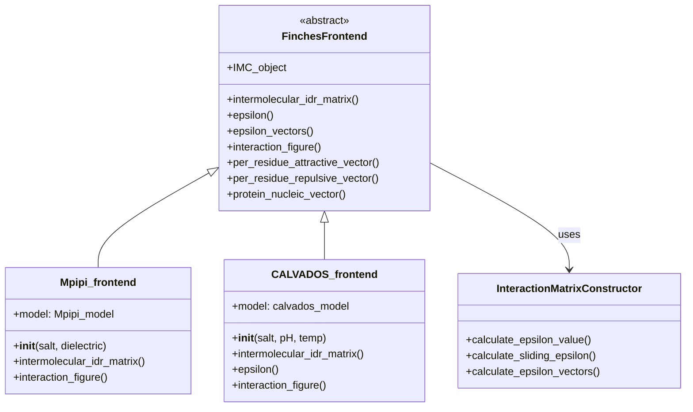
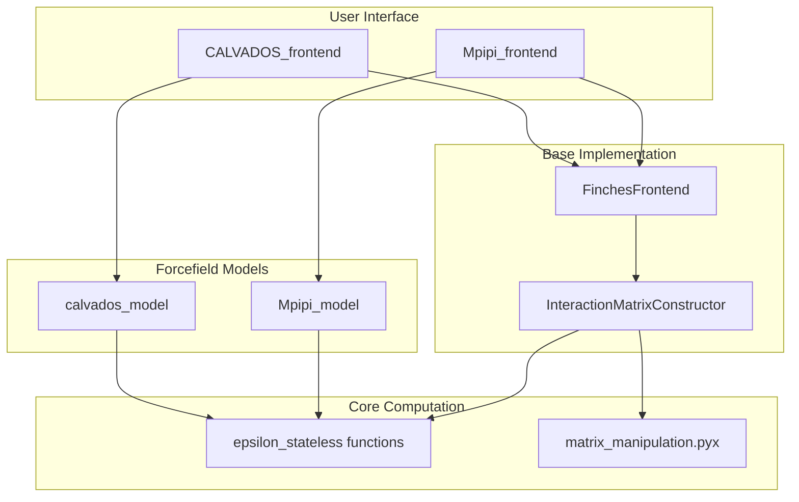
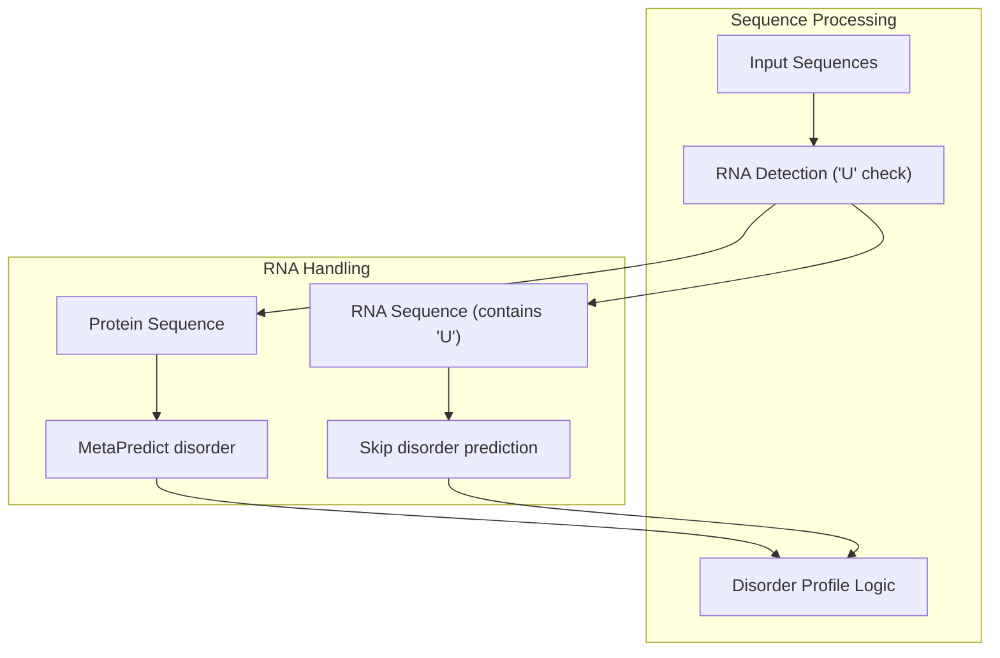
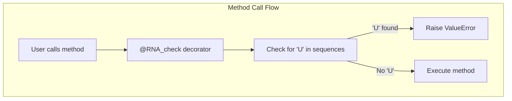
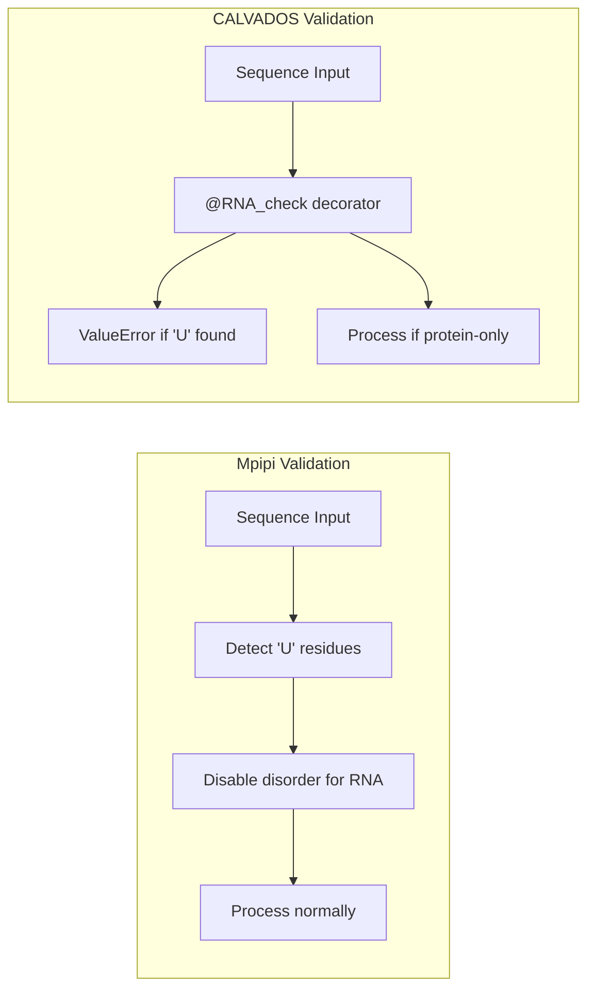

# Frontend Interfaces

<details>
<summary>Relevant source files</summary>

The following files were used as context for generating this wiki page:

- [docs/api.rst](docs/api.rst)
- [docs/conf.py](docs/conf.py)
- [finches/data/fingerprints.py](finches/data/fingerprints.py)
- [finches/epsilon_stateless.py](finches/epsilon_stateless.py)
- [finches/frontend/calvados_frontend.py](finches/frontend/calvados_frontend.py)
- [finches/frontend/frontend_base.py](finches/frontend/frontend_base.py)
- [finches/frontend/mpipi_frontend.py](finches/frontend/mpipi_frontend.py)

</details>


This document provides a detailed explanation of the frontend interface classes that serve as the primary user-facing API for FINCHES. The frontend interfaces abstract away the complexity of the underlying computational engine while providing a consistent, easy-to-use interface for calculating epsilon values, generating interaction matrices, and visualizing protein-protein interactions.

For information about the core computational algorithms, see [Core Concepts](#4). For complete API reference documentation, see [Frontend Classes](#5.1).

## Purpose and Architecture

The frontend interfaces implement a polymorphic design pattern where different forcefield models (Mpipi, CALVADOS) are accessed through a unified interface. This allows users to switch between different physics models without changing their analysis code.

### Frontend Class Hierarchy



Sources: [finches/frontend/frontend_base.py:20-41](), [finches/frontend/mpipi_frontend.py:12-21](), [finches/frontend/calvados_frontend.py:28-43]()

### Backend Integration Pattern



Sources: [finches/frontend/frontend_base.py:21](), [finches/frontend/mpipi_frontend.py:18-21](), [finches/frontend/calvados_frontend.py:40-43]()

## Base Class Functionality

The `FinchesFrontend` base class defines the core interface and implements most functionality that is shared between different forcefield models. Key design elements:

| Feature | Implementation | Purpose |
|---------|---------------|---------|
| Abstract base | Cannot be instantiated directly | Enforces consistent interface |
| Template methods | Implements complex workflows | Reduces code duplication |
| Polymorphic dispatch | Derived classes override specific methods | Handles model-specific requirements |

### Core Methods Available in All Frontends

#### epsilon()
Calculates the epsilon value between two sequences.

```python
epsilon_value = frontend.epsilon(seq1, seq2, 
                               use_aliphatic_weighting=True,
                               use_charge_weighting=True)
```

#### intermolecular_idr_matrix()
Generates sliding window interaction matrices with disorder profiles.

```python
matrix_data, disorder1, disorder2 = frontend.intermolecular_idr_matrix(
    seq1, seq2, window_size=31, null_shuffle=False)
```

#### interaction_figure()
Creates publication-ready interaction matrix visualizations.

```python
fig, im, ax_main, ax_top, ax_right, ax_colorbar = frontend.interaction_figure(
    seq1, seq2, vmin=-3, vmax=3, cmap='PRGn')
```

Sources: [finches/frontend/frontend_base.py:206-241](), [finches/frontend/frontend_base.py:46-199](), [finches/frontend/frontend_base.py:288-564]()

## Mpipi_frontend Implementation

The `Mpipi_frontend` class implements the Mpipi forcefield model with support for protein-RNA interactions.

### Initialization and Configuration

```python
from finches import Mpipi_frontend
frontend = Mpipi_frontend(salt=0.150, dielectric=80.0)
```

### RNA Support Features

The Mpipi frontend uniquely supports RNA sequences (containing 'U' residues):



Key implementation details:

- Automatically detects RNA sequences by presence of 'U' residues
- Disables disorder prediction for RNA sequences ([finches/frontend/mpipi_frontend.py:105-113]())
- Maintains compatibility with all protein analysis methods

### Model-Specific Parameters

| Parameter | Default | Range | Purpose |
|-----------|---------|-------|---------|
| `salt` | 0.150 M | 0-1.0 M | Ionic strength for electrostatic calculations |
| `dielectric` | 80.0 | 1-100 | Solvent dielectric constant |

Sources: [finches/frontend/mpipi_frontend.py:12-21](), [finches/frontend/mpipi_frontend.py:105-126]()

## CALVADOS_frontend Implementation

The `CALVADOS_frontend` class implements the CALVADOS2 forcefield with strict protein-only support.

### Initialization and Configuration

```python
from finches import CALVADOS_frontend
frontend = CALVADOS_frontend(salt=0.150, pH=7.4, temp=288)
```

### RNA Restriction Mechanism

CALVADOS enforces protein-only analysis through a decorator pattern:



The `@RNA_check` decorator ([finches/frontend/calvados_frontend.py:16-25]()) automatically validates input sequences and raises `ValueError` if RNA residues are detected.

### Model-Specific Parameters

| Parameter | Default | Range | Purpose |
|-----------|---------|-------|---------|
| `salt` | 0.150 M | 0-1.0 M | Ionic strength |
| `pH` | 7.4 | 1-14 | Solution pH for ionization states |
| `temp` | 288 K | 273-373 K | Temperature for thermodynamic calculations |

### Visualization Defaults

CALVADOS uses different default visualization parameters optimized for its interaction strength scale:

```python
# CALVADOS default ranges
vmin = -7.5  # More sensitive to attractive interactions
vmax = 7.5   # Wider dynamic range
```

Sources: [finches/frontend/calvados_frontend.py:28-43](), [finches/frontend/calvados_frontend.py:51-61](), [finches/frontend/calvados_frontend.py:204-205]()

## Method Comparison

### Core Analysis Methods

| Method | Mpipi_frontend | CALVADOS_frontend | Key Differences |
|--------|---------------|-------------------|-----------------|
| `epsilon()` | Inherited from base | Decorated with `@RNA_check` | RNA validation |
| `intermolecular_idr_matrix()` | Custom RNA handling | Decorated with `@RNA_check` | Disorder prediction logic |
| `interaction_figure()` | Custom RNA detection | Decorated validation | Default vmin/vmax ranges |
| `protein_nucleic_vector()` | Inherited from base | Raises Exception | RNA support vs restriction |

### Parameter Validation



Sources: [finches/frontend/mpipi_frontend.py:105-126](), [finches/frontend/calvados_frontend.py:16-25]()

## Usage Patterns

### Basic Epsilon Calculation

```python
# Both frontends support identical epsilon calculation
mpipi = Mpipi_frontend()
calvados = CALVADOS_frontend()

seq1 = "MADEEKSQNGKRKR"
seq2 = "GESGKSKRFGRGE"

mpipi_eps = mpipi.epsilon(seq1, seq2)
calvados_eps = calvados.epsilon(seq1, seq2)
```

### Protein-RNA Analysis (Mpipi only)

```python
# Only Mpipi supports RNA sequences
mpipi = Mpipi_frontend()
protein_seq = "GQGKSGKDSHHPARTAHSNKKGQKSGG"
rna_seq = "UUUUUUUUUUUUUUUUUUUUUUUUUUUU"

# This works with Mpipi
matrix_data = mpipi.intermolecular_idr_matrix(protein_seq, rna_seq)

# This would raise ValueError with CALVADOS
# calvados.intermolecular_idr_matrix(protein_seq, rna_seq)  # Error!
```

### Model-Specific Initialization

```python
# Mpipi with custom electrostatic parameters
mpipi = Mpipi_frontend(salt=0.100, dielectric=78.0)

# CALVADOS with physiological conditions
calvados = CALVADOS_frontend(salt=0.150, pH=7.0, temp=298)
```

Sources: [finches/frontend/frontend_base.py:206-241](), [finches/frontend/mpipi_frontend.py:27-126](), [finches/frontend/calvados_frontend.py:51-139]()

---