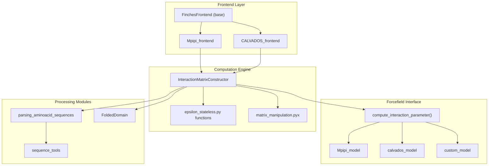
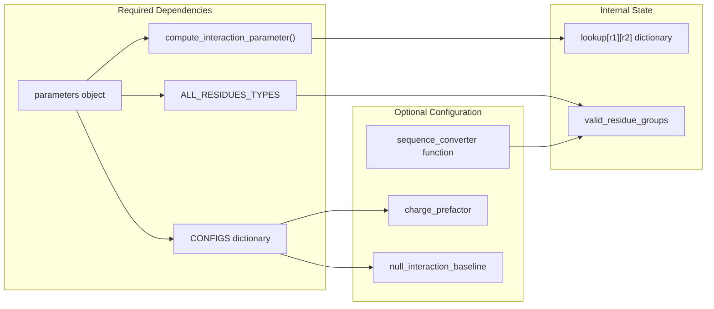
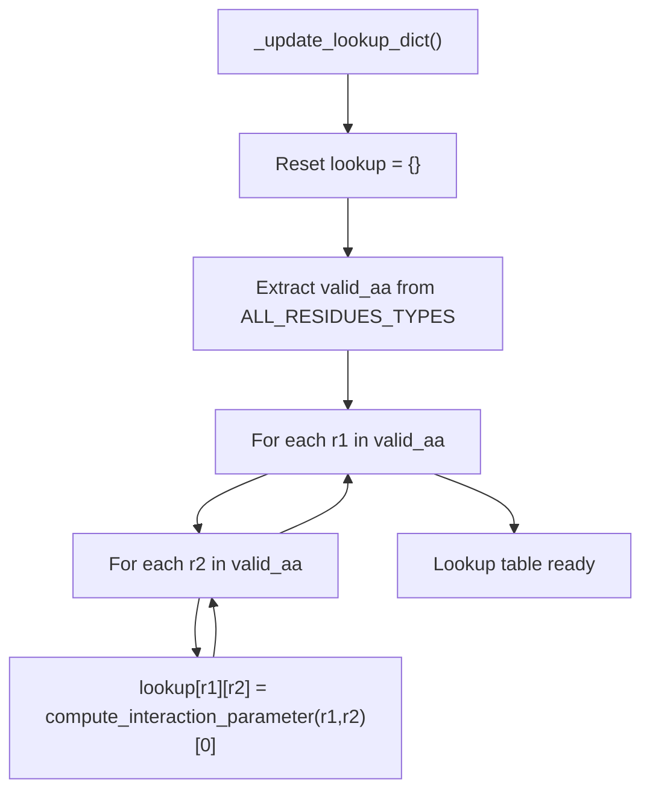
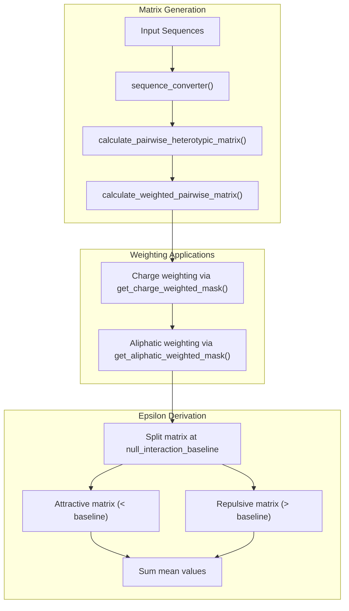
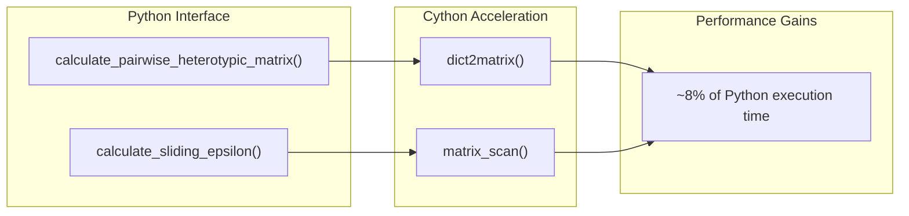

# Core Concepts

Relevant source files

The following files were used as context for generating this wiki page:

- [docs/extended_methods.rst](docs/extended_methods.rst)
- [finches/data/forcefield_dependencies.py](finches/data/forcefield_dependencies.py)
- [finches/epsilon_calculation.py](finches/epsilon_calculation.py)

This document provides a deep dive into the fundamental concepts and algorithms underlying FINCHES calculations. It covers the core computational architecture, the central role of the `InteractionMatrixConstructor`, the forcefield interface pattern, matrix-based calculations, and sequence weighting mechanisms. 

For detailed information about specific forcefield implementations, see [Forcefield Models](#4.1). For sequence processing specifics, see [Sequence Processing](#4.2). For matrix optimization details, see [Matrix Calculations](#4.3).

## Computational Architecture Overview

FINCHES employs a layered architecture where user-facing frontend classes delegate to a central computational engine, which in turn utilizes pluggable forcefield models and optimized matrix operations.

### Core Architecture Mapping

**Sources:** [finches/epsilon_calculation.py:18-132](), [docs/extended_methods.rst:7-10]()

## InteractionMatrixConstructor - The Central Engine

The `InteractionMatrixConstructor` class serves as the primary computational hub, implementing a standardized interface for calculating inter-residue interactions regardless of the underlying forcefield model.

### Core Responsibilities

The `InteractionMatrixConstructor` implements several key computational workflows:

| Method | Purpose | Returns |
|--------|---------|---------|
| `calculate_pairwise_heterotypic_matrix()` | Raw residue-residue interaction matrix | numpy array (len(seq1) × len(seq2)) |
| `calculate_weighted_pairwise_matrix()` | Matrix with charge/aliphatic weighting | numpy array with applied corrections |
| `calculate_epsilon_value()` | Single scalar interaction strength | float (attractive < 0, repulsive > 0) |
| `calculate_sliding_epsilon()` | Local interaction map via sliding windows | tuple (matrix, seq1_indices, seq2_indices) |

**Sources:** [finches/epsilon_calculation.py:396-873]()

### Initialization and Dependencies

The constructor requires a forcefield parameters object and accepts several configuration options:

**Sources:** [finches/epsilon_calculation.py:20-191](), [finches/epsilon_calculation.py:195-297]()

## Forcefield Interface Pattern

FINCHES uses an interface design pattern to decouple biophysical models from computational algorithms. This allows the same analysis code to work with different underlying force fields.

### Required Interface Methods

Every forcefield object must implement:

- `ALL_RESIDUES_TYPES`: List of valid residue groups (proteins, DNA, RNA)
- `compute_interaction_parameter(r1, r2)`: Returns interaction strength between residues
- `CONFIGS`: Dictionary containing `charge_prefactor` and `null_interaction_baseline`

**Sources:** [finches/epsilon_calculation.py:75-90]()

### Lookup Table Construction

The `_update_lookup_dict()` method precomputes all pairwise interactions for performance:

**Sources:** [finches/epsilon_calculation.py:195-252]()

## Matrix-Based Epsilon Calculations

FINCHES calculates epsilon values through a multi-step matrix-based approach, separating raw interaction calculation from weighting and aggregation.

### Epsilon Calculation Pipeline

**Sources:** [finches/epsilon_calculation.py:494-603](), [docs/extended_methods.rst:13-16]()

### Sliding Window Analysis

For interaction maps, FINCHES extracts subsquares from the full matrix and calculates local epsilon values:

- Window size must be odd (automatically corrected if even)
- Each subsquare treated as local `M^{raw-local}` matrix  
- Uniform sampling with step size of 1
- Output indices account for window centering

**Sources:** [finches/epsilon_calculation.py:705-873](), [docs/extended_methods.rst:18-23]()

## Sequence Weighting Mechanisms

FINCHES applies two types of sequence-context weighting to capture local environmental effects.

### Charge Weighting Implementation

The charge correction downweighs repulsion between like-charged residues:

1. **Fragment Analysis**: For charged residue pairs, extract i±1 neighbors (4-6 residues total)
2. **Metrics Calculation**: Compute FCR (fraction charged) and NCPR (net charge per residue)  
3. **Weighting Factor**: `|NCPR/FCR|` where same charges = 1, opposite charges = 0
4. **Scaling**: Apply forcefield-specific `charge_prefactor` (0-1 range)

The implementation reduces repulsive interactions: `w_matrix = matrix - (matrix * repulsive_mask * charge_prefactor)`

**Sources:** [finches/epsilon_calculation.py:546-577](), [docs/extended_methods.rst:30-38]()

### Aliphatic Weighting

Applied after charge weighting via `get_aliphatic_weighted_mask()` to enhance hydrophobic clustering effects.

**Sources:** [finches/epsilon_calculation.py:597-599]()

## Performance Architecture

FINCHES employs strategic optimizations for computationally intensive operations.

### Cython Integration

The `use_cython=True` flag (default) enables optimized implementations in `matrix_manipulation.pyx` for matrix construction and sliding window analysis.

**Sources:** [finches/epsilon_calculation.py:440-444](), [finches/epsilon_calculation.py:476-477](), [finches/epsilon_calculation.py:831-833]()

### Lookup Table Caching

All pairwise interactions are precomputed once during initialization and stored in `self.lookup[r1][r2]` for O(1) access during matrix construction.

**Sources:** [finches/epsilon_calculation.py:149](), [finches/epsilon_calculation.py:219-237]()

---