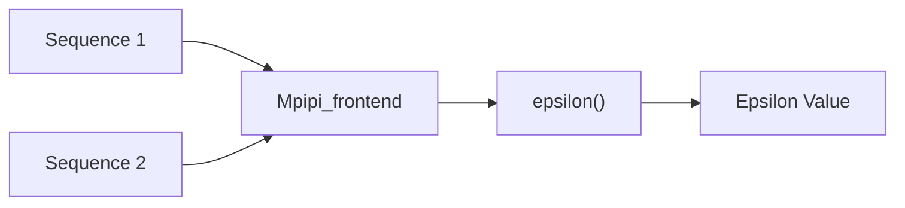
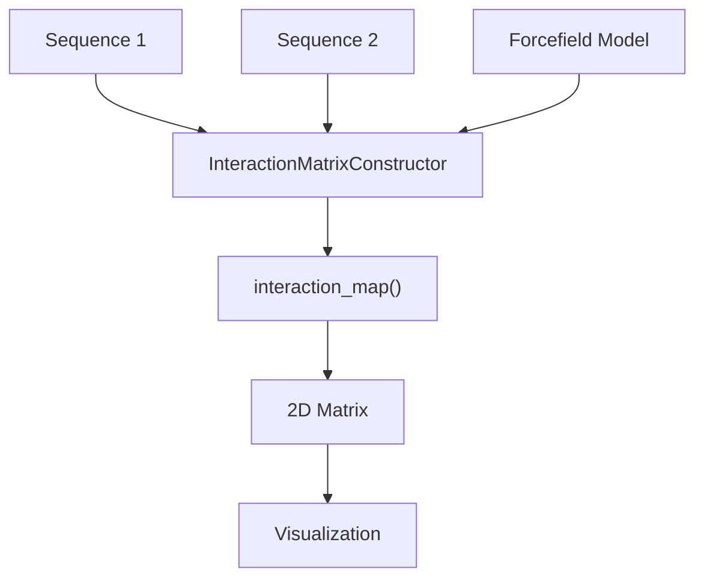
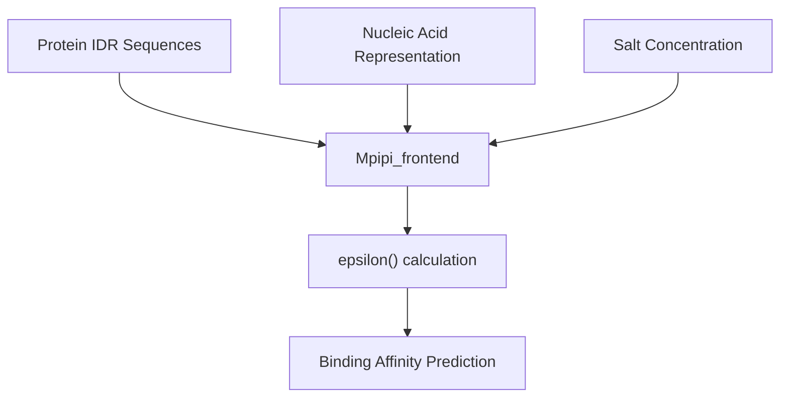
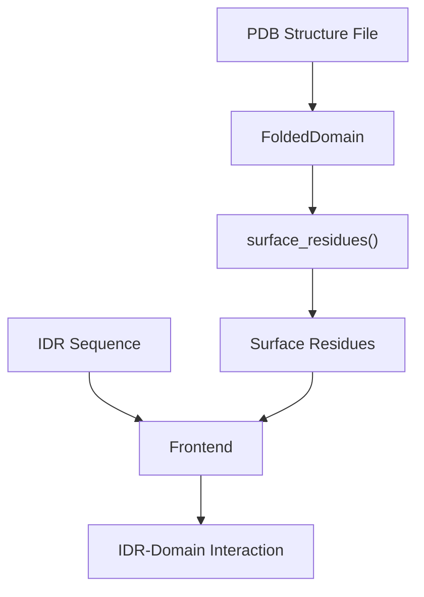
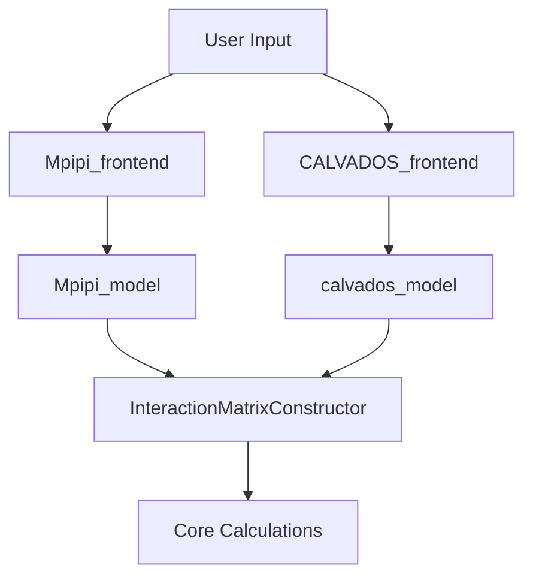
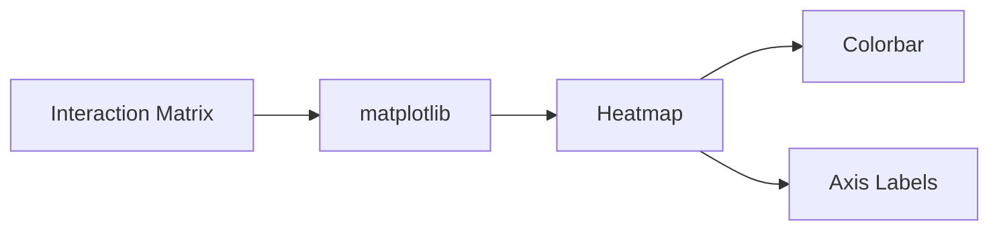
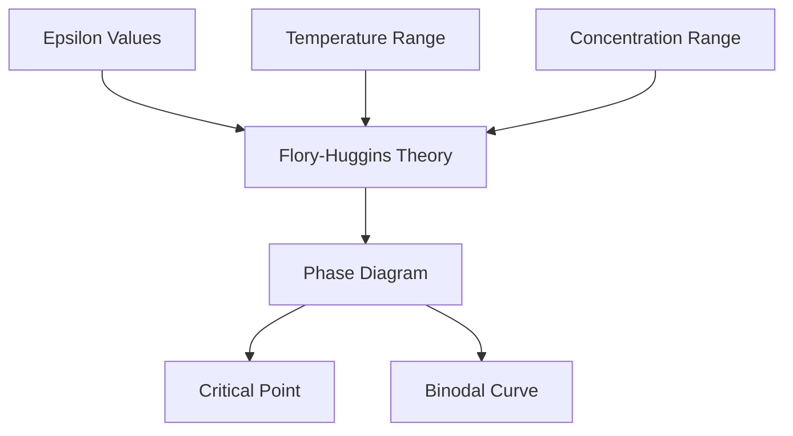
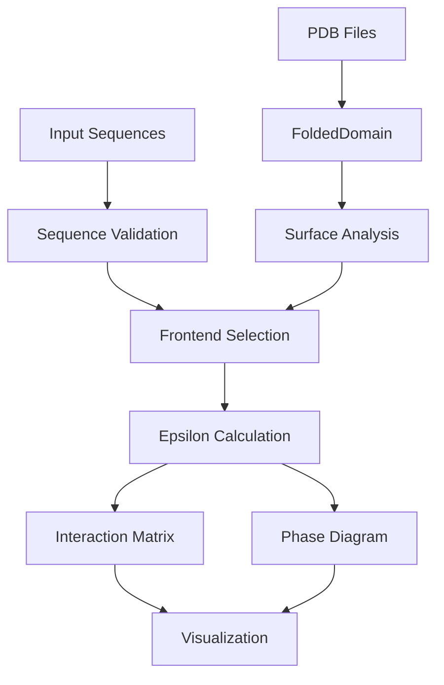

# Examples and Tutorials

<details>
<summary>Relevant source files</summary>

The following files were used as context for generating this wiki page:

- [demo/docs_demo/ADBD1.pdb](demo/docs_demo/ADBD1.pdb)
- [demo/docs_demo/epsilon_docs.ipynb](demo/docs_demo/epsilon_docs.ipynb)
- [demo/nucleic_acid/protein_nucleic_acid_binding.ipynb](demo/nucleic_acid/protein_nucleic_acid_binding.ipynb)
- [demo/phase_diagrams/phase_diagram_demo.ipynb](demo/phase_diagrams/phase_diagram_demo.ipynb)
- [demo/protein_matrix/interaction_matrix_demo.ipynb](demo/protein_matrix/interaction_matrix_demo.ipynb)

</details>


This page provides comprehensive examples and tutorials demonstrating how to use FINCHES for analyzing intrinsically disordered regions (IDRs) and their interactions. The examples progress from basic epsilon calculations to advanced analysis including interaction matrices, protein-nucleic acid binding, and IDR-folded domain interactions.

For detailed API documentation, see [API Reference](#5). For understanding the underlying concepts and algorithms, see [Core Concepts](#4).

## Basic Usage Examples

### Simple Epsilon Calculation

The most fundamental operation in FINCHES is calculating epsilon values between two protein sequences. This example shows the minimal setup required:



#### Using Mpipi Forcefield

[demo/docs_demo/epsilon_docs.ipynb:26-42]() demonstrates the basic workflow:

```python
from finches import Mpipi_frontend, CALVADOS_frontend

# Initialize frontend objects
mf = Mpipi_frontend()
cf = CALVADOS_frontend()

# Example sequences
s1 = 'MESNQSNNGGSGNAALNRGGRYVPPHLRGGDGGAAAAASAGGDDRRGGAGGGGYRRGGGNSGGGGGGGYDRGYNDNRDDRDNRGGSGGYGRDRNYEDRGYNGGGGGGGNRGYNNNRGGGGGGYNRQDRGDGGSSNFSRGGYNNRDEGSDNRGSGRSYNNDRRDNGGD'
s2 = 'LEGMSGDMRSGGGYRGRGGRGNGQRFGGRDHRYQGGSGNGGGGNGGGGGFGGGGQRSGGGGGFQSGGGGGRQQQQQQRAQPQQDWWS'

# Calculate epsilon using both forcefields
eps_mpipi = mf.epsilon(s1, s2)
eps_calvados = cf.epsilon(s1, s2)
```

The epsilon value represents the interaction strength between two IDR sequences, with negative values indicating attractive interactions.

Sources: [demo/docs_demo/epsilon_docs.ipynb:26-46]()

### Interaction Matrix Generation

For detailed spatial analysis of IDR interactions, FINCHES can generate 2D interaction matrices showing per-residue interaction patterns:



[demo/docs_demo/epsilon_docs.ipynb:47-71]() shows matrix generation:

```python
# Generate interaction matrix
fig, im, ax1, ax2, ax3, ax4 = mf.interaction_map(s1, s2)
```

The `interaction_map()` method returns matplotlib figure objects for immediate visualization of the interaction landscape.

Sources: [demo/docs_demo/epsilon_docs.ipynb:47-71]()

## Advanced Analysis Examples

### Homotypic IDR Interactions

[demo/protein_matrix/interaction_matrix_demo.ipynb:105-120]() demonstrates analysis of self-interactions:


This example uses the med1 IDR sequence to analyze homotypic interactions, which are crucial for understanding phase separation behavior.

Sources: [demo/protein_matrix/interaction_matrix_demo.ipynb:81-120]()

### Protein-Nucleic Acid Binding Analysis

FINCHES can analyze interactions between protein IDRs and nucleic acids. [demo/nucleic_acid/protein_nucleic_acid_binding.ipynb:36-61]() shows the setup:



The example initializes the frontend with specific salt concentrations relevant for nucleic acid interactions:

```python
ms = Mpipi_frontend(salt=0.150)  # 150 mM salt
```

Sources: [demo/nucleic_acid/protein_nucleic_acid_binding.ipynb:58-61]()

### IDR-Folded Domain Analysis

For analyzing interactions between IDRs and structured protein domains, FINCHES provides the `FoldedDomain` class:



The workflow involves:
1. Loading a PDB structure using `FoldedDomain`
2. Extracting surface-accessible residues
3. Calculating interactions between the IDR and surface residues

Sources: [demo/docs_demo/ADBD1.pdb:1-10]()

## Frontend Interface Comparison

FINCHES provides multiple forcefield implementations accessible through unified frontend interfaces:



### Mpipi vs CALVADOS Comparison

Both frontends provide identical APIs but use different underlying physics models:

| Method | Mpipi_frontend | CALVADOS_frontend |
|--------|----------------|-------------------|
| `epsilon()` | Wang-Frenkel + Coulombic | Ashbaugh-Hatch + Yukawa |
| `interaction_map()` | Per-residue Mpipi parameters | CALVADOS residue properties |
| `phase_diagram()` | Flory-Huggins with Mpipi | Flory-Huggins with CALVADOS |

[demo/docs_demo/epsilon_docs.ipynb:31-32]() shows initialization of both frontends, while [demo/docs_demo/epsilon_docs.ipynb:41-45]() demonstrates their use with identical sequences producing different results due to different underlying physics.

Sources: [demo/docs_demo/epsilon_docs.ipynb:31-45]()

## Visualization Examples

### Interaction Matrix Heatmaps

The standard output from `interaction_map()` provides publication-ready visualizations:



[demo/protein_matrix/interaction_matrix_demo.ipynb:107-120]() generates comprehensive interaction visualizations for the med1 IDR sequence.

### Phase Diagram Generation

For understanding phase separation behavior:



The `phase_diagram()` method generates phase boundary predictions based on calculated epsilon values.

Sources: [demo/protein_matrix/interaction_matrix_demo.ipynb:107-120]()

## Complete Workflow Example

A typical FINCHES analysis workflow combines multiple components:



This workflow demonstrates the integration between sequence analysis, structural data, and thermodynamic modeling that makes FINCHES a comprehensive tool for IDR analysis.

Sources: [demo/docs_demo/epsilon_docs.ipynb:26-71](), [demo/protein_matrix/interaction_matrix_demo.ipynb:54-120](), [demo/nucleic_acid/protein_nucleic_acid_binding.ipynb:58-61]()

---