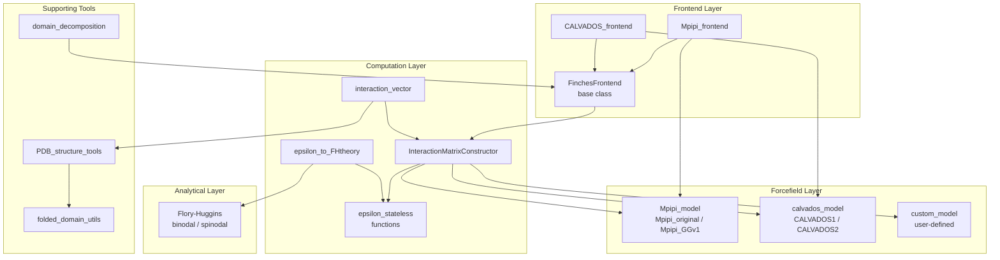

**FINCHES** (**F**irst-principle **I**nteractions via **CHE**mical **S**pecificity) is a Python package for predicting intermolecular interactions driven by intrinsically disordered regions (IDRs). Rather than relying on top-down empirical fitting, FINCHES starts from the bottom up: it uses physics-based coarse-grained forcefields to compute per-residue and per-fragment interaction energies directly from amino acid sequences, then aggregates those energies into quantitative predictions about binding specificity and phase behavior. The package was published in *Science* (2025) and is available as a standalone Python library, a set of Google Colab notebooks, and a webserver at [finches-online.com](https://www.finches-online.com/).

Sources: [README.md](/README.md#L1-L30), [docs/index.rst](/docs/index.rst#L1-L48)

## What FINCHES Predicts

FINCHES answers four central questions about disordered region interactions. **First**, it generates **interaction maps** (intermaps) — 2D heatmaps where each pixel represents the predicted interaction strength between a sliding-window fragment of one sequence and a fragment of another, revealing which regions drive heterotypic or homotypic association. **Second**, it computes **per-residue interaction vectors** that decompose the overall interaction into attractive and repulsive contributions at each position, making it possible to pinpoint "sticky" residues. **Third**, it calculates a single **mean-field epsilon (ε) value** that quantifies the net interaction strength between two sequences — this scalar is the key input for higher-level thermodynamic reasoning. **Fourth**, it bridges that epsilon into **Flory-Huggins phase diagrams**, predicting whether a sequence will undergo liquid-liquid phase separation and how the phase boundary shifts with conditions like salt or pH. All four analyses share the same underlying forcefield engine, so results are internally consistent across scales.

Sources: [docs/index.rst](/docs/index.rst#L14-L40), [finches/frontend/frontend_base.py](/finches/frontend/frontend_base.py#L1-L50)

## Architecture at a Glance

The codebase is organized around a clean separation between **physics models** (forcefields), **computation engines** (epsilon and matrix constructors), and **user-facing interfaces** (frontends). This three-layer architecture means you can swap forcefields without changing analysis code, or access the same computation at different levels of abstraction depending on your needs.



**Frontend Layer** — The `Mpipi_frontend` and `CALVADOS_frontend` classes inherit from a shared `FinchesFrontend` base. They bundle a forcefield model with an `InteractionMatrixConstructor`, exposing high-level methods like `epsilon()`, `interaction_figure()`, and `intermolecular_idr_matrix()` through a single object. Most users should start here.

**Computation Layer** — The `InteractionMatrixConstructor` is the engine that converts a forcefield into actionable calculations. It builds a pairwise lookup table from the model's `compute_interaction_parameter()` function, then provides methods for whole-sequence epsilon, sliding-window matrices, and weighted pairwise interactions. Stateless helper functions in `epsilon_stateless` handle matrix decomposition (attractive vs. repulsive) and vector construction without maintaining state.

**Forcefield Layer** — Each forcefield class encapsulates the physics: `Mpipi_model` loads the Mpipi-GG parameters (σ, ε, ν, μ, charge dictionaries) and computes the modified-Mpipi interaction potential; `calvados_model` builds Ashbaugh-Hatch + Yukawa potentials from CALVADOS2 stickiness parameters; `custom_model` lets you define arbitrary pairwise dictionaries with optional condition-dependent tuning. All three expose the same interface (`ALL_RESIDUES_TYPES`, `compute_interaction_parameter()`, `CONFIGS`), so the `InteractionMatrixConstructor` treats them uniformly.

Sources: [finches/__init__.py](/finches/__init__.py#L1-L24), [finches/frontend/frontend_base.py](/finches/frontend/frontend_base.py#L14-L50), [finches/epsilon_calculation.py](/finches/epsilon_calculation.py#L17-L100), [finches/forcefields/mpipi.py](/finches/forcefields/mpipi.py#L1-L40), [finches/forcefields/calvados.py](/finches/forcefields/calvados.py#L1-L50)

## Project Structure

```
finches/
├── __init__.py                    # Package entry: exports Mpipi_frontend, CALVADOS_frontend
├── frontend/
│   ├── frontend_base.py           # FinchesFrontend base class (shared logic)
│   ├── mpipi_frontend.py          # Mpipi_frontend (protein + RNA support)
│   ├── calvados_frontend.py       # CALVADOS_frontend (protein only, RNA guard)
│   └── interlogo.py               # Interaction logo generation
├── epsilon_calculation.py         # InteractionMatrixConstructor (core engine)
├── epsilon_stateless.py           # Pure functions: matrix ops, epsilon vectors
├── epsilon_to_FHtheory.py         # Bridge from epsilon → Flory-Huggins phase diagrams
├── interaction_vector.py          # Per-residue interaction vector plots
├── forcefields/
│   ├── mpipi.py                   # Mpipi_model (Mpipi_original, Mpipi_GGv1)
│   ├── calvados.py                # calvados_model (CALVADOS1, CALVADOS2)
│   ├── custom_model.py            # custom_model (user-defined pairwise)
│   └── calibration/               # Forcefield calibration scripts
├── analytical_fh/
│   ├── floryhuggins.py            # Binodal/spinodal wrapper
│   └── backend.py                 # Analytical FH solver (Qian et al. 2022)
├── PDB_structure_tools.py         # PDB → surface-accessible residue extraction
├── domain_decomposition/          # Identify interacting regions from intermaps
├── data/                          # Precomputed forcefield parameters (pickle)
├── utils/
│   ├── folded_domain_utils.py     # FoldedDomain class (SASA, surface masking)
│   └── matrix_manipulation.pyx    # Cython-accelerated matrix computation
└── tests/                         # pytest suite
```

Sources: [finches/__init__.py](/finches/__init__.py#L1-L24), [finches/epsilon_calculation.py](/finches/epsilon_calculation.py#L17-L50), [finches/forcefields/custom_model.py](/finches/forcefields/custom_model.py#L1-L30)

## Forcefield Comparison

FINCHES ships with two validated forcefields. Choosing between them determines the underlying physics, the supported residue types, and the condition-dependent parameters available.

| Feature | **Mpipi-GG** (`Mpipi_frontend`) | **CALVADOS2** (`CALVADOS_frontend`) |
|---|---|---|
| **Underlying potential** | Modified Mpipi (σ, ε, ν, μ + charge) | Ashbaugh-Hatch LJ + Yukawa DH |
| **Source publication** | Joseph et al. 2021; Lotthammer et al. 2024 | Tesei et al. 2021 |
| **Protein support** | 20 standard amino acids | 20 standard amino acids |
| **RNA support** | Yes (residue `U`) | No (raises `ValueError` on `U`) |
| **Tunable conditions** | `salt`, `dielectric` | `salt`, `pH`, `temp` |
| **Default charge_prefactor** | 0.20 | 0.70 |
| **Default null_interaction_baseline** | −0.128533 | −0.45 |
| **Recommended for** | Protein–protein and protein–RNA IDRs | Protein-only IDRs with pH/temperature studies |

> [!TIP]
> The `null_interaction_baseline` is the threshold that separates attractive from repulsive pairwise interactions. It is calibrated per-forcefield to reproduce the behavior of a poly(GS) reference sequence (expected to act as a non-interacting Gaussian chain). This means you **cannot** compare raw epsilon values across forcefields — only the ranking of sequences within a single forcefield is meaningful.

Sources: [finches/forcefields/mpipi.py](/finches/forcefields/mpipi.py#L17-L35), [finches/forcefields/calvados.py](/finches/forcefields/calvados.py#L26-L50), [finches/frontend/calvados_frontend.py](/finches/frontend/calvados_frontend.py#L18-L28)

## Quick Usage Example

The simplest way to use FINCHES is through the frontend objects. After installation, import a frontend, instantiate it, and pass amino acid sequences as strings:

```python
from finches import Mpipi_frontend, CALVADOS_frontend

# Instantiate frontends with default conditions
mf = Mpipi_frontend()          # salt=0.150, dielectric=80.0
cf = CALVADOS_frontend()       # salt=0.150, pH=7.4, temp=288

# Define a sequence (DDX4 N-terminal domain)
ddx4_ntd = 'MGDEDWEAEINPHMSSYVPIFEKDRYSGENGDNFNRTPASSSEMDDGPSRRDHFMKSGFASGRNFGNRDAGECNKRDNTSTMGGFGVGKSFGNRGFSNSRFEDGDSSGFWRESSNDCEDNPTRNRGFSKRGGYRDGNNSEASGPYRRGGRGSFRGCRGGFGLGSPNNDLDPDECMQRTGGLFGSRRPVLSGTGNGDTSQSRSGSGSERGGYKGLNEEVITGSGKNSWKSEAEGGES'

# Compute homotypic epsilon (scalar interaction strength)
print(mf.epsilon(ddx4_ntd, ddx4_ntd))

# Generate an interaction map figure
mf.interaction_figure(ddx4_ntd, ddx4_ntd)

# Compute the sliding-window interaction matrix
matrix, disorder1, disorder2 = mf.intermolecular_idr_matrix(ddx4_ntd, ddx4_ntd)
```

The `epsilon()` method returns a single float summarizing the net interaction; `interaction_figure()` produces a matplotlib heatmap with parallel disorder tracks; `intermolecular_idr_matrix()` returns the raw matrix and per-sequence disorder profiles for custom analysis.

Sources: [README.md](/README.md#L40-L75), [finches/__init__.py](/finches/__init__.py#L20-L24), [finches/frontend/mpipi_frontend.py](/finches/frontend/mpipi_frontend.py#L11-L30)

## Three Interfaces, One Goal

FINCHES is accessible through three complementary interfaces, each suited to a different workflow:

| Interface | Best for | Location |
|---|---|---|
| **Python package** | Programmatic analysis, batch computation, integration into pipelines | `pip install git+https://git@github.com/idptools/finches.git` |
| **Google Colab** | Zero-install exploration, teaching, one-off analyses | [finches-colab](https://github.com/idptools/finches-colab) |
| **Webserver** | Quick lookups without any setup, sharing results with non-coders | [finches-online.com](https://www.finches-online.com/) |

The Python package offers full control over every parameter (window size, weighting schemes, null shuffles, custom forcefields). The Colab notebooks provide guided walkthroughs. The webserver exposes the most common operations through a browser UI.

Sources: [README.md](/README.md#L8-L15)

## Key Concepts to Understand

Before diving into the detailed documentation, four conceptual pillars underpin every FINCHES computation:

**Epsilon (ε)** is the mean-field interaction parameter. It is computed by building a pairwise interaction matrix between two sequences, separating attractive from repulsive contributions using the `null_interaction_baseline`, applying optional charge and aliphatic weighting schemes, and averaging. A more negative ε indicates stronger net attraction. This is the fundamental quantity from which all other predictions derive.

**Interaction maps** are computed via a sliding-window approach: each sequence is decomposed into overlapping fragments of a configurable window size (default 31 residues), and the epsilon is computed for every pair of fragments. The resulting 2D matrix reveals spatially resolved interaction patterns — for example, a specific charged patch on one IDR driving association with an aromatic patch on another.

**Weighting schemes** refine the raw pairwise matrix. *Charge weighting* reduces the repulsive contribution of like-charge pairs, reflecting the fact that charged sidechains can reorient away from each other in a disordered chain. *Aliphatic weighting* boosts the contribution of aliphatic residues that are surrounded by other aliphatic residues, capturing the cooperative effect of hydrophobic patches. Both are enabled by default and are controlled by the `charge_prefactor` parameter specific to each forcefield.

**Phase diagrams** connect epsilon to macroscopic behavior via Flory-Huggins theory. The epsilon value maps to the Flory-Huggins χ parameter, and the analytical binodal/spinodal curves from Qian et al. (2022) predict the coexistence concentrations. This bridge enables sequence-level mutations to be directly linked to shifts in phase boundaries.

> [!TIP]
> FINCHES predictions are most reliable for **comparative** analyses — e.g., "does mutation X increase or decrease phase separation propensity relative to the wildtype?" — rather than absolute quantitative predictions of critical concentrations. The mean-field framework necessarily simplifies chain connectivity, solvation, and many-body effects. The documentation's caveats sections discuss these limitations in detail.

Sources: [finches/epsilon_stateless.py](/finches/epsilon_stateless.py#L85-L160), [finches/epsilon_calculation.py](/finches/epsilon_calculation.py#L17-L100), [finches/analytical_fh/floryhuggins.py](/finches/analytical_fh/floryhuggins.py#L1-L60), [finches/epsilon_to_FHtheory.py](/finches/epsilon_to_FHtheory.py#L1-L30)

## Where to Go Next

The documentation is organized to take you from installation through deep technical detail. For beginners, we recommend this reading order:

1. **[Quick Start](2-quick-start)** — Get FINCHES running and compute your first epsilon and interaction map
2. **[Installation Guide](3-installation-guide)** — Detailed setup for conda, pip, and development installs
3. **[Architecture Overview](4-architecture-overview)** — How the frontend → computation → forcefield layers connect
4. **[Mpipi and CALVADOS Frontends](5-mpipi-and-calvados-frontends)** — Complete API reference for the two main user-facing classes
5. **[Interaction Maps and Figures](6-interaction-maps-and-figures)** — Generating and interpreting 2D interaction heatmaps
6. **[Epsilon Calculation and Weighting](9-epsilon-calculation-and-weighting)** — Understanding how epsilon is computed and how weighting schemes affect results

If you have a specific use case in mind, you can jump directly to the relevant deep-dive page — the catalog structure is designed so each page is self-contained while cross-referencing prerequisites.