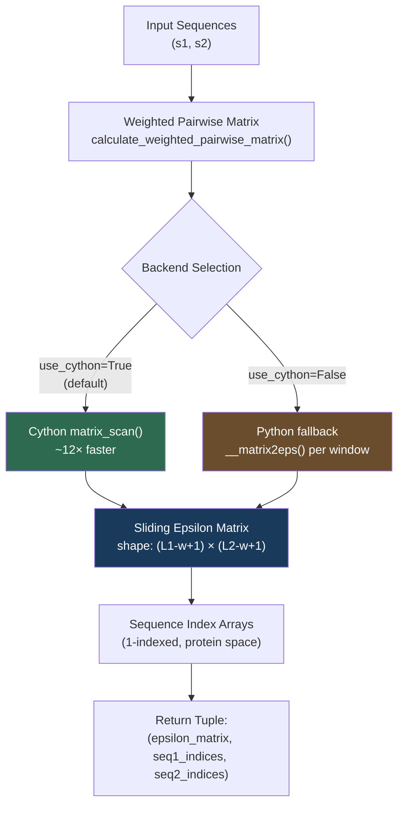

The sliding window matrix computation transforms a raw pairwise interaction matrix into a **spatially smoothed epsilon landscape**, revealing how local interaction strength varies across the contact surface between two sequences. Rather than collapsing an entire sequence pair into a single scalar epsilon, the sliding window approach systematically extracts every possible contiguous sub-region of fixed size, computes epsilon for each, and assembles the results into a 2D map. This is the core analytical primitive behind finches' interaction heatmaps and regional interaction profiling.

## Algorithmic Foundation

The sliding window computation operates on a **pre-weighted pairwise interaction matrix** — a 2D array of shape `(len(s1), len(s2))` where each cell holds the interaction parameter between residue `s1[i]` and `s2[j]`, already adjusted for charge and aliphatic weighting. A square window of size `w × w` (where `w` is the `window_size` parameter) slides across this matrix in unit increments along both axes. At each position, the sub-matrix enclosed by the window is decomposed into **attractive** and **repulsive** components using the `null_interaction_baseline` as the splitting threshold, each component is baseline-subtracted, row-averaged, and summed — producing a single epsilon value for that window position.

The resulting output matrix has shape `((len(s1) - w + 1), (len(s2) - w + 1))`, where each cell represents the average local interaction character between the residue neighborhoods centered on the corresponding sequence positions. The function also returns **protein-space index arrays** (1-indexed) that map matrix coordinates back to sequence residue numbers, with each index pointing to the center residue of its window.



Sources: [epsilon_calculation.py](/finches/epsilon_calculation.py#L705-L872), [matrix_manipulation.pyx](/finches/utils/matrix_manipulation.pyx#L33-L150)

## The `calculate_sliding_epsilon` Method

This is the primary user-facing entry point, exposed as a method on the [`InteractionMatrixConstructor`](8-interactionmatrixconstructor) object. It orchestrates the full pipeline: matrix construction → weighting → window scanning → index generation.

```python
from finches.forcefields.mpipi import Mpipi_model
from finches.epsilon_calculation import InteractionMatrixConstructor

# Initialize model and constructor
params = Mpipi_model(version='Mpipi_GGv1')
IMC = InteractionMatrixConstructor(parameters=params)

# Compute sliding window epsilon
s1 = "MDVFLKNRKRVTSRQRNELSLKEEFQSLKQ"
s2 = "SGDDDVETLPGAEPEPSGKRRRGQNQQ"

result = IMC.calculate_sliding_epsilon(
    s1, s2,
    window_size=31,                  # must be odd; auto-corrected if even
    use_charge_weighting=True,       # apply charge-based repulsion dampening
    use_aliphatic_weighting=True,    # apply aliphatic patch enhancement
    use_cython=True                  # use Cython backend (default)
)

epsilon_matrix = result[0]    # 2D array of sliding epsilon values
seq1_indices  = result[1]    # 1-indexed positions along sequence 1
seq2_indices  = result[2]    # 1-indexed positions along sequence 2
```

### Parameter Reference

| Parameter | Type | Default | Description |
|-----------|------|---------|-------------|
| `sequence1` | `str` | *required* | First amino acid sequence |
| `sequence2` | `str` | *required* | Second amino acid sequence |
| `window_size` | `int` | `31` | Size of the sliding window. Must be odd; even values are auto-corrected to the next odd number with a warning |
| `use_charge_weighting` | `bool` | `True` | Apply charge-based repulsion dampening to the pairwise matrix before scanning |
| `use_aliphatic_weighting` | `bool` | `True` | Apply aliphatic patch enhancement weighting to the pairwise matrix before scanning |
| `use_cython` | `bool` | `True` | Use the Cython-accelerated `matrix_scan()` backend; `False` falls back to pure Python |

### Return Value

The method returns a **3-tuple** `(epsilon_matrix, seq1_indices, seq2_indices)`:

| Element | Shape | Meaning |
|---------|-------|---------|
| `epsilon_matrix` | `(L1 - w + 1, L2 - w + 1)` | 2D matrix of local epsilon values. Negative = net attractive, positive = net repulsive |
| `seq1_indices` | `(L1 - w + 1,)` | 1-indexed residue positions along sequence 1 (center of each window) |
| `seq2_indices` | `(L2 - w + 1,)` | 1-indexed residue positions along sequence 2 (center of each window) |

Where `L1 = len(sequence1)`, `L2 = len(sequence2)`, and `w = window_size`.

Sources: [epsilon_calculation.py](/finches/epsilon_calculation.py#L705-L790)

## Per-Window Epsilon Computation

Each window sub-matrix undergoes the same epsilon decomposition used in whole-sequence calculation, but applied locally. The internal logic proceeds as follows:

1. **Split** the `w × w` sub-matrix into attractive and repulsive components using the `null_interaction_baseline` threshold: values below the baseline are attractive; values above are repulsive.
2. **Baseline-subtract** both matrices so that zero represents the null interaction reference (equivalent to a poly(GS) Gaussian chain baseline).
3. **Row-average** each matrix along the column axis (axis 1), yielding per-row attractive and repulsive contributions.
4. **Sum** the attractive and repulsive row-averages to produce a single scalar epsilon for that window position.

In the **Python fallback** path, this is implemented by the nested `__matrix2eps()` helper which calls `epsilon_stateless.get_attractive_repulsive_matrices()` followed by baseline subtraction and the mean-then-sum aggregation. In the **Cython path**, this entire pipeline is inlined as raw C loops within `matrix_scan()`, eliminating Python overhead entirely.

Sources: [epsilon_calculation.py](/finches/epsilon_calculation.py#L795-L816), [epsilon_stateless.py](/finches/epsilon_stateless.py#L16-L49)

## Cython Acceleration: `matrix_scan()`

The `matrix_manipulation.matrix_scan()` function in `finches/utils/matrix_manipulation.pyx` is the performance-critical implementation. It receives the pre-weighted matrix as a typed memoryview (`double[:, :]`) and operates entirely in C-level loops with Cython compiler directives `@cython.boundscheck(False)` and `@cython.cdivision(True)` enabled, which disable runtime bounds checking and division-by-zero checks respectively.

The function preallocates four C-typed NumPy arrays — the output `everything` matrix, plus working buffers `attractive_matrix`, `repulsive_matrix`, and `sub` (all of size `window_size × window_size`). For each window position `(i, j)`, it:

1. Copies the window region from the memoryview into `sub` using raw index loops
2. Constructs `attractive_matrix` and `repulsive_matrix` by comparing each element against `null_interaction_baseline` with conditional assignment — all in pure C with no Python branching
3. Computes the row-mean-then-sum aggregation via nested accumulation loops
4. Stores the result in `everything[i, j]`

After scanning, it computes the protein-space index arrays using the formula `start = int((window_size - 1) / 2) + 1` and validates that the index array lengths match the output matrix dimensions via assertion.

> [!TIP]
> The Cython implementation avoids all Python object creation inside the hot loop — even the attractive/repulsive split is performed via C-level `if/else` on individual array elements rather than NumPy boolean indexing. This is what delivers the ~12× speedup over the Python fallback, which must construct intermediate NumPy arrays for each window position.

Sources: [matrix_manipulation.pyx](/finches/utils/matrix_manipulation.pyx#L33-L150)

## Python Fallback Implementation

When `use_cython=False`, the method falls back to a pure-Python implementation that iterates over all window positions and delegates each sub-matrix to the `__matrix2eps()` closure. This path is functionally equivalent to the Cython version but significantly slower due to per-window NumPy array slicing and the overhead of calling `epsilon_stateless.get_attractive_repulsive_matrices()` for each position.

The Python path also contains an explicit guard that raises an exception if `window_size` exceeds either sequence length, whereas the Cython path performs the same check at the top of `matrix_scan()`.

Sources: [epsilon_calculation.py](/finches/epsilon_calculation.py#L836-L872), [matrix_manipulation.pyx](/finches/utils/matrix_manipulation.pyx#L80-L81)

## Index Mapping and Protein-Space Convention

A critical design detail: the returned index arrays use **1-indexed protein-space numbering**, not Python's 0-indexed convention. For a window of size `w` on a sequence of length `L`, the first index is `ceil(w/2)` and the last is `L - ceil(w/2) + 1`. This means each index points to the **center residue** of its corresponding window, making the output directly interpretable in the context of residue numbering from PDB files or sequence annotations.

The index mapping formula, expressed in code:

```python
start = int((window_size - 1) / 2) + 1   # first valid center position (1-indexed)
end   = (sequence_length - start) + 1      # last valid center position (1-indexed)
indices = np.arange(start, end + 1)        # inclusive range
```

For a sequence of length 100 with `window_size=31`, this yields indices 16 through 85, meaning the first window spans residues 1–31 (centered on 16) and the last spans residues 70–100 (centered on 85).

Sources: [epsilon_calculation.py](/finches/epsilon_calculation.py#L856-L865), [matrix_manipulation.pyx](/finches/utils/matrix_manipulation.pyx#L136-L148)

## Visualization

The `calculate_sliding_epsilon` docstring includes a recommended plotting pattern using `matplotlib`:

```python
import matplotlib.pyplot as plt

result = IMC.calculate_sliding_epsilon(s1, s2, window_size=31)

fig, ax = plt.subplots(figsize=(10, 10))
plt.imshow(
    result[0],
    extent=[result[1][0], result[1][-1], result[2][0], result[2][-1]],
    aspect='auto',
    vmax=4, vmin=-4,
    cmap='seismic',
    origin='lower'
)
plt.colorbar(label='ε')
plt.xlabel('Sequence 1 position')
plt.ylabel('Sequence 2 position')
plt.show()
```

Key rendering considerations: `aspect='auto'` prevents distortion when sequences have different lengths; `origin='lower'` ensures residue position (1,1) is in the lower-left corner; the `extent` parameter maps pixel coordinates to protein-space residue numbers; and `vmax/vmin` should be adjusted per forcefield (±4 works well for Mpipi_GGv1).

Sources: [epsilon_calculation.py](/finches/epsilon_calculation.py#L727-L748)

## Computational Complexity

The sliding window scan has time complexity **O((L₁ - w + 1) × (L₂ - w + 1) × w²)**, where the `w²` factor comes from the per-window epsilon decomposition. For two sequences of length `N` with a typical window size of 31, this means approximately `(N - 30)² × 961` floating-point operations. The Cython implementation reduces the constant factor dramatically by avoiding intermediate array allocations and Python interpreter overhead.

| Scenario | L₁ = L₂ = 200, w = 31 | L₁ = L₂ = 500, w = 31 | L₁ = L₂ = 1000, w = 31 |
|----------|------------------------|------------------------|-------------------------|
| Output matrix cells | 170 × 170 = 28,900 | 470 × 470 = 220,900 | 970 × 970 = 940,900 |
| Per-cell operations | 961 | 961 | 961 |
| Total FP ops | ~27.8M | ~212M | ~904M |

Sources: [matrix_manipulation.pyx](/finches/utils/matrix_manipulation.pyx#L70-L132)

## Relationship to Other Computation Modes

The sliding window computation is one of three epsilon computation modes available through the `InteractionMatrixConstructor`. Understanding when to use each is essential:

| Mode | Method | Output | Use Case |
|------|--------|--------|----------|
| **Full matrix** | `calculate_weighted_pairwise_matrix()` | Raw `L₁ × L₂` matrix | Visualizing per-residue interaction parameters |
| **Scalar epsilon** | `calculate_epsilon_value()` | Single `float` | Comparing overall interaction strength between sequence pairs |
| **Sliding window** | `calculate_sliding_epsilon()` | Smoothed matrix + indices | Identifying spatially localized interaction hotspots |

The sliding window mode is the natural choice when you need **spatial resolution** (where in the sequence do interactions concentrate?) rather than just overall propensity. It can be understood as a smoothed version of the raw pairwise matrix, where each pixel in the output represents the average interaction character over a local neighborhood rather than a single residue pair.

> [!TIP]
> The sliding window epsilon is not a simple convolution (moving average) of the raw matrix. Each window position involves a full attractive/repulsive decomposition with baseline subtraction before averaging, meaning the nonlinear split operation is applied per-window rather than globally. This preserves the physically meaningful separation of attractive and repulsive contributions within each local region.

Sources: [epsilon_calculation.py](/finches/epsilon_calculation.py#L606-L872)

## Next Steps

- For the underlying matrix construction that feeds the sliding window, see [InteractionMatrixConstructor](8-interactionmatrixconstructor)
- For the Cython acceleration internals, see [Cython Matrix Acceleration](20-cython-matrix-acceleration)
- For how epsilon vectors (per-residue profiles) relate to the sliding window approach, see [Per-Residue Interaction Vectors](7-per-residue-interaction-vectors)
- For the weighting schemes applied before the window scan, see [Sequence Context Weighting Schemes](19-sequence-context-weighting-schemes)