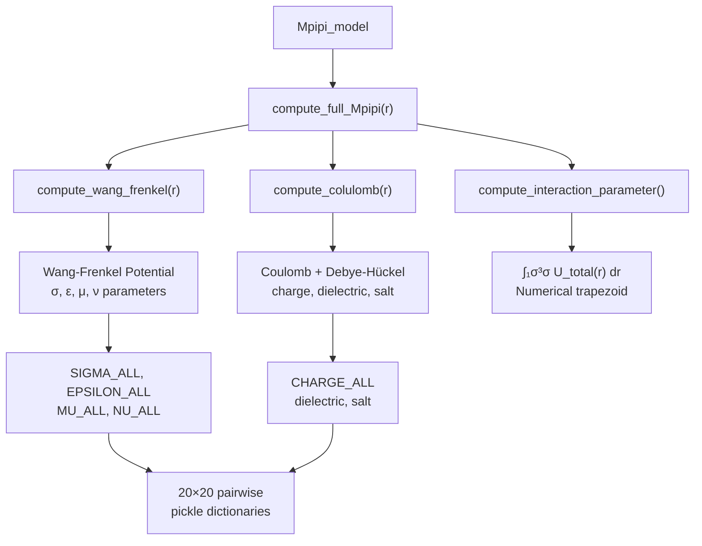
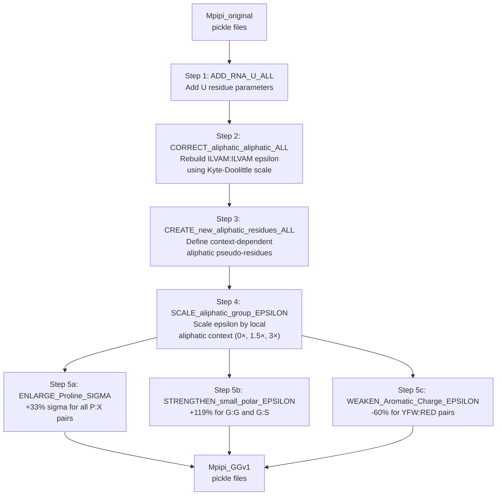
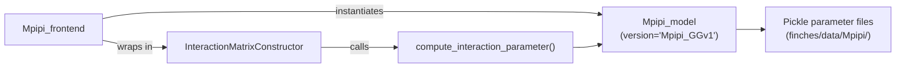

The **Mpipi forcefield** is a physics-driven coarse-grained model for biomolecular phase separation, achieving near-quantitative accuracy for intrinsically disordered protein (IDR) interactions. Implemented as the `Mpipi_model` class, it defines a complete set of pairwise residue parameters and potential energy functions that underpin every interaction calculation in finches. The model combines a **Wang-Frenkel** short-range potential with a **Debye-Hückel screened Coulomb** electrostatic potential, calibrated against experimental phase separation data. Two parameter versions ship with finches — `Mpipi_original` (from the foundational Joseph et al. 2021 paper) and `Mpipi_GGv1` (a refined variant with corrected aliphatic interactions, RNA support, and targeted epsilon/sigma adjustments).

Sources: [mpipi.py](finches/forcefields/mpipi.py#L1-L20), [mpipi.py](finches/forcefields/mpipi.py#L35-L102)

## Potential Energy Architecture

The total pairwise interaction energy between two residues in the Mpipi model is the sum of two independent potentials:

$$U_{\text{total}}(r) = U_{\text{Wang-Frenkel}}(r) + U_{\text{Coulomb}}(r)$$

This decomposition separates **non-specific short-range interactions** (π-π, cation-π, hydrophobic) from **electrostatic interactions**, each governed by distinct parameter sets. The architecture is reflected in the class method `compute_full_Mpipi()`, which delegates to `compute_wang_frenkel()` and `compute_colulomb()` and sums their results.



Sources: [mpipi.py](finches/forcefields/mpipi.py#L289-L335), [mpipi.py](finches/forcefields/mpipi.py#L342-L415)

## Wang-Frenkel Potential

The Wang-Frenkel (WF) potential is a tunable, finite-range interaction model that replaces the Lennard-Jones potential used in earlier coarse-grained frameworks. It is governed by **four pairwise parameters** per residue pair:

| Parameter | Symbol | Dictionary | Dimensions | Physical Meaning |
|-----------|--------|------------|------------|------------------|
| Size | σᵢⱼ | `SIGMA_ALL` | Å | Cutoff distance; where WF potential crosses zero |
| Well depth | εᵢⱼ | `EPSILON_ALL` | kJ/mol | Minimum energy of the interaction well |
| Width control | μᵢⱼ | `MU_ALL` | dimensionless | Controls well width and steepness |
| Width control | νᵢⱼ | `NU_ALL` | dimensionless | Second width/steepness parameter |

The potential is computed as:

1. Define the interaction range: `R_ij = 3 × σ_ij`
2. Compute the normalization constant αᵢⱼ from σ, μ, ν, and R
3. Evaluate: `U_WF(r) = ε × α × [(σ/r)^(2μ) - 1] × [(R/r)^(2μ) - 1]^(2ν)`

The potential goes to zero at `r = σ` and `r = R = 3σ`, with the well minimum occurring between these boundaries. This finite-range design is critical for coarse-grained simulations because it avoids the long-range tail artifacts of Lennard-Jones potentials.

Sources: [mpipi.py](finches/forcefields/mpipi.py#L553-L608)

## Coulomb Potential with Debye-Hückel Screening

The electrostatic component uses a standard Coulomb potential augmented with **Debye-Hückel screening** to model salt-dependent attenuation:

$$U_{\text{Coulomb}}(r_{ij}) = \frac{C^2 \cdot N_A \cdot q_i \cdot q_j}{4\pi \varepsilon_0 \cdot \varepsilon_r \cdot r_{ij}} \times e^{-\kappa \cdot r_{ij}}$$

Where:
- **qᵢ, qⱼ** are residue charges from `CHARGE_ALL` (in elemental charge units)
- **ε_r** is the solvent dielectric constant (default: 80.0 for water)
- **κ = √(salt) / 3.06** is the inverse Debye screening length, with salt in molar units
- The exponential term provides distance-dependent screening; at zero salt, screening is disabled (κ = 0)

The function accepts per-call overrides for `dielectric` and `salt`, enabling condition-dependent exploration without re-instantiating the model object.

Sources: [mpipi.py](finches/forcefields/mpipi.py#L481-L546)

## Harmonic Bond Potential

A standard harmonic potential constrains backbone bond lengths between adjacent beads:

$$U_{\text{harmonic}}(r) = \frac{1}{2} k \cdot (100 \cdot (r - r_{\text{ref}}))^2 / 1000$$

The factor of 100 converts Å to pm, and the `/1000` converts J to kJ. Two ideal bond lengths are defined by mode:

| Mode | r_ref (Å) | k (J·mol⁻¹·pm⁻²) | Application |
|------|-----------|---------------------|-------------|
| `protein` | 3.81 | 8.03 (default) | Polypeptide backbone |
| `nucleic` | 5.00 | 8.03 (default) | RNA backbone |

Sources: [mpipi.py](finches/forcefields/mpipi.py#L426-L476)

## Interaction Parameter Computation

The `compute_interaction_parameter()` method converts the full distance-dependent potential into a **single scalar interaction parameter** by numerically integrating the combined potential between 1σ and 3σ:

```python
interaction_param = np.trapezoid(combo[s1:s3], x=r[s1:s3])
```

This integral captures the net interaction strength within the physically meaningful range of the WF potential. The method returns a tuple: `(interaction_param, full_potential_profile, idx_1σ, idx_3σ, distance_array)`, providing both the summary scalar and the raw data for visualization or further analysis.

Sources: [mpipi.py](finches/forcefields/mpipi.py#L342-L415)

## Parameter Versions and Configuration

The `Mpipi_model` class supports two primary versions, each with distinct parameter files and calibration constants:

| Version | Parameter Files | charge_prefactor | null_interaction_baseline | Description |
|---------|----------------|------------------|--------------------------|-------------|
| `Mpipi_original` | `sigma.pickle`, `epsilon.pickle`, etc. | 0.20 | -0.066265 | Joseph et al. 2021 original parameters |
| `Mpipi_GGv1` | `sigma_ggv1.pickle`, `epsilon_ggv1.pickle`, etc. | 0.20 | -0.128533 | Refined with aliphatic corrections, RNA, and targeted tweaks |
| `OLD_Mpipi_GGv1` | `old_sigma_ggv1.pickle`, etc. | 0.20 | -0.128533 | Legacy snapshot; nearly identical to `Mpipi_GGv1` |

The **`charge_prefactor`** (0.20 for both versions) scales charge weighting — a mechanism that reduces repulsion between oppositely charged residues to reflect sidechain orientational freedom and pKa shifts. The **`null_interaction_baseline`** defines the attractive/repulsive threshold, calibrated so that a poly(GS) repeat sequence yields ε ≈ 0 (i.e., behaves as a Gaussian chain).

Sources: [mpipi.py](finches/forcefields/mpipi.py#L19-L34), [mpipi.py](finches/forcefields/mpipi.py#L115-L187)

## Model Instantiation

The `Mpipi_model` constructor loads pre-computed pickle dictionaries and configures the environment:

```python
from finches.forcefields.mpipi import Mpipi_model

# Default: Mpipi_GGv1 at physiological conditions
model = Mpipi_model(version='Mpipi_GGv1', dielectric=80.0, salt=0.150)

# Original Joseph et al. parameters
model_original = Mpipi_model(version='Mpipi_original')

# Custom parameter directory (must contain the five required pickle files)
model_custom = Mpipi_model(version='Mpipi_original', input_directory='/path/to/params')
```

For custom directories, five pickle files are required: `sigma.pickle`, `epsilon.pickle`, `nu.pickle`, `mu.pickle`, and `charge.pickle`. Each contains a nested dictionary indexed as `[residue_1][residue_2]` (or `[residue]` for charge), covering all 20 standard amino acids. The `Mpipi_GGv1` version expects files with the `_ggv1` suffix.

Sources: [mpipi.py](finches/forcefields/mpipi.py#L35-L102), [mpipi.py](finches/forcefields/mpipi.py#L107-L112)

## Supported Residue Types

The model defines two residue groups via `ALL_RESIDUES_TYPES`:

- **Protein residues** (20): `M, G, K, T, Y, A, D, E, V, L, Q, W, R, F, S, H, N, P, C, I`
- **RNA residues** (1): `U`

The `Mpipi_GGv1` version additionally defines **context-dependent aliphatic pseudo-residues** (lowercase `a, l, m, i, v, b, o, x, y, z`) that represent aliphatic residues in different local sequence contexts. These are used internally by the aliphatic weighting scheme and are not directly specified in input sequences.

Sources: [mpipi.py](finches/forcefields/mpipi.py#L16-L17), [mpipi.py](finches/forcefields/mpipi.py#L199-L199)

## Mpipi_GGv1 Parameter Derivation Pipeline

The `Mpipi_GGv1` parameters are derived from `Mpipi_original` through a deterministic sequence of modification functions, executed in the build notebook. The pipeline order is critical because later steps depend on parameters created by earlier ones:



Sources: [build_MpipiGG_v1.ipynb](finches/data/Mpipi/build_MpipiGG_v1.ipynb#L1-L376), [mPiPi_GGv1_modification_fxns.py](finches/data/Mpipi/mPiPi_GGv1_modification_fxns.py#L1-L12)

### Step-by-Step Modification Details

**Step 1 — RNA Addition** (`ADD_RNA_U_ALL`): Injects uracil (U) parameters for all 20 amino acid:U pairs, sourced from `defined_RNA_params.py`. This must execute first because subsequent steps assume U exists in the parameter dictionaries. U has charge −0.75 and unique per-pair sigma/epsilon values.

**Step 2 — Aliphatic:Aliphatic Correction** (`CORRECT_aliphatic_aliphatic_ALL`): Replaces the original ILVAM:ILVAM epsilon values with values derived from the **Kyte-Doolittle hydrophobicity scale**. The original Mpipi showed a counterintuitive *decrease* in epsilon with increasing hydrophobicity; this correction inverts the dependency: `NEW_ε = |slope| × (KD₁ + KD₂) + intercept/α`, where slope = 0.00839, intercept = 0.07555, and α = 4.3. Also fixes MU for I:I and I:V to 2.0.

**Step 3 — Context-Dependent Aliphatic Residues** (`CREATE_new_aliphatic_residues_ALL`): Creates 10 new pseudo-residue codes (a,l,m,i,v for "group 1" and b,o,x,y,z for "group 2") that mirror A,L,M,I,V but enable distinct interaction strengths based on local aliphatic neighbor count. Each inherits all pairwise parameters from its parent amino acid.

**Step 4 — Aliphatic Group Epsilon Scaling** (`SCALE_aliphatic_group_EPSILON`): Applies context-dependent scaling to the three aliphatic groups:

| Group | Residues | Context | Epsilon Scaler | Effective Multiplier |
|-------|----------|---------|---------------|---------------------|
| grp0 | A, L, M, I, V | No aliphatic neighbors | 0 | 1.0× (unchanged) |
| grp1 | a, l, m, i, v | One aliphatic neighbor | 0.5 | 1.5× |
| grp2 | b, o, x, y, z | Two aliphatic neighbors | 2.0 | 3.0× |

**Step 5a — Proline Sigma Enlargement** (`ENLARGE_Proline_SIGMA`): Increases σ for all P:X pairs by 33%, reflecting proline's structural rigidity and larger effective excluded volume.

**Step 5b — Small Polar Strengthening** (`STRENGTHEN_small_polar_EPSILON`): Increases G:G and G:S epsilon by 119%, reflecting the underestimation of glycine and serine small-polar interactions in the original parameterization.

**Step 5c — Aromatic:Charge Weakening** (`WEAKEN_Aromatic_Charge_EPSILON`): Reduces epsilon for YFW:RED pairs by 60%, correcting overestimated aromatic–charged residue cation-π interactions.

Sources: [mPiPi_GGv1_modification_fxns.py](finches/data/Mpipi/mPiPi_GGv1_modification_fxns.py#L17-L89), [mPiPi_GGv1_modification_fxns.py](finches/data/Mpipi/mPiPi_GGv1_modification_fxns.py#L95-L193), [mPiPi_GGv1_modification_fxns.py](finches/data/Mpipi/mPiPi_GGv1_modification_fxns.py#L199-L373), [mPiPi_GGv1_modification_fxns.py](finches/data/Mpipi/mPiPi_GGv1_modification_fxns.py#L376-L467), [defined_RNA_params.py](finches/data/Mpipi/defined_RNA_params.py#L1-L28)

## RNA (Uracil) Parameters

The `Mpipi_GGv1` version includes parameters for RNA uracil (U) residue interactions with all 20 amino acids, sourced from LAMMPS input files (`lammps_Mpipi_v5_NEWPARAMS.in`). Key characteristics:

- **Charge**: U = −0.75 (partial negative charge on the nucleotide base)
- **U:U self-interaction**: ε = 0.305, σ = 8.17 Å, ν = 1.0, μ = 3.0
- **AA:U interactions**: Epsilon ranges from 0.097 (K:U, weakest) to 0.428 (W:U, strongest), reflecting the dominance of π-π stacking between aromatic residues and RNA bases
- **Sigma values**: Range from 6.43 Å (G:U) to 8.17 Å (U:U), with ν = 1.0 and μ = 3.0 for all AA:U pairs

Sources: [defined_RNA_params.py](finches/data/Mpipi/defined_RNA_params.py#L1-L28)

## Parameter Data Files

All parameters are stored as serialized Python pickle dictionaries in `finches/data/Mpipi/`:

| File | Version | Structure | Contents |
|------|---------|-----------|----------|
| `sigma.pickle` | original | `dict[R1][R2] → float` | 20×20 pairwise size parameters (Å) |
| `epsilon.pickle` | original | `dict[R1][R2] → float` | 20×20 pairwise well depths (kJ/mol) |
| `nu.pickle` | original | `dict[R1][R2] → float` | 20×20 ν width parameters |
| `mu.pickle` | original | `dict[R1][R2] → float` | 20×20 μ width parameters |
| `charge.pickle` | original | `dict[R] → float` | 20 per-residue charges |
| `*_ggv1.pickle` | GGv1 | Same structure, extended | Includes U and aliphatic pseudo-residues |
| `old_*_ggv1.pickle` | legacy | Same as GGv1 | Snapshot of dynamically-computed GGv1 values |

> [!TIP]
> The `Mpipi_GGv1` pickle files contain **more than 20 residues** — they include U (uracil) and 10 lowercase aliphatic pseudo-residues. If you load these files directly, expect dictionaries keyed by 31 residue codes, not 20.

Sources: [mpipi.py](finches/forcefields/mpipi.py#L115-L184), [build_MpipiGG_v1.ipynb](finches/data/Mpipi/build_MpipiGG_v1.ipynb#L337-L350)

## Connection to the Frontend and IMC

The `Mpipi_model` object serves as the parameter backend for two upstream components:

1. **`InteractionMatrixConstructor`** — accepts an `Mpipi_model` instance and builds a lookup table of pairwise interaction parameters via `compute_interaction_parameter()`, then provides sliding-window epsilon calculations with charge and aliphatic weighting schemes.

2. **`Mpipi_frontend`** — the highest-level user interface, which automatically instantiates `Mpipi_model("Mpipi_GGv1")` and wraps it in an `InteractionMatrixConstructor`, exposing `epsilon()`, `intermolecular_idr_matrix()`, and `interaction_figure()` methods.



> [!TIP]
> When using the frontend, you never instantiate `Mpipi_model` directly — it's created internally with `Mpipi_GGv1`. If you need `Mpipi_original` or custom conditions, instantiate `Mpipi_model` and `InteractionMatrixConstructor` yourself for full control.

Sources: [mpipi_frontend.py](finches/frontend/mpipi_frontend.py#L7-L21), [epsilon_calculation.py](finches/epsilon_calculation.py#L18-L165)

## Key API Reference

| Method | Signature | Returns | Description |
|--------|-----------|---------|-------------|
| `compute_wang_frenkel` | `(residue_1, residue_2, r)` | float or np.array | WF potential at distance(s) r (kJ/mol) |
| `compute_colulomb` | `(residue_1, residue_2, r, dielectric, salt)` | float or np.array | Screened Coulomb at distance(s) r (kJ/mol) |
| `compute_full_Mpipi` | `(residue_1, residue_2, r, dielectric, salt)` | float or np.array | Total potential = WF + Coulomb (J/mol) |
| `compute_interaction_parameter` | `(residue_1, residue_2, r, dielectric, salt)` | tuple | (integral, profile, idx_1σ, idx_3σ, r_array) |

Sources: [mpipi.py](finches/forcefields/mpipi.py#L209-L238), [mpipi.py](finches/forcefields/mpipi.py#L243-L283), [mpipi.py](finches/forcefields/mpipi.py#L289-L335), [mpipi.py](finches/forcefields/mpipi.py#L342-L415)

## Further Reading

- For the calibrated frontend that uses these parameters: [Mpipi and CALVADOS Frontends](5-mpipi-and-calvados-frontends)
- For how interaction parameters feed into matrix construction: [InteractionMatrixConstructor](8-interactionmatrixconstructor)
- For the alternative CALVADOS parameterization: [CALVADOS Forcefield Parameters](12-calvados-forcefield-parameters)
- For defining your own forcefield: [Custom Forcefield Definition](13-custom-forcefield-definition)