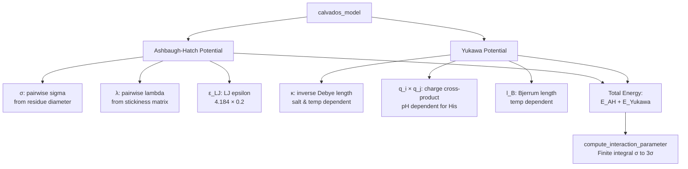

The **CALVADOS** (CoArse-grained LAttice model for Variable DesOrdered Sequences) forcefield provides a physics-driven coarse-grained model for intrinsically disordered protein interactions. Within finches, CALVADOS is implemented as a pairwise potential combining an **Ashbaugh-Hatch Lennard-Jones** potential (capturing steric and sticky interactions) with a **Debye-Hückel Yukawa** potential (capturing screened electrostatics). The model is condition-dependent — salt concentration, pH, and temperature all modulate the resulting interaction parameters, making CALVADOS uniquely suited for exploring how solution conditions reshape phase behavior.

Sources: [calvados.py](finches/forcefields/calvados.py#L1-L51)

## Model Architecture

CALVADOS decomposes the pairwise interaction energy between two coarse-grained residues into two physically distinct contributions. The **Ashbaugh-Hatch (AH) potential** is a modified Lennard-Jones potential that introduces a per-residue "stickiness" parameter (λ), allowing the attractive well depth to vary by amino acid type while preserving the repulsive core. The **Yukawa potential** implements Debye-Hückel electrostatics with an exponential decay governed by the inverse Debye length (κ), which itself depends on salt concentration and temperature. These two potentials are evaluated independently and summed to yield the total pairwise energy.



The key architectural insight is that CALVADOS parameters are **not static lookup tables** — the Yukawa prefactors are recomputed whenever the model is instantiated with new conditions, meaning the same `calvados_model` object produces different pairwise energies under different salt, pH, or temperature regimes.

Sources: [calvados.py](finches/forcefields/calvados.py#L75-L201), [calvados.py](finches/forcefields/calvados.py#L402-L483)

## Version Configurations

Two CALVADOS parameter sets are available, differing in their calibrated stickiness values (λ) and their empirical correction constants:

| Property | CALVADOS1 | CALVADOS2 |
|---|---|---|
| **charge_prefactor** | `nan` (not precomputed) | `0.7` |
| **null_interaction_baseline** | `nan` (not precomputed) | `-0.45` |
| **Status** | Legacy / uncalibrated | **Recommended** |
| **RNA Support** | No | No |

The **`charge_prefactor`** scales how strongly local charge context weighting is applied during epsilon calculation. The **`null_interaction_baseline`** defines the interaction threshold below which pairwise terms are classified as "attractive" — it is calibrated so that a poly(GS) repeat sequence yields ε ≈ 0, representing a non-interacting Gaussian chain reference. For CALVADOS2, this baseline is set at −0.45 (slightly adjusted from the raw −0.478 value to improve empirical agreement).

> [!TIP]
> CALVADOS1 lacks precomputed `charge_prefactor` and `null_interaction_baseline` values. If you need these, set `compute_forcefield_dependencies=True` when constructing the `InteractionMatrixConstructor`, or use CALVADOS2 which ships with validated defaults.

Sources: [calvados.py](finches/forcefields/calvados.py#L63-L71)

## Condition-Dependent Parameters

The `_genParams` method recomputes electrostatic parameters upon model initialization, making CALVADOS uniquely responsive to solution conditions. Three physical quantities are derived:

**Bjerrum length (l_B)** — the distance at which the electrostatic energy between two unit charges equals thermal energy (k_BT). Computed from the temperature-dependent dielectric constant of water using the empirical formula `ε_w(T) = 5321/T + 233.76 − 0.9297T + 0.001417T² − 0.8292×10⁻⁶T³`, then `l_B = e²/(4πε₀ε_w) × N_A × 1000 / (RT)`.

**Inverse Debye length (κ)** — sets the screening decay length for the Yukawa potential. Computed as `κ = √(8π × l_B × I × N_A/10)`, where `I` is the ionic strength (salt concentration in M). Higher salt → larger κ → shorter-range electrostatics.

**Histidine charge** — His receives a pH-dependent fractional charge via `q_His = 1/(1 + 10^(pH−6))`, reflecting its pKa ≈ 6. At physiological pH (7.4), His carries ≈ 0.038 charges; at pH 6, it carries 0.5 charges.

| Condition | Default | Physical Effect |
|---|---|---|
| `salt` | 0.150 M | Screens electrostatic interactions; higher salt compresses Yukawa decay |
| `pH` | 7.4 | Modulates His charge; minimal effect on other residues |
| `temp` | 288 K | Scales thermal energy, Bjerrum length, and Debye screening |

Sources: [calvados.py](finches/forcefields/calvados.py#L205-L254)

## Per-Residue Parameter Tables

The CALVADOS model loads per-residue parameters from a serialized pickle file (`calvados_residues.pickle`) indexed by both three-letter and one-letter amino acid codes. Each residue entry contains:

| Parameter | Symbol | Description |
|---|---|---|
| **sigma** | σ | Van der Waals diameter (nm) — sets the LJ contact distance |
| **lambda** | λ | Stickiness parameter — scales the LJ attractive well depth (version-specific) |
| **charge** | q | Net residue charge at reference pH |

The **pairwise sigma map** and **pairwise lambda map** are constructed using the Lorentz combining rule (arithmetic mean): `σ_ij = (σ_i + σ_j)/2` and `λ_ij = (λ_i + λ_j)/2`. These 20×20 symmetric matrices are stored as `self.sigmamap` and `self.lambdamap` on the model object.

The 20 standard amino acids are supported: M, G, K, T, Y, A, D, E, V, L, Q, W, R, F, S, H, N, P, C, I. **RNA residues (U) are not supported** — a dedicated `RNA_check` decorator in the frontend raises a `ValueError` if uracil appears in input sequences.

Sources: [calvados.py](finches/forcefields/calvados.py#L186-L200), [calvados_frontend.py](finches/frontend/calvados_frontend.py#L16-L25), [fingerprints.py](finches/data/fingerprints.py#L39-L74)

## Ashbaugh-Hatch Potential

The Ashbaugh-Hatch potential is a shifted Lennard-Jones potential with a per-pair stickiness parameter λ that modulates the attractive well without changing the repulsive core. This enables different amino acid pairs to have different interaction strengths while sharing a common excluded-volume diameter:

**For r < 2^(1/6) × σ** (inside the LJ minimum):
```
E_AH = 4ε[(σ/r)¹² − (σ/r)⁶ − λ·shift] + ε(1−λ)
```

**For r ≥ 2^(1/6) × σ** (outside the LJ minimum):
```
E_AH = 4ελ[(σ/r)¹² − (σ/r)⁶ − shift]
```

Where `shift = (σ/r_c)¹² − (σ/r_c)⁶` ensures the potential goes to zero at the cutoff, and `ε_LJ = 4.184 × 0.2 = 0.8368 kJ/mol` (the LJ energy scale). The default LJ cutoff is `r_c = 2.0 nm`. Note that the Ashbaugh-Hatch potential is **not temperature-dependent** — only the Yukawa term responds to temperature changes.

Sources: [calvados.py](finches/forcefields/calvados.py#L449-L474)

## Yukawa (Debye-Hückel) Potential

The Yukawa potential implements screened Coulombic electrostatics with an exponential decay:

```
E_Yukawa = q_ij × [exp(−κr)/r − shift]
```

Where `q_ij = q_i × q_j × l_B × RT` is the pairwise charge prefactor (a 20×20 matrix built from the cross-product of residue charges), and `shift = exp(−κ × r_cut)/r_cut` ensures the potential vanishes at the Yukawa cutoff (`r_cut = 4.0 nm` by default). The **total energy** at any distance is simply the sum: `E_total = E_AH + E_Yukawa`.

> [!TIP]
> The `compute_calvados_energy` function expects distances in **nanometers** (matching native CALVADOS units), while `compute_full_calvados` accepts distances in **angstroms** and performs the internal conversion. This unit boundary is a common source of confusion — always pass angstroms to the model methods and nanometers only to the standalone energy function.

Sources: [calvados.py](finches/forcefields/calvados.py#L476-L483)

## Interaction Parameter Computation

The `compute_interaction_parameter` method converts the full distance-dependent potential into a single scalar interaction strength. It does this by numerically integrating the combined AH + Yukawa potential between **σ and 3σ** using the trapezoidal rule:

```python
interaction_param = np.trapezoid(combo[s1:s3], x=r_angstroms[s1:s3])
```

This finite integral captures the thermally-relevant region of the potential — inside σ the energy is dominated by excluded volume, while beyond 3σ the interactions are negligible. The returned tuple contains:

| Index | Type | Content |
|---|---|---|
| `[0]` | float | Interaction parameter (integral from σ to 3σ) |
| `[1]` | np.array | Full pairwise potential vs. distance profile |
| `[2]` | int | Index for σ in the distance array (Å) |
| `[3]` | int | Index for 3σ in the distance array (Å) |
| `[4]` | np.array | Distance array (Å) |

These interaction parameters populate the lookup table used by `InteractionMatrixConstructor` for all downstream epsilon calculations, sliding-window matrices, and phase diagram computations.

Sources: [calvados.py](finches/forcefields/calvados.py#L327-L396)

## Instantiation and Usage

The `calvados_model` class is the direct interface to CALVADOS parameters. It is constructed with a version string and optional condition parameters:

```python
from finches.forcefields.calvados import calvados_model

# Default CALVADOS2 at physiological conditions
model = calvados_model('CALVADOS2', salt=0.150, pH=7.4, temp=288)

# High-salt condition — electrostatics more screened
model_high_salt = calvados_model('CALVADOS2', salt=0.500, pH=7.4, temp=310)

# Compute pairwise interaction between arginine and aspartate
result = model.compute_interaction_parameter('R', 'D')
print(f"Interaction parameter: {result[0]:.4f}")

# Compute full potential at specific distances (in Angstroms)
distances = [3.0, 5.0, 8.0, 12.0]
energies = model.compute_full_calvados('R', 'D', distances)
```

The model object is then passed to `InteractionMatrixConstructor` for higher-level computations. For most users, the `CALVADOS_frontend` provides a more convenient interface — it automatically instantiates a CALVADOS2 model and wraps the `InteractionMatrixConstructor`:

```python
from finches.frontend.calvados_frontend import CALVADOS_frontend

calvados = CALVADOS_frontend(salt=0.150, pH=7.4, temp=288)

# Scalar epsilon value
eps = calvados.epsilon('RGGGGGGGGG', 'DDDDDDDDDD')

# Sliding-window interaction matrix
matrix_result = calvados.intermolecular_idr_matrix(seq1, seq2, window_size=31)
```

Sources: [calvados.py](finches/forcefields/calvados.py#L75-L125), [calvados_frontend.py](finches/frontend/calvados_frontend.py#L28-L44)

## Built-in Parameter Constants

Several constants are hard-coded in the `calvados_model` constructor, reflecting the original CALVADOS simulation parameters:

| Constant | Value | Origin |
|---|---|---|
| `eps_factor` | 0.2 | LJ energy scaling factor |
| `lj_eps` | 0.8368 kJ/mol | `4.184 × eps_factor` |
| `cutoff` | 2.0 nm | AH potential cutoff distance |
| `yukawa_r_cut` | 4.0 nm | Yukawa potential cutoff distance |

These values are drawn from the CALVADOS source: `eps_factor` and `lj_eps` from line 65 of `single_chain/simulate.py`, `cutoff` from line 29 of `direct_coexistence/submit.py`, and `yukawa_r_cut` from lines 104–105 of the simulation scripts.

Sources: [calvados.py](finches/forcefields/calvados.py#L164-L176)

## CALVADOS vs. Mpipi Comparison

CALVADOS and Mpipi represent two distinct coarse-grained philosophies for IDP interactions:

| Feature | CALVADOS | Mpipi |
|---|---|---|
| **Potential form** | Ashbaugh-Hatch + Yukawa | Modified Mie + Debye-Hückel |
| **Stickiness** | Per-residue λ parameter | Per-pair ε parameter |
| **Condition dependence** | Salt, pH, temp all modulate parameters | Salt modulates; temp/pH less exposed |
| **RNA support** | ❌ Not supported | ✅ Supported |
| **Versions** | CALVADOS1, CALVADOS2 | Mpipi_original, Mpipi_GGv1 |
| **null_interaction_baseline** | −0.45 (CALVADOS2) | −0.1285 (Mpipi_GGv1) |
| **charge_prefactor** | 0.7 (CALVADOS2) | 0.20 (Mpipi_GGv1) |

The higher `charge_prefactor` in CALVADOS2 (0.7 vs. 0.2) means that charge context weighting plays a substantially larger role in CALVADOS epsilon calculations. Conversely, the more negative `null_interaction_baseline` in CALVADOS2 (−0.45 vs. −0.13) shifts the attractive/repulsive threshold, reflecting the different energy scales of the two forcefields.

Sources: [calvados.py](finches/forcefields/calvados.py#L63-L71), [mpipi.py](finches/forcefields/mpipi.py#L19-L33)

## Custom Parameter Directories

By default, `calvados_model` loads parameters from the bundled `finches/data/calvados/` directory. You can point to a custom directory containing a `calvados_residues.pickle` file to substitute alternative per-residue parameters (e.g., modified stickiness values or non-standard residue types):

```python
model = calvados_model('CALVADOS2', input_directory='/path/to/custom/params')
```

The pickle file must be a DataFrame with columns for residue properties (three-letter code, one-letter code, sigma, charge, and version-specific lambda columns). If the specified version column does not exist in the pickle, an exception is raised with guidance to check available versions.

Sources: [calvados.py](finches/forcefields/calvados.py#L130-L153)

## Related Pages

- For the high-level frontend API that wraps this model, see [Mpipi and CALVADOS Frontends](5-mpipi-and-calvados-frontends)
- For the `InteractionMatrixConstructor` that consumes these parameters, see [InteractionMatrixConstructor](8-interactionmatrixconstructor)
- For the Mpipi forcefield counterpart, see [Mpipi Forcefield Parameters](11-mpipi-forcefield-parameters)
- For defining entirely custom forcefields, see [Custom Forcefield Definition](13-custom-forcefield-definition)
- For how these parameters feed into phase behavior analysis, see [Flory-Huggins Phase Diagrams](14-flory-huggins-phase-diagrams)