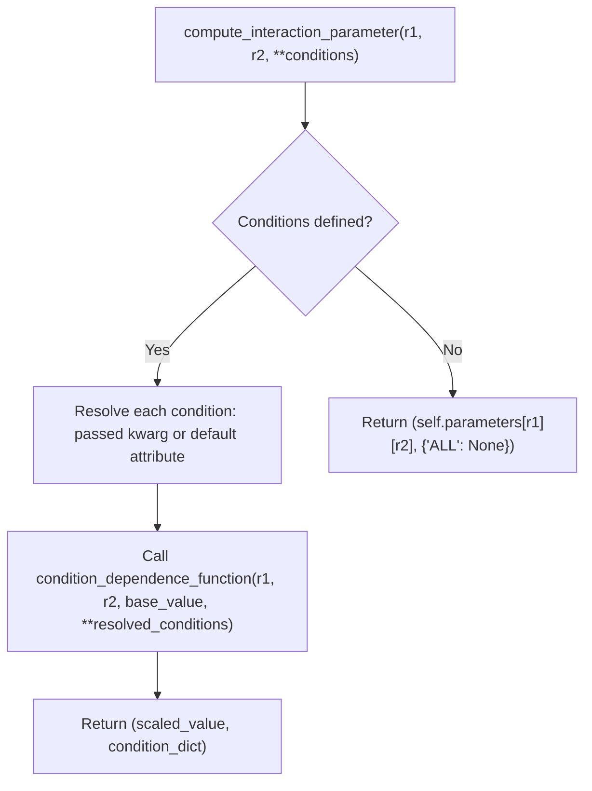
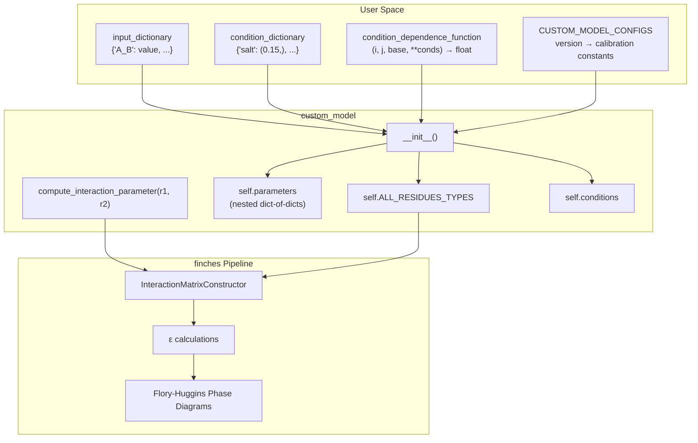

The `custom_model` class in finches provides a **user-defined forcefield interface** that lets you define arbitrary pairwise interaction parameters between any set of residue types, then use those parameters seamlessly with the full finches analysis pipeline — from [InteractionMatrixConstructor](8-interactionmatrixconstructor) through to [Flory-Huggins Phase Diagrams](14-flory-huggins-phase-diagrams). The returned object is architecturally identical to the built-in `Mpipi_model` and `calvados_model` objects, implementing the same `compute_interaction_parameter` contract that the rest of finches expects. This means you can substitute a custom forcefield anywhere a built-in one is accepted, without modifying downstream code.

Sources: [custom_model.py](finches/forcefields/custom_model.py#L1-L8), [epsilon_calculation.py](finches/epsilon_calculation.py#L17-L70)

## The Forcefield Interface Contract

Every forcefield object in finches — whether built-in or custom — must expose three attributes that the `InteractionMatrixConstructor` depends on. This **interface pattern** is what makes the system extensible:

| Required Attribute | Type | Purpose |
|---|---|---|
| `compute_interaction_parameter(r1, r2, **conditions)` | method | Returns `(interaction_value, condition_dict)` for a residue pair |
| `ALL_RESIDUES_TYPES` | list of lists | Defines which residues may co-occur in the same sequence |
| `CONFIGS` | dict | Contains `'charge_prefactor'` and `'null_interaction_baseline'` |

The `InteractionMatrixConstructor` calls `parameters.compute_interaction_parameter(r1, r2)[0]` to build its internal lookup table, and reads `ALL_RESIDUE_TYPES` to validate sequence composition. The `CONFIGS` dictionary provides default calibration values for charge weighting and the attractive/repulsive baseline.

Sources: [epsilon_calculation.py](finches/epsilon_calculation.py#L72-L89), [epsilon_calculation.py](finches/epsilon_calculation.py#L227-L251)

## Class Signature and Parameters

```python
from finches.forcefields.custom_model import custom_model

my_model = custom_model(
    version,
    input_dictionary,
    valid_residue_groups=[],
    condition_dictionary={},
    condition_dependence_function=None
)
```

Sources: [custom_model.py](finches/forcefields/custom_model.py#L29-L135)

### `version` : str

A string identifier that maps to a key in the `CUSTOM_MODEL_CONFIGS` dictionary at the top of the module. This dictionary stores version-specific calibration constants — specifically `charge_prefactor` and `null_interaction_baseline`. If your version string does not exist in `CUSTOM_MODEL_CONFIGS`, initialization raises a `KeyError`.

**To add a new version**, you must extend the `CUSTOM_MODEL_CONFIGS` dictionary before instantiation:

```python
from finches.forcefields.custom_model import CUSTOM_MODEL_CONFIGS

CUSTOM_MODEL_CONFIGS['MY_VERSION'] = {}
CUSTOM_MODEL_CONFIGS['MY_VERSION']['charge_prefactor'] = 0.25
CUSTOM_MODEL_CONFIGS['MY_VERSION']['null_interaction_baseline'] = -0.12
```

Sources: [custom_model.py](finches/forcefields/custom_model.py#L17-L26), [custom_model.py](finches/forcefields/custom_model.py#L236-L239)

### `input_dictionary` : dict

The core data structure defining all pairwise interaction parameters. Keys are **underscore-separated residue pairs** where each residue is a single character; values are the interaction strength (float or int). **Every pairwise combination must be defined exactly once.** The class automatically symmetrizes the input — if you define `'A_B': 1.0`, the reverse pair `B_A` is implicitly set to the same value.

```python
my_dict = {
    'A_A': -1, 'A_B':  1, 'A_C': -2.4,
    'B_B': -2, 'B_C':  1,
    'C_C':  2
}
```

This flat dictionary is internally converted into a **nested dictionary-of-dictionaries** stored as `self.parameters`, enabling `O(1)` lookup:

```python
self.parameters = {
    'A': {'A': -1,   'B':  1,   'C': -2.4},
    'B': {'A':  1,   'B': -2,   'C':  1},
    'C': {'A': -2.4, 'B':  1,   'C':  2}
}
```

**Validation rules** enforced at initialization:
- Each key must be exactly 3 characters long (e.g., `X_Y`)
- The key must contain exactly one underscore separator
- Duplicate pair definitions raise an exception
- Missing pairs will cause `KeyError` at compute time

Sources: [custom_model.py](finches/forcefields/custom_model.py#L137-L164)

### `valid_residue_groups` : list of lists

Defines which residue types are permitted to co-occur within the same sequence chain. Each inner list is a **co-occurrence group** — residues from different groups cannot appear in the same sequence.

```python
# All residues allowed in the same chain (default behavior)
valid_residue_groups = []

# Protein residues and RNA residues in separate groups
valid_residue_groups = [['A', 'B', 'C'], ['U']]
```

When `valid_residue_groups` is empty (default), all residues from the `input_dictionary` are placed into a single group: `self.ALL_RESIDUES_TYPES = [list(self.parameters.keys())]`. When explicitly provided, the union of all groups **must exactly match** the residues in the `input_dictionary` — any mismatch raises an exception.

This is particularly important for **protein–nucleic acid systems** where RNA beads (e.g., `'U'`) should not appear in amino acid sequences and vice versa.

Sources: [custom_model.py](finches/forcefields/custom_model.py#L71-L92), [custom_model.py](finches/forcefields/custom_model.py#L218-L233)

### `condition_dictionary` : dict

Defines **environmental conditions** (e.g., salt concentration, pH, temperature) that can modulate the interaction parameters at compute time. Each key is set as a property on the returned object with the corresponding value:

```python
condition_dict = {'pH': 7.5, 'salt': 0.2}
# Results in: self.pH = 7.5, self.salt = 0.2
```

Values should be provided as **tuples** — the first element becomes the default value via `setattr(self, key, value[0])`. The condition keys are stored in `self.conditions` for runtime lookup.

**Reserved names that cannot be used as condition keys:**

| Reserved Name | Reason |
|---|---|
| `ALL_RESIDUES_TYPES` | Core attribute for residue group definition |
| `conditions` | Internal list of condition names |
| `compute_interaction_parameter` | Core interface method |
| `condition_dependence_function` | Internal function reference |
| `valid_residue_groups` | Core attribute for residue group definition |
| `version` | Core attribute for version identification |

If `condition_dictionary` is non-empty, a `condition_dependence_function` **must** also be provided.

Sources: [custom_model.py](finches/forcefields/custom_model.py#L94-L116), [custom_model.py](finches/forcefields/custom_model.py#L170-L214)

### `condition_dependence_function` : callable

A user-defined function that **recalculates interaction parameters** as a function of environmental conditions. It is called by `compute_interaction_parameter` whenever conditions are specified. The function signature must be:

```python
def my_condition_function(i, j, base_value, **conditions):
    """
    Parameters
    ----------
    i : str
        First residue type
    j : str
        Second residue type
    base_value : float
        The value from self.parameters[i][j]
    **conditions : keyword arguments
        All conditions defined in condition_dictionary

    Returns
    -------
    float
        Updated interaction parameter value
    """
    ...
```

**Example** — salt-dependent scaling of electrostatic interactions:

```python
def salt_scale(i, j, base_value, salt=None, pH=None):
    # Scale electrostatic pairs by Debye screening
    if i in ['D', 'E', 'K', 'R'] or j in ['D', 'E', 'K', 'R']:
        return base_value * (0.15 / salt)  # scale with ionic strength
    return base_value
```

The function is validated at initialization: it must be callable and must accept all condition names defined in `condition_dictionary` as keyword arguments.

Sources: [custom_model.py](finches/forcefields/custom_model.py#L117-L128), [custom_model.py](finches/forcefields/custom_model.py#L196-L210)

## How `compute_interaction_parameter` Works

This is the method that the `InteractionMatrixConstructor` calls to populate its lookup table. Its behavior branches on whether conditions are defined:



When conditions are active, each condition is resolved by checking if it was passed as a keyword argument to `compute_interaction_parameter`; if not, the default value (set during `__init__`) is used. The `condition_dependence_function` then receives the base parameter value and all resolved conditions, returning the tuned interaction strength.

Sources: [custom_model.py](finches/forcefields/custom_model.py#L246-L285)

## Complete Working Example

The following example demonstrates building a custom 3-bead model with salt-dependent conditions and integrating it with the `InteractionMatrixConstructor`:

```python
from finches.forcefields.custom_model import custom_model, CUSTOM_MODEL_CONFIGS
from finches.epsilon_calculation import InteractionMatrixConstructor

# Step 1: Define version configuration
CUSTOM_MODEL_CONFIGS['my_model_v1'] = {
    'charge_prefactor': 0.2,
    'null_interaction_baseline': -0.1
}

# Step 2: Define pairwise interaction dictionary
#   'P' = pi-pi bead, 'C' = charged bead, 'H' = hydrophobic bead
input_dict = {
    'P_P': -3.0, 'P_C': -1.0, 'P_H': -2.0,
    'C_C':  2.0, 'C_H':  0.5,
    'H_H': -2.5
}

# Step 3: Define condition dependence function
def salt_dependent(i, j, base_value, salt=None):
    """Scale charged interactions by ionic strength."""
    charged = {'C'}
    if i in charged and j in charged:
        return base_value * (0.15 / salt)
    return base_value

# Step 4: Instantiate the custom model
my_model = custom_model(
    version='my_model_v1',
    input_dictionary=input_dict,
    valid_residue_groups=[['P', 'C', 'H']],
    condition_dictionary={'salt': (0.15,)},   # default 0.15 M
    condition_dependence_function=salt_dependent
)

# Step 5: Use with InteractionMatrixConstructor
IMC = InteractionMatrixConstructor(my_model)
```

Sources: [custom_model.py](finches/forcefields/custom_model.py#L29-L135), [epsilon_calculation.py](finches/epsilon_calculation.py#L18-L25)

## Real-World Example: 21-Residue Custom Forcefield

The finches test suite includes a complete 21-residue custom forcefield (the 20 standard amino acids plus an `'X'` placeholder) in `example_forcefield.py`. This demonstrates a production-scale `input_dictionary` with 231 pairwise entries covering all symmetric pairs:

```python
from finches.tests.test_data.example_forcefield import input_dictionary
# input_dictionary contains keys like 'M_W': -2, 'G_W': -6, 'W_W': -19, etc.
```

Notable patterns in this example:
- **π–π interactions** are strongest (e.g., `'W_W': -19`, `'Y_Y': -16`, `'F_F': -13`)
- **Charge–charge repulsions** are strongly positive (e.g., `'D_D': 29`, `'K_K': 24`, `'R_R': 21`)
- **Charge–charge attractions** are strongly negative (e.g., `'E_K': -27`, `'D_R': -27`)
- **The `'X'` placeholder** has zero interaction with all residues (`'X_X': 0`, `'A_X': 0`, etc.)

Sources: [example_forcefield.py](finches/tests/test_data/example_forcefield.py#L1-L30)

## Comparison with Built-in Forcefields

The custom model differs fundamentally from the built-in Mpipi and CALVADOS models in how interaction parameters are derived:

| Aspect | `custom_model` | `Mpipi_model` | `calvados_model` |
|---|---|---|---|
| Parameter source | User-provided `input_dictionary` | Precomputed pickle files (σ, ε, ν, μ, charge) | Precomputed pickle files (σ, λ, charge) |
| Interaction computation | Direct dictionary lookup | Finite integral of Wang-Frenkel + Coulomb potential | Finite integral of Ashbaugh-Hatch + Yukawa potential |
| Condition handling | User-defined `condition_dependence_function` | Built-in salt/dielectric modulation | Built-in salt/pH/temperature modulation |
| Parameter physics | Arbitrary (user-defined) | π–π + electrostatics (Joseph et al. 2021) | Stickiness + Debye-Hückel (CALVADOS) |
| Residue types | Any single-character symbols | 20 AA + `'U'` (RNA) | 20 AA |
| `compute_interaction_parameter` return | `(float, dict)` | `(float, np.array, int, int, np.array)` | `(float, np.array, int, int, np.array)` |

> [!TIP]
> The `InteractionMatrixConstructor` only uses index `[0]` of the `compute_interaction_parameter` return tuple — the scalar interaction value. The additional array data returned by Mpipi and CALVADOS (energy profiles, sigma indices, distance arrays) is available for direct model inspection but is not consumed by the IMC pipeline. This means your custom model only needs to return a 2-tuple `(float, dict)` to be fully compatible.

Sources: [custom_model.py](finches/forcefields/custom_model.py#L246-L285), [mpipi.py](finches/forcefields/mpipi.py#L342-L381), [calvados.py](finches/forcefields/calvados.py#L327-L396)

## Calibration: Setting `null_interaction_baseline`

The `null_interaction_baseline` is the threshold that distinguishes **attractive** from **repulsive** interactions in the interaction matrix. For built-in models, this is calibrated against a poly(GS) repeat sequence, which is assumed to behave as a Gaussian chain with ε ≈ 0.

For a custom model, you have two options:

**Option 1 — Precompute and add to CONFIGS:**

```python
from finches.data.forcefield_dependencies import get_null_interaction_baseline
from finches.epsilon_calculation import InteractionMatrixConstructor

# Build the IMC first (baseline will show a warning)
IMC = InteractionMatrixConstructor(my_model, compute_forcefield_dependencies=True)
baseline = IMC.null_interaction_baseline

# Then add to CONFIGS for future use
CUSTOM_MODEL_CONFIGS['my_model_v1']['null_interaction_baseline'] = baseline
```

**Option 2 — Pass explicitly at IMC construction:**

```python
IMC = InteractionMatrixConstructor(
    my_model,
    null_interaction_baseline=-0.1  # your calibrated value
)
```

The `get_null_interaction_baseline` function uses `scipy.optimize.root_scalar` to find the baseline value where a poly(GS) sequence yields ε = 0, searching within a bracket of `[-10.0, 10.0]` by default.

> [!TIP]
> If neither a precomputed baseline nor `compute_forcefield_dependencies=True` is set, the `InteractionMatrixConstructor` will print a warning but continue. However, any downstream analysis that depends on the attractive/repulsive decomposition (e.g., epsilon vectors, phase diagrams) will produce incorrect results without a proper baseline. Always calibrate your custom model before relying on signed interaction decomposition.

Sources: [forcefield_dependencies.py](finches/data/forcefield_dependencies.py#L17-L68), [epsilon_calculation.py](finches/epsilon_calculation.py#L167-L180)

## Architecture: Custom Model in the Forcefield Pipeline



The custom model sits at the same position in the pipeline as [Mpipi Forcefield Parameters](11-mpipi-forcefield-parameters) or [CALVADOS Forcefield Parameters](12-calvados-forcefield-parameters). Once instantiated and passed to `InteractionMatrixConstructor`, all downstream functionality — sliding window matrices, per-residue vectors, epsilon values, and phase diagrams — works identically regardless of which forcefield backs the computation.

Sources: [custom_model.py](finches/forcefields/custom_model.py#L29-L135), [epsilon_calculation.py](finches/epsilon_calculation.py#L18-L131)

## Next Steps

With a custom forcefield defined, you can proceed to:
- **Compute interaction matrices** using [InteractionMatrixConstructor](8-interactionmatrixconstructor) with your custom model
- **Calculate per-residue interaction vectors** via [Per-Residue Interaction Vectors](7-per-residue-interaction-vectors)
- **Generate phase diagrams** with [Flory-Huggins Phase Diagrams](14-flory-huggins-phase-diagrams) using your custom energetics
- **Explore condition-dependent behavior** through [Condition-Dependent Phase Behavior](15-condition-dependent-phase-behavior) by varying your custom conditions