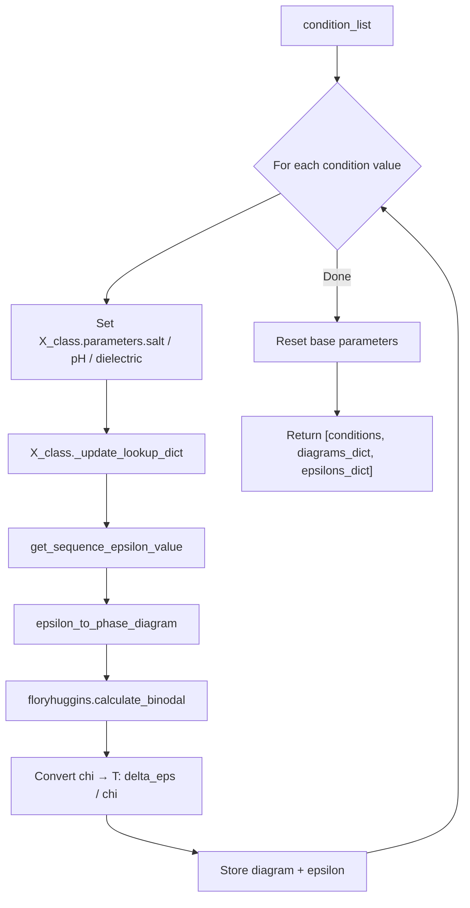

Finches provides dedicated infrastructure for exploring how **environmental conditions**—salt concentration, pH, and dielectric constant—reshape the phase boundaries of intrinsically disordered proteins. Rather than computing a single static phase diagram, the `epsilon_to_FHtheory` module iteratively re-parameterizes the forcefield, recalculates the mean-field interaction parameter (ε), and rebuilds the Flory-Huggins binodal at each condition value, producing a family of phase diagrams that reveal how solution chemistry modulates liquid-liquid phase separation.

## Architectural Overview

The condition-dependent phase diagram pipeline chains three computational stages: **parameter re-initialization**, **ε recomputation**, and **χ→T conversion**. At each step, the `InteractionMatrixConstructor` is mutated in-place via `_update_lookup_dict()`, ensuring that the per-residue interaction lookup tables reflect the new electrostatic environment before any downstream calculation proceeds.



The critical insight is that changing salt, pH, or dielectric does not alter the sequence—it alters the **electrostatic contribution** to ε through the Debye screening length and charge state calculations baked into each forcefield model. This means the same sequence can exhibit dramatically different phase behavior under different buffer conditions.

Sources: [epsilon_to_FHtheory.py](finches/epsilon_to_FHtheory.py#L1-L23), [epsilon_to_FHtheory.py](finches/epsilon_to_FHtheory.py#L194-L270)

## Condition-Specific Builder Functions

Three parallel functions provide condition-dependent phase diagram construction, each targeting a distinct environmental variable. All share an identical return structure: a three-element list containing `[condition_list, out_diagrams, out_epsilons]`, where `out_diagrams` and `out_epsilons` are dictionaries keyed by the condition value.

| Function | Parameter Mutated | Validation Check | Reset Behavior |
|---|---|---|---|
| `build_SALT_dependent_phase_diagrams` | `X_class.parameters.salt` | Confirms `parameters.salt` exists | `X_class.parameters.salt = base_value` + `_update_lookup_dict()` |
| `build_PH_dependent_phase_diagrams` | `X_class.parameters.pH` | Confirms `parameters.pH` exists | `X_class.parameters.salt = base_value` + `_update_parameters(base_params)` |
| `build_DIELECTRIC_dependent_phase_diagrams` | `X_class.parameters.dielectric` | Confirms `parameters.dielectric` exists | `X_class.parameters.salt = base_value` + `_update_parameters(base_params)` |

> [!TIP]
> The salt-dependent builder uses a more robust reset strategy—calling `_update_lookup_dict()` directly—while the pH and dielectric builders restore via `_update_parameters(base_params)`. This asymmetry reflects that salt changes only modify the lookup table, whereas pH/dielectric alter the charge state of individual residues, requiring a full parameter re-initialization.

### Salt-Dependent Phase Diagrams

The `build_SALT_dependent_phase_diagrams` function is the most commonly used variant, as salt concentration directly controls the Debye screening length and therefore the range and strength of electrostatic interactions. Each salt value in `condition_list` is set on `X_class.parameters.salt`, the lookup dict is refreshed, and both a phase diagram and an ε value are computed:

```python
from finches.frontend.mpipi_frontend import Mpipi_frontend
from finches.epsilon_to_FHtheory import build_SALT_dependent_phase_diagrams

mf = Mpipi_frontend(salt=0.150)  # initial salt = 150 mM
seq = "MGDEDWEAEINPHMSSYVPIFEKDRYSGENGDNFNRTPASSSEMDDGPSRRDHFMKSGFASGRNFGNRDAGECNKRDNTSTMGGFGVGKSFGNRGFSNSRFEDGDSSGFWRESSNDCEDNPTRNRGFSKRGGYRDGNNSEASGPYRRGGRGSFRGCRGGFGLGSPNNDLDPDECMQRTGGLFGSRRPVLSGTGNGDTSQSRSGSGSERGGYKGLNEEVITGSGKNSWKSEAEGGES"

salt_values = [0.100, 0.200, 0.300, 0.400, 0.500]
results = build_SALT_dependent_phase_diagrams(seq, mf.IMC_object, salt_values)

# results[0] → [0.100, 0.200, 0.300, 0.400, 0.500]
# results[1] → {0.100: phase_diagram, 0.200: phase_diagram, ...}
# results[2] → {0.100: epsilon_value, 0.200: epsilon_value, ...}
```

After iteration completes, the function **restores the original salt value** on the `InteractionMatrixConstructor`, ensuring no side effects leak into subsequent computations.

Sources: [epsilon_to_FHtheory.py](finches/epsilon_to_FHtheory.py#L194-L270)

### pH-Dependent Phase Diagrams

The `build_PH_dependent_phase_diagrams` function iterates over pH values, which alters the **protonation state** of ionizable residues (His, Asp, Glu, Lys, etc.) within the forcefield model. This changes the net charge per residue and therefore the entire electrostatic landscape. Usage mirrors the salt variant:

```python
from finches.epsilon_to_FHtheory import build_PH_dependent_phase_diagrams

ph_values = [6.0, 7.0, 7.4, 8.0]
results = build_PH_dependent_phase_diagrams(seq, mf.IMC_object, ph_values,
                                            prefactor=None,
                                            null_interaction_baseline=None)
```

pH-dependent behavior is particularly relevant for sequences with high histidine content or for modeling cellular compartmentalization where local pH varies significantly (e.g., lysosomes at pH ~5 vs. cytoplasm at pH ~7.4).

Sources: [epsilon_to_FHtheory.py](finches/epsilon_to_FHtheory.py#L113-L189)

### Dielectric-Dependent Phase Diagrams

The `build_DIELECTRIC_dependent_phase_diagrams` function modifies the dielectric constant, which scales all electrostatic interactions uniformly. Lower dielectric values strengthen charge-charge interactions (mimicking a less polar solvent environment), while higher values weaken them:

```python
from finches.epsilon_to_FHtheory import build_DIELECTRIC_dependent_phase_diagrams

dielectric_values = [40.0, 60.0, 80.0, 100.0]
results = build_DIELECTRIC_dependent_phase_diagrams(seq, mf.IMC_object, dielectric_values)
```

The default aqueous dielectric is ~80.0. Exploring lower values can approximate crowding-induced effective dielectric changes or membrane-proximal environments.

Sources: [epsilon_to_FHtheory.py](finches/epsilon_to_FHtheory.py#L33-L109)

## Epsilon-to-Phase-Diagram Conversion

The core conversion logic lives in `epsilon_to_phase_diagram(seq, epsilon)`, which bridges the computed mean-field ε and the Flory-Huggins binodal. This function performs four critical transformations:

1. **Repulsive epsilon guard**: If ε > 0 (repulsive), it is set to −0.01. Positive ε would produce mathematically invalid "inverse" phase diagrams when converting χ→T, because the conversion assumes δ_ε represents a net attractive site-specific energy.

2. **Per-residue scaling**: The chain-level ε is divided by sequence length to obtain δ_ε (per-residue contact energy), because `calculate_binodal` already accounts for polymer length via the Flory-Huggins degree of polymerization parameter.

3. **Binodal computation**: `floryhuggins.calculate_binodal(len(seq), 'analytic_binodal', n_points=50000, chi_max=0.8)` computes the χ vs. φ binodal using the analytical solution from Qian, Michaels & Knowles (2022).

4. **χ→T conversion**: Temperature is recovered as `T = δ_ε / χ`, exploiting the Flory-Huggins relationship χ = δ_ε / (k_B T). With k_B = 1, this gives T in units of δ_ε.

The function also computes the **spinodal** using `calculate_spinodal` with the same χ→T conversion, returning both curves in a single 8-element list:

| Index | Content | Space |
|---|---|---|
| 0 | Dilute phase concentrations (binodal) | φ |
| 1 | Dense phase concentrations (binodal) | φ |
| 2 | Critical point `[φ_c, T_c]` (binodal) | φ, T |
| 3 | Temperature array (binodal) | T |
| 4 | Dilute phase concentrations (spinodal) | φ |
| 5 | Dense phase concentrations (spinodal) | φ |
| 6 | Critical point `[φ_c, T_c]` (spinodal) | φ, T |
| 7 | Temperature array (spinodal) | T |

Sources: [epsilon_to_FHtheory.py](finches/epsilon_to_FHtheory.py#L356-L448)

## Manual Condition Variation via Frontend Re-initialization

An alternative to the builder functions is to **re-instantiate the frontend** at each condition value. This is the approach used in the DDX4 salt-dependency demo and is sometimes preferable when you need complete control over model construction or want to vary multiple conditions simultaneously:

```python
from finches.frontend.mpipi_frontend import Mpipi_frontend
from finches.epsilon_to_FHtheory import return_phase_diagram

DDX4_WT = "MGDEDWEAEINPHMSSYVPIFEKDRYSGENGDNFNRTPASSSEMD..."

# Compute phase diagrams at different salt concentrations by
# constructing fresh frontends with different salt parameters
B_100mM = return_phase_diagram(DDX4_WT, Mpipi_frontend(salt=0.100).IMC_object)
B_200mM = return_phase_diagram(DDX4_WT, Mpipi_frontend(salt=0.200).IMC_object)
B_300mM = return_phase_diagram(DDX4_WT, Mpipi_frontend(salt=0.300).IMC_object)

# Normalize temperatures against a reference critical temperature
T_ref = max(B_200mM[3])  # reference T_c at 200 mM

import matplotlib.pyplot as plt
plt.plot(B_100mM[0], B_100mM[3] / T_ref, label='100 mM NaCl')
plt.plot(B_100mM[1], B_100mM[3] / T_ref)
plt.plot(B_300mM[0], B_300mM[3] / T_ref, label='300 mM NaCl')
plt.plot(B_300mM[1], B_300mM[3] / T_ref)
plt.xlabel(r'$\phi$')
plt.ylabel(r'$T / T_{c,ref}$')
```

This approach creates a new `Mpipi_model` and `InteractionMatrixConstructor` for each condition, avoiding the in-place mutation pattern used by the builder functions. It is cleaner when conditions are sparse but less efficient for large condition sweeps because each instantiation rebuilds the full interaction lookup table from scratch.

Sources: [phase_diagram_demo.ipynb](demo/phase_diagrams/phase_diagram_demo.ipynb#L443-L484)

## Parameter Reset and Side-Effect Safety

All three builder functions implement a **reset protocol** after iteration completes to ensure the `InteractionMatrixConstructor` is restored to its original state. This is critical because the constructor is mutated in-place during the loop—if not reset, subsequent calls using the same constructor object would operate at the last-iterated condition rather than the user's intended baseline.

The reset protocol differs slightly across functions:

- **Salt builder**: Directly restores `X_class.parameters.salt = base_value` and calls `X_class._update_lookup_dict()`. This is sufficient because salt only affects the Debye length, not residue charge states.

- **pH / Dielectric builders**: Restore via `X_class.parameters.salt = base_value` followed by `X_class._update_parameters(base_params)`. The full parameter update is necessary because pH and dielectric changes alter residue-level charge calculations that propagate beyond the lookup dict.

> [!TIP]
> There is a subtle inconsistency in the pH and dielectric builders: both reset `X_class.parameters.salt = base_value` rather than resetting their respective parameter (pH or dielectric). The subsequent `_update_parameters(base_params)` call does restore the full parameter set, making the salt reset redundant but harmless. If you rely on the constructor after a builder call, verify the parameters are in the expected state.

Sources: [epsilon_to_FHtheory.py](finches/epsilon_to_FHtheory.py#L103-L108), [epsilon_to_FHtheory.py](finches/epsilon_to_FHtheory.py#L183-L188)

## Interpreting Condition-Dependent Phase Diagrams

When visualizing families of condition-dependent phase diagrams, two conventions are common:

1. **Temperature normalization**: Divide all temperature arrays by a reference critical temperature (typically the lowest-salt or wild-type T_c). This puts all curves on a shared `T/T_c` axis, making it easy to see how the **saturation concentration** (the dilute arm of the binodal at a given temperature) shifts with condition.

2. **Log-scale concentration**: Use `plt.xscale('log')` on the φ axis. The dilute-phase concentrations span orders of magnitude (especially for strongly phase-separating sequences), and log scale prevents the dense-phase arm from visually dominating the plot.

For salt-dependent diagrams, the expected physical trend is that **increasing salt shrinks the two-phase region**: higher ionic strength screens electrostatic interactions, reducing the net attractive ε, lowering T_c, and raising the saturation concentration. Sequences whose phase separation is driven primarily by π-π and cation-π interactions (rather than electrostatics) will show weaker salt sensitivity.

Sources: [phase_diagram_demo.ipynb](demo/phase_diagrams/phase_diagram_demo.ipynb#L443-L484), [epsilon_to_FHtheory.py](finches/epsilon_to_FHtheory.py#L275-L334)

## API Summary

| Function | Signature | Returns |
|---|---|---|
| `build_SALT_dependent_phase_diagrams` | `(seq, X_class, condition_list)` | `[conditions, {salt: diagram}, {salt: epsilon}]` |
| `build_PH_dependent_phase_diagrams` | `(seq, X_class, condition_list, prefactor, null_interaction_baseline)` | `[conditions, {pH: diagram}, {pH: epsilon}]` |
| `build_DIELECTRIC_dependent_phase_diagrams` | `(seq, X_class, condition_list, prefactor, null_interaction_baseline)` | `[conditions, {ε_r: diagram}, {ε_r: epsilon}]` |
| `return_phase_diagram` | `(seq, X_class)` | 8-element binodal+spinodal list |
| `epsilon_to_phase_diagram` | `(seq, epsilon)` | 8-element binodal+spinodal list |

For the underlying Flory-Huggins computation engine, see [Flory-Huggins Phase Diagrams](14-flory-huggins-phase-diagrams). For the epsilon calculation that feeds into these phase diagrams, see [Epsilon Calculation and Weighting](9-epsilon-calculation-and-weighting). To understand how forcefield parameters respond to condition changes, consult [Mpipi Forcefield Parameters](11-mpipi-forcefield-parameters) and [CALVADOS Forcefield Parameters](12-calvados-forcefield-parameters).
