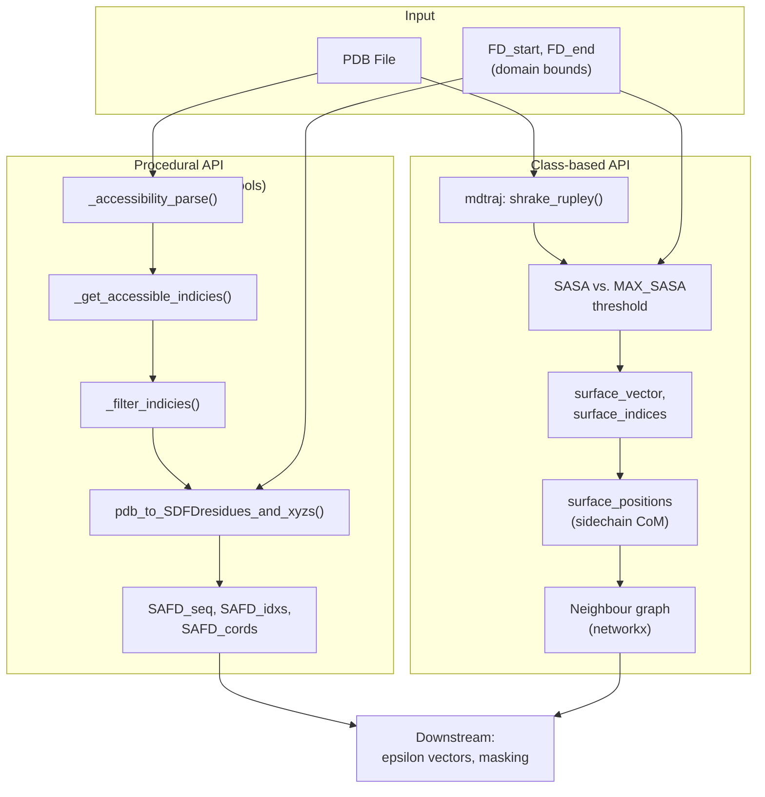

Finches provides two complementary systems for extracting solvent-accessible surface residues from PDB structures of folded domains — a **procedural function API** built on `soursop` and a **class-based API** built on `mdtraj`. Both share the same conceptual pipeline: parse a PDB → compute per-residue Solvent Accessible Surface Area (SASA) → threshold residues into surface vs. buried → return sequences, indices, and 3D coordinates for downstream interaction calculations.

## Architectural Overview

The surface residue extraction subsystem exists to bridge **static structural data** (PDB files) with **sequence-based interaction models**. Folded domains bury residues in their interior; only surface-exposed residues can participate in interdomain interactions with flanking intrinsically disordered regions (IDRs). Extracting these residues correctly is therefore a prerequisite for any physically meaningful epsilon calculation between an IDR and a folded domain.



The **procedural API** (`PDB_structure_tools`) is the earlier implementation, offering fine-grained functions that can be composed for custom workflows. The **class-based API** (`FoldedDomain`) is the newer, richer system that bundles surface identification with spatial graph construction, neighbour analysis, and direct epsilon computation on surface patches.

Sources: [PDB_structure_tools.py](/finches/PDB_structure_tools.py#L1-L11), [folded_domain_utils.py](/finches/utils/folded_domain_utils.py#L1-L66)

## The FoldedDomain Class

The `FoldedDomain` class in `finches.utils.folded_domain_utils` is the primary, recommended interface for surface residue extraction. It encapsulates the full lifecycle: PDB loading, SASA computation, surface classification, spatial coordinate extraction, and lazy evaluation of derived properties (neighbour graphs, distance matrices, epsilon values).

### Initialization and Core Attributes

Upon construction, a `FoldedDomain` object computes and exposes the following attributes:

| Attribute | Type | Description |
|---|---|---|
| `self.sequence` | `str` | Full amino acid sequence of the folded domain |
| `self.traj` | `mdtraj.Trajectory` | mdtraj trajectory object of the PDB |
| `self.sasa` | `np.ndarray` | Per-residue SASA in Ų (converted from nm²) |
| `self.surface_vector` | `list[int]` | Binary vector: 1 = surface, 0 = buried |
| `self.surface_indices` | `list[int]` | Residue indices classified as surface |
| `self.surface_positions` | `dict[int→np.ndarray]` | Sidechain center-of-mass XYZ for each surface residue |
| `self.surface_fraction` | `float` | Fraction of residues classified as surface-exposed |

These are computed eagerly during `__init__`. Several more expensive properties are computed lazily on first access via `@property` descriptors.

Sources: [folded_domain_utils.py](/finches/utils/folded_domain_utils.py#L66-L149)

### Constructor Parameters

```python
from finches.utils.folded_domain_utils import FoldedDomain

fd = FoldedDomain(
    pdbfilename='my_domain.pdb',
    start=None,                # start residue index (optional slice)
    end=None,                  # end residue index (optional slice)
    probe_radius=1.4,          # Å, solvent probe radius for SASA
    residue_overide_mapping={}, # map non-standard residue names
    surface_thresh=0.10,       # fraction of max SASA for classification
    sasa_mode='v1',            # 'v1' or 'v2' thresholding strategy
    ignore_warnings=False,
    SASA_ONLY=False            # if True, skip surface classification
)
```

| Parameter | Default | Purpose |
|---|---|---|
| `pdbfilename` | *(required)* | Path to the PDB file |
| `start` / `end` | `None` | Slice the PDB to a residue range before analysis |
| `probe_radius` | `1.4` | Solvent probe radius in Å (1.4 = water); internally converted to nm for mdtraj |
| `residue_overide_mapping` | `{}` | Dictionary mapping non-standard 3-letter residue names to standard ones |
| `surface_thresh` | `0.10` | Fraction of max SASA; residues above this fraction are surface-exposed |
| `sasa_mode` | `'v1'` | Controls the reference max SASA used for thresholding (see below) |
| `SASA_ONLY` | `False` | If `True`, compute only SASA and skip all surface analysis |

Sources: [folded_domain_utils.py](/finches/utils/folded_domain_utils.py#L70-L149)

### The Two SASA Thresholding Modes

The classification of a residue as surface-exposed depends on how the threshold is compared to a reference maximum SASA value. Finches ships with pre-computed `MAX_SASA_DATA` — a dictionary of per-amino-acid maximum SASA values derived from all-atom excluded-volume simulations of GXG tripeptides, where each entry is `[sidechain_max_SASA, backbone_max_SASA]`.

**Mode `v1`** (default) compares the residue's computed SASA against only the **sidechain** max SASA:

```python
solvent_accessible = sasa[i] > surface_thresh * MAX_SASA_DATA[sequence[i]][0]
```

Under v1, glycine (sidechain max SASA = 0) is classified as surface-exposed only if its computed SASA is also exactly zero (which means it is fully buried). In practice, glycines with any exposure are almost always classified as surface residues since `sasa > 0` is trivially satisfied once the residue has any exposure.

**Mode `v2`** compares against the **sum** of sidechain and backbone max SASA, making the criterion more stringent:

```python
solvent_accessible = sasa[i] > surface_thresh * (MAX_SASA_DATA[sequence[i]][0] + MAX_SASA_DATA[sequence[i]][1])
```

This accounts for the backbone contribution and typically classifies fewer residues as surface-exposed.

Sources: [folded_domain_utils.py](/finches/utils/folded_domain_utils.py#L14-L36), [folded_domain_utils.py](/finches/utils/folded_domain_utils.py#L198-L213)

### Surface Position Computation

After classifying surface residues, `FoldedDomain` computes 3D positions for each surface residue. Rather than using Cα coordinates, it uses the **sidechain center of mass** — which better represents where a surface residue's chemical groups actually are:

```python
atom_indices = p.topology.select(f'sidechain and resid {idx}')
if len(atom_indices) == 0:
    atom_indices = p.topology.select(f'resid {idx} and name CA')  # fallback for Gly
self.surface_positions[idx] = md.compute_center_of_mass(p.atom_slice(atom_indices))[0]
```

Glycine residues have no sidechain atoms, so the method falls back to Cα coordinates for them. This distinction matters for downstream neighbour graph construction and distance calculations, which use these positions as the basis for spatial proximity.

Sources: [folded_domain_utils.py](/finches/utils/folded_domain_utils.py#L220-L230)

## The Procedural API (PDB_structure_tools)

The `finches.PDB_structure_tools` module provides a set of composable functions for surface residue extraction using `soursop` as the backend PDB parser. These functions are lower-level but offer flexibility for custom pipelines.

### Core Pipeline Functions

The primary entry point is `pdb_to_SDFDresidues_and_xyzs()`, which orchestrates the full extraction in a single call:

```python
from finches.PDB_structure_tools import pdb_to_SDFDresidues_and_xyzs

SAFD_seq, SAFD_idxs, SAFD_cords = pdb_to_SDFDresidues_and_xyzs(
    pdb='protein.pdb',
    FD_start=50,
    FD_end=120,
    issolate_domain=False
)
```

This returns three objects: **SAFD_seq** (a string of solvent-accessible folded domain residues), **SAFD_idxs** (their indices into the full sequence), and **SAFD_cords** (their Cα XYZ coordinates from the PDB). The `issolate_domain` flag is reserved for computing SASA on the domain in isolation from surrounding chains, but is not yet implemented.

Sources: [PDB_structure_tools.py](/finches/PDB_structure_tools.py#L249-L339)

### Internal Pipeline Steps

The full pipeline decomposes into four steps, each exposed as a standalone function:

| Step | Function | Input → Output |
|---|---|---|
| 1. SASA computation | `_accessibility_parse(PO)` | soursop ProteinTrajectory → list of per-residue SASA |
| 2. Threshold | `_get_accessible_indicies(l_acc, threshold=10)` | SASA list → indices where SASA > threshold |
| 3. Domain filtering | `_filter_indicies(l_acc_idxs, FD_start, FD_end)` | accessible indices → indices within domain bounds |
| 4. Coordinate extraction | via `PO.get_multiple_CA_index()` | SAFD indices → Cα XYZ coordinates |

The default accessibility threshold in the procedural API is **10** (in the SASA units returned by soursop with `stride=1, probe_radius=7`), which is a different convention than the fractional threshold used by `FoldedDomain`.

Sources: [PDB_structure_tools.py](/finches/PDB_structure_tools.py#L22-L99)

### Alternative Entry Points

The module also provides functions that accept pre-computed data, avoiding redundant PDB parsing:

- **`accesssvector_to_SAFD_residues(sequence, FD_start, FD_end, accessibility_track)`** — given a pre-computed SASA track and sequence, returns `SAFD_seq` and `SAFD_idxs` without coordinates.
- **`tracks_to_SAFD_residues_and_xyzs(sequence, FD_start, FD_end, accessibility_track, full_cordinate_track)`** — given both a SASA track and a coordinate track, returns all three outputs without PDB re-parsing.
- **`pdb_to_xyz_cordinate_track(pdb)`** — extracts the full Cα coordinate track from a PDB for later use.

Sources: [PDB_structure_tools.py](/finches/PDB_structure_tools.py#L344-L491)

### Domain Flanking Analysis

The `extract_flanking_domain_combinations()` function uses `metapredict` to identify IDR/folded-domain boundaries in a PDB's sequence, then returns pairs of directly adjoining IDR and FD regions. This is useful for automated pipelines that need to identify which IDRs interact with which folded domains:

```python
from finches.PDB_structure_tools import extract_flanking_domain_combinations

flanking_combinations, IDRs, FDs = extract_flanking_domain_combinations(
    pdb='protein.pdb',
    return_domain_lists=True
)
# flanking_combinations: list of (idr_bounds, fd_bounds) tuples
```

Sources: [PDB_structure_tools.py](/finches/PDB_structure_tools.py#L572-L627)

## Mapping SAFD Vectors Back to Full Domain

After computing interaction vectors on only the solvent-accessible residues, you often need to project those values back onto the full folded domain for visualization. The `map_SAFD_vector_to_full_folded_domain()` function handles this:

```python
from finches.PDB_structure_tools import map_SAFD_vector_to_full_folded_domain

FULL_FD_vector, FULL_FD_idxs = map_SAFD_vector_to_full_folded_domain(
    partial_vector=attractive_vector,  # e.g., from epsilon_calculation
    SAFD_idxs=SAFD_idxs,
    FD_start=50,
    FD_end=120,
    null_value=0  # value for buried/non-accessible positions
)
```

The returned `FULL_FD_vector` has length `(FD_end - FD_start + 1)`, with SAFD values placed at their correct positions and `null_value` filling the gaps. This is directly usable as a color map for PyMOL or similar visualization tools.

Sources: [PDB_structure_tools.py](/finches/PDB_structure_tools.py#L495-L567)

## Spatial Accessibility Masking

The `build_column_mask_based_on_xyz()` function constructs a **2D binary mask** over an interaction matrix, encoding which (FD surface residue, IDR residue) pairs are physically reachable given polymer chain constraints. For each surface residue, it computes the 3D distance from that residue to the FD-IDR junction point, then compares that distance against the expected end-to-end distance of an equivalent-length (GS)ₙ polymer at the IDR residue's position. If the surface residue is closer than the polymer can reach, that matrix position is masked to 0.

```python
from finches.PDB_structure_tools import build_column_mask_based_on_xyz

mask = build_column_mask_based_on_xyz(
    matrix=interaction_matrix,
    SAFD_cords=SAFD_cords,
    IDR_positon='Cterm',  # 'Cterm', 'Nterm', or 'CUSTOM'
    origin_index=None      # required if IDR_positon='CUSTOM'
)
```

> [!TIP]
> The `IDR_positon` parameter (note: preserved typo for backwards compatibility) determines where the IDR attaches to the folded domain. `'Cterm'` uses the last SAFD coordinate as the junction; `'Nterm'` uses the first; `'CUSTOM'` requires an explicit `origin_index` into `SAFD_cords`.

Sources: [PDB_structure_tools.py](/finches/PDB_structure_tools.py#L157-L244)

## Comparison: Procedural API vs. FoldedDomain Class

| Aspect | `PDB_structure_tools` (procedural) | `FoldedDomain` (class) |
|---|---|---|
| **PDB backend** | soursop | mdtraj |
| **SASA method** | `PO.get_all_SASA(probe_radius=7)` | `md.shrake_rupley(probe_radius=1.4)` |
| **Threshold type** | Absolute (default: 10) | Fractional (default: 0.10 × max SASA) |
| **Coordinate type** | Cα atoms | Sidechain center of mass (Cα fallback for Gly) |
| **Surface positions** | Returned as array slice | Stored as `{index: xyz}` dict |
| **Neighbour graph** | Not available | Lazy `networkx` graph with edge weights |
| **Epsilon on surface** | Not available | `calculate_surface_epsilon()`, `calculate_mean_surface_epsilon()` |
| **Domain extraction** | `extract_flanking_domain_combinations()` | Not included (use `extract_and_write_domains()`) |
| **Visualization export** | Manual via `map_SAFD_vector_to_full_folded_domain()` | `write_SASA_vis_file()`, `write_epsilon_vis_file()` |
| **Recommended for** | Legacy pipelines, step-by-step control | New code, integrated analysis |

Sources: [PDB_structure_tools.py](/finches/PDB_structure_tools.py#L1-L40), [folded_domain_utils.py](/finches/utils/folded_domain_utils.py#L66-L149)

## Domain Extraction Utility

The standalone `extract_and_write_domains()` function provides a clean way to excise a specific residue range from a PDB and write it to a new file with renumbered indices — a common preprocessing step before running `FoldedDomain` on an isolated domain:

```python
from finches.utils.folded_domain_utils import extract_and_write_domains

extract_and_write_domains(
    pdb_file='full_protein.pdb',
    outfile='domain_only.pdb',
    start=50,
    end=120,
    reset_indices=True  # renumber residues and atoms starting from 1
)
```

Sources: [folded_domain_utils.py](/finches/utils/folded_domain_utils.py#L995-L1044)

## Practical Workflow

A typical end-to-end workflow combining surface extraction with interaction analysis looks like:

```python
from finches.utils.folded_domain_utils import FoldedDomain
from finches.frontend.mpipi_frontend import Mpipi_frontend

# 1. Initialize frontend for epsilon calculations
mf = Mpipi_frontend()

# 2. Load PDB and extract surface residues
fd = FoldedDomain('my_folded_domain.pdb', surface_thresh=0.10, sasa_mode='v1')

# 3. Inspect surface composition
print(f"Surface fraction: {fd.surface_fraction:.2f}")
print(f"Surface residues: {''.join(fd.sequence[i] for i in fd.surface_indices)}")

# 4. Compute surface epsilon against an IDR sequence
idr_sequence = "GSDEKRRGSDEKRRGSDEKRR"
surface_eps = fd.calculate_surface_epsilon(idr_sequence, mf.IMC_object)

# 5. Get mean surface epsilon
mean_eps = fd.calculate_mean_surface_epsilon(idr_sequence, mf.IMC_object)
```

> [!TIP]
> The `FoldedDomain` class lazily evaluates the neighbour graph on first access to `surface_neighbours`, `surface_graph`, or any surface distance property. If you only need SASA and surface classification, the graph is never built — avoiding the expensive `networkx` shortest-path computation. Call `fd.get_nearest_neighbour_res(distance_thresh=9.0)` explicitly if you want to control the neighbour distance threshold before any lazy trigger.

Sources: [folded_domain_utils.py](/finches/utils/folded_domain_utils.py#L486-L584)

## Next Steps

- **[Spatial Accessibility Masking](17-spatial-accessibility-masking)** — how the SAFD coordinates feed into 2D polymer-constraint masking of interaction matrices
- **[Epsilon Calculation and Weighting](9-epsilon-calculation-and-weighting)** — how surface epsilon values are computed from per-residue interaction pairs
- **[Domain Decomposition and Regions](18-domain-decomposition-and-regions)** — automated identification of IDR/FD boundaries within full sequences