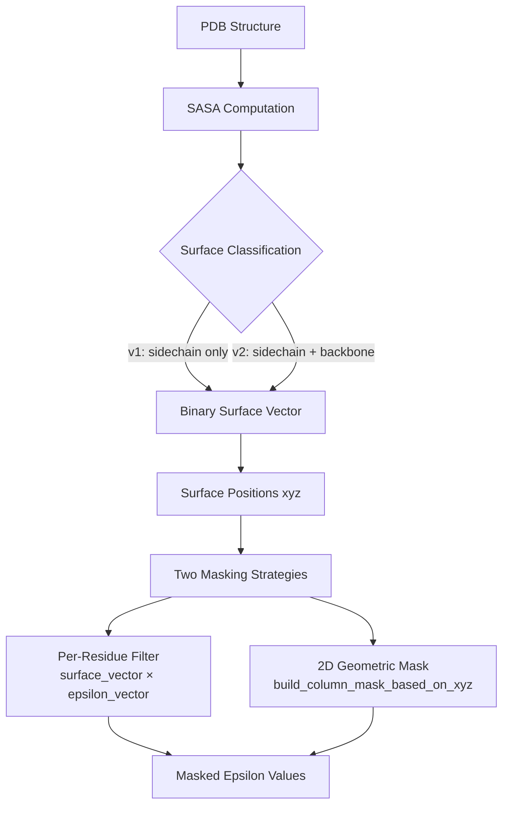
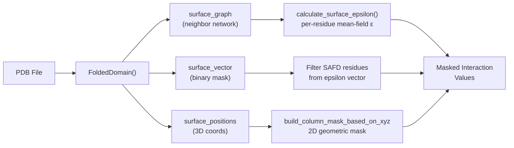

Spatial accessibility masking is the computational pipeline by which finches converts a folded domain's three-dimensional structure into binary and geometric masks that filter which residues participate in inter-domain interaction calculations. The core principle is straightforward: **buried residues cannot engage in intermolecular contacts**, so they must be excluded from epsilon computations. finches implements this through two complementary subsystems — the `FoldedDomain` class for per-residue SASA-based surface classification, and the `PDB_structure_tools` module for coordinate-driven geometric masking of interaction matrices.

## Conceptual Foundation: Why Masking Matters

When computing interaction strengths between an intrinsically disordered region (IDR) and a folded domain (FD), a naive approach would treat every residue in the FD as equally available for contact. This is physically incorrect: residues buried in the protein interior are inaccessible to the IDR chain. Without masking, epsilon values are systematically inflated because buried residues contribute spurious attractive or repulsive terms. Spatial accessibility masking resolves this by constructing a binary surface vector — 1 for solvent-exposed, 0 for buried — and then applying it either as a direct filter on per-residue epsilon vectors or as a 2D mask on interaction matrices, where additional geometric constraints exclude residue pairs that are physically unreachable given polymer chain connectivity.



Sources: [folded_domain_utils.py](/finches/utils/folded_domain_utils.py#L66-L248), [PDB_structure_tools.py](/finches/PDB_structure_tools.py#L157-L244)

## The FoldedDomain Class: SASA-Based Surface Classification

The `FoldedDomain` class is the primary entry point for spatial accessibility analysis. It loads a PDB structure via mdtraj, computes per-residue Solvent Accessible Surface Area (SASA) using the Shrake-Rupley algorithm, and classifies each residue as surface-exposed or buried against reference maximum SASA values derived from GXG tripeptide simulations.

### Initialization and Surface Vector Construction

Upon construction, `FoldedDomain` performs a tightly coupled sequence: PDB loading → SASA calculation → surface classification → 3D position extraction. The **surface vector** is the central data structure — a list of 0/1 values, one per residue, where 1 denotes solvent-accessible. Classification depends on the `sasa_mode` parameter, which controls the reference SASA used in the threshold comparison:

| Parameter | Default | Description |
|---|---|---|
| `pdbfilename` | *(required)* | Path to the PDB file to analyze |
| `start` / `end` | `None` | Residue index slice (both must be provided or neither) |
| `probe_radius` | `1.4` | SASA probe radius in Ångströms (converted to nm internally for mdtraj) |
| `surface_thresh` | `0.10` | Fractional threshold for surface classification |
| `sasa_mode` | `'v1'` | Surface classification mode (v1 or v2) |
| `residue_overide_mapping` | `{}` | Dict mapping non-standard residue names to standard ones |
| `ignore_warnings` | `False` | Suppress the start/end residue warning |
| `SASA_ONLY` | `False` | Compute only SASA, skip all downstream analysis |

```python
from finches.utils.folded_domain_utils import FoldedDomain

# Basic usage - load a PDB and classify surface residues
fd = FoldedDomain('my_protein.pdb')

# Access the binary surface vector
print(fd.surface_vector)      # e.g. [0, 1, 1, 0, 1, ...]
print(fd.surface_fraction)    # fraction of residues on the surface
print(fd.surface_indices)     # indices of surface-exposed residues
print(fd.sequence)            # full amino acid sequence string
```

Sources: [folded_domain_utils.py](/finches/utils/folded_domain_utils.py#L71-L149)

### SASA Modes: v1 vs v2

The two SASA modes differ in what reference maximum SASA they compare against, which controls how stringently a residue must be exposed to be classified as "surface":

**v1 (default)** compares the residue's computed SASA against only the **sidechain** maximum SASA. This means glycine (which has zero sidechain SASA) is classified as surface-exposed unless it is fully buried (residue SASA = 0 and max sidechain SASA = 0, so 0 > 0 evaluates false). The classification criterion is:

```
residue_sasa[i] > surface_thresh × MAX_SASA_DATA[residue][0]
```

**v2** compares against the **sum** of sidechain and backbone maximum SASA, making it more stringent — a residue must be more exposed (relative to its total possible exposure) to be classified as surface:

```
residue_sasa[i] > surface_thresh × (MAX_SASA_DATA[residue][0] + MAX_SASA_DATA[residue][1])
```

The `MAX_SASA_DATA` dictionary stores `[sidechain_max, backbone_max]` pairs for each amino acid, calculated from all-atom excluded-volume simulations of GXG tripeptides. These are fixed empirical constants — not user-configurable — and they anchor the fractional threshold to physically meaningful reference values.

Sources: [folded_domain_utils.py](/finches/utils/folded_domain_utils.py#L17-L36), [folded_domain_utils.py](/finches/utils/folded_domain_utils.py#L198-L217)

### Surface Positions and 3D Geometry

For each surface residue, `FoldedDomain` computes the **center of mass** of the sidechain atoms as the representative 3D coordinate. If a residue lacks sidechain atoms (e.g., glycine), the Cα atom position is used instead. These positions are stored in `surface_positions` as a dictionary mapping residue index → 3D coordinate (in nm, as returned by mdtraj). This coordinate information is essential for downstream geometric masking and for building the surface neighbor graph.

```python
fd = FoldedDomain('my_protein.pdb')

# Access 3D positions of surface residues
for idx, pos in fd.surface_positions.items():
    print(f"Residue {idx} ({fd.sequence[idx]}) at x={pos[0]:.2f}, y={pos[1]:.2f}, z={pos[2]:.2f}")
```

Sources: [folded_domain_utils.py](/finches/utils/folded_domain_utils.py#L220-L231)

## Surface Neighbor Graph and Distance Metrics

Beyond the binary surface vector, `FoldedDomain` lazily constructs a **networkx graph** of surface residues connected by spatial proximity. This graph is not built at initialization — it is computed on first access to any of the lazy properties (`surface_graph`, `surface_neighbours`, `surface_distance_surface`, `surface_distance_straight_line`, `all_shortest_paths`).

### Construction via `get_nearest_neighbour_res`

The method `get_nearest_neighbour_res(distance_thresh=9.0)` builds the neighbor graph by computing a pairwise Euclidean distance matrix between all surface residue positions, then connecting residues within the threshold (default 9 Å). Each edge is weighted by the Euclidean distance between the connected residues. From this graph, two distance metrics are derived:

| Metric | Property | Description |
|---|---|---|
| **Surface distance** | `surface_distance_surface` | Shortest-path distance through the graph (Dijkstra), reflecting the geodesic path along the protein surface |
| **Straight-line distance** | `surface_distance_straight_line` | Direct Euclidean distance, ignoring surface topology |

The surface distance is the physically meaningful metric for most applications — two residues may be close in Euclidean space but far apart along the protein surface (e.g., on opposite faces of a domain). The `surface_neighbours` dictionary maps each residue index to a list of `[neighbor_index, distance]` pairs, and `surface_neighbour_sequences` concatenates the one-letter codes of neighboring residues into a string for each surface position.

```python
fd = FoldedDomain('my_protein.pdb')

# Access surface neighbor graph (triggers lazy computation)
graph = fd.surface_graph
print(f"Surface graph: {graph.number_of_nodes()} nodes, {graph.number_of_edges()} edges")

# Compare surface vs. straight-line distance between two residues
i, j = fd.surface_indices[0], fd.surface_indices[5]
print(f"Surface dist: {fd.surface_distance_surface[i][j]:.1f} Å")
print(f"Straight-line: {fd.surface_distance_straight_line[i][j]:.1f} Å")
```

Sources: [folded_domain_utils.py](/finches/utils/folded_domain_utils.py#L324-L438), [folded_domain_utils.py](/finches/utils/folded_domain_utils.py#L256-L305)

## Geometric Masking of Interaction Matrices

While the `FoldedDomain` class provides per-residue surface classification, the `PDB_structure_tools` module offers a complementary approach: **2D geometric masking** of entire interaction matrices. The central function is `build_column_mask_based_on_xyz`, which constructs a binary mask based on whether each IDR–FD residue pair is geometrically reachable given polymer chain constraints.

### `build_column_mask_based_on_xyz`

This function takes an interaction matrix (rows = FD residues, columns = IDR residues), the 3D coordinates of solvent-accessible folded domain (SAFD) residues, and the position of the IDR attachment point (N-terminal, C-terminal, or custom). For each SAFD residue, it computes the Euclidean distance from the IDR attachment point on the FD. A matrix entry is set to 1 (accessible) if this distance is less than the expanded polymer limit for the corresponding IDR residue position, and 0 otherwise. The polymer limits come from the `GS_seqs_dic` reference data, which provides the expected end-to-end distance of an equivalent-length Gaussian chain.

| Parameter | Description |
|---|---|
| `matrix` | 2D interaction array with shape (FD_sequence, IDR_sequence) |
| `SAFD_cords` | 3D coordinates of SAFD residues (from `pdb_to_SDFDresidues_and_xyzs`) |
| `IDR_positon` | `'Cterm'`, `'Nterm'`, or `'CUSTOM'` — where IDR attaches to FD |
| `origin_index` | Custom attachment point index (required if `IDR_positon='CUSTOM'`) |

> [!TIP]
> The `build_column_mask_based_on_xyz` function is marked as "BROKEN" in the source code — it should be used with caution. The per-residue masking approach via `FoldedDomain.surface_vector` is the more robust and tested pathway for production use.

Sources: [PDB_structure_tools.py](/finches/PDB_structure_tools.py#L157-L244)

### SAFD Extraction Pipeline

Before building a geometric mask, you must extract the solvent-accessible folded domain (SAFD) residues and their coordinates. The `pdb_to_SDFDresidues_and_xyzs` function provides this in a single call:

```python
from finches.PDB_structure_tools import pdb_to_SDFDresidues_and_xyzs

SAFD_seq, SAFD_idxs, SAFD_cords = pdb_to_SDFDresidues_and_xyzs(
    pdb='my_protein.pdb',
    FD_start=50,    # folded domain start index
    FD_end=150      # folded domain end index
)
```

This returns three values: the concatenated sequence of solvent-accessible residues, their indices within the full protein, and their Cα coordinates in 3D space. Internally, it uses the `soursop` library for SASA computation (with a probe radius of 7 and stride 1) and a threshold of 10 for accessibility classification. For workflows where the PDB has already been parsed, `tracks_to_SAFD_residues_and_xyzs` accepts pre-computed accessibility and coordinate tracks to avoid redundant I/O.

Sources: [PDB_structure_tools.py](/finches/PDB_structure_tools.py#L249-L339), [PDB_structure_tools.py](/finches/PDB_structure_tools.py#L70-L99)

### Mapping SAFD Vectors Back to Full Domain

When epsilon vectors are computed using only the SAFD sequence, they must be mapped back to the full folded domain for visualization. The `map_SAFD_vector_to_full_folded_domain` function expands a partial vector (length = number of SAFD residues) into a full-length vector (length = FD_end - FD_start + 1), inserting a `null_value` (default 0) for buried positions:

```python
from finches.PDB_structure_tools import map_SAFD_vector_to_full_folded_domain

full_vector, full_indices = map_SAFD_vector_to_full_folded_domain(
    partial_vector=epsilon_vector,
    SAFD_idxs=SAFD_idxs,
    FD_start=50,
    FD_end=150,
    null_value=0
)
```

Sources: [PDB_structure_tools.py](/finches/PDB_structure_tools.py#L495-L567)

## Surface Epsilon: Masking Applied to Interaction Calculations

The `FoldedDomain` class provides three methods that directly apply spatial masking to epsilon calculations, producing per-residue or per-patch interaction values that account for local surface chemistry.

### `calculate_surface_epsilon`

This is the core method. For each solvent-accessible residue, it: (1) collects the neighboring surface residues within the distance threshold, (2) reorders the neighbor sequence to prioritize chemically similar residues adjacent to the center residue (hydrophobes near hydrophobes, charged near like-charged), and (3) computes the mean-field epsilon between the reordered neighbor string and the input sequence, normalized by the neighbor string length. This produces a dictionary mapping residue index → `[residue_type, neighbor_string, surface_epsilon_value]`.

### `calculate_attractive_surface_epsilon` / `calculate_repulsive_surface_epsilon`

These convenience methods filter the surface epsilon values, returning only those below (attractive) or above/equal (repulsive) to a threshold (default 0). They are useful for identifying which surface patches drive favorable vs. unfavorable interactions with a given IDR sequence.

```python
from finches.utils.folded_domain_utils import FoldedDomain
from finches.frontend.mpipi_frontend import Mpipi_frontend

# Initialize FoldedDomain and frontend
fd = FoldedDomain('my_protein.pdb')
mf = Mpipi_frontend()

# Calculate per-residue surface epsilon against an IDR sequence
idr_sequence = "MSTPQKLEREVD"
surface_eps = fd.calculate_surface_epsilon(idr_sequence, mf.IMC_object)

# Extract only attractive patches
attractive = fd.calculate_attractive_surface_epsilon(idr_sequence, mf.IMC_object)
print(f"Attractive surface residues: {len(attractive)} out of {len(fd.surface_indices)}")
```

Sources: [folded_domain_utils.py](/finches/utils/folded_domain_utils.py#L486-L584), [folded_domain_utils.py](/finches/utils/folded_domain_utils.py#L619-L696)

### IDR–Surface Patch Interactions

For higher-resolution analysis, `calculate_idr_surface_patch_interactions` computes a **per-patch, per-IDR-window** epsilon matrix. It tiles the IDR sequence into overlapping windows of `idr_tile_size` (must be odd) and computes epsilon between each window and each surface patch (defined by residues within `patch_radius` Å of a center residue). The return value is a tuple of: the interaction dictionary, the full epsilon matrix (NaN for non-surface residues), and the mean epsilon vector across all patches.

Sources: [folded_domain_utils.py](/finches/utils/folded_domain_utils.py#L891-L985)

## Inverse Weighted Distance (IWD) for Surface Residue Clustering

The `calculate_IWD` method quantifies the spatial clustering of specific residue types on the protein surface using the inverse weighted distance metric from Schueler-Furman & Baker (2003). Given a set of residues (by type or by explicit positions), it computes the mean of 1/d across all pairs, where d is either surface distance or straight-line distance. An optional null distribution is generated by randomizing residue positions across the surface, enabling statistical assessment of whether observed clustering exceeds chance.

```python
fd = FoldedDomain('my_protein.pdb')

# IWD of hydrophobic residues on the surface
iwd, n_res, null_dist = fd.calculate_IWD(
    residues=['I', 'V', 'L', 'A', 'M'],
    distance_mode='surface',
    calculate_null=True,
    number_null_iterations=1000
)
```

Sources: [folded_domain_utils.py](/finches/utils/folded_domain_utils.py#L703-L820)

## Complete Workflow: From PDB to Masked Epsilon

The following diagram illustrates the end-to-end pipeline for applying spatial accessibility masking to an IDR–FD interaction calculation:



> [!TIP]
> The `FoldedDomain` class is aliased as `FoldeDomain` (missing the terminal 'd') for backward compatibility. Both names refer to the same class — use `FoldedDomain` in new code.

Sources: [folded_domain_utils.py](/finches/utils/folded_domain_utils.py#L62-L65), [folded_domain_utils.py](/finches/utils/folded_domain_utils.py#L987-L989)

## Visualization Output

Two methods support exporting masked data for external visualization tools (e.g., PyMOL coloring scripts): `write_SASA_vis_file` writes a per-residue binary surface classification, and `write_epsilon_vis_file` writes per-residue surface epsilon values. Both use the format `<residue_index> A <value>`, one line per residue.

Sources: [folded_domain_utils.py](/finches/utils/folded_domain_utils.py#L827-L888)

---

**Next steps**: For the PDB parsing and surface residue extraction that feeds into spatial accessibility masking, see [PDB Surface Residue Extraction](16-pdb-surface-residue-extraction). For how masked epsilon values propagate into phase diagram calculations, see [Flory-Huggins Phase Diagrams](14-flory-huggins-phase-diagrams). For the epsilon computation engine itself, see [Epsilon Calculation and Weighting](9-epsilon-calculation-and-weighting).