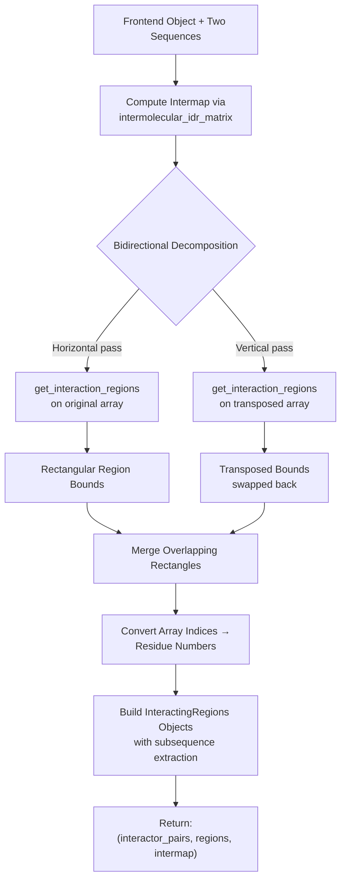

The `finches.domain_decomposition` module provides an algorithmic pipeline for **automatically identifying and bounding spatial regions of preferential interaction** within an intermolecular interaction map (intermap). Rather than manually inspecting 2D heatmaps, you can programmatically extract rectangular regions where two sequences exhibit strong attractive or repulsive behavior, complete with residue-level boundaries, subsequence extraction, and visualization overlays. This is the bridge between raw interaction matrices and biologically interpretable domain–domain interaction predictions.

Sources: [domain_analysis.py](finches/domain_decomposition/domain_analysis.py#L1-L796)

## Conceptual Architecture

Domain decomposition in finches operates as a **three-stage pipeline** that progressively narrows from 1D column counts → 2D rectangular bounds → bidirectional merged regions. The central insight is that an intermap's columns (and rows) encode a 1D signal of "how many residues in sequence 2 interact with this position in sequence 1 below a threshold." Peaks in that signal define candidate interaction corridors, and the algorithm recursively applies peak detection on sub-slices to refine 2D boundaries.



The bidirectional strategy exists because `get_interaction_regions` has an inherent directional bias: its first pass operates on columns, making it more sensitive to "vertically oriented" interaction blocks. Running both the original and transposed array and merging overlapping results captures horizontally oriented blocks that would otherwise be missed.

Sources: [domain_analysis.py](finches/domain_decomposition/domain_analysis.py#L628-L696), [domain_analysis.py](finches/domain_decomposition/domain_analysis.py#L90-L198)

## The `InteractingRegions` Data Structure

The `InteractingRegions` class is the primary output object — a structured container that captures both the **strict peak boundaries** and the **window-expanded boundaries** for each interacting region pair.

| Attribute | Type | Description |
|---|---|---|
| `r1_start` / `r1_end` | `int` | Start/end residue indices for sequence 1 (peak bounds) |
| `r1_sequence` | `str` | Subsequence of sequence 1 within peak bounds |
| `r2_start` / `r2_end` | `int` | Start/end residue indices for sequence 2 (peak bounds) |
| `r2_sequence` | `str` | Subsequence of sequence 2 within peak bounds |
| `r1_start_full` / `r1_end_full` | `int` | Expanded bounds including half-window on each side |
| `r1_sequence_full` | `str` | Subsequence at the expanded (full-window) bounds |
| `rectangle_info` | `property` | List of `[x_start, x_end, y_start, y_end, kwargs]` for plotting |

The distinction between `r1_start`/`r1_end` and `r1_start_full`/`r1_end_full` is deliberate: the peak-detection algorithm identifies the center of each sliding window, but the actual interaction extends ±half-window residues around that center. The `_full` attributes expand the bounds accordingly, giving you the complete sequence context that contributes to the detected interaction.

> [!TIP]
> When using `InteractingRegions.rectangle_info` for visualization, you can customize the rectangle appearance by setting `ir.edgecolor` or `ir.rectangle_kwargs = {'facecolor': 'blue', 'alpha': 0.3}` before accessing the property. The kwargs are merged into the matplotlib Rectangle parameters at render time.

Sources: [domain_analysis.py](finches/domain_decomposition/domain_analysis.py#L12-L88)

## The `extract_regions` Entry Point

This is the primary user-facing function that orchestrates the full pipeline:

```python
from finches.frontend.mpipi_frontend import Mpipi_frontend
from finches.domain_decomposition.domain_analysis import extract_regions

mf = Mpipi_frontend()

s1 = 'MESNQSNNGGSGNAALNRGGRYVPPHLRGGDGGAAAAASAGGDDRRGGAGGGGYRRG'
s2 = 'LEGMSGDMRSGGGYRGRGGRGNGQRFGGRDHRYQGGSGNGGGGNGGGGGFGGGGQRSGG'

interactor_pairs, regions, intermap = extract_regions(
    frontend_obj=mf,
    seq1=s1,
    seq2=s2,
    window_size=31,
    criteria="less",
    criteria_threshold=-0.2,
    baseline=0.3,
    min_region_area=500,
    min_region_size=20
)
```

The return tuple contains: **(1)** a list of `InteractingRegions` objects with residue-level boundaries and subsequences, **(2)** the raw rectangular bounds in array-index space, and **(3)** the full intermap array for downstream visualization or analysis.

Sources: [domain_analysis.py](finches/domain_decomposition/domain_analysis.py#L90-L198)

## Parameter Reference

The decomposition algorithm exposes several interdependent thresholds that control region sensitivity and specificity:

| Parameter | Default | Role |
|---|---|---|
| `window_size` | `31` | Sliding window for intermap computation. Must be odd; even values are auto-corrected with a warning. |
| `criteria` | `"less"` | Direction of thresholding: `"less"` selects attractive (negative ε) regions; `"greater"` selects repulsive (positive ε) regions. |
| `criteria_threshold` | `-0.2` | The ε value at which masking is applied. Values more negative than this are considered "interacting" when `criteria="less"`. |
| `baseline` | `0.3` | Fraction of peak height that defines the "edge" of a peak. A peak's boundary is where the signal drops below `baseline × peak_height`. |
| `min_region_area` | `500` | Minimum area (width × height in residues) for a region to be retained. Filters out small spurious patches. |
| `min_region_size` | `20` | Minimum linear dimension (in residues) along either axis. Ensures regions are biologically meaningful in extent. |
| `penalize_opposite` | `False` | When `True`, subtracts counts of oppositely-signed interactions from the column counts, penalizing regions that overlap with strong opposite-character interactions. |
| `offset_threshold` | `0.2` | Threshold for the opposite-sign penalty. Mirrors `criteria_threshold` for the opposite direction. |

**Tuning guidance**: Lowering `criteria_threshold` (e.g., from -0.2 to -0.5) makes the algorithm more selective, retaining only the strongest interaction patches. Raising `baseline` (e.g., from 0.3 to 0.5) makes peak edges sharper, producing tighter boundaries. Decreasing `min_region_area` and `min_region_size` increases sensitivity to small interaction patches at the cost of more potential false positives.

Sources: [domain_analysis.py](finches/domain_decomposition/domain_analysis.py#L90-L198), [domain_analysis.py](finches/domain_decomposition/domain_analysis.py#L300-L398)

## Algorithm Deep Dive: Three-Pass Peak Detection

The core of the decomposition is `get_interaction_regions`, which performs a **recursive three-pass peak detection** on the 2D intermap array. Each pass narrows the search space:

### Pass 1 — Column Scan

The intermap is thresholded into a binary mask (values ≤ `criteria_threshold` when `criteria="less"`). Column-wise sums produce a 1D count signal. `scipy.signal.find_peaks` identifies peaks in a smoothed version (3-point moving average) of this signal. Each peak's width is measured using `peak_width`, which walks outward from the peak until the signal drops below `baseline × peak_height`. Peaks narrower than `min_region_size` are discarded.

### Pass 2 — Row Scan within Each Column Peak

For each column-peak region, the corresponding sub-slice of the intermap is transposed and the same peak detection is applied. This identifies row ranges where the interaction is concentrated *within* the column corridor.

### Pass 3 — Column Scan within Each Row Sub-Region

For each row sub-region within each column peak, the algorithm extracts the 2D sub-sub-map and applies peak detection once more on columns. This final pass refines the horizontal boundaries, producing tight rectangular bounds.

Each resulting rectangle is evaluated against `min_region_area` and `min_region_size` in both dimensions before acceptance.

```mermaid
flowchart LR
    subgraph "Pass 1: Column Scan"
        A[Full Intermap] --> B[Column-wise count signal]
        B --> C[find_peaks + peak_width]
        C --> D["Column bounds:<br>(left_idx, right_idx)"]
    end
    subgraph "Pass 2: Row Scan"
        D --> E["Extract submap[:, left:right]"]
        E --> F["Transpose → row count signal"]
        F --> G["Row bounds:<br>(bottom_idx, top_idx)"]
    end
    subgraph "Pass 3: Refinement"
        G --> H["Extract subsubmap[bot:top, left:right]"]
        H --> I["Column count on subsubmap"]
        I --> J["Final rectangular bounds"]
    end
```



Sources: [domain_analysis.py](finches/domain_decomposition/domain_analysis.py#L401-L598), [domain_analysis.py](finches/domain_decomposition/domain_analysis.py#L210-L298)

## Bidirectional Merging

Because the three-pass algorithm is column-first, it produces regions that are tall-and-narrow biased. `get_bidirectional_interaction_regions` resolves this by running `get_interaction_regions` on both the original and transposed array, then **merging any overlapping rectangles** using a greedy pairwise algorithm:

1. Run the decomposition on the array → `regions_1`
2. Run the decomposition on the transposed array → `regions_2`, then swap each bound tuple from `((x_start, x_end), (y_start, y_end))` to `((y_start, y_end), (x_start, x_end))`
3. Combine both region lists
4. Iteratively check all pairs for overlap via `rectangles_overlap`; when overlap is found, replace the pair with a **bounding box** (min of left edges, max of right edges) and restart the scan
5. Repeat until no overlaps remain

The overlap test uses standard axis-aligned rectangle separation logic: two rectangles do NOT overlap if one is entirely to the left/right or above/below the other; otherwise they overlap.

> [!TIP]
> The merge algorithm's complexity is O(n²) per iteration with restart-on-merge semantics. For very large numbers of regions (>100), this could become slow. In practice, most protein–protein intermaps produce fewer than 20 regions, so this is rarely a concern.

Sources: [domain_analysis.py](finches/domain_decomposition/domain_analysis.py#L628-L696), [domain_analysis.py](finches/domain_decomposition/domain_analysis.py#L600-L626)

## Index Conversion: Array Space ↔ Residue Space

The intermap is computed using a sliding window of size `window_size`, which means the array indices do not directly correspond to residue numbers. The function `convert_intermap_index_to_residue_number` performs this mapping:

```python
residue_number = array_index + window_half
# where window_half = (window_size - 1) / 2
```

For a default `window_size=31`, `window_half=15`, so array index 0 corresponds to residue 16, array index 1 to residue 17, and so on. This offset accounts for the fact that the first valid window centers on the 16th residue (with 15 residues on each side).

Sources: [domain_analysis.py](finches/domain_decomposition/domain_analysis.py#L200-L225)

## Visualization with `plot_regions_on_intermap`

The module provides a convenience function to overlay detected region rectangles on the intermap heatmap:

```python
from finches.domain_decomposition.domain_analysis import plot_regions_on_intermap

# Plot with multiple region sets in different colors
plot_regions_on_intermap(
    array=intermap,
    regions_lists=[regions_set_1, regions_set_2],
    colors=['red', 'blue'],
    filename='output.png'  # None to display interactively
)
```

The function renders the intermap using the `PRGn` colormap (purple = attractive, green = repulsive) with `vmin=-2.5, vmax=2.5`, draws `matplotlib.patches.Rectangle` outlines for each region, and labels the axes as "Sequence 1" and "Sequence 2". The y-axis is inverted to match the standard intermap orientation.

Sources: [domain_analysis.py](finches/domain_decomposition/domain_analysis.py#L700-L796)

## Utility Functions

Several lower-level functions support the pipeline and are available for custom analysis workflows:

| Function | Signature | Purpose |
|---|---|---|
| `peak_width` | `(data, peak_index, baseline)` | Walks left and right from a peak until signal drops below `baseline`; returns `(width, left_index, right_index)`. Raises `PeakError` if the peak value is already below baseline. |
| `remove_included_ranges` | `(ranges)` | Given a list of `(width, left, right)` tuples, removes any range fully enclosed within another. Sorted by left boundary, then filtered iteratively. |
| `rectangles_overlap` | `(R1, R2)` | Returns `True` if two axis-aligned rectangles overlap, using separation-axis testing. |
| `rectangle_area` | `(rect)` | Computes `width × height` from `((left, right), (bottom, top))` bound format. |

Sources: [domain_analysis.py](finches/domain_decomposition/domain_analysis.py#L230-L298), [domain_analysis.py](finches/domain_decomposition/domain_analysis.py#L600-L660)

## Putting It All Together: End-to-End Example

```python
from finches import Mpipi_frontend
from finches.domain_decomposition.domain_analysis import extract_regions, plot_regions_on_intermap

# Initialize frontend
mf = Mpipi_frontend()

# Define two sequences (e.g., IDR regions from different proteins)
s1 = 'MESNQSNNGGSGNAALNRGGRYVPPHLRGGDGGAAAAASAGGDDRRGGAGGGGYRRGGGNSGGGGGGGYDRGYNDNRDDRDNRGGSGGYGRDRNYEDRGYNGGGGGGGNRGYNNNRGGGGGGYNRQDRGDGGSSNFSRGGYNNRDEGSDNRGSGRSYNNDRRDNGGD'
s2 = 'LEGMSGDMRSGGGYRGRGGRGNGQRFGGRDHRYQGGSGNGGGGNGGGGGFGGGGQRSGGGGGFQSGGGGGRQQQQQQRAQPQQDWWS'

# Extract interacting regions
interactor_pairs, raw_regions, intermap = extract_regions(
    frontend_obj=mf,
    seq1=s1,
    seq2=s2,
    window_size=31,
    criteria="less",          # find attractive interactions
    criteria_threshold=-0.2,  # ε below -0.2 considered interacting
    baseline=0.3,             # peak edge at 30% of peak height
    min_region_area=500,      # require at least 500 residue² area
    min_region_size=20        # require at least 20 residues per dimension
)

# Inspect each interacting region
for ir in interactor_pairs:
    print(f"Seq1 residues {ir.r1_start}-{ir.r1_end}: {ir.r1_sequence}")
    print(f"Seq2 residues {ir.r2_start}-{ir.r2_end}: {ir.r2_sequence}")
    print(f"Full-window seq1: {ir.r1_start_full}-{ir.r1_end_full}")
    print(f"Full-window seq2: {ir.r2_start_full}-{ir.r2_end_full}")
    print("---")

# Visualize regions overlaid on the intermap
plot_regions_on_intermap(intermap, [raw_regions], ['red'], filename='regions.png')
```

Sources: [domain_analysis.py](finches/domain_decomposition/domain_analysis.py#L90-L198), [domain_analysis.py](finches/domain_decomposition/domain_analysis.py#L700-L796)

## Relationship to Adjacent Modules

The domain decomposition pipeline sits downstream of the intermap computation and complements the folded domain analysis tools:

- **[Interaction Maps and Figures](6-interaction-maps-and-figures)** — generates the raw intermap that `extract_regions` operates on
- **[Sliding Window Matrix Computation](10-sliding-window-matrix-computation)** — the `InteractionMatrixConstructor.calculate_sliding_epsilon` call underpins the intermap generation
- **[PDB Surface Residue Extraction](16-pdb-surface-residue-extraction)** and **[Spatial Accessibility Masking](17-spatial-accessibility-masking)** — the `FoldedDomain` class in `folded_domain_utils.py` provides orthogonal functionality for identifying surface residues on structured domains; these can be combined with domain decomposition to analyze IDR–folded-domain interfaces

For sequence-level interaction analysis without region extraction, see [Per-Residue Interaction Vectors](7-per-residue-interaction-vectors). For the underlying ε calculation that feeds the intermap, see [Epsilon Calculation and Weighting](9-epsilon-calculation-and-weighting).
