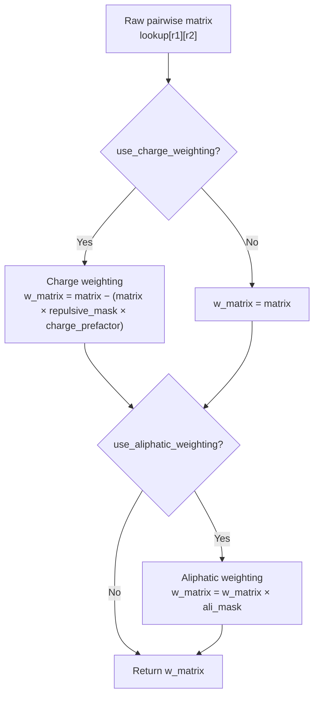

Finches implements two principal **sequence context weighting schemes** — charge weighting and aliphatic clustering weighting — that correct the raw pairwise interaction matrix for local sequence context effects that coarse-grained forcefields cannot capture at the residue-pair level alone. Both schemes operate as multiplicative or subtractive transforms on the interaction matrix *before* epsilon aggregation, meaning they alter the effective per-residue interaction strengths without changing the underlying forcefield parameters. A third context-dependent scheme — spatial accessibility masking for folded domain–IDR interfaces — combines charge weighting with 3D geometric reachability and is discussed in [Spatial Accessibility Masking](17-spatial-accessibility-masking).

## Architectural Overview

The weighting pipeline is a sequential transform on the raw pairwise matrix. The `calculate_weighted_pairwise_matrix` method orchestrates the order: the raw matrix is first charge-weighted (subtractive), then aliphatic-weighted (multiplicative). This ordering matters because charge weighting adjusts repulsive elements in-place, and aliphatic weighting then scales the entire matrix — including the already charge-adjusted values.



Each weighting scheme is implemented as a **mask-generation function** in `parsing_aminoacid_sequences.py` that returns a 2D array of the same shape as the interaction matrix. The mask encodes per-position weighting factors derived from the local sequence context, which are then applied algebraically in `epsilon_calculation.py`.

Sources: [epsilon_calculation.py](/finches/epsilon_calculation.py#L494-L603), [parsing_aminoacid_sequences.py](/finches/parsing_aminoacid_sequences.py#L25-L306)

## Charge Context Weighting

### Physical Rationale

In a mean-field implicit solvent model, like-charge repulsion between two residues is computed as if both sidechains point toward one another and experience full electrostatic penalty. In reality, charged sidechains on a polypeptide chain can reorient away from each other and/or experience pKa shifts that attenuate their effective charge. The **charge context weighting** scheme corrects for this by weakening repulsive interactions between charged residues that are embedded in local sequence patches of **like charge** — the physical intuition being that clusters of same-sign charges have already partially screened each other through sidechain reorientation, so their cross-sequence repulsion is overestimated by the raw model.

Sources: [parsing_aminoacid_sequences.py](/finches/parsing_aminoacid_sequences.py#L25-L96), [epsilon_calculation.py](/finches/epsilon_calculation.py#L546-L594)

### The |NCPR/FCR| Weighting Factor

For each pair of charged residues (r₁ from sequence 1, r₂ from sequence 2), the scheme extracts a **window of ±1 residues** around each position, concatenates the two local fragments, and computes:

$$w_{\text{charge}} = \left|\frac{\text{NCPR}}{\text{FCR}}\right|$$

where **NCPR** is the net charge per residue and **FCR** is the fraction of charged residues of the concatenated fragment. This ratio has elegant boundary behavior:

| Fragment composition | NCPR | FCR | \|NCPR/FCR\| | Interpretation |
|---|---|---|---|---|
| All same-sign charges (e.g. `EEE`) | ±1.0 | 1.0 | **1.0** | Maximum weight — like-charge cluster, most over-counted repulsion |
| Equal mix of +/− charges (e.g. `KEE`) | 0.0 | 1.0 | **0.0** | No weight — charges balance, no systematic over-counting |
| Single charged in neutral context (e.g. `KAA`) | 0.33 | 0.33 | **1.0** | Isolated charge gets full weight (FCR=NCPR for single-charge fragments) |
| No charged residues | — | 0 | **0.0** | No weight — non-charged pair, mask entry is zero |

The weighting factor is then applied as a **subtractive correction** to the repulsive portion of the interaction matrix:

```python
w_matrix = matrix - (matrix * repulsive_mask * charge_prefactor)
```

The `charge_prefactor` (0 < prefactor < 1) is a forcefield-specific scalar that controls the overall magnitude of the correction. It is calibrated per model and stored in the forcefield's `CONFIGS` dictionary.

> [!TIP]
> The charge weighting only generates a **repulsive mask** — the attractive mask is computed but currently unused. An alternative implementation that split weighting into both attractive and repulsive components was tested but found to perform worse across calibration benchmarks. The commented-out alternative remains in source for reference.

Sources: [parsing_aminoacid_sequences.py](/finches/parsing_aminoacid_sequences.py#L97-L194), [sequence_tools.py](/finches/sequence_tools.py#L76-L113)

### Window Extraction: `get_neighbors_window_of3`

The local fragment around each charged residue is extracted by `get_neighbors_window_of3(i, sequence)`, which returns the residue at position `i` plus one neighbor on each side (window size ≤ 3). At sequence boundaries, the window gracefully truncates to 2 or 1 residues rather than padding. The two windows from sequence 1 and sequence 2 are concatenated into a single fragment of up to 6 residues for the NCPR/FCR calculation.

Sources: [sequence_tools.py](/finches/sequence_tools.py#L164-L195)

### Folded Domain Variant: `get_charge_weighted_FD_mask`

For interdomain interactions between a **solvent-accessible folded domain (SAFD)** surface and an IDR, the charge weighting is asymmetric: the folded domain residue is treated in isolation (no ±1 window), while the IDR residue still gets its ±1 context window. This reflects the physical reality that surface residues on a folded domain have fixed orientations dictated by the tertiary structure, not by local sequence context. The concatenated fragment is therefore `r1 + get_neighbors_window_of3(j, sequence2)` rather than the symmetric double-window.

Sources: [parsing_aminoacid_sequences.py](/finches/parsing_aminoacid_sequences.py#L200-L246), [epsilon_stateless.py](/finches/epsilon_stateless.py#L271-L422)

## Aliphatic Clustering Weighting

### Physical Rationale

In implicit solvent coarse-grained models, the attractive interaction between two aliphatic (hydrophobic) residues reflects the energetics of water release at the interface. However, water release is a **quantized** phenomenon: two isolated leucines may not form a sufficiently large hydrophobic patch to release many water molecules, whereas two clusters of leucines create a contiguous interface that does. The **aliphatic clustering weighting** scheme up-weights attractive interactions between aliphatic residues that belong to local clusters, making clustered aliphatics effectively more hydrophobic than the same number of individually spaced aliphatics.

Sources: [parsing_aminoacid_sequences.py](/finches/parsing_aminoacid_sequences.py#L252-L306)

### Group Assignment: `get_aliphatic_groups`

Each aliphatic residue (A, V, I, L, M) in a sequence is assigned to a **group** based on how many aliphatic neighbors it has within its local fragment. The process works in three stages:

1. **Binary mask**: The sequence is converted to a binary mask where aliphatic positions = 1, all others = 0.
2. **Nearest-neighbor counting**: `MASK_n_closest_nearest_neighbors` counts how many aliphatic neighbors each aliphatic residue has within its connected fragment (fragments are defined by `extract_fragments` with `max_separation=1`, meaning at most one gap between aliphatics before the fragment splits).
3. **Group thresholding**: The raw neighbor count is capped at 3, producing three groups:

| Group | Neighbor count | Physical meaning |
|---|---|---|
| **0** | N/A (non-aliphatic) | No aliphatic weighting applied |
| **1** | 1 | Isolated aliphatic — no clustering benefit |
| **2** | 2 | Small cluster — moderate hydrophobic enhancement |
| **3** | ≥3 | Large cluster — strong hydrophobic enhancement |

Sources: [parsing_aminoacid_sequences.py](/finches/parsing_aminoacid_sequences.py#L311-L341), [sequence_tools.py](/finches/sequence_tools.py#L236-L317)

### Multiplicative Weighting Table

The aliphatic mask is a 2D matrix where each entry is determined by the group pairing between the two sequences. The **multiplier_weighting** dictionary defines the scaling factor for each group combination:

|  | Seq2: Group 1 | Seq2: Group 2 | Seq2: Group 3 |
|---|---|---|---|
| **Seq1: Group 1** | 1.0 | 1.0 | 1.0 |
| **Seq1: Group 2** | 1.0 | **1.5** | **1.5** |
| **Seq1: Group 3** | 1.0 | **1.5** | **3.0** |

Key observations from this table: interactions involving at least one isolated aliphatic (Group 1) are **never scaled** (multiplier = 1.0). Scaling only activates when both residues belong to clusters. The maximum multiplier of **3.0** occurs when two large clusters interact, reflecting the disproportionately large hydrophobic interface created by clustered–clustered contact. The asymmetric 1.5 factors for mixed group-2/group-3 pairings represent intermediate enhancement.

The mask is applied as a **pure multiplicative** transform:

```python
w_matrix = w_matrix * ali_mask
```

This means aliphatic weighting scales *all* interactions — both attractive and repulsive — for positions where aliphatic clustering is present. Non-aliphatic positions have a mask value of 1.0, leaving them unchanged.

> [!TIP]
> Aliphatic clustering weighting is **not applied** in interdomain (folded domain–IDR) calculations. The rationale is that aliphatic groups are not computed for the surface of folded domains, so all aliphatics on the FD surface are treated as if they are in isolation (Group 1). See `get_interdomain_epsilon_vectors` where `use_aliphatic_weighting` is absent from the parameter list.

Sources: [parsing_aminoacid_sequences.py](/finches/parsing_aminoacid_sequences.py#L284-L306), [epsilon_calculation.py](/finches/epsilon_calculation.py#L597-L599)

## Fragment Extraction and Neighbor Counting

Both weighting schemes depend on `sequence_tools.py` utilities for extracting local sequence context:

### `extract_fragments(mask, max_separation=1)`

Converts a binary mask into contiguous fragments, where a fragment is a run of 1s separated by at most `max_separation` zeros. For example, with `max_separation=1`:

```
Input:  [0, 0, 1, 1, 1, 0, 1, 1, 0, 0, 0, 1, 0, 0, 1, 1, 0, 0, 1, 0, 1, 1, 0, 1]
Output: ['111011', '1', '11', '11', '101101']
```

The single zero between positions 4 and 6 is bridged into one fragment, while two or more zeros create a fragment boundary.

### `MASK_n_closest_nearest_neighbors(mask, max_separation=1, max_distance=4)`

For each position in the mask that is 1 (aliphatic), this function counts the number of aliphatic neighbors within a window of `max_distance=4` residues around that position, *within its local fragment*. The result is a non-binary mask where each aliphatic position holds its neighbor count and non-aliphatic positions remain 0.

Sources: [sequence_tools.py](/finches/sequence_tools.py#L201-L317)

## Integration into the Epsilon Pipeline

The complete weighting pipeline flows through `calculate_weighted_pairwise_matrix`, which is called by all downstream epsilon computation functions. The following table summarizes which weighting schemes are active in each computation path:

| Computation function | Charge weighting | Aliphatic weighting | Spatial (XYZ) masking |
|---|---|---|---|
| `calculate_epsilon_value` | ✓ | ✓ | ✗ |
| `calculate_epsilon_vectors` | ✓ | ✓ | ✗ |
| `calculate_sliding_epsilon` | ✓ | ✓ | ✗ |
| `get_interdomain_epsilon_vectors` | ✓ (FD variant) | ✗ | ✓ |
| `get_interdomain_epsilon_value` | ✓ (FD variant) | ✗ | ✓ |

All IDR–IDR computations default to both charge and aliphatic weighting enabled. Both can be disabled via `use_charge_weighting=False` and `use_aliphatic_weighting=False` flags. Interdomain computations use the asymmetric `get_charge_weighted_FD_mask` and apply spatial accessibility masking but skip aliphatic weighting entirely.

Sources: [epsilon_calculation.py](/finches/epsilon_calculation.py#L614-L701), [epsilon_stateless.py](/finches/epsilon_stateless.py#L119-L268), [epsilon_stateless.py](/finches/epsilon_stateless.py#L271-L422)

## Controlling Weighting via the API

The weighting flags are exposed at every level of the computation stack. At the `InteractionMatrixConstructor` level:

```python
from finches.forcefields.mpipi import Mpipi_model
from finches.epsilon_calculation import InteractionMatrixConstructor

params = Mpipi_model(version='Mpipi_GGv1')
IMC = InteractionMatrixConstructor(parameters=params)

# Default: both weightings enabled
eps = IMC.calculate_epsilon_value(seq1, seq2)

# Disable charge weighting (use raw repulsive values)
eps = IMC.calculate_epsilon_value(seq1, seq2, use_charge_weighting=False)

# Disable aliphatic weighting (treat all aliphatics as isolated)
eps = IMC.calculate_epsilon_value(seq1, seq2, use_aliphatic_weighting=False)

# Disable both (pure pairwise matrix, no context correction)
eps = IMC.calculate_epsilon_value(seq1, seq2,
                                   use_charge_weighting=False,
                                   use_aliphatic_weighting=False)
```

The `charge_prefactor` is set at construction time from the forcefield's `CONFIGS` dictionary, but can be overridden per-call through the stateless functions in `epsilon_stateless.py`.

Sources: [epsilon_calculation.py](/finches/epsilon_calculation.py#L18-L189), [epsilon_stateless.py](/finches/epsilon_stateless.py#L119-L268)

## Design Rationale and Limitations

The two weighting schemes address fundamentally different physical corrections. **Charge weighting** is a *subtractive* correction that weakens overestimated repulsion for like-charge clusters — it never makes interactions more attractive, only less repulsive. **Aliphatic weighting** is a *multiplicative* correction that enhances both attractive and repulsive interactions for clustered aliphatic positions — it amplifies whatever the raw matrix already says. This asymmetry is intentional: charge reorientation can only reduce repulsion (never enhance attraction beyond the raw model), while hydrophobic clustering genuinely amplifies the effective interaction strength.

An important limitation: aliphatic weighting is currently **restricted to the five standard aliphatic residues** (A, V, I, L, M). Aromatic residues (F, W, Y) are not clustered, even though π–π stacking clusters likely exhibit similar context-dependent enhancement. The source code notes this as a future investigation area. Additionally, the charge weighting window is fixed at ±1 (3 residues total); this was chosen as a balance between capturing local charge context and computational cost, but could in principle be generalized.

Sources: [parsing_aminoacid_sequences.py](/finches/parsing_aminoacid_sequences.py#L252-L267), [epsilon_calculation.py](/finches/epsilon_calculation.py#L568-L576)

## Next Steps

- For the forcefield parameters that define `charge_prefactor` and `null_interaction_baseline`, see [Mpipi Forcefield Parameters](11-mpipi-forcefield-parameters) and [CALVADOS Forcefield Parameters](12-calvados-forcefield-parameters).
- For how the weighted matrix feeds into epsilon aggregation, see [Epsilon Calculation and Weighting](9-epsilon-calculation-and-weighting).
- For the spatial accessibility masking scheme used in interdomain calculations, see [Spatial Accessibility Masking](17-spatial-accessibility-masking).
- For the Cython-accelerated matrix operations underlying the weighting pipeline, see [Cython Matrix Acceleration](20-cython-matrix-acceleration).