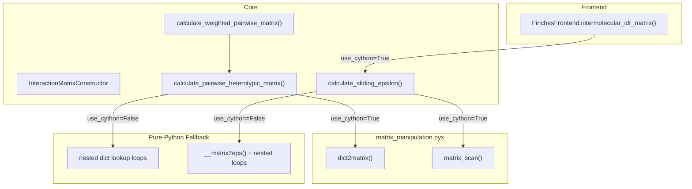

The `matrix_manipulation.pyx` Cython extension module provides C-compiled hot paths for two computationally intensive operations in finches: **pairwise interaction matrix construction** (`dict2matrix`) and **sliding window epsilon scanning** (`matrix_scan`). By replacing pure-Python loops with statically typed C loops that eliminate bounds checking and leverage typed memoryviews, these functions reduce wall-clock time to roughly **5–10% of the equivalent Python implementation**—a 10–20× speedup that makes large-matrix and high-throughput analyses practical.

Sources: [matrix_manipulation.pyx](finches/utils/matrix_manipulation.pyx#L1-L201), [epsilon_calculation.py](finches/epsilon_calculation.py#L450-L520)

## Architecture and Call Graph

The Cython module sits at the bottom of a layered computation pipeline. Higher-level API functions in [InteractionMatrixConstructor](8-interactionmatrixconstructor) and the frontends delegate to it via an explicit `use_cython` flag, with pure-Python fallbacks always available.



When `use_cython=True` (the default), the call path routes through the compiled `.pyx` functions. When `False`, identical logic executes in pure Python, useful for debugging or environments where the Cython extension failed to compile.

Sources: [epsilon_calculation.py](finches/epsilon_calculation.py#L450-L520), [frontend_base.py](finches/frontend/frontend_base.py#L60-L135)

## Cython Optimization Directives

Each accelerated function is decorated with two Cython compiler directives that strip Python-level safety checks at compile time:

| Directive | Effect | Risk |
|---|---|---|
| `@cython.boundscheck(False)` | Disables array index bounds validation | Out-of-bounds access causes undefined behavior (segfault) instead of `IndexError` |
| `@cython.cdivision(True)` | Disables Python-style zero-division checking | Division by zero causes C-level fault instead of `ZeroDivisionError` |

These are safe here because all loop bounds are derived from pre-validated matrix dimensions, and division only occurs against the known-positive `window_size`. The combination eliminates per-iteration Python overhead and allows the inner loops to compile to flat C machine code.

Sources: [matrix_manipulation.pyx](finches/utils/matrix_manipulation.pyx#L8-L18)

## Function Reference

### `dict2matrix(seq1, seq2, lookup) → np.ndarray`

Constructs a Len(seq1) × Len(seq2) pairwise interaction matrix by looking up each residue pair in a precomputed dictionary. This replaces the pure-Python double loop that appends to a list-of-lists and converts via `np.array()`.

**Typed signature:**

- `seq1: str`, `seq2: str` — amino acid sequences
- `lookup: dict` — nested dictionary where `lookup[r1][r2]` returns a `float` interaction parameter
- **Returns:** `cnp.ndarray[cnp.float_t, ndim=2]` — a C-contiguous float64 matrix

**Implementation strategy:** The function preallocates an `np.empty((l1, l2), dtype=float)` array and fills it with C-typed index variables (`cdef int r1, r2`), avoiding any intermediate Python list construction. Because the inner loop is a single dictionary lookup per element, the dominant cost in Python was the per-iteration interpreter dispatch—Cython eliminates this entirely.

**Called from:** `InteractionMatrixConstructor.calculate_pairwise_heterotypic_matrix()` when `use_cython=True`.

Sources: [matrix_manipulation.pyx](finches/utils/matrix_manipulation.pyx#L8-L22), [epsilon_calculation.py](finches/epsilon_calculation.py#L460-L476)

### `matrix_scan(w_matrix, window_size, null_interaction_baseline) → tuple`

The performance-critical function for [Sliding Window Matrix Computation](10-sliding-window-matrix-computation). Computes a smoothed epsilon matrix by sliding a `window_size × window_size` window across the full interaction matrix, decomposing each sub-window into attractive and repulsive components relative to `null_interaction_baseline`, and summing their row-wise means.

**Typed signature:**

- `w_matrix: double[:,:]` — a Cython typed memoryview (zero-copy view of the NumPy array)
- `window_size: int` — side length of the square sliding window (should be odd)
- `null_interaction_baseline: double` — threshold separating attractive (< baseline) from repulsive (> baseline) interactions
- **Returns:** `(everything, seq1_indices, seq2_indices)` — a 3-tuple of NumPy arrays

**Return elements:**

| Element | Shape | Description |
|---|---|---|
| `everything` | `(L1−W+1) × (L2−W+1)` | Sliding window epsilon values |
| `seq1_indices` | `(L1−W+1,)` | Protein-space residue indices for sequence 1 (1-based) |
| `seq2_indices` | `(L2−W+1,)` | Protein-space residue indices for sequence 2 (1-based) |

Where `L1`, `L2` are matrix dimensions and `W` is `window_size`.

**Implementation strategy — why this is fast:** The function uses four preallocated arrays (`everything`, `attractive_matrix`, `repulsive_matrix`, `sub`) and manually decomposes each window element-by-element in C-typed loops. The attractive/repulsive split, row-wise mean accumulation, and final summation are all written as explicit `for` loops over `cdef int` indices with `cdef double` accumulators. This avoids NumPy's per-operation overhead (temporary array creation, dtype coercion, method dispatch) on the small `window_size × window_size` submatrices—overhead that dominates the pure-Python version because the window operation is repeated `(L1−W+1) × (L2−W+1)` times.

**Protein-space indexing:** The returned index arrays use 1-based numbering (first residue = 1), computed as `start = int((window_size − 1) / 2) + 1`. This matches biochemical convention and is enforced by an assertion that `len(seq_indices) == matrix.shape[i]`.

**Called from:** `InteractionMatrixConstructor.calculate_sliding_epsilon()` when `use_cython=True`.

Sources: [matrix_manipulation.pyx](finches/utils/matrix_manipulation.pyx#L25-L127), [epsilon_calculation.py](finches/epsilon_calculation.py#L745-L800)

### `return_random_array(n) → np.ndarray` and `seed_C_rand(seedval)`

Utility functions for stochastic operations. `return_random_array(n)` generates an array of `n` uniform random floats using C's `rand()/RAND_MAX`, and the `cdef` (module-private) `seed_C_rand()` wraps `srand()` for seeding. These use `libc.stdlib` directly, bypassing Python's `random` module for minimal overhead in tight loops.

Sources: [matrix_manipulation.pyx](finches/utils/matrix_manipulation.pyx#L130-L201)

## Build and Compilation

The Cython extension is compiled at install time through `setup.py`, which declares a single `Extension` targeting `finches.utils.matrix_manipulation`:

```python
extensions = [
    Extension(
        "finches.utils.matrix_manipulation",
        ["finches/utils/matrix_manipulation.pyx"],
        include_dirs=[numpy.get_include()],
    )
]
setup(
    ext_modules=cythonize(extensions, compiler_directives={'language_level': "3"}),
)
```

The `include_dirs` references NumPy's C API headers (required for `cimport numpy`), and `language_level="3"` ensures Python 3 semantics during Cython's transpilation step. The build dependencies—`cython` and `numpy`—are declared in `pyproject.toml` under `[build-system] requires`.

> [!TIP]
> If the Cython extension fails to compile (e.g., missing C compiler or Cython not installed), the package still installs—only the `use_cython=True` code path will fail at runtime. The pure-Python fallbacks in `calculate_pairwise_heterotypic_matrix()` and `calculate_sliding_epsilon()` provide identical results, so setting `use_cython=False` is a safe workaround.

Sources: [setup.py](setup.py#L1-L32), [pyproject.toml](pyproject.toml#L1-L6)

## Cython vs. Pure Python: Algorithmic Comparison

The two implementations are algorithmically identical but differ in execution model:

| Aspect | Cython (`matrix_manipulation.pyx`) | Pure Python |
|---|---|---|
| **dict2matrix** loop | `cdef int` indices → C `for` loop over `cnp.ndarray` | Python `for` loop appending to nested `list` → `np.array()` |
| **matrix_scan** window extraction | Typed memoryview copy into preallocated `sub` array | NumPy slice: `w_matrix[i:i+W, j:j+W]` |
| **Attractive/repulsive split** | Element-by-element `if/else` in C | `epsilon_stateless.get_attractive_repulsive_matrices()` using boolean mask multiplication |
| **Row-mean accumulation** | Explicit `row_sum += attractive_matrix[r1,r2]` with `cdef double` | `np.sum(np.mean(attractive_matrix, axis=1))` |
| **Array allocation** | Preallocated once (`np.empty`) | Created per window iteration (NumPy temporaries) |
| **Relative performance** | **1×** (baseline) | **10–20×** slower |

The key insight is that the Cython version doesn't just "speed up Python"—it replaces NumPy's vectorized-but-high-overhead small-array operations with raw C loops. For the `matrix_scan` function, where the inner window is typically 31×31 = 961 elements but the outer loop runs `(L1−30) × (L2−30)` times, the per-window NumPy dispatch cost (function lookup, dtype checks, temporary allocation) overwhelms the actual arithmetic. Cython eliminates all of that dispatch overhead.

Sources: [matrix_manipulation.pyx](finches/utils/matrix_manipulation.pyx#L80-L127), [epsilon_calculation.py](finches/epsilon_calculation.py#L800-L874), [epsilon_stateless.py](finches/epsilon_stateless.py#L24-L56)

## Integration Points and the `use_cython` Flag

The `use_cython` boolean flag propagates through three layers:

1. **Frontend layer** — `FinchesFrontend.intermolecular_idr_matrix()` accepts `use_cython=True` and passes it directly to `calculate_sliding_epsilon()`.

2. **InteractionMatrixConstructor** — both `calculate_pairwise_heterotypic_matrix()` and `calculate_sliding_epsilon()` accept `use_cython=True`. Note that `calculate_weighted_pairwise_matrix()` also accepts the flag and forwards it to `calculate_pairwise_heterotypic_matrix()` for the initial matrix construction.

3. **Cython layer** — the flag determines whether `matrix_manipulation.dict2matrix()` / `matrix_manipulation.matrix_scan()` or the inline Python equivalents are called.

This layered design means that Cython acceleration is applied at **both** the matrix construction step (`dict2matrix`) and the sliding window scan step (`matrix_scan`), and can be independently toggled at any calling level.

> [!TIP]
> For maximum throughput on batch analyses (e.g., scanning hundreds of sequence pairs), ensure `use_cython=True` at the top-level call. The flag defaults to `True` everywhere, so this is the default behavior—only explicit `use_cython=False` disables it.

Sources: [frontend_base.py](finches/frontend/frontend_base.py#L62-L135), [epsilon_calculation.py](finches/epsilon_calculation.py#L440-L520), [epsilon_calculation.py](finches/epsilon_calculation.py#L710-L800)

## Related Pages

- The sliding window algorithm that `matrix_scan` accelerates is documented in [Sliding Window Matrix Computation](10-sliding-window-matrix-computation).
- The `InteractionMatrixConstructor` methods that invoke these Cython functions are covered in [InteractionMatrixConstructor](8-interactionmatrixconstructor).
- The dictionary lookup table (`self.lookup`) consumed by `dict2matrix` is built from forcefield parameters—see [Mpipi Forcefield Parameters](11-mpipi-forcefield-parameters) and [CALVADOS Forcefield Parameters](12-calvados-forcefield-parameters).