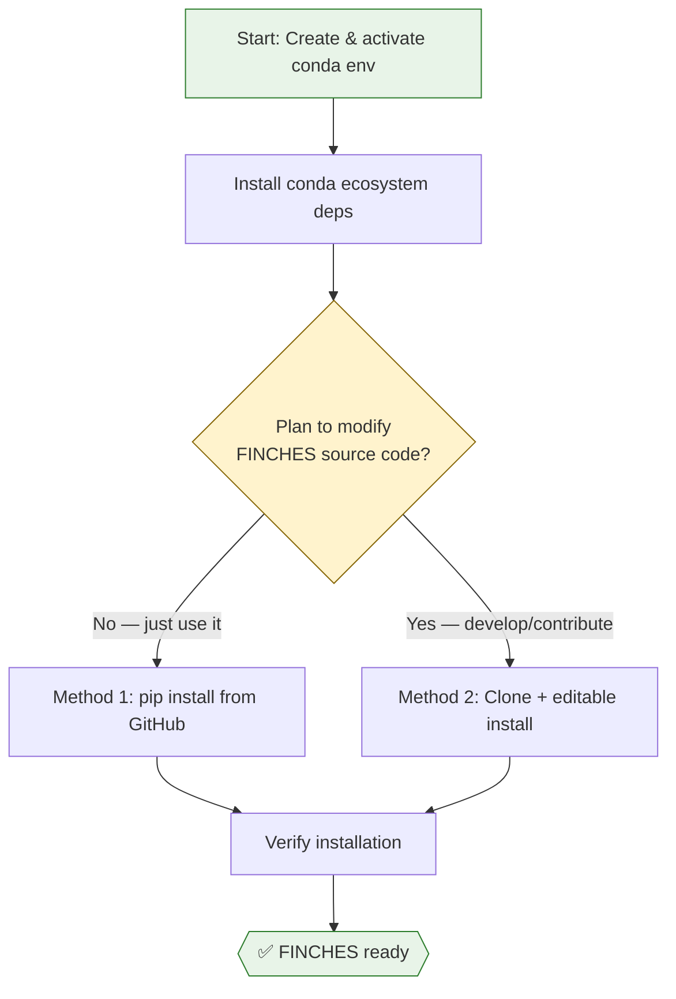
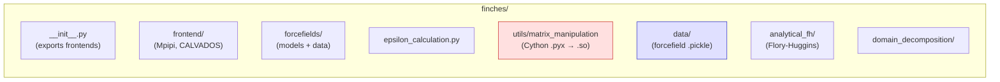

This guide walks you through every step needed to get **FINCHES** (First-principle Interactions via CHEmical Specificity) installed and verified on your system. FINCHES is a Python package for computing IDR-associated chemical specificity, and its installation involves a compiled Cython extension alongside several scientific Python dependencies. By the end of this page, you will have a working environment ready for [Quick Start](2-quick-start) exploration.

Sources: [README.md](/README.md#L1-L176), [pyproject.toml](/pyproject.toml#L1-L76)

## Prerequisites

Before installing FINCHES, review the following requirements and constraints to ensure a smooth setup:

| Requirement | Detail |
|---|---|
| **Python version** | ≥ 3.7 required; **3.11 or 3.12 recommended** for best performance |
| **License** | CC BY-NC 4.0 — **non-commercial use only** |
| **C++ compiler** | Required for Cython extension compilation (bundled with most OS dev tools) |
| **Git** | Required for both installation methods |
| **Conda** (recommended) | For managing the environment and dependency ecosystem |

> [!TIP]
> FINCHES includes a Cython-compiled module (`matrix_manipulation.pyx`) that accelerates matrix operations. This extension is built during installation and requires a working C compiler. On macOS, ensure Xcode Command Line Tools are installed (`xcode-select --install`). On Linux, `gcc` is typically available by default.

Sources: [pyproject.toml](/pyproject.toml#L26-L31), [setup.py](/setup.py#L1-L30), [LICENSE](/LICENSE#L1-L5)

## Core Dependencies

FINCHES depends on the following runtime packages, declared in `pyproject.toml`. Understanding these helps troubleshoot any version conflicts:

| Package | Version Constraint | Role |
|---|---|---|
| `numpy` | (≥ 2 recommended) | Array operations, Cython include paths |
| `afrc` | ≥ 0.3.4 | Analytical FRC (Flory Random Coil) scaling |
| `scipy` | any | Numerical integration and optimization |
| `soursop` | ≥ 0.2.4 | Polymer physics calculations |
| `pandas` | any | Data structure manipulation |
| `metapredict` | any (pip-only) | Intrinsically disordered region prediction |
| `ipython` | any | Interactive computing support |

The **build-time** dependencies (needed only during installation) are `setuptools≥61.0`, `wheel`, `versioningit≈2.0`, `cython`, and `numpy`.

Sources: [pyproject.toml](/pyproject.toml#L29-L31), [pyproject.toml](/pyproject.toml#L1-L8)

## Installation Methods at a Glance

The following flowchart illustrates the two supported installation paths and their decision criteria:



### Method 1: Direct pip Install from GitHub

This is the **recommended approach** for most users. It installs a frozen copy of FINCHES directly into your active environment without cloning the repository locally.

```bash
pip install git+https://git@github.com/idptools/finches.git
```

This command fetches the latest `main` branch, compiles the Cython extension, and installs all dependencies automatically. It can be run from any directory — the package lands in your environment's site-packages.

Sources: [README.md](/README.md#L113-L118)

### Method 2: Clone and Editable Install

Use this method if you intend to modify the source code, contribute fixes, or want the convenience of updating via `git pull`. **Clone to a sensible working directory** — the repository will be copied to that location.

```bash
# 1. Clone the repository
git clone git@github.com:idptools/finches.git

# 2. Enter the project root (where pyproject.toml lives)
cd finches

# 3. Install in editable mode
pip install -e .
```

The `-e` (editable) flag creates a live link to the source directory rather than copying files into site-packages. This provides two critical advantages:

1. **Instant updates** — running `git pull` inside the cloned directory immediately reflects code changes the next time you import FINCHES, with no reinstallation required.
2. **Correct Cython compilation** — the Cython extension (`matrix_manipulation.pyx`) is compiled in-place during an editable install. A non-editable pip install currently has a known packaging issue where the compiled `.so` file may not be correctly distributed.

> [!TIP]
> If you use Method 2 and later switch to a different branch or pull major changes, the Cython `.so` file won't automatically recompile. Re-run `pip install -e .` to rebuild the extension after significant updates.

Sources: [README.md](/README.md#L120-L145), [setup.py](/setup.py#L17-L29)

## Step-by-Step: Conda Environment Setup

The following procedure has been tested in a clean conda environment and represents the most reliable installation path. It carefully manages the dependency ecosystem to avoid the cross-platform numpy conflicts that can occur when mixing conda and PyPI packages.

### Step 1 — Create and Activate the Environment

```bash
conda create -n finches python=3.12 -y
conda activate finches
```

Sources: [README.md](/README.md#L84-L91)

### Step 2 — Install Ecosystem Dependencies via Conda

Install the core scientific packages **from conda** to ensure ABI compatibility. This is especially important on macOS where mixing conda and PyPI numpy/PyTorch builds causes segfaults.

```bash
# Install from the pytorch channel for consistent ABI
conda install numpy pytorch scipy cython matplotlib jupyter -c pytorch

# mdtraj is installed separately (different channel/dependency chain)
conda install mdtraj
```

### Step 3 — Install pip-Only Dependencies

```bash
# metapredict is only distributed via PyPI
pip install metapredict
```

Sources: [README.md](/README.md#L94-L108)

### Step 4 — Install FINCHES

Choose Method 1 or Method 2 from the sections above. For most users:

```bash
pip install git+https://git@github.com/idptools/finches.git
```

Sources: [README.md](/README.md#L110-L118)

### Step 5 — Verify the Installation

Navigate away from the install directory (to avoid import confusion) and run the verification command:

```bash
cd ~
python -c "from finches.frontend.mpipi_frontend import Mpipi_frontend; mf = Mpipi_frontend(); print('Success')"
```

If the output is `Success`, FINCHES is correctly installed and the forcefield data and Cython extension are accessible. The first invocation may take a moment as Python compiles and caches imported modules.

Sources: [README.md](/README.md#L147-L158)

## Complete Installation Summary

The table below provides a single-copy reference for the full installation sequence from a fresh system:

| Step | Command | Purpose |
|---|---|---|
| 1 | `conda create -n finches python=3.12 -y` | Create isolated environment |
| 2 | `conda activate finches` | Activate the environment |
| 3 | `conda install numpy pytorch scipy cython matplotlib jupyter -c pytorch` | Core scientific deps (conda) |
| 4 | `conda install mdtraj` | Trajectory analysis dep (conda) |
| 5 | `pip install metapredict` | IDR prediction dep (PyPI only) |
| 6a | `pip install git+https://git@github.com/idptools/finches.git` | Install FINCHES (direct) |
| 6b | `git clone git@github.com:idptools/finches.git && cd finches && pip install -e .` | Install FINCHES (editable) |
| 7 | `python -c "from finches.frontend.mpipi_frontend import Mpipi_frontend; mf = Mpipi_frontend(); print('Success')"` | Verify installation |

Sources: [README.md](/README.md#L75-L158), [pyproject.toml](/pyproject.toml#L29-L31)

## Platform-Specific Notes

### macOS

On Apple Silicon (M1/M2/M3) and Intel Macs alike, the **most critical rule** is to install `numpy` and `pytorch` from the **same package ecosystem** — either both from conda or both from PyPI. Mixing them produces segmentation faults due to incompatible C ABI bindings. The conda-first approach in the step-by-step guide above avoids this by design.

Ensure Xcode Command Line Tools are installed before running `pip install`, as the Cython extension requires a C compiler:

```bash
xcode-select --install
```

### Linux

Linux systems typically ship with `gcc` pre-installed. If not, install it via your distribution's package manager (`sudo apt install build-essential` on Debian/Ubuntu). No other platform-specific steps are needed.

### Windows

FINCHES has not been officially tested on Windows. The recommended path for Windows users is to use **Windows Subsystem for Linux (WSL2)** with a conda distribution installed inside the WSL environment, then follow the Linux instructions.

Sources: [README.md](/README.md#L76-L78), [setup.py](/setup.py#L1-L30)

## Troubleshooting

| Symptom | Likely Cause | Resolution |
|---|---|---|
| `ModuleNotFoundError: No module named 'finches.utils.matrix_manipulation'` | Cython `.pyx` not compiled to `.so` | Re-run `pip install -e .` from the project root, or use Method 1 instead |
| `ImportError: numpy.core.multiarray failed to import` | numpy version mismatch between compile-time and runtime | Reinstall numpy in the active env: `conda install numpy --force-reinstall` |
| Segmentation fault on import | Mixed conda/PyPI numpy + pytorch | Remove and reinstall both from conda: `conda install numpy pytorch -c pytorch` |
| `versioningit` errors during install | Missing build dependency | Install separately: `pip install versioningit` then retry |
| `metapredict` not found | Not installed via pip | `pip install metapredict` (conda does not distribute this package) |
| Slow first import | Normal — Python caches bytecode on first run | Subsequent imports will be fast; no action needed |

Sources: [README.md](/README.md#L76-L158), [setup.py](/setup.py#L17-L29), [pyproject.toml](/pyproject.toml#L1-L8)

## What Gets Installed

Understanding the package layout helps diagnose import issues and know where data files reside. The following diagram shows the installed package structure at a glance:



The **red** node (`matrix_manipulation`) is the Cython-compiled module — if this file is missing its compiled `.so` counterpart, FINCHES will fail on import. The **blue** node (`data/`) contains serialized forcefield parameter files (`.pickle`) that are loaded at runtime by the frontend objects.

Sources: [finches/__init__.py](/finches/__init__.py#L1-L24), [setup.py](/setup.py#L12-L22), [MANIFEST.in](/MANIFEST.in#L1-L17)

## Alternative Installation: Google Colab

If you prefer not to install anything locally, FINCHES is available as a set of **pre-configured Google Colab notebooks**. This requires zero local setup — just open a notebook in your browser and run it:

- **Colab notebooks**: [github.com/idptools/finches-colab](https://github.com/idptools/finches-colab)
- **Web server**: [finches-online.com](https://www.finches-online.com/)

These alternatives are ideal for quick exploration or teaching, though they lack the flexibility of a local installation for programmatic use.

Sources: [README.md](/README.md#L10-L14)

## Next Steps

With FINCHES installed and verified, you're ready to begin using it:

1. **[Quick Start](2-quick-start)** — Run your first interaction prediction in under a minute
2. **[Architecture Overview](4-architecture-overview)** — Understand how frontends, forcefields, and computation layers connect
3. **[Mpipi and CALVADOS Frontends](5-mpipi-and-calvados-frontends)** — Learn the primary API for interaction maps, epsilon values, and per-residue vectors