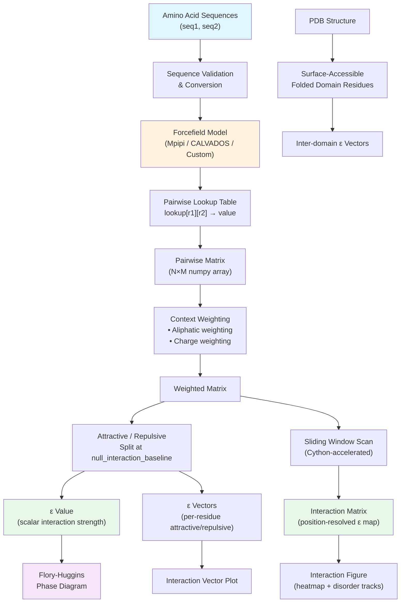

FINCHES (**F**irst-principle **I**nteractions via **CHE**mical **S**pecificity) is organized as a four-layer architecture that cleanly separates user interaction, core computation, biophysical models, and parameter data. This page maps the complete module topology, traces the primary data flow from amino acid sequences through to phase diagrams, and identifies the design patterns that make the system extensible across multiple forcefield models.

Sources: [__init__.py](/finches/__init__.py#L1-L24), [README.md](/README.md#L1-L176)

## Structural Layers

The codebase is partitioned into four distinct layers, each with a single responsibility. The **Frontend Layer** exposes the user-facing API and handles visualization. The **Core Computation Layer** implements the mathematical machinery for building interaction matrices, computing epsilon values, and constructing per-residue vectors. The **Forcefield Layer** encapsulates biophysical models as interchangeable plug-ins. The **Data Layer** stores precomputed parameter sets as pickled dictionaries. This separation ensures that adding a new forcefield never requires changes to the computation or frontend code.

```
finches/
├── frontend/                  ← Layer 1: User-facing API & Visualization
│   ├── frontend_base.py           FinchesFrontend (abstract base class)
│   ├── mpipi_frontend.py          Mpipi_frontend (concrete)
│   ├── calvados_frontend.py       CALVADOS_frontend (concrete)
│   └── interlogo.py               Logo generation utilities
│
├── epsilon_calculation.py    ← Layer 2: Core Computation
├── epsilon_stateless.py          Stateless vector/epsilon functions
├── epsilon_to_FHtheory.py        Bridge to Flory-Huggins theory
├── interaction_vector.py         Interaction vector plotting
├── sequence_tools.py             Sequence property calculators (FCR, NCPR)
├── parsing_aminoacid_sequences.py Sequence parsing utilities
│
├── forcefields/               ← Layer 3: Forcefield Models (Interface Pattern)
│   ├── mpipi.py                   Mpipi_model
│   ├── calvados.py                calvados_model
│   ├── custom_model.py            custom_model (user-defined)
│   └── calibration/              Calibration data & scripts
│
├── analytical_fh/            ← Layer 2b: Flory-Huggins Solver
│   ├── backend.py                 Original Qian et al. solver
│   └── floryhuggins.py            Wrapper API
│
├── domain_decomposition/     ← Cross-cutting: Region Analysis
│   └── domain_analysis.py         InteractingRegions, extract_regions
│
├── PDB_structure_tools.py    ← Cross-cutting: Folded Domain Integration
│
├── utils/                    ← Performance: Cython Acceleration
│   ├── matrix_manipulation.pyx    dict2matrix, matrix_scan (Cython)
│   └── folded_domain_utils.py     Folded domain helper functions
│
├── data/                     ← Layer 4: Parameter Data
│   ├── Mpipi/                     Mpipi pickled parameter files
│   ├── calvados/                  CALVADOS pickled parameter files
│   ├── fingerprints.py            Parameter fingerprinting
│   ├── forcefield_dependencies.py Baseline & prefactor computation
│   └── reference_sequence_info.py Reference sequence data
│
└── tests/                    ← Verification
    ├── test_epsilon_calculation.py
    ├── test_FH_diagrams.py
    ├── test_finches.py
    └── test_frontend_mpipi.py
```

Sources: [__init__.py](/finches/__init__.py#L1-L24), [epsilon_calculation.py](/finches/epsilon_calculation.py#L1-L50), [frontend_base.py](/finches/frontend_base.py#L1-L30)

## Core Design Patterns

FINCHES employs two primary design patterns that govern how modules interact.

### Interface Pattern: InteractionMatrixConstructor

The **InteractionMatrixConstructor** is the architectural linchpin. It accepts any forcefield object that implements a required contract — specifically `ALL_RESIDUES_TYPES`, `compute_interaction_parameter(r1, r2)`, and `CONFIGS` — and provides a uniform API for computing pairwise matrices, weighted matrices, epsilon values, and sliding-window matrices regardless of the underlying biophysical model. This is the classic Interface (or Strategy) pattern: the computation algorithm is fixed, while the interaction parameter source is interchangeable.

| Forcefield Contract Method | Purpose | Defined In |
|---|---|---|
| `ALL_RESIDUES_TYPES` | List of valid residue groups (e.g., protein + RNA) | All forcefield classes |
| `compute_interaction_parameter(r1, r2)` | Returns pairwise interaction value for residue pair | All forcefield classes |
| `CONFIGS` | Dictionary with `charge_prefactor` and `null_interaction_baseline` | All forcefield classes |

Sources: [epsilon_calculation.py](/finches/epsilon_calculation.py#L29-L100)

### Inheritance Pattern: FinchesFrontend Hierarchy

The **Frontend** layer uses class inheritance to share implementation while allowing model-specific customization. `FinchesFrontend` is an abstract base class that defines shared methods (`intermolecular_idr_matrix`, `epsilon`, `interaction_figure`, `per_residue_attractive_vector`). `Mpipi_frontend` and `CALVADOS_frontend` derive from it, each constructing their own forcefield model and `InteractionMatrixConstructor` instance, then delegating to the superclass for computation. The `CALVADOS_frontend` additionally applies an `@RNA_check` decorator to reject RNA-containing sequences, since CALVADOS2 does not support nucleic acid residues.

| Class | Parent | Forcefield | RNA Support | Key Override |
|---|---|---|---|---|
| `FinchesFrontend` | — | None (abstract) | — | Cannot be instantiated directly |
| `Mpipi_frontend` | `FinchesFrontend` | `Mpipi_GGv1` | ✅ (via `U` residue) | Handles `U` → disables disorder prediction |
| `CALVADOS_frontend` | `FinchesFrontend` | `CALVADOS2` | ❌ | `@RNA_check` decorator on all methods |

Sources: [frontend_base.py](/finches/frontend_base.py#L12-L28), [mpipi_frontend.py](/finches/frontend/mpipi_frontend.py#L1-L15), [calvados_frontend.py](/finches/frontend/calvados_frontend.py#L1-L40)

## Data Flow Architecture

The following diagram traces the primary computational pipeline from amino acid sequences to final outputs. Every analysis in FINCHES follows this core path, with optional branches for phase diagrams and folded domain interactions.



**Stage 1 — Sequence Intake & Validation**: Input sequences are validated against `ALL_RESIDUES_TYPES` to ensure all residues belong to a single residue group. An optional `sequence_converter` function can transform sequences before validation (used for masking or custom residue mapping).

**Stage 2 — Forcefield Resolution**: The forcefield model's `compute_interaction_parameter(r1, r2)` is called for every residue pair to populate a lookup dictionary. This happens once during `InteractionMatrixConstructor` initialization and again if `_update_parameters()` is called.

**Stage 3 — Matrix Construction**: The pairwise interaction matrix is built by indexing the lookup table for each (residue_i, residue_j) pair. The Cython-accelerated `dict2matrix()` function handles this for performance-critical paths.

**Stage 4 — Context Weighting**: Two optional weighting schemes modify the raw matrix. **Aliphatic weighting** amplifies interactions for residues surrounded by other aliphatic residues, capturing hydrophobic patch effects. **Charge weighting** reduces repulsion between oppositely charged neighbors (scaled by `charge_prefactor`), modeling sidechain reorientation and pKa shifts.

**Stage 5 — Epsilon Computation**: The weighted matrix is split at the `null_interaction_baseline` (calibrated against poly(GS) sequences as a Gaussian chain reference) into attractive and repulsive components. Summing and averaging yields either a scalar ε value or per-residue ε vectors.

**Stage 6 — Sliding Window Scan**: For interaction maps, the sequences are decomposed into overlapping windows and ε is computed per window pair, producing a position-resolved 2D matrix. The Cython `matrix_scan()` function provides ~12× speedup over pure Python for this step.

Sources: [epsilon_calculation.py](/finches/epsilon_calculation.py#L200-L400), [epsilon_stateless.py](/finches/epsilon_stateless.py#L1-L200), [matrix_manipulation.pyx](/finches/utils/matrix_manipulation.pyx#L1-L80)

## Forcefield Model Comparison

The three forcefield models differ in their physical basis, parameter sources, and supported residue types. All three implement the same contract, making them interchangeable within `InteractionMatrixConstructor`.

| Property | Mpipi (Mpipi_GGv1) | CALVADOS (CALVADOS2) | Custom Model |
|---|---|---|---|
| **Physical Basis** | Mie potential + Debye-Hückel | Ashbaugh-Hatch LJ + Yukawa | User-defined |
| **Parameter Source** | Joseph et al. 2021, Lotthammer et al. 2024 | Tesei et al. 2021 | User-provided dictionary |
| **Condition Dependence** | Salt, dielectric | Salt, pH, temperature | Arbitrary via callback |
| **RNA Support** | ✅ (U residue) | ❌ | User-defined |
| **Parameter Storage** | 5 pickled dicts (σ, ε, ν, μ, charge) | 1 pickled DataFrame | Inline dictionary |
| **Default charge_prefactor** | 0.20 | 0.70 | User-defined |
| **Default null_interaction_baseline** | −0.128533 | −0.45 | User-defined |

The `custom_model` class enables arbitrary forcefield definitions by accepting a flat dictionary of pairwise interactions (e.g., `{'A_A': -1, 'A_K': 0.5}`), an optional `condition_dictionary` for tunable parameters, and a `condition_dependence_function` callback that recalculates interactions when conditions change. This makes it possible to prototype novel coarse-grained models without modifying FINCHES source code.

Sources: [mpipi.py](/finches/forcefields/mpipi.py#L1-L50), [calvados.py](/finches/forcefields/calvados.py#L1-L80), [custom_model.py](/finches/forcefields/custom_model.py#L1-L60)

## Cross-Cutting Modules

Several modules span multiple layers and integrate with external tools:

**Folded Domain Integration** (`PDB_structure_tools.py`): Uses `soursop` to parse PDB structures, compute solvent-accessible surface area (SASA) with a 7Å probe radius, and extract surface-accessible folded domain (SAFD) residues. These residues are then fed into `get_interdomain_epsilon_vectors()` to compute how an IDR interacts with the surface of an adjacent folded domain, accounting for spatial proximity via distance-dependent weighting.

**Domain Decomposition** (`domain_decomposition/domain_analysis.py`): Identifies contiguous interacting regions within the 2D interaction matrix using peak-finding on per-row/column ε profiles. Returns `InteractingRegions` objects that encapsulate start/end positions, sequences, and rectangle coordinates for overlay on interaction maps.

**Flory-Huggins Bridge** (`epsilon_to_FHtheory.py`): Converts computed ε values into Flory-Huggins χ parameters and constructs phase diagrams. Supports condition-dependent scanning across salt, pH, and dielectric values by iteratively re-initializing the forcefield model and recomputing ε at each condition point.

**Sequence Utilities** (`sequence_tools.py`): Provides sequence-level property calculators including fraction of charged residues (FCR), net charge per residue (NCPR), and κ (kappa) parameter for charge patterning analysis.

Sources: [PDB_structure_tools.py](/finches/PDB_structure_tools.py#L1-L80), [domain_analysis.py](/finches/domain_decomposition/domain_analysis.py#L1-L100), [epsilon_to_FHtheory.py](/finches/epsilon_to_FHtheory.py#L1-L50), [sequence_tools.py](/finches/sequence_tools.py#L1-L80)

## Performance Architecture

FINCHES uses Cython for two performance-critical operations. The `dict2matrix()` function converts the Python lookup dictionary into a NumPy 2D array using typed C-level loops with `@cython.boundscheck(False)`. The `matrix_scan()` function implements the sliding-window ε computation with pre-allocated arrays and C-level arithmetic, providing approximately **12× speedup** over the equivalent pure-Python implementation. Both are compiled at install time via the `cython` dependency and are automatically used when `use_cython=True` (the default) is passed to frontend methods.

> [!TIP]
> Always keep `use_cython=True` (the default) for production runs. The Cython path is transparently invoked — no code changes are needed. Only set `use_cython=False` for debugging, as the pure-Python fallback is significantly slower for large sequences.

Sources: [matrix_manipulation.pyx](/finches/utils/matrix_manipulation.pyx#L1-L80)

## Recommended Reading Path

Now that you understand the architecture, the following progression builds from user-facing APIs inward to computational details:

1. **[Mpipi and CALVADOS Frontends](5-mpipi-and-calvados-frontends)** — Start here to learn the primary API entry points
2. **[InteractionMatrixConstructor](8-interactionmatrixconstructor)** — Understand the core interface that connects frontends to forcefields
3. **[Epsilon Calculation and Weighting](9-epsilon-calculation-and-weighting)** — Dive into how interaction strength is quantified
4. **[Mpipi Forcefield Parameters](11-mpipi-forcefield-parameters)** — Examine the default forcefield model in detail
5. **[Flory-Huggins Phase Diagrams](14-flory-huggins-phase-diagrams)** — See how ε values predict phase behavior