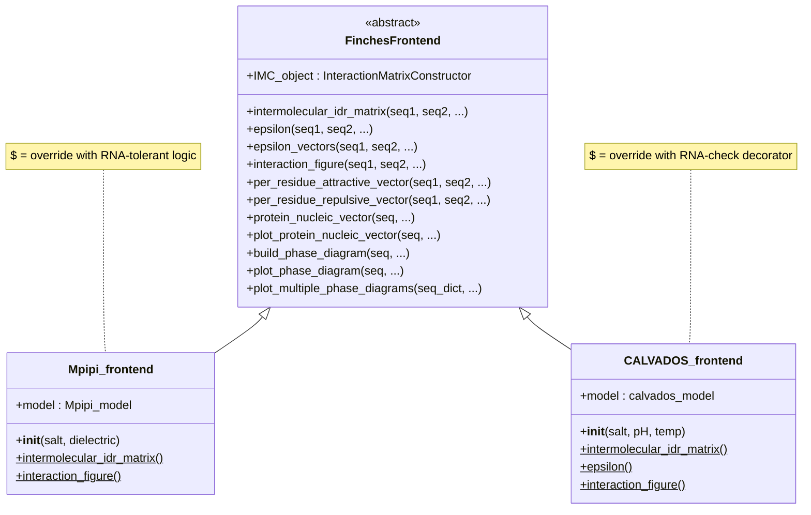
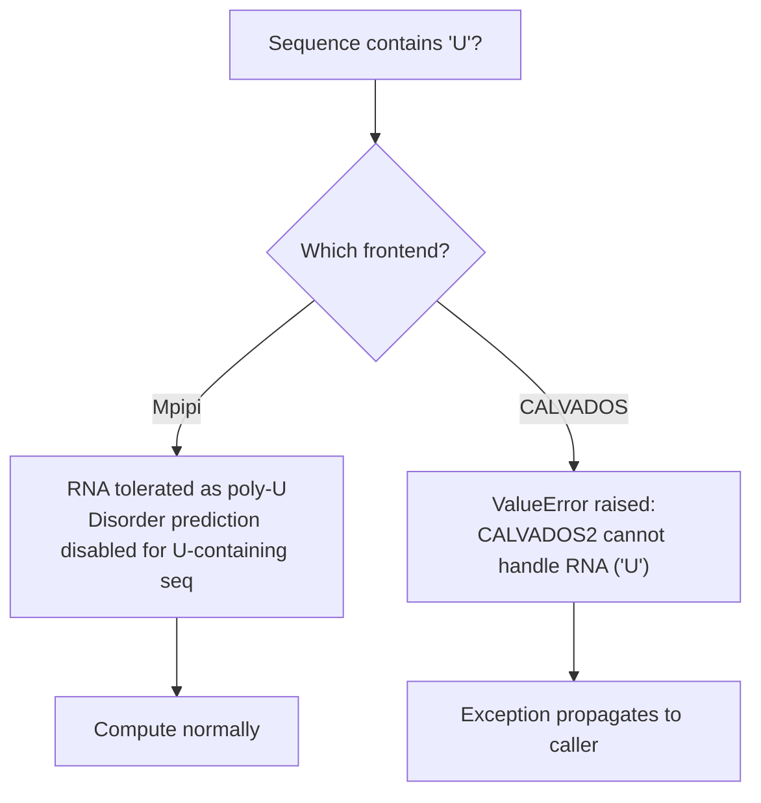

The **Mpipi** and **CALVADOS** frontends are the primary user-facing interfaces in finches. They provide a unified, high-level API for computing intermolecular interaction energies, generating per-residue interaction vectors, building interaction matrix figures, and constructing Flory-Huggins phase diagrams — all without requiring direct interaction with the underlying forcefield parameters or computation engine. Each frontend wraps a specific coarse-grained forcefield model and delegates heavy computation to the shared `InteractionMatrixConstructor`, while adding model-specific validation, default parameters, and RNA handling logic.

Sources: [frontend_base.py](finches/frontend/frontend_base.py#L1-L30), [mpipi_frontend.py](finches/frontend/mpipi_frontend.py#L1-L25), [calvados_frontend.py](finches/frontend/calvados_frontend.py#L1-L35)

## Architecture: Inheritance-Driven Design

Both frontends inherit from the abstract base class `FinchesFrontend`, which implements the full computational and visualization API. The derived classes override only their constructors (to bind the correct forcefield model) and a small number of methods that require model-specific input validation — most notably RNA sequence handling. This means every new method added to the base class automatically becomes available in both frontends, ensuring API consistency across models.



The base class explicitly prevents direct instantiation — calling `FinchesFrontend()` raises a `TypeError`, forcing users to work through one of the concrete derived classes.

Sources: [frontend_base.py](finches/frontend/frontend_base.py#L25-L37)

## Instantiation and Constructor Parameters

Each frontend's constructor initializes two critical objects: the **forcefield model** (which encodes all residue-residue interaction parameters) and the **`InteractionMatrixConstructor`** (which uses that model for computation). The constructors differ in which physical conditions they expose:

| Frontend | Constructor Signature | Forcefield Model | Physical Parameters |
|---|---|---|---|
| `Mpipi_frontend` | `Mpipi_frontend(salt=0.150, dielectric=80.0)` | `Mpipi_model("Mpipi_GGv1")` | Salt concentration (M), Dielectric constant |
| `CALVADOS_frontend` | `CALVADOS_frontend(salt=0.150, pH=7.4, temp=288)` | `calvados_model("CALVADOS2")` | Salt concentration (M), pH, Temperature (K) |

**Key difference**: Mpipi exposes a `dielectric` parameter (screening via dielectric constant), while CALVADOS exposes `pH` and `temp` parameters (Henderson-Hasselbalch protonation and temperature-dependent electrostatics). Both default to **150 mM salt**, reflecting physiological ionic strength.

```python
# Mpipi frontend — dielectric-based electrostatics
from finches.frontend.mpipi_frontend import Mpipi_frontend
mf = Mpipi_frontend(salt=0.150, dielectric=80.0)

# CALVADOS frontend — pH and temperature-based electrostatics
from finches.frontend.calvados_frontend import CALVADOS_frontend
cf = CALVADOS_frontend(salt=0.150, pH=7.4, temp=288)
```

Sources: [mpipi_frontend.py](finches/frontend/mpipi_frontend.py#L9-L16), [calvados_frontend.py](finches/frontend/calvados_frontend.py#L31-L41)

## Core API Methods

The following methods are available on **both** frontend objects. The table summarizes each method's purpose and return type:

| Method | Purpose | Returns |
|---|---|---|
| `epsilon(seq1, seq2)` | Whole-sequence pairwise interaction energy | `float` |
| `epsilon_vectors(seq1, seq2)` | Attractive and repulsive epsilon decomposition vectors | `tuple` of arrays |
| `intermolecular_idr_matrix(seq1, seq2)` | Sliding-window interaction matrix with disorder profiles | `(matrix_tuple, disorder_1, disorder_2)` |
| `interaction_figure(seq1, seq2)` | Full visualization: heatmap + disorder tracks | `(fig, im, ax_main, ax_top, ax_right, ax_colorbar)` |
| `per_residue_attractive_vector(seq1, seq2)` | Per-residue average of attractive interactions | `(indices, values)` |
| `per_residue_repulsive_vector(seq1, seq2)` | Per-residue average of repulsive interactions | `(indices, values)` |
| `protein_nucleic_vector(seq)` | Per-residue protein–RNA binding profile (poly-U) | `(indices, values)` |
| `plot_protein_nucleic_vector(seq)` | Visualization of protein–RNA binding profile | `(fig, ax)` |
| `build_phase_diagram(seq)` | Flory-Huggins binodal + spinodal curves | 8-element tuple |
| `plot_phase_diagram(seq)` | Single-sequence phase diagram plot | `(phase_data, fig, ax)` |
| `plot_multiple_phase_diagrams(seq_dict)` | Overlay multiple phase diagrams | `(phase_data_list, fig, ax)` |

Sources: [frontend_base.py](finches/frontend/frontend_base.py#L39-L1345)

### Epsilon: Whole-Sequence Interaction Energy

The simplest entry point computes a single scalar epsilon value for two full sequences. This delegates directly to `InteractionMatrixConstructor.calculate_epsilon_value()`:

```python
mf = Mpipi_frontend()
eps = mf.epsilon("MDVFKPGDKIIYTVKQEE", "KRTYADGEEYVQTVKPGK")
# Returns a float — negative = net attractive, positive = net repulsive
```

The `use_aliphatic_weighting` and `use_charge_weighting` flags (both default `True`) control whether local sequence context adjusts aliphatic and charge contributions, respectively.

Sources: [frontend_base.py](finches/frontend/frontend_base.py#L201-L232)

### Intermolecular IDR Matrix: Sliding-Window Computation

The `intermolecular_idr_matrix()` method is the computational backbone for region-resolved analysis. It decomposes both sequences into overlapping windows of `window_size` residues (default 31) and computes epsilon for every pair of windows, producing a 2D matrix where each cell represents the interaction energy between one region of `seq1` and one region of `seq2`.

The return value is a 3-tuple:

- **`[0]`** — The interaction matrix tuple itself: `(matrix_array, seq1_indices, seq2_indices)`. The `matrix_array` is a 2D NumPy array; the index arrays map matrix rows/columns back to sequence positions.
- **`[1]`** — Disorder profile for `seq1` (from metapredict), or all-1s array if `disorder_1=False`.
- **`[2]`** — Disorder profile for `seq2`, or all-1s array if `disorder_2=False`.

```python
mf = Mpipi_frontend()
result = mf.intermolecular_idr_matrix("MDVFKPGDKIIYTVKQEE", "KRTYADGEEYVQTVKPGK")
matrix_array = result[0][0]    # 2D sliding epsilon values
seq1_idx     = result[0][1]    # indices mapping rows to seq1 positions
seq2_idx     = result[0][2]    # indices mapping columns to seq2 positions
disorder_1   = result[1]       # disorder profile for seq1
disorder_2   = result[2]       # disorder profile for seq2
```

> [!TIP]
> The window edges are not padded, so the matrix dimensions are smaller than the sequence lengths by approximately `(window_size - 1)` on each side. Always use the returned index arrays to map matrix positions back to residue positions.

When `null_shuffle` is set to an integer (e.g., 100), the method generates that many sequence-shuffled null matrices, subtracts the mean null from the real matrix, and returns the shuffle-normalized result. For homotypic interactions (`seq1 == seq2`), the null is symmetrized to avoid artifacts.

Sources: [frontend_base.py](finches/frontend/frontend_base.py#L42-L197)

### Per-Residue Interaction Vectors

Two complementary methods decompose the interaction matrix into per-residue profiles along `seq1`:

- **`per_residue_attractive_vector()`** — For each residue in `seq1`, averages all **negative** (attractive) values across `seq2`. This identifies "sticker" regions without confounding from repulsive neighbors.
- **`per_residue_repulsive_vector()`** — For each residue in `seq1`, averages all **positive** (repulsive) values across `seq2`.

Both return `(indices, values)` and apply Savitzky-Golay smoothing by default (`smoothing_window=20`, `poly_order=3`). Set `smoothing_window=False` to disable smoothing. Set `return_total=True` to get the raw sum instead of the average.

Sources: [frontend_base.py](finches/frontend/frontend_base.py#L540-L795)

### Protein–Nucleic Acid Vector

The `protein_nucleic_vector()` method computes a per-residue profile of protein–RNA binding propensity by sliding a window across the protein sequence and computing epsilon against a poly-U RNA fragment of the same length. This is only available on frontends that support RNA (see the RNA handling section below). The result is smoothed with a Savitzky-Golay filter and returned as `(indices, values)`.

Sources: [frontend_base.py](finches/frontend/frontend_base.py#L800-L895)

### Interaction Figure

The `interaction_figure()` method produces a publication-quality composite figure containing: a central interaction matrix heatmap, parallel disorder profile bar plots along the top and right axes, and an integrated colorbar. When `zero_folded=True` (default), residues predicted as folded by metapredict are zeroed out in the matrix, reflecting the physical reality that folded domains are not available for IDR-like interactions.

The visualization parameters differ between frontends:

| Parameter | Mpipi Default | CALVADOS Default | Reason |
|---|---|---|---|
| `vmin` / `vmax` | -3 / 3 | -7.5 / 7.5 | CALVADOS epsilon values span a wider range |

Additional figure features include domain highlighting (`seq1_domains`, `seq2_domains`), position marker lines (`seq1_lines`, `seq2_lines`), and custom rectangle overlays (`plot_rectangles`).

Sources: [frontend_base.py](finches/frontend/frontend_base.py#L236-L530), [calvados_frontend.py](finches/frontend/calvados_frontend.py#L160-L175)

### Phase Diagrams

Three methods provide Flory-Huggins phase diagram computation and visualization:

1. **`build_phase_diagram(seq)`** — Computes the homotypic binodal and spinodal curves from the sequence's epsilon value. Returns an 8-element tuple with dilute/dense concentrations, critical points, and temperature arrays for both binodal and spinodal.
2. **`plot_phase_diagram(seq)`** — Plots a single sequence's binodal as temperature vs. volume fraction (φ).
3. **`plot_multiple_phase_diagrams(seq_dict)`** — Overlays multiple sequences' binodals. Accepts a dictionary of `{name: [sequence, color]}` and optionally normalizes temperatures by a reference sequence's critical temperature (`tc_ref`).

Sources: [frontend_base.py](finches/frontend/frontend_base.py#L1020-L1345)

## RNA Sequence Handling: The Critical Difference

The most important functional distinction between the two frontends is how they handle RNA sequences (represented by the `U` residue code for uracil):



**Mpipi** accommodates RNA as poly-U fragments — the Mpipi forcefield includes parameters for uracil. When a sequence contains `U`, the frontend automatically disables disorder prediction for that sequence (since metapredict only handles protein sequences) but proceeds with computation.

**CALVADOS** explicitly **rejects** any sequence containing `U`. This is enforced through the `@RNA_check` decorator, which inspects `seq1` and `seq2` before any computation begins and raises a `ValueError` with the message `"CALVADOS2 cannot handle RNA ('U')"`. This decorator is applied to `intermolecular_idr_matrix()`, `epsilon()`, and `interaction_figure()` in the CALVADOS frontend.

Additionally, CALVADOS provides a stub `protein_nucleic_vector()` that unconditionally raises an exception, since protein–RNA computation is inherently unsupported.

> [!TIP]
> Always check your sequences for `U` residues before passing them to `CALVADOS_frontend`. If you need protein–RNA interaction analysis, use `Mpipi_frontend` exclusively.

Sources: [mpipi_frontend.py](finches/frontend/mpipi_frontend.py#L50-L75), [calvados_frontend.py](finches/frontend/calvados_frontend.py#L17-L29)

## Method Override Summary

While the base class provides full implementations, each derived class overrides specific methods to inject model-specific behavior. The table below shows exactly which methods are overridden and why:

| Method | Overridden in Mpipi? | Overridden in CALVADOS? | Reason for Override |
|---|---|---|---|
| `__init__` | ✅ | ✅ | Bind different forcefield model and `IMC_object` |
| `intermolecular_idr_matrix` | ✅ | ✅ | Mpipi: auto-detect `U` → disable disorder; CALVADOS: `@RNA_check` decorator |
| `epsilon` | ❌ | ✅ | CALVADOS: `@RNA_check` decorator |
| `epsilon_vectors` | ❌ | ❌ | No model-specific validation needed |
| `interaction_figure` | ✅ | ✅ | Mpipi: auto-detect `U` → disable disorder; CALVADOS: `@RNA_check` + different `vmin`/`vmax` defaults |
| `per_residue_attractive_vector` | ❌ | ❌ | Inherited as-is |
| `per_residue_repulsive_vector` | ❌ | ❌ | Inherited as-is |
| `protein_nucleic_vector` | ❌ | ✅ (stub) | CALVADOS: raises exception — RNA unsupported |
| `build_phase_diagram` | ❌ | ❌ | Inherited as-is |
| `plot_phase_diagram` | ❌ | ❌ | Inherited as-is |
| `plot_multiple_phase_diagrams` | ❌ | ❌ | Inherited as-is |

Sources: [mpipi_frontend.py](finches/frontend/mpipi_frontend.py#L1-L292), [calvados_frontend.py](finches/frontend/calvados_frontend.py#L1-L350)

## Choosing a Frontend

| Criterion | Use `Mpipi_frontend` | Use `CALVADOS_frontend` |
|---|---|---|
| Protein–protein IDR interactions | ✅ | ✅ |
| Protein–RNA interactions | ✅ | ❌ |
| Dielectric-based electrostatic control | ✅ | ❌ |
| pH/temperature-dependent protonation | ❌ | ✅ |
| Mpipi_GGv1 parameter set | ✅ | ❌ |
| CALVADOS2 parameter set | ❌ | ✅ |

For most protein–protein studies, either frontend will produce valid results, but the numerical values will differ because they encode different coarse-grained forcefield parameterizations. For protein–nucleic acid work, `Mpipi_frontend` is the only option.

**Next steps**: To understand the forcefield parameters that each frontend binds, see [Mpipi Forcefield Parameters](11-mpipi-forcefield-parameters) and [CALVADOS Forcefield Parameters](12-calvados-forcefield-parameters). For the computation engine that both frontends delegate to, see [InteractionMatrixConstructor](8-interactionmatrixconstructor). For visualization details, see [Interaction Maps and Figures](6-interaction-maps-and-figures).
