Interaction maps (intermaps) are the primary visual output of FINCHES, providing a two-dimensional heatmap that reveals how every local region of one intrinsically disordered region (IDR) is predicted to interact with every local region of another. They are generated through the **`interaction_figure()`** method on either the `Mpipi_frontend` or `CALVADOS_frontend` object, which internally computes a sliding-window epsilon matrix, overlays per-sequence disorder profiles, masks folded regions, and renders a publication-ready matplotlib figure in a single call.

## How Intermaps Work

An intermap is constructed by decomposing two sequences into overlapping fragments of `window_size` residues, then computing the pairwise epsilon (interaction energy) between every fragment from sequence 1 and every fragment from sequence 2. The resulting 2D matrix is displayed as a heatmap where the **x-axis** maps positions in sequence 1, the **y-axis** maps positions in sequence 2, and **pixel color** encodes the predicted interaction strength — negative (attractive) values in green and positive (repulsive) values in purple by default. Parallel bar tracks along the top and right edges show the predicted disorder probability for each residue, and folded domains are automatically zeroed out.

```mermaid
flowchart TD
    A["Two amino acid<br/>sequences &#40;seq1, seq2&#41;"] --> B["Sliding-window<br/>fragmentation<br/>&#40;window_size=31&#41;"]
    B --> C["Pairwise epsilon<br/>computation<br/>&#40;IMC_object&#41;"]
    C --> D["Raw interaction<br/>matrix &#40;2D ndarray&#41;"]
    D --> E{"null_shuffle<br/>enabled?"}
    E -- Yes --> F["Subtract shuffled<br/>baseline matrix"]
    E -- No --> G["Proceed"]
    F --> G
    G --> H{"zero_folded<br/>enabled?"}
    H -- Yes --> I["Mask folded-domain<br/>regions to zero"]
    H -- No --> J["Proceed"]
    I --> J
    J --> K["Render heatmap +<br/>disorder bar tracks<br/>+ colorbar"]
    K --> L["Return fig, im,<br/>ax_main, ax_top,<br/>ax_right, ax_colorbar"]
```



The pipeline above shows the full decision flow from raw sequences through to the rendered figure. Each stage is configurable through the `interaction_figure()` parameter set.

Sources: [frontend_base.py](finches/frontend/frontend_base.py#L247-L399), [frontend_base.py](finches/frontend/frontend_base.py#L131-L198)

## Generating an Interaction Figure

The simplest usage requires only two sequences and a frontend object:

```python
from finches.frontend.mpipi_frontend import Mpipi_frontend

mf = Mpipi_frontend()

s1 = 'MESNQSNNGGSGNAALNRGGRYVPPHLRGGDGGAAAAASAGGDDRRGGAGGGGYRRGGGNSGGGGGGGYDRGYNDNRDDRDNRGGSGGYGRDRNYEDRGYNGGGGGGGNRGYNNNRGGGGGGYNRQDRGDGGSSNFSRGGYNNRDEGSDNRGSGRSYNNDRRDNGGD'
s2 = 'LEGMSGDMRSGGGYRGRGGRGNGQRFGGRDHRYQGGSGNGGGGNGGGGGFGGGGQRSGGGGGFQSGGGGGRQQQQQQRAQPQQDWWS'

# Generate the interaction figure (homotypic)
mf.interaction_figure(s1, s1, tic_frequency=15)

# Generate the interaction figure (heterotypic)
mf.interaction_figure(s1, s2, tic_frequency=15)
```

The method returns a tuple of matplotlib objects for further customization: `(fig, im, ax_main, ax_top, ax_right, ax_colorbar)`. If `no_disorder=True`, the return simplifies to `(fig, im, ax_main)`.

Sources: [frontend_base.py](finches/frontend/frontend_base.py#L247-L399), [interaction_matrix_demo.ipynb](demo/protein_matrix/interaction_matrix_demo.ipynb#L87-L120)

## Interaction Figure Parameters

The `interaction_figure()` method exposes extensive control over computation, visual styling, and domain annotation:

| Parameter | Type | Default | Purpose |
|---|---|---|---|
| `seq1`, `seq2` | str | — | Amino acid sequences to compare |
| `window_size` | int | 31 | Sliding window length (must be odd) |
| `use_cython` | bool | True | Use Cython-accelerated matrix computation |
| `use_aliphatic_weighting` | bool | True | Weight aliphatic residues by local aliphatic density |
| `use_charge_weighting` | bool | True | Weight charged residues by local charge density |
| `tic_frequency` | int | 100 | Spacing between axis tick marks |
| `vmin`, `vmax` | float | -3, 3 | Color scale bounds (kT units) |
| `cmap` | str | `'PRGn'` | Matplotlib colormap name |
| `zero_folded` | bool | True | Set folded-domain pixels to zero |
| `disorder_1`, `disorder_2` | bool | True | Compute and display disorder profiles |
| `no_disorder` | bool | False | Omit disorder tracks entirely |
| `null_shuffle` | bool/int | False | Number of sequence shuffles for null baseline subtraction |
| `fname` | str | None | File path to save figure (None = display only) |
| `seq1_domains`, `seq2_domains` | list | [] | Domain regions to highlight as dark bars |
| `seq1_lines`, `seq2_lines` | list | [] | Vertical/horizontal reference lines |
| `plot_rectangles` | list | None | Custom rectangle overlays `[s1_start, s1_end, s2_start, s2_end, kwargs]` |
| `linewidth` | float | 1 | Width of domain-boundary lines |

Sources: [frontend_base.py](finches/frontend/frontend_base.py#L247-L399)

## Figure Layout and Axes

The interaction figure uses `plt.subplot2grid((4, 4), ...)` to arrange four panels in a single figure:

| Axis | Grid Position | Content |
|---|---|---|
| `ax_main` | (1,0) colspan=3, rowspan=3 | 2D interaction heatmap |
| `ax_top` | (0,0) colspan=3 | Disorder bar plot for sequence 1 (vertical bars, 0–1 scale) |
| `ax_right` | (1,3) rowspan=3 | Disorder bar plot for sequence 2 (horizontal bars, 0–1 scale) |
| `ax_colorbar` | (0,3) | Color scale legend for the heatmap |

Domain highlights passed via `seq1_domains` or `seq2_domains` render as dark vertical or horizontal spans on the corresponding disorder track. Custom rectangles from `plot_rectangles` draw directly on `ax_main` as edge-only patches, useful for annotating specific interaction hot-spots.

Sources: [frontend_base.py](finches/frontend/frontend_base.py#L400-L560)

## Accessing the Raw Matrix

When you need the underlying numerical data for custom analysis or visualization, call `intermolecular_idr_matrix()` instead of `interaction_figure()`:

```python
# Returns (B, disorder_1, disorder_2)
result = mf.intermolecular_idr_matrix(s1, s2, window_size=31)

# Unpack the matrix tuple
B       = result[0]   # The interaction matrix structure
d1      = result[1]   # Disorder profile for sequence 1
d2      = result[2]   # Disorder profile for sequence 2

# B is itself a 3-element tuple:
matrix  = B[0]   # 2D numpy array of sliding epsilon values
idx_s1  = B[1]   # Index array mapping matrix columns to sequence 1 positions
idx_s2  = B[2]   # Index array mapping matrix rows to sequence 2 positions
```

The index arrays are necessary because the sliding window does not pad the sequences — the matrix edges start and end at positions that depend on `window_size`. Specifically, the first valid index is at `window_size // 2 + 1` and the last is at `len(seq) - window_size // 2`.

Sources: [frontend_base.py](finches/frontend/frontend_base.py#L58-L198)

## Null Shuffle Normalization

Setting `null_shuffle` to an integer (recommended: 100) subtracts a sequence-shuffled baseline from the interaction matrix. For each shuffle iteration, both sequences are randomly permuted, a new matrix is computed, and the mean across all shuffles becomes the null baseline. For **homotypic** interactions (seq1 == seq2), the null is symmetrized to avoid artifacts. This normalization highlights interaction patterns that depend on residue order rather than composition alone.

```python
# Normalize against 100 shuffled controls
mf.interaction_figure(s1, s2, null_shuffle=100, tic_frequency=15)
```

Sources: [frontend_base.py](finches/frontend/frontend_base.py#L147-L192)

## Folded Domain Masking

When `zero_folded=True` (the default), the `interaction_figure()` method uses **metapredict** to identify folded domain boundaries and sets all matrix pixels corresponding to folded residues to zero. This prevents stably folded regions from contributing misleading interaction signals, since the coarse-grained forcefield models are calibrated for disordered contexts. The same folded boundaries are shaded in grey on disorder tracks when using `plot_protein_nucleic_vector()`.

Sources: [frontend_base.py](finches/frontend/frontend_base.py#L400-L440)

## Sequence Logo Visualizations (interlogo)

The `interlogo` module provides HTML-rendered sequence logos that color and size each residue according to its chemical context and interaction contribution. These are designed for Jupyter notebook display.

### Chemical Context Color Scheme

Residues are colored by chemical class using a fixed palette defined in `AA_COLOR`:

| Chemical Class | Residues | Color |
|---|---|---|
| Aromatic | Y, W, F | `#ff9d00` (orange) |
| Aliphatic | A, L, M, I, V | `#171616` (black) |
| Polar | Q, N, S, T, H, G | `#04700d` (green) |
| Negative | E, D | `#ff0d0d` (red) |
| Positive | R, K | `#2900f5` (blue) |
| Cysteine | C | `#ffe70d` (yellow) |
| Proline | P | `#cf30b7` (magenta) |

A separate `AA_CHARGE_COLOR` dictionary provides a charge-only view where only E/D (red) and R/K (blue) are colored; all others are black.

### Attractive and Repulsive Logos

```python
from finches.frontend.interlogo import plot_attractive_logo, plot_repulsive_logo

# Attractive logo: residues sized by favorable interaction contribution
plot_attractive_logo(s1, s2, mf, window_size=31, quantile_threshold=0.7)

# Repulsive logo: residues sized by unfavorable interaction contribution
plot_repulsive_logo(s1, s2, mf, window_size=31, quantile_threshold=0.7)
```

The `quantile_threshold` parameter (default 0.7) controls the visibility cutoff: residues below the threshold quantile of the size distribution are rendered in light grey (`#cccccc`) rather than their chemical class color, ensuring only the most interaction-relevant positions are visually prominent.

### Custom Chemical Context Plots

For manual control, `chemical_context_seq_plot()` accepts any sequence and a scaling vector:

```python
from finches.frontend.interlogo import chemical_context_seq_plot
import numpy as np

scale_vector = np.random.rand(len(s1))  # any per-residue values
chemical_context_seq_plot(s1, scale_vector, min_font_sz=8, max_font_sz=30, quantile_threshold=0.7)
```

Sources: [interlogo.py](finches/frontend/interlogo.py#L1-L270)

## Window Size Considerations

The default `window_size=31` was chosen empirically: ~30-residue IDRs represent a length scale where chemical specificity can be meaningfully encoded. Smaller windows increase spatial resolution but reduce the fragment length over which interaction energies are averaged, potentially introducing noise. Larger windows smooth over local variation but may miss fine-grained interaction patterns. When using non-default windows, adjust `vmin`/`vmax` accordingly since the energy range shifts:

```python
# Smaller window — narrower energy range
mf.interaction_figure(s1, s2, window_size=13, vmin=-2, vmax=2, tic_frequency=15)
```

Sources: [idr_idr.rst](docs/idr_idr.rst#L52-L67)

## Frontend Model Differences

Both `Mpipi_frontend` and `CALVADOS_frontend` expose the same `interaction_figure()` interface, but differ in their underlying forcefield and initialization parameters:

| Feature | Mpipi_frontend | CALVADOS_frontend |
|---|---|---|
| Forcefield | Mpipi_GGv1 | CALVADOS2 |
| Init params | `salt`, `dielectric` | `salt`, `pH`, `temp` |
| RNA support | Yes (via `U` in sequence) | No (raises `ValueError`) |
| Default salt | 0.150 M | 0.150 M |

The CALVADOS frontend applies an `@RNA_check` decorator that raises a `ValueError` if `'U'` appears in either input sequence, whereas the Mpipi frontend supports protein–nucleic acid interactions natively.

Sources: [mpipi_frontend.py](finches/frontend/mpipi_frontend.py#L1-L100), [calvados_frontend.py](finches/frontend/calvados_frontend.py#L1-L150)

> [!TIP]
> When generating interaction figures for publication, set `fname` to save at 350 DPI and manually adjust `tic_frequency` based on sequence length — use ~15 for sequences under 200 residues and ~100 for sequences over 500 residues to keep tick labels readable.

> [!TIP]
> The `plot_rectangles` parameter is the most flexible way to annotate interaction hot-spots: pass `[[s1_start, s1_end, s2_start, s2_end, {'edgecolor':'red', 'linestyle':'--'}]]` to draw styled rectangles directly on the heatmap without altering the underlying data.