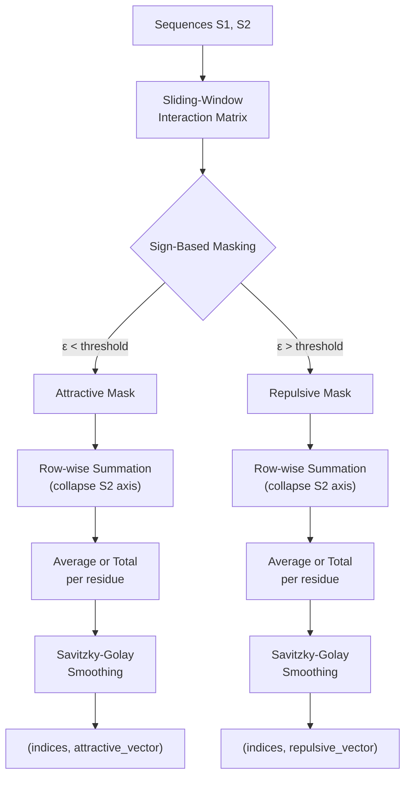
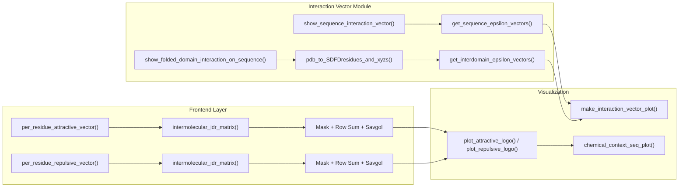

Per-residue interaction vectors decompose a global ε interaction value into a **position-resolved profile**, revealing which residues in one sequence drive attractive or repulsive interactions with another sequence. This is the diagnostic lens that transforms a single scalar summary into a residue-by-residue map of interaction chemistry — essential for identifying "sticker" regions, understanding domain boundaries, and rationalizing mutational effects within intrinsically disordered regions.

## Conceptual Foundation

A per-residue interaction vector answers the question: *for each position i in sequence 1, what is the net interaction character with sequence 2?* The answer is not a single number but two complementary vectors — **attractive** and **repulsive** — each of length *N* (the number of residues in the reference sequence). These vectors are computed by collapsing the full sliding-window interaction matrix along one axis, applying sign-based masking to isolate attractive (ε < 0) from repulsive (ε > 0) contributions, and optionally smoothing the result.

This decomposition matters because averaging over a region can obscure the interplay of stickers and spacers: a region may be strongly attractive at a few positions yet repulsive elsewhere. Since repulsive regions in an IDR can reconfigure to avoid each other while attractive residues actively drive coalescence, the per-residue profile lets you identify putative sticker residues **without confounding by neighboring repulsive elements**.



Sources: [frontend_base.py](finches/frontend/frontend_base.py#L570-L696), [frontend_base.py](finches/frontend/frontend_base.py#L702-L828)

## Two API Layers: Frontend vs. Interaction Vector Module

Finches exposes per-residue interaction vectors through **two complementary API layers**, each suited to different workflows. The frontend layer provides the highest-level, most convenient access through methods on a `FinchesFrontend` object, while the `interaction_vector` module offers standalone functions with direct plotting capabilities.

| Feature | Frontend (`FinchesFrontend`) | Interaction Vector Module |
|---|---|---|
| Entry point | `xf.per_residue_attractive_vector()` / `xf.per_residue_repulsive_vector()` | `show_sequence_interaction_vector()` / `show_folded_domain_interaction_vector()` |
| Returns | `(indices, values)` numpy arrays | matplotlib figure (or vectors if `return_vectors=True`) |
| Computation basis | Sliding-window matrix → row reduction | Direct `get_sequence_epsilon_vectors()` call |
| Smoothing | Built-in Savitzky-Golay | None (raw vectors plotted) |
| Folded domain support | No (IDR–IDR only) | Yes, via PDB surface residues |
| Logo visualization | Via `interlogo.plot_attractive_logo()` | Via `make_interaction_vector_plot()` |

Sources: [frontend_base.py](finches/frontend/frontend_base.py#L570-L696), [interaction_vector.py](finches/interaction_vector.py#L100-L144)

## Frontend API: `per_residue_attractive_vector` and `per_residue_repulsive_vector`

These methods on any `FinchesFrontend` instance (e.g., `MpipiFrontend` or `CalvadosFrontend`) compute per-residue vectors from the full sliding-window interaction matrix. The computation proceeds in three stages: **matrix generation** → **masked row reduction** → **smoothing**.

### Attractive Vector

```python
from finches.frontend.mpipi_frontend import MpipiFrontend

xf = MpipiFrontend()

seq1 = "MDFFVLSVQEGDSNVQVDVLGATAAYSVLEA"
seq2 = "GSTDRRAGATQNEVSMVSQLQDKVKVLGAP"

indices, attractive_vals = xf.per_residue_attractive_vector(
    seq1, seq2,
    window_size=31,
    return_total=False,
    attractive_threshold=0,
    smoothing_window=20,
    poly_order=3
)
```

The function first calls `intermolecular_idr_matrix()` to obtain the sliding-window matrix *B*, then constructs an `attractive_mask` where `B < attractive_threshold`. Row-wise summation of `B * attractive_mask` yields the total attractive contribution per position. When `return_total=False` (default), this sum is divided by the count of attractive entries per row, giving the **average** attractive interaction; when `True`, the raw sum is returned, which can reveal regions with many modestly attractive residues that collectively drive binding.

> [!TIP]
> Setting `return_total=True` shifts the interpretation from "how attractive is each residue on average" to "how much total attractive pull does each residue experience" — the latter is more physically meaningful for predicting sticker-driven phase behavior, because multiple weak stickers can cooperate equivalently to fewer strong ones.

### Repulsive Vector

```python
indices, repulsive_vals = xf.per_residue_repulsive_vector(
    seq1, seq2,
    window_size=31,
    return_total=False,
    repulsive_threshold=0,
    smoothing_window=20,
    poly_order=3
)
```

The logic mirrors the attractive vector but applies `repulsive_mask = B > repulsive_threshold`. The same `return_total` flag controls average-vs-total behavior.

### Parameter Reference

| Parameter | Type | Default | Description |
|---|---|---|---|
| `seq1` | str | — | First amino acid sequence (reference sequence for vector) |
| `seq2` | str | — | Second amino acid sequence |
| `window_size` | int | 31 | Sliding window size for interaction matrix |
| `use_cython` | bool | True | Use Cython-accelerated matrix computation |
| `use_aliphatic_weighting` | bool | True | Weight by local aliphatic residue density |
| `use_charge_weighting` | bool | True | Weight by local charge context |
| `return_total` | bool | False | Return sum instead of average per row |
| `attractive_threshold` / `repulsive_threshold` | float | 0 | Sign boundary for masking |
| `smoothing_window` | int / False | 20 | Savitzky-Golay window (False to disable) |
| `poly_order` | int / False | 3 | Savitzky-Golay polynomial order (False to disable) |

Sources: [frontend_base.py](finches/frontend/frontend_base.py#L570-L696), [frontend_base.py](finches/frontend/frontend_base.py#L702-L828)

## Standalone Module API: `interaction_vector`

The `finches.interaction_vector` module provides four functions that operate independently of the frontend, offering both **IDR–IDR** and **IDR–folded domain** interaction vector computation with built-in matplotlib plotting.

### IDR–IDR Interaction Vectors

`show_sequence_interaction_vector()` computes and plots the per-residue interaction profile between two IDR sequences. It is a convenience wrapper over `epsilon_calculation.get_sequence_epsilon_vectors()` followed by `make_interaction_vector_plot()`:

```python
from finches.interaction_vector import show_sequence_interaction_vector
from finches.forcefields.mpipi import Mpipi_model
from finches.epsilon_calculation import InteractionMatrixConstructor

params = Mpipi_model(version='Mpipi_GGv1')
IMC = InteractionMatrixConstructor(parameters=params)

seq1 = "MDFFVLSVQEGDSNVQVDVLGATAAYSVLEA"
seq2 = "GSTDRRAGATQNEVSMVSQLQDKVKVLGAP"

fig = show_sequence_interaction_vector(
    seq1, seq2, IMC,
    charge_prefactor=None,
    null_interaction_baseline=None,
    use_charge_weighting=True,
    use_aliphatic_weighting=True,
    sequence_names=['Protein_A', 'Protein_B'],
    title=None
)
```

The returned figure displays the attractive vector (red) and repulsive vector (blue) as overlaid line plots, with residue positions on the x-axis. When `all_resi_labels=True` (default), x-axis tick labels show the actual amino acid residues **colored by their chemical class** (aromatic = orange, charged = red/blue, polar = green, aliphatic = black, cysteine = yellow, proline = purple).

### IDR–Folded Domain Interaction Vectors

`show_folded_domain_interaction_on_sequence()` extends interaction vector computation to the biologically critical case of an IDR interacting with **solvent-accessible residues on an adjoining folded domain**. It chains PDB structure parsing with interdomain vector computation:

```python
from finches.interaction_vector import show_folded_domain_interaction_on_sequence

fig = show_folded_domain_interaction_on_sequence(
    pdb='structure.pdb',
    FD_start=50,
    FD_end=150,
    sequence2='GGGGDDDDRRRR...',  # the IDR
    X=IMC,
    idr_position='Cterm',
    sequence_of_ref='sequence2',  # project onto the IDR
    sequence_names=['Full_protein', 'IDR_region']
)
```

The workflow first calls `pdb_to_SDFDresidues_and_xyzs()` to extract solvent-accessible folded domain (SAFD) residues and their 3D coordinates, then passes these to `get_interdomain_epsilon_vectors()` which accounts for **spatial proximity** — residues closer in 3D space to the IDR attachment point contribute more strongly. The `sequence_of_ref` parameter controls which sequence the vector is projected onto: `'sequence2'` (the IDR) or `'sequence1'` (the SAFD surface).

### Full Folded Domain Vector

`make_interaction_vector_for_folded_domain()` returns vectors of length equal to the **entire folded domain** (not just solvent-accessible residues). Buried positions are filled with zero, making the vector directly alignable with the full domain sequence:

```python
from finches.interaction_vector import make_interaction_vector_for_folded_domain

full_attractive, full_repulsive = make_interaction_vector_for_folded_domain(
    pdb='structure.pdb',
    FD_start=50, FD_end=150,
    sequence2='GGGGDDDDRRRR...',
    X=IMC,
    idr_position='Cterm'
)
# len(full_attractive) == FD_end - FD_start + 1
```

Sources: [interaction_vector.py](finches/interaction_vector.py#L19-L95), [interaction_vector.py](finches/interaction_vector.py#L100-L144), [interaction_vector.py](finches/interaction_vector.py#L256-L314)

## Visualization: Interaction Vector Plots and Sequence Logos

### Line Plot Rendering

`make_interaction_vector_plot()` renders the dual attractive/repulsive vectors as a matplotlib figure with configurable residue-labeled x-axis:

```python
from finches.interaction_vector import make_interaction_vector_plot

fig = make_interaction_vector_plot(
    attractive_vector, repulsive_vector, sequence1,
    sequence_names=['Protein_A', 'Protein_B'],
    title='Custom title',
    all_resi_labels=True,   # color-coded residue tick labels
    fig=None                # pass existing figure to overlay
)
```

The figure uses a dashed grey line at y=0 as the interaction baseline, with attractive values (negative, red) below and repulsive values (positive, blue) above. The figure width scales dynamically with sequence length at roughly `len(sequence) / 5.5` inches.

### HTML Sequence Logos

The `interlogo` module provides an alternative visualization that renders the amino acid sequence as an **HTML string with residue-specific font sizing**, where larger characters indicate stronger interaction. This is particularly effective in Jupyter notebooks for quick visual scanning of sticker positions:

```python
from finches.frontend.interlogo import plot_attractive_logo, plot_repulsive_logo

# Attractive logo: larger residues = more attractive
plot_attractive_logo(seq1, seq2, xf, window_size=31, quantile_threshold=0.7)

# Repulsive logo: larger residues = more repulsive
plot_repulsive_logo(seq1, seq2, xf, window_size=31, quantile_threshold=0.7)
```

The `quantile_threshold` parameter (default 0.7) controls a visual cutoff: residues below the 70th percentile of the interaction magnitude are rendered in light grey (`#cccccc`), drawing the eye to the strongest interactors. Residues are colored by chemical class using a 6-category scheme:

| Chemical Class | Residues | Color |
|---|---|---|
| Aromatic | Y, W, F | `#ff9d00` (orange) |
| Aliphatic | A, L, M, I, V | `#171616` (near-black) |
| Polar | Q, N, S, T, H, G | `#04700d` (green) |
| Negative | E, D | `#ff0d0d` (red) |
| Positive | R, K | `#2900f5` (blue) |
| Special | C, P | `#ffe70d` (yellow), `#cf30b7` (purple) |

The underlying `chemical_context_seq_plot()` function normalizes the interaction vector to a font size range (default 3–40 px) and delegates to `styled_text()` for HTML generation, inserting line breaks every 50 residues for readability.

Sources: [interaction_vector.py](finches/interaction_vector.py#L149-L253), [interlogo.py](finches/interlogo.py#L194-L268), [interlogo.py](finches/interlogo.py#L121-L173)

## Protein–Nucleic Acid Interaction Vectors

A specialized variant, `protein_nucleic_vector()`, computes per-residue interaction profiles between a protein and a poly-U RNA sequence. This sidesteps the full matrix construction and instead uses a **sliding-window epsilon calculation** against a fixed poly-U target:

```python
indices, binding_profile = xf.protein_nucleic_vector(
    seq='MDFFVLSVQEGDSNVQVDVLGATAAYSVLEA',
    fragsize=21,
    smoothing_window=30,
    poly_order=3
)
```

Each window of length `fragsize` in the protein is evaluated against a poly-U RNA fragment of the same length, and the resulting epsilon value (normalized by fragment length) is assigned to the window center. This produces a 1D profile of RNA-binding propensity along the protein chain.

Sources: [frontend_base.py](finches/frontend/frontend_base.py#L834-L872)

## Computation Pipeline Summary



Sources: [interaction_vector.py](finches/interaction_vector.py#L1-L16), [frontend_base.py](finches/frontend/frontend_base.py#L567-L696), [interlogo.py](finches/interlogo.py#L1-L48)

## Practical Considerations

**Smoothing is on by default.** The Savitzky-Golay filter (window=20, poly_order=3) removes high-frequency noise from the per-residue profile but can blur sharp transitions at domain boundaries. Disable it by passing `smoothing_window=False` or `poly_order=False` when you need the raw residue-level signal.

**Index offsets depend on window size.** Because the sliding-window matrix does not pad sequences, the returned index arrays start at `(window_size + 1) / 2` and end at `len(sequence) - (window_size - 1) / 2`. Always use the returned indices rather than assuming `range(len(sequence))`.

**The `sequence_of_ref` parameter matters for folded domains.** When computing IDR–folded domain vectors, `sequence_of_ref='sequence2'` projects the vector onto the IDR (useful for identifying which IDR residues are most influenced by the folded surface), while `sequence_of_ref='sequence1'` projects onto the SAFD surface (useful for mapping which surface patches interact most strongly with the IDR).

> [!TIP]
> For folded domain analysis, prefer `make_interaction_vector_for_folded_domain()` over `show_folded_domain_interaction_on_sequence()` when you need to align the vector with the full domain sequence (e.g., for overlay with other per-residue annotations), because the former returns vectors of the full domain length with zeros at buried positions.

Sources: [interaction_vector.py](finches/interaction_vector.py#L256-L314), [frontend_base.py](finches/frontend/frontend_base.py#L652-L696)

## Related Pages

- For the sliding-window matrix that underpins these vectors, see [Sliding Window Matrix Computation](10-sliding-window-matrix-computation).
- For the epsilon decomposition logic (attractive/repulsive splitting), see [Epsilon Calculation and Weighting](9-epsilon-calculation-and-weighting).
- For the frontend objects that host the `per_residue_*_vector()` methods, see [Mpipi and CALVADOS Frontends](5-mpipi-and-calvados-frontends).
- For PDB surface residue extraction used in folded domain vectors, see [PDB Surface Residue Extraction](16-pdb-surface-residue-extraction).