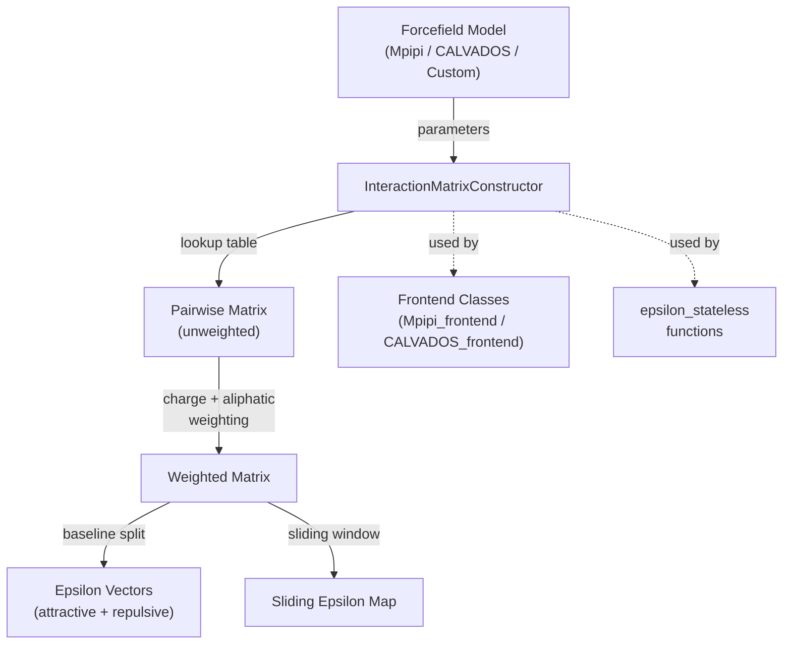

The **InteractionMatrixConstructor** is the central computational engine in finches — a class that bridges forcefield models and sequence-level interaction analysis through an **interface design pattern**. It accepts any validated forcefield object (e.g., Mpipi, CALVADOS) and exposes a unified API for computing pairwise matrices, weighted matrices, epsilon vectors, and sliding-window epsilon maps. If you need fine-grained control over interaction calculations beyond what the frontends offer, this is your entry point.

Sources: [epsilon_calculation.py](/finches/epsilon_calculation.py#L1-L25)

## Architectural Role

The `InteractionMatrixConstructor` occupies a pivotal position in finches' computation pipeline. Forcefield models define *how* residues interact (the biophysics); the `InteractionMatrixConstructor` defines *what* to compute with those interactions (the analysis). This separation means the same analysis code works unchanged across different forcefields — the classic interface pattern.



The frontends ([Mpipi and CALVADOS Frontends](5-mpipi-and-calvados-frontends)) internally instantiate an `InteractionMatrixConstructor` and delegate to it, while the stateless functions in `epsilon_stateless` accept an IMC instance as their `X` parameter for zero-overhead functional calls.

Sources: [epsilon_calculation.py](/finches/epsilon_calculation.py#L27-L42), [frontend_base.py](/finches/frontend/frontend_base.py#L40-L41)

## Initialization and Configuration

The constructor accepts a forcefield object and several model-specific tuning parameters:

```python
from finches.forcefields.mpipi import Mpipi_model
from finches.epsilon_calculation import InteractionMatrixConstructor

# Initialize forcefield
Mpipi_GGv1_params = Mpipi_model(version='Mpipi_GGv1')

# Initialize InteractionMatrixConstructor
IMC = InteractionMatrixConstructor(
    parameters=Mpipi_GGv1_params,
    sequence_converter=False,
    charge_prefactor=None,
    null_interaction_baseline=None,
    compute_forcefield_dependencies=False
)
```

| Parameter | Type | Default | Purpose |
|-----------|------|---------|---------|
| `parameters` | forcefield object | *(required)* | Any object from `finches.forcefields` implementing `ALL_RESIDUES_TYPES`, `compute_interaction_parameter()`, and `CONFIGS` |
| `sequence_converter` | callable | `lambda a: a` | Transforms input sequences before computation (e.g., masking residues) |
| `charge_prefactor` | float | from `CONFIGS` | Scalar (0–1) scaling charge-weighting strength; tunes how much like-charge repulsion is softened |
| `null_interaction_baseline` | float | from `CONFIGS` | Threshold separating attractive from repulsive interactions; defaults to the poly(GS) reference value |
| `compute_forcefield_dependencies` | bool | `False` | If `True`, recomputes `null_interaction_baseline` at runtime when not available in `CONFIGS` |

Sources: [epsilon_calculation.py](/finches/epsilon_calculation.py#L20-L131)

### Forcefield Contract

The `parameters` object must implement three specific attributes — this is the **forcefield interface contract**:

1. **`ALL_RESIDUES_TYPES`** — A list of lists, where each inner list defines residues belonging to the same molecular type (e.g., one list for amino acids, one for RNA bases). Every residue across all lists must have a calculable pairwise parameter.

2. **`compute_interaction_parameter(r1, r2)`** — A function returning the interaction parameter for any valid residue pair. The returned value is a sequence whose `[0]` element is the scalar interaction strength (negative = attractive, positive = repulsive).

3. **`CONFIGS`** — A dictionary containing precomputed forcefield-specific constants, minimally including `'charge_prefactor'` and `'null_interaction_baseline'`.

For example, the Mpipi model defines `ALL_RESIDUES_TYPES` as `[['M','G','K','T','Y','A','D','E','V','L','Q','W','R','F','S','H','N','P','C','I'], ['U']]`, separating protein residues from RNA uracil.

Sources: [epsilon_calculation.py](/finches/epsilon_calculation.py#L59-L89), [mpipi.py](/finches/forcefields/mpipi.py#L199-L199)

### Internal State on Construction

During `__init__`, the constructor builds a **lookup dictionary** — a nested `dict` where `self.lookup[r1][r2]` maps directly to the interaction value for every valid residue pair. This precomputation means subsequent matrix calculations avoid repeated forcefield function calls and instead perform constant-time dictionary lookups. The lookup is built by `_update_lookup_dict()`, which iterates over all cross-product pairs from the flattened residue set.

Sources: [epsilon_calculation.py](/finches/epsilon_calculation.py#L134-L189), [epsilon_calculation.py](/finches/epsilon_calculation.py#L195-L252)

## Core Methods

### Pairwise Matrix Construction

These methods build the raw (unweighted) interaction matrix from sequence-to-sequence residue lookups.

**`calculate_pairwise_heterotypic_matrix(sequence1, sequence2, convert_to_custom=True, use_cython=True)`** → `np.ndarray` of shape `(len(seq1), len(seq2))`

Returns the full pairwise matrix where each element `[i][j]` is `self.lookup[seq1[i]][seq2[j]]`. The Cython-backed path via `matrix_manipulation.dict2matrix()` is ~10× faster than the pure-Python fallback. Sequences are validated through the sequence converter and `_check_sequence()` before computation.

**`calculate_pairwise_homotypic_matrix(sequence, convert_to_custom=True)`** → `np.ndarray`

A convenience wrapper that calls the heterotypic method with `sequence2 = sequence1`.

Sources: [epsilon_calculation.py](/finches/epsilon_calculation.py#L396-L488)

### Weighted Matrix Construction

**`calculate_weighted_pairwise_matrix(sequence1, sequence2, convert_to_custom=True, charge_prefactor=None, use_charge_weighting=True, use_aliphatic_weighting=True, use_cython=True)`** → `np.ndarray`

This is where biophysical context enters. Starting from the raw pairwise matrix, two sequential weighting operations are applied:

1. **Charge weighting** — For every pair of charged residues, the local ±1 residue window around each is concatenated and the ratio `|NCPR|/FCR` is computed. This weight reflects whether like-charged residues cluster together. The weighted matrix becomes: `w_matrix = matrix - (matrix * repulsive_mask * charge_prefactor)`, effectively softening like-charge repulsion where charge clusters exist.

2. **Aliphatic weighting** — A multiplicative mask derived from local aliphatic patches (A, L, M, I, V) amplifies interaction strength for residues embedded in aliphatic-rich regions.

Both weighting schemes are independently toggleable via their respective boolean flags.

Sources: [epsilon_calculation.py](/finches/epsilon_calculation.py#L494-L603), [parsing_aminoacid_sequences.py](/finches/parsing_aminoacid_sequences.py#L25-L96)

### Epsilon Vector and Value Calculation

**`calculate_epsilon_vectors(sequence1, sequence2, use_charge_weighting=True, use_aliphatic_weighting=True)`** → `tuple[list, list]`

Returns `(attractive_vector, repulsive_vector)` — per-residue decomposition of the interaction. Internally delegates to `epsilon_stateless.get_sequence_epsilon_vectors()`, which: (1) builds the weighted matrix, (2) splits it at `null_interaction_baseline` into attractive/repulsive sub-matrices, (3) subtracts the baseline so zero = non-interacting, and (4) computes column means to produce per-residue vectors.

**`calculate_epsilon_value(sequence1, sequence2, use_charge_weighting=True, use_aliphatic_weighting=True)`** → `float`

Returns the scalar epsilon — the sum of all elements in both the attractive and repulsive vectors. This single value quantifies the overall interaction strength between two sequences.

Sources: [epsilon_calculation.py](/finches/epsilon_calculation.py#L614-L701), [epsilon_stateless.py](/finches/epsilon_stateless.py#L119-L201)

### Sliding Window Epsilon

**`calculate_sliding_epsilon(sequence1, sequence2, window_size=31, use_charge_weighting=True, use_aliphatic_weighting=True, use_cython=True)`** → `tuple[np.ndarray, np.ndarray, np.ndarray]`

This is the most computationally intensive and visually rich output. Rather than computing a single epsilon for the whole sequence, it slides a `window_size × window_size` window across the weighted pairwise matrix and computes a local epsilon for each window position. The result is a 2D heatmap matrix with associated sequence-position index arrays.

The return tuple is `(epsilon_matrix, seq2_indices, seq1_indices)`, where the index arrays map matrix coordinates back to protein-space residue numbers (1-indexed). The Cython path via `matrix_manipulation.matrix_scan()` is used by default for performance.

```python
B = IMC.calculate_sliding_epsilon(seq1, seq2, window_size=31)

import matplotlib.pyplot as plt
fig, ax = plt.subplots(figsize=(10, 10))
plt.imshow(B[0],
           extent=[B[1][0], B[1][-1], B[2][0], B[2][-1]],
           aspect='auto', vmax=4, vmin=-4,
           cmap='seismic', origin='lower')
```

> [!TIP]
> The window size must be odd — if an even value is passed, it is silently incremented. The window cannot exceed the length of either sequence.

Sources: [epsilon_calculation.py](/finches/epsilon_calculation.py#L705-L872)

## Utility and Update Methods

### Sequence Validation

**`_check_sequence(sequence)`** — Validates that all residues in the sequence belong to exactly **one** residue group from `self.valid_residue_groups`. Raises an exception if the sequence mixes residue types (e.g., protein + RNA in the same string) or contains unknown residues.

**`get_converted_sequence(sequence)`** → `str` — Passes the sequence through `self.sequence_converter`, then validates. Useful for inspecting what transformed sequence will actually be computed.

Sources: [epsilon_calculation.py](/finches/epsilon_calculation.py#L302-L383)

### Forcefield Hot-Swap

**`_update_parameters(new_parameters)`** — Replaces the current forcefield object and rebuilds the lookup dictionary, while preserving `charge_prefactor`, `sequence_converter`, and `null_interaction_baseline`. This enables runtime forcefield switching without full re-instantiation.

**`_update_lookup_dict(unknown_set_to_zero=False)`** — Rebuilds the `self.lookup` dictionary from scratch using the current `self.parameters`. If `unknown_set_to_zero=True`, missing residue pairs are silently set to 0.0 instead of raising an error — useful for models with incomplete parameter sets.

Sources: [epsilon_calculation.py](/finches/epsilon_calculation.py#L195-L296)

## Complete Method Summary

| Method | Returns | Description |
|--------|---------|-------------|
| `calculate_pairwise_homotypic_matrix(seq)` | `np.ndarray (n×n)` | Raw unweighted self-interaction matrix |
| `calculate_pairwise_heterotypic_matrix(s1, s2)` | `np.ndarray (n×m)` | Raw unweighted cross-interaction matrix |
| `calculate_weighted_pairwise_matrix(s1, s2)` | `np.ndarray (n×m)` | Matrix after charge + aliphatic weighting |
| `calculate_epsilon_vectors(s1, s2)` | `(list, list)` | Per-residue attractive and repulsive vectors |
| `calculate_epsilon_value(s1, s2)` | `float` | Scalar overall interaction strength |
| `calculate_sliding_epsilon(s1, s2)` | `(matrix, idx1, idx2)` | 2D local-epsilon heatmap with indices |
| `get_converted_sequence(seq)` | `str` | Sequence after converter + validation |
| `_update_parameters(params)` | `None` | Hot-swap forcefield, rebuild lookup |
| `_update_lookup_dict()` | `None` | Rebuild lookup from current parameters |

Sources: [epsilon_calculation.py](/finches/epsilon_calculation.py#L18-L874)

## Data Flow: From Residues to Epsilon

The complete computation pipeline for a pair of sequences follows this progression:

```mermaid
flowchart LR
    A["Residue pair<br/>r1, r2"] -->|lookup[r1][r2]| B["Raw pairwise<br/>matrix"]
    B -->|charge_prefactor ×<br/>repulsive_mask| C["Charge-weighted<br/>matrix"]
    C -->|× aliphatic_mask| D["Fully weighted<br/>matrix"]
    D -->|split at baseline| E["Attractive +<br/>Repulsive matrices"]
    E -->|subtract baseline<br/>+ column means| F["Epsilon vectors"]
    F -->|sum| G["Scalar epsilon"]
    D -->|sliding window| H["2D epsilon map"]
```

Every method in the class is a waypoint on this single computational path — the methods simply expose intermediate results at different stages of the pipeline.

Sources: [epsilon_calculation.py](/finches/epsilon_calculation.py#L386-L872), [epsilon_stateless.py](/finches/epsilon_stateless.py#L14-L49)

## Relationship to Other Components

The `InteractionMatrixConstructor` is **consumed by** (not a consumer of):

- **Frontend classes** — Both `Mpipi_frontend` and `CALVADOS_frontend` store an IMC instance as `self.IMC_object` and delegate their `intermolecular_idr_matrix()` and epsilon calls to it. See [Mpipi and CALVADOS Frontends](5-mpipi-and-calvados-frontends).

- **`epsilon_stateless` functions** — The stateless functions `get_sequence_epsilon_vectors()` and `get_sequence_epsilon_value()` accept an IMC as their `X` parameter and call its `calculate_weighted_pairwise_matrix()` method. See [Epsilon Calculation and Weighting](9-epsilon-calculation-and-weighting).

- **`interaction_vector` module** — The visualization functions pass the IMC through to epsilon computation for generating per-residue interaction plots. See [Per-Residue Interaction Vectors](7-per-residue-interaction-vectors).

- **Cython acceleration** — Both `calculate_pairwise_heterotypic_matrix()` and `calculate_sliding_epsilon()` route through `matrix_manipulation` Cython functions for performance-critical loops. See [Cython Matrix Acceleration](20-cython-matrix-acceleration).

> [!TIP]
> When choosing between direct IMC usage and a frontend, prefer the frontend for standard analyses. Use the IMC directly when you need custom weighting combinations, intermediate matrix inspection, or forcefield hot-swapping within a single session.
