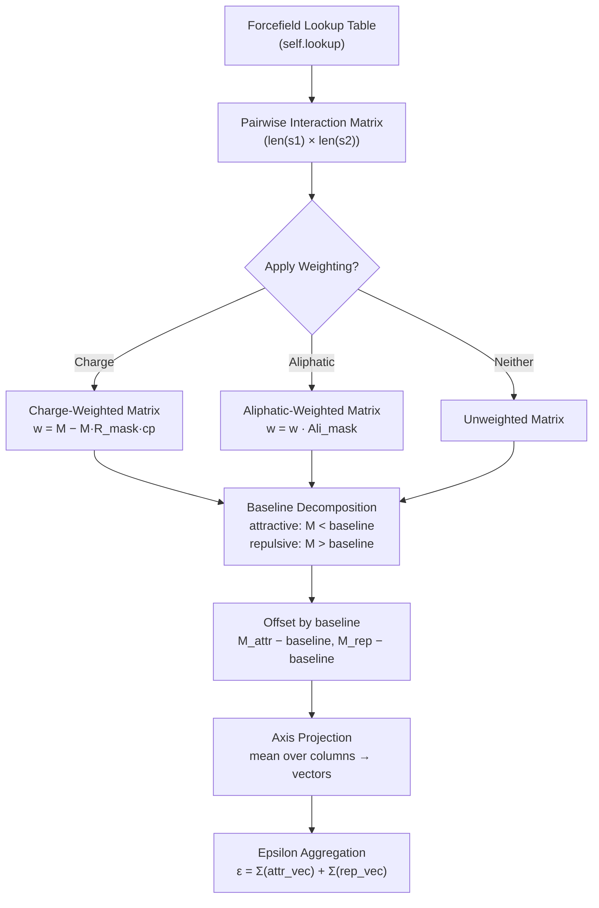

The epsilon calculation pipeline is the quantitative core of finches — it transforms raw pairwise forcefield parameters into scalar interaction parameters (ε) that encode the net attractive and repulsive character between two amino acid sequences. This pipeline operates through a layered architecture: forcefield lookup → matrix construction → context weighting → baseline decomposition → epsilon aggregation. Understanding each layer is essential for interpreting phase behavior predictions and for customizing analysis beyond the frontend defaults.

## Computational Pipeline Overview

The epsilon computation follows a deterministic five-stage pipeline. Each stage refines the raw inter-residue energetics into a progressively more biophysically realistic representation of sequence:sequence interaction:



The pipeline is orchestrated by the `InteractionMatrixConstructor` class (which governs matrix construction and weighting) and the stateless functions in `epsilon_stateless` (which handle decomposition and aggregation). This separation ensures that the same decomposition logic applies regardless of whether the input matrix came from homotypic, heterotypic, or interdomain computations.

Sources: [epsilon_calculation.py](/finches/epsilon_calculation.py#L18-L131), [epsilon_stateless.py](/finches/epsilon_stateless.py#L1-L50)

## The InteractionMatrixConstructor as Epsilon Engine

The `InteractionMatrixConstructor` is the primary object through which all epsilon-relevant computation flows. It is initialized with a forcefield parameter object and two model-specific calibration constants — `charge_prefactor` and `null_interaction_baseline` — that govern how raw interaction values are weighted and partitioned:

```python
from finches.forcefields.mpipi import Mpipi_model
from finches.epsilon_calculation import InteractionMatrixConstructor

# Initialize forcefield
params = Mpipi_model(version='Mpipi_GGv1')

# Initialize constructor with auto-calibrated constants
IMC = InteractionMatrixConstructor(parameters=params)
```

At construction, the object builds a **lookup dictionary** (`self.lookup`) that pre-computes every valid residue pair interaction via `parameters.compute_interaction_parameter(r1, r2)`. This dictionary is the foundation for all subsequent matrix operations and avoids redundant forcefield evaluation during sequence analysis. If either `charge_prefactor` or `null_interaction_baseline` is not explicitly provided, the constructor attempts to retrieve precomputed values from `parameters.CONFIGS`; if unavailable and `compute_forcefield_dependencies=True`, it recomputes them on the fly.

Sources: [epsilon_calculation.py](/finches/epsilon_calculation.py#L18-L189)

### Constructor Parameters and Their Roles

| Parameter | Type | Role | Default Source |
|---|---|---|---|
| `parameters` | forcefield object | Provides `compute_interaction_parameter()`, `ALL_RESIDUES_TYPES`, `CONFIGS` | Required |
| `sequence_converter` | function | Transforms input sequences before matrix construction (e.g., masking) | Identity function |
| `charge_prefactor` | float ∈ (0, 1) | Scales strength of charge-context weighting on repulsive interactions | `parameters.CONFIGS['charge_prefactor']` |
| `null_interaction_baseline` | float | Threshold partitioning attractive from repulsive interactions | `parameters.CONFIGS['null_interaction_baseline']` |
| `compute_forcefield_dependencies` | bool | Recompute calibration constants if missing from `CONFIGS` | `False` |

The `sequence_converter` parameter enables a powerful indirection: any function that transforms an input string into a valid residue sequence can be injected, allowing masking, domain extraction, or residue remapping without modifying the core computation path.

Sources: [epsilon_calculation.py](/finches/epsilon_calculation.py#L20-L131)

## Null Interaction Baseline Calibration

The **null interaction baseline** is the single most consequential calibration constant in the epsilon pipeline. It defines the energy threshold below which pairwise interactions are classified as *attractive* and above which they are *repulsive*. This is not zero — it is the interaction energy of a reference sequence that is expected to behave as a non-interacting Gaussian chain. The standard reference is a 400-residue poly(GS) repeat:

```python
# What the calibration function solves internally
seq = 'GS' * 200
# Find baseline such that epsilon(seq, seq) = 0
result = root_scalar(f, bracket=[-10.0, 10.0])
```

The calibration uses `scipy.optimize.root_scalar` to find the baseline value where the computed epsilon of the poly(GS) homodimer crosses zero, with charge and aliphatic weighting **disabled**. This root-finding approach ensures the baseline is self-consistent with the underlying forcefield — changing the forcefield version requires recalibration.

The `get_null_interaction_baseline` function in `finches.data.forcefield_dependencies` exposes this calibration for new or custom forcefields. Precomputed baselines are stored in each forcefield's `CONFIGS` dictionary to avoid expensive recomputation at runtime.

Sources: [forcefield_dependencies.py](/finches/data/forcefield_dependencies.py#L17-L68)

## Matrix Construction: From Lookup to Pairwise Arrays

Three matrix construction methods form the foundation of epsilon computation, each producing a 2D NumPy array where element `[i][j]` represents the interaction energy between residue `i` of sequence 1 and residue `j` of sequence 2:

### Unweighted Matrix Construction

**`calculate_pairwise_heterotypic_matrix(sequence1, sequence2)`** builds the raw interaction matrix by looking up each residue pair in `self.lookup`. Two backends are available: a Cython implementation (`matrix_manipulation.dict2matrix`) that is ~10× faster, and a pure-Python fallback. The homotypic variant (`calculate_pairwise_homotypic_matrix`) simply calls the heterotypic method with both sequences identical.

### Weighted Matrix Construction

**`calculate_weighted_pairwise_matrix(sequence1, sequence2, ...)`** applies two optional weighting schemes to the raw matrix, controlled by boolean flags:

```python
w_matrix = IMC.calculate_weighted_pairwise_matrix(
    sequence1, sequence2,
    use_charge_weighting=True,    # scale repulsive charge-charge interactions
    use_aliphatic_weighting=True   # up-weight clustered aliphatic interactions
)
```

The weighting is applied **sequentially** — charge weighting first, then aliphatic weighting on the already charge-weighted matrix. This ordering matters because aliphatic weighting is a multiplicative mask that can amplify or attenuate values that charge weighting has already modified.

Sources: [epsilon_calculation.py](/finches/epsilon_calculation.py#L426-L603)

## Charge Context Weighting

Charge weighting implements a biophysical insight: like-charge repulsion between two residues depends on the **local charge context** surrounding each residue, not just the residue pair in isolation. Two lysines flanked by other lysines experience stronger effective repulsion than two lysines embedded in a neutral sequence context, because clusters of like-charged residues cannot reorient their sidechains to avoid one another.

The weighting is computed as:

$$w_{matrix} = M - (M \times R_{mask} \times c_p)$$

where $R_{mask}$ is the repulsive charge mask and $c_p$ is the `charge_prefactor`. The mask is constructed by examining each charged residue pair `(r1, r2)` and computing the local charge asymmetry in a ±1 residue window around each:

$$\text{charge\_weight} = \left|\frac{\text{NCPR}}{\text{FCR}}\right|$$

Here, NCPR is the net charge per residue and FCR is the fraction of charged residues in the concatenated local fragment. This ratio approaches 1.0 when the fragment is uniformly like-charged (maximal repulsion relief needed) and 0.0 when the fragment is charge-balanced (no relief needed). Only the **repulsive** component of charge weighting is applied — the attractive mask is computed but currently unused, as empirical validation showed the repulsive-only scheme performed better across benchmarks.

| Fragment Example | NCPR | FCR | |NCPR/FCR| | Interpretation |
|---|---|---|---|---|
| `KKK` + `KKK` | +1.0 | 1.0 | 1.0 | Maximum repulsion relief |
| `EEE` + `EEE` | −1.0 | 1.0 | 1.0 | Maximum repulsion relief |
| `KKK` + `EEE` | 0.0 | 1.0 | 0.0 | No relief (opposite charges) |
| `KAK` + `EAE` | 0.0 | 0.67 | 0.0 | No relief (balanced) |

Sources: [parsing_aminoacid_sequences.py](/finches/parsing_aminoacid_sequences.py#L25-L194), [epsilon_calculation.py](/finches/epsilon_calculation.py#L546-L594)

## Aliphatic Context Weighting

Aliphatic weighting approximates a solvent-mediated effect: hydrophobic attraction between aliphatic residues is not pairwise additive but depends on whether aliphatic residues form **contiguous clusters**. A single leucine has minimal hydrophobic driving force in isolation, but a run of three adjacent leucines creates an interface large enough to release multiple water molecules, producing a disproportionately stronger attraction.

The implementation proceeds in two stages:

1. **Grouping**: Each aliphatic residue (A, V, I, L, M) is assigned a group number (0, 1, 2, or 3) based on how many of its nearest neighbors are also aliphatic. Group 0 = non-aliphatic; Group 1 = isolated aliphatic; Group 2 = one aliphatic neighbor; Group 3 = two or more aliphatic neighbors.

2. **Mask multiplication**: A symmetric multiplier table maps group combinations to scaling factors:

| Group₁ \ Group₂ | 1 (isolated) | 2 (pair) | 3 (cluster) |
|---|---|---|---|
| **1** (isolated) | 1.0 | 1.0 | 1.0 |
| **2** (pair) | 1.0 | 1.5 | 1.5 |
| **3** (cluster) | 1.0 | 1.5 | **3.0** |

The final weighted matrix is: `w_matrix = w_matrix * aliphatic_mask`. This means two clustered aliphatic regions interacting across sequences receive a **3× boost** to their attractive interaction, while isolated aliphatics retain their unweighted value (multiplier = 1.0). The asymmetry in the table (cluster × cluster = 3.0 but pair × pair = 1.5) reflects the nonlinear scaling of water release with interface size.

Sources: [parsing_aminoacid_sequences.py](/finches/parsing_aminoacid_sequences.py#L252-L341)

## Baseline Decomposition and Epsilon Aggregation

Once the weighted matrix is constructed, the stateless functions in `epsilon_stateless` partition it into attractive and repulsive components and aggregate per-residue or whole-sequence epsilon values.

### Attractive-Repulsive Decomposition

**`get_attractive_repulsive_matrices(matrix, null_interaction_baseline)`** performs a threshold split:

```python
attractive_matrix = (matrix < null_interaction_baseline) * matrix
repulsive_matrix  = (matrix > null_interaction_baseline) * matrix
```

Elements exactly equal to the baseline are zeroed in both matrices. The baseline is then subtracted from both matrices so that zero represents the non-interacting reference, negative values indicate attraction, and positive values indicate repulsion:

```python
attractive_matrix = attractive_matrix - null_interaction_baseline
repulsive_matrix  = repulsive_matrix  - null_interaction_baseline
```

### Epsilon Vectors

**`get_sequence_epsilon_vectors(sequence1, sequence2, X, ...)`** produces per-residue vectors by projecting the decomposed matrices along the column axis (mean over sequence 2 residues for each sequence 1 residue):

```python
attractive_vector = np.mean(attractive_matrix, axis=1)  # len == len(sequence1)
repulsive_vector  = np.mean(repulsive_matrix, axis=1)
```

These vectors reveal which regions of sequence 1 are locally attractive or repulsive relative to sequence 2, and are the data underlying interaction vector plots.

### Scalar Epsilon

**`get_sequence_epsilon_value(sequence1, sequence2, X, ...)`** collapses the vectors into a single scalar:

```python
epsilon = np.sum(attractive_vector) + np.sum(repulsive_vector)
```

Negative epsilon indicates net attractive interaction (driving condensation); positive epsilon indicates net repulsion. This scalar is the input to Flory-Huggins phase diagram construction.

Sources: [epsilon_stateless.py](/finches/epsilon_stateless.py#L14-L268)

## Interdomain Epsilon: Folded Domain Surface Interactions

A specialized variant of epsilon computation handles interactions between the **solvent-accessible surface of a folded domain (FD)** and an adjacent intrinsically disordered region (IDR). The function `get_interdomain_epsilon_vectors()` incorporates a spatial accessibility mask (`SAFD_cords`) that restricts interaction to FD surface residues reachable by the IDR chain, given the IDR's attachment point (C-terminal, N-terminal, or custom origin):

```python
from finches.epsilon_stateless import get_interdomain_epsilon_value

epsilon = get_interdomain_epsilon_value(
    SAFD_sequence,   # surface residues only
    idr_sequence,    # the IDR
    IMC,             # InteractionMatrixConstructor
    SAFD_cords,      # spatial coordinates for masking
    IDR_positon='Cterm',
    sequence_of_ref='sequence2'  # project onto IDR
)
```

Key differences from standard epsilon computation: (1) the pairwise matrix is masked by a spatial reachability filter (`build_column_mask_based_on_xyz`), and (2) **aliphatic weighting is not applied** because aliphatic grouping is only meaningful between contiguous sequence regions, and folded domain surface residues are non-contiguous by definition. Charge weighting uses a specialized FD variant (`get_charge_weighted_FD_mask`) where the FD residue is treated in isolation (no ±1 window on the FD side).

Sources: [epsilon_stateless.py](/finches/epsilon_stateless.py#L271-L530)

## Method Catalog: InteractionMatrixConstructor

The following table summarizes all epsilon-relevant methods on the `InteractionMatrixConstructor` class and their relationship to the stateless function layer:

| IMC Method | Delegates To | Returns | Description |
|---|---|---|---|
| `calculate_pairwise_heterotypic_matrix(s1, s2)` | Cython/Python lookup | `np.array (len_s1 × len_s2)` | Raw unweighted matrix |
| `calculate_pairwise_homotypic_matrix(s)` | heterotypic(s, s) | `np.array (n × n)` | Self-interaction matrix |
| `calculate_weighted_pairwise_matrix(s1, s2, ...)` | heterotypic + weighting | `np.array (len_s1 × len_s2)` | Charge + aliphatic weighted matrix |
| `calculate_epsilon_vectors(s1, s2, ...)` | `get_sequence_epsilon_vectors` | `(attr_vec, rep_vec)` | Per-residue attractive/repulsive vectors |
| `calculate_epsilon_value(s1, s2, ...)` | `get_sequence_epsilon_value` | `float` | Scalar epsilon |
| `calculate_sliding_epsilon(s1, s2, window_size, ...)` | Cython/Python sliding window | `(matrix, s2_idx, s1_idx)` | Local epsilon landscape |

Sources: [epsilon_calculation.py](/finches/epsilon_calculation.py#L396-L872)

## Weighting Flag Combinations and Their Semantics

The four possible combinations of the `use_charge_weighting` and `use_aliphatic_weighting` flags produce qualitatively different interaction models:

| Charge | Aliphatic | Biophysical Interpretation | When to Use |
|---|---|---|---|
| ✗ | ✗ | Pure mean-field: every residue pair contributes its bare forcefield value | Baseline comparison; debugging; forcefield validation |
| ✓ | ✗ | Charge context-aware: like-charge clusters get repulsion relief | Sequences with prominent charge patterning |
| ✗ | ✓ | Aliphatic cluster-aware: hydrophobic patches get attraction boost | Sequences with aliphatic clustering but minimal charge |
| ✓ | ✓ | Full biophysical model: both effects active | **Default and recommended for production use** |

The default for both `calculate_epsilon_value` and `calculate_epsilon_vectors` is **both enabled** (`True`), which reflects the empirically validated configuration across the finches benchmark suite.

Sources: [epsilon_calculation.py](/finches/epsilon_calculation.py#L614-L701), [epsilon_stateless.py](/finches/epsilon_stateless.py#L120-L268)

> [!TIP]
> The `null_interaction_baseline` is forcefield-version-specific — mixing a baseline from one forcefield version with parameters from another will produce silently incorrect epsilon values. Always verify that `IMC.null_interaction_baseline` matches the expected value in your forcefield's `CONFIGS` dictionary.

> [!TIP]
> Charge weighting only generates a repulsive correction (like-charge clusters get repulsion relief). There is no attractive charge weighting despite the code computing an attractive mask — this is an intentional design decision from empirical validation, not a bug.

## Related Pages

- The `InteractionMatrixConstructor` class is documented in detail at [InteractionMatrixConstructor](8-interactionmatrixconstructor)
- Sliding window epsilon computation extends these concepts at [Sliding Window Matrix Computation](10-sliding-window-matrix-computation)
- The weighting schemes described here connect to the broader framework at [Sequence Context Weighting Schemes](19-sequence-context-weighting-schemes)
- Forcefield parameter objects that feed into epsilon calculation: [Mpipi Forcefield Parameters](11-mpipi-forcefield-parameters) and [CALVADOS Forcefield Parameters](12-calvados-forcefield-parameters)
- Epsilon values flow into phase diagram construction at [Flory-Huggins Phase Diagrams](14-flory-huggins-phase-diagrams)