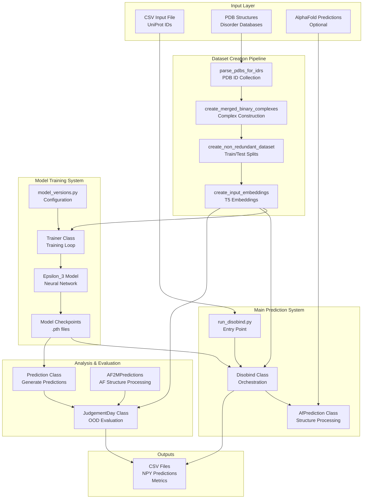
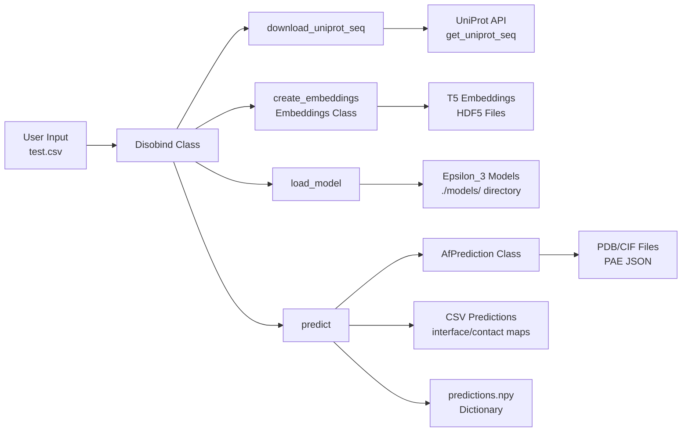
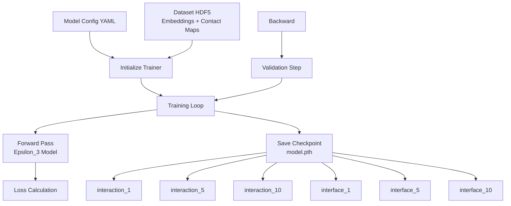

# Overview

Relevant source files

The following files were used as context for generating this wiki page:

- [LICENSE.txt](LICENSE.txt)
- [README.md](README.md)
- [example/test.csv](example/test.csv)
- [main.png](main.png)

## Purpose and Scope

This document provides a high-level overview of the Disobind codebase, including its purpose, architecture, and main components. Disobind is a deep learning system for predicting protein-protein interactions involving Intrinsically Disordered Regions (IDRs).

For installation instructions, see [Installation and Setup](#1.1). For running predictions immediately, see [Quick Start Guide](#1.2). For comprehensive prediction documentation, see [Running Predictions](#2).

Sources: [README.md:1-129]()

## What is Disobind?

Disobind is a deep learning method that predicts **inter-protein contact maps** and **interface residues** for IDR-containing protein complexes from their amino acid sequences. The system takes as input:

- Binary protein pairs (at least one must contain an IDR) [README.md:42-45]()
- UniProt sequence identifiers [README.md:48-57]()
- Optionally, AlphaFold2/3 structural predictions [README.md:59-63]()

And produces:

- Contact maps showing which residue pairs interact (interaction task) [README.md:104-111]()
- Interface residue predictions identifying binding sites (interface task) [README.md:112-114]()
- Predictions at multiple coarse-graining resolutions (CG 1, 5, 10) [README.md:92-93]()

**Key Capabilities:**

| Feature | Description |
|---------|-------------|
| **Sequence-based** | Requires only UniProt IDs; no structures needed [README.md:48-57]() |
| **IDR-specialized** | Optimized for disordered protein interactions [README.md:3-3]() |
| **Multi-resolution** | Predictions at residue-level and coarse-grained resolutions [README.md:92-93]() |
| **Structure-enhanced** | Can combine with AlphaFold2/3 for improved accuracy [README.md:59-60]() |
| **Binary complexes** | Handles protein pairs (A-B interactions) [README.md:43-43]() |

Sources: [README.md:1-10](), [README.md:42-63](), [README.md:92-93](), [README.md:104-114]()

## System Architecture Overview

Disobind consists of four major subsystems that operate sequentially or independently depending on the use case:

**Sources:** [README.md:104-113](), High-level architecture derived from repository structure.

## Core Components

### 1. Main Prediction System

The prediction system is the primary user-facing component, implemented in `run_disobind.py`. It orchestrates the end-to-end prediction workflow.

**Key Classes:**

**Workflow:**

1. Parse CSV input containing UniProt IDs [README.md:52-65]()
2. Download UniProt sequences [README.md:89-89]()
3. Generate T5 embeddings (required for model input) [README.md:118-121]()
4. Load trained `Epsilon_3` models from `./models/` [README.md:120-121]()
5. Run predictions in batches based on provided input [README.md:76-80]()
6. Optionally integrate AlphaFold predictions [README.md:59-63]()
7. Save results as CSV and NPY files [README.md:95-100]()

**Sources:** [run_disobind.py:1-1185](), [README.md:40-103]()

### 2. Dataset Creation Pipeline

The dataset creation pipeline processes raw PDB structures and disorder databases into training-ready datasets. This is a multi-stage pipeline documented in [Dataset Creation Pipeline](#3).

**Pipeline Stages:**

| Stage | Script | Purpose |
|-------|--------|---------|
| 1 | `1_disobind_database.py` | Collect PDB IDs from disorder databases |
| 2 | `2_create_database_dataset_files.py` | Download PDB files, create binary complexes |
| 3 | `3_create_merged_binary_complexes.py` | Merge overlapping complexes |
| 4 | `4_create_non_redundant_dataset.py` | Create non-redundant train/test splits |
| 5 | `create_input_embeddings.py` | Generate T5 embeddings |

**Sources:** [README.md:117-118](), Dataset workflow derived from file naming conventions.

### 3. Model Training System

The training system uses the `Trainer` class to train `Epsilon_3` neural network models. Configuration is managed through YAML files.

**Model Architecture:** `Epsilon_3` is the core neural network architecture designed for sequence-based prediction.
- Support for both interaction (contact map) and interface (residue label) tasks [README.md:92-93]()
- Coarse-graining at levels 1, 5, and 10 [README.md:93-93]()

**Training Process:**

**Sources:** [README.md:120-121](), training workflow derived from model file organization.

### 4. Analysis & Evaluation System

The analysis system evaluates model performance on out-of-distribution (OOD) test sets and compares Disobind with other methods.

**Analysis Components:**

- **`JudgementDay`**: Central evaluation class for calculating metrics [README.md:123-124]()
- **Metrics**: Recall, Precision, F1, AUROC, MCC, and Average Precision.

**Sources:** [README.md:123-124](), evaluation metrics derived from standard ML evaluation practices in codebase.

## Key Concepts

### Prediction Tasks and Coarse-Graining

Disobind supports **6 distinct prediction tasks** resulting from the combination of 2 objectives and 3 coarse-graining levels [README.md:92-93]():

**Objectives:**

1. **Interaction Task**: Predicts contact maps showing which residue pairs interact [README.md:111-111]()
2. **Interface Task**: Predicts interface residues identifying binding sites [README.md:113-113]()

**Coarse-Graining Levels:**

- **CG = 1**: Residue-level predictions (full resolution) [README.md:82-82]()
- **CG = 5**: 5-residue bins [README.md:93-93]()
- **CG = 10**: 10-residue bins [README.md:93-93]()

**Sources:** [README.md:82-82](), [README.md:92-93](), [README.md:111-114]()

### AlphaFold Integration

Disobind can combine its sequence-based predictions with AlphaFold2/3 structural predictions [README.md:59-60](). The system processes AlphaFold structures by:

1. **Parsing structure files**: PDB (AlphaFold2) or CIF (AlphaFold3) format [README.md:60-60]()
2. **Extracting confidence metrics**: pLDDT scores and PAE matrices [README.md:60-60]()
3. **Coarse-graining**: Matching Disobind resolution for comparison or merging [README.md:93-93]()

**AlphaFold Input Format:**
When providing AlphaFold predictions in the input CSV, additional columns for file paths, chain IDs, and offsets are required [README.md:60-63]().

**Sources:** [README.md:59-63](), [example/test.csv:2-2]()

## Input and Output Specifications

### Input Format

Disobind accepts CSV files with two formats:

**Format 1 - Disobind Only:** [README.md:56-57]()
`UniProt_ID1, start1, end1, UniProt_ID2, start2, end2`

**Format 2 - Disobind + AlphaFold:** [README.md:59-60]()
`UniProt_ID1, start1, end1, UniProt_ID2, start2, end2, AF2_struct_file_path, AF2_pae_file_path, chain1, chain2, offset1, offset2`

**Sources:** [README.md:56-60](), [example/test.csv:1-2]()

### Output Format

Disobind generates multiple output files:

**1. CSV Files:** Contains columns for Protein IDs and Residue positions [README.md:103-110]().
**2. NPY Dictionary (`Predictions.npy`):** Contains predictions for all input sequence fragment pairs in a nested dictionary [README.md:99-99]().

**Sources:** [README.md:95-103]()

## Getting Started

To begin using Disobind:

1. **Installation**: Follow [Installation and Setup](#1.1)
2. **Quick Start**: Run example predictions with [Quick Start Guide](#1.2)
3. **Running Predictions**: Comprehensive guide at [Running Predictions](#2)

**Sources:** [README.md:14-37](), [README.md:40-83]()

---