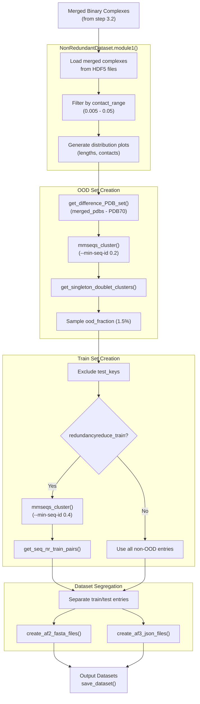
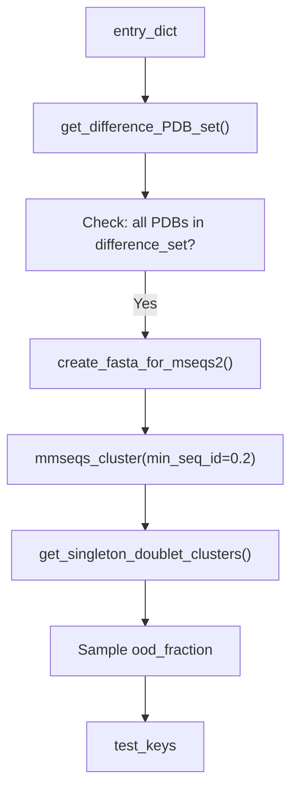

# Non-Redundant Dataset Creation

<details>
<summary>Relevant source files</summary>

The following files were used as context for generating this wiki page:

- [database/input_files/Merged_DIBS_MFIB_Fdb_PDBtot-cdr.csv](database/input_files/Merged_DIBS_MFIB_Fdb_PDBtot-cdr.csv)
- [database/input_files/pdb70_clu.tsv](database/input_files/pdb70_clu.tsv)
- [dataset/4_create_non_redundant_dataset.py](dataset/4_create_non_redundant_dataset.py)

</details>


## Purpose and Scope

This document describes the process of creating non-redundant training and out-of-distribution (OOD) test datasets from merged binary complexes. The redundancy reduction ensures that:

1. The OOD test set is non-redundant with respect to itself, the training set, and the AlphaFold2 PDB70 dataset.
2. The training set optionally undergoes redundancy reduction at a specified sequence identity threshold.
3. Datasets are properly split and formatted for downstream model training and evaluation.

For information about creating merged binary complexes (the input to this process), see [Creating Binary Complexes](3.2). For generating embeddings from the non-redundant datasets, see [Generating Embeddings](3.4).

**Sources:** [dataset/4_create_non_redundant_dataset.py:1-249](), [dataset/README.md:19-22]()

---

## Overview

The non-redundant dataset creation process is implemented in the `NonRedundantDataset` class [dataset/4_create_non_redundant_dataset.py:31-143]() and performs four main operations:

1. **Filtering by contact density**: Select merged binary complexes with appropriate contact fractions.
2. **OOD set creation**: Generate a test set non-redundant at both PDB and sequence levels.
3. **Train set creation**: Create a training set excluding OOD entries, with optional redundancy reduction.
4. **Dataset segregation**: Split data and prepare input files for AlphaFold predictions.

**Sources:** [dataset/4_create_non_redundant_dataset.py:31-143]()

---

## Workflow Overview

### System Data Flow Diagram

The diagram below bridges the natural language process steps to the specific code entities in `4_create_non_redundant_dataset.py`.



**Sources:** [dataset/4_create_non_redundant_dataset.py:145-249](), [dataset/4_create_non_redundant_dataset.py:312-375](), [dataset/4_create_non_redundant_dataset.py:861-903]()

---

## Input Requirements

The script expects merged binary complexes created by the previous pipeline stage (see [Creating Binary Complexes](3.2)).

### Required Input Files

| File/Directory | Description | Source Reference |
|----------------|-------------|------------------|
| `merged_binary_complexes_dir` | Directory containing merged complex HDF5 files | [dataset/4_create_non_redundant_dataset.py:47]() |
| `merged_binary_complexes_file` | Comma-separated list of complex keys | [dataset/4_create_non_redundant_dataset.py:49]() |
| `uni_seq_path` | Uniprot sequences dictionary | [dataset/4_create_non_redundant_dataset.py:45]() |
| `pdb70_tsv_file` | PDB70 cluster assignments | [dataset/4_create_non_redundant_dataset.py:66]() |
| `pdb70_rep_fasta_file` | PDB70 representative sequences | [dataset/4_create_non_redundant_dataset.py:74]() |

### HDF5 File Structure

Each merged binary complex HDF5 file contains metadata and the binary contact map:

```python
{
    "prot1_seq": str[],           # Protein 1 sequence
    "prot2_seq": str[],           # Protein 2 sequence
    "prot1_length": int,          # Length of protein 1
    "prot2_length": int,          # Length of protein 2
    "prot1_uni_boundary": str,    # "start-end" boundary
    "prot2_uni_boundary": str,    # "start-end" boundary
    "binary_cmap": np.array,      # Binary contact map
    "contacts_count": int,        # Number of contacts
    "merged_entries": str[]       # List of merged PDB entries
}
```

**Sources:** [dataset/4_create_non_redundant_dataset.py:312-375]()

---

## Module 1: Loading and Filtering by Contact Density

### Purpose

Load merged binary complexes and filter based on contact density to reduce dataset sparsity while maintaining sufficient positive examples.

### Implementation

The `module1()` method [dataset/4_create_non_redundant_dataset.py:312-375]() filters complexes where the fraction of contacts falls within the specified range:

```python
self.contact_range = [0.005, 0.05]  # 0.5% to 5%
```

### Output

- `entry_dict`: Dictionary containing all filtered complexes in memory [dataset/4_create_non_redundant_dataset.py:134]().
- `unique_merged_pdbs`: Set of all PDB IDs from merged complexes [dataset/4_create_non_redundant_dataset.py:128]().
- Distribution plots: `Summary_plots_pre_filter.png` and `Summary_plots_post_filter.png` [dataset/4_create_non_redundant_dataset.py:276-309]().

**Sources:** [dataset/4_create_non_redundant_dataset.py:312-375](), [dataset/4_create_non_redundant_dataset.py:113]()

---

## Module 2: OOD Test Set Creation

### Purpose

Create an out-of-distribution test set that is non-redundant with the AlphaFold2 PDB70 training dataset, non-redundant with itself (<20% sequence identity), and representative of novel interactions.

### Redundancy Reduction Implementation

The OOD creation logic involves structural comparison against PDB70 and sequence clustering via MMSeqs2.



### Sequence-Level Filtering

**Key method:** `create_fasta_for_mseqs2()` [dataset/4_create_non_redundant_dataset.py:437-473](), `get_singleton_doublet_clusters()` [dataset/4_create_non_redundant_dataset.py:506-544]().

The process creates unique headers for each protein sequence to enable post-clustering identification:
**Header format:** `{entry_id}:{uni_id}-{boundary}` [dataset/4_create_non_redundant_dataset.py:421-424]().

**MMSeqs2 clustering parameters:**
- Algorithm: `easy-cluster` [dataset/4_create_non_redundant_dataset.py:124]().
- Sequence identity cutoff: `0.2` (20%) [dataset/4_create_non_redundant_dataset.py:119]().
- Cluster mode: `1` [dataset/4_create_non_redundant_dataset.py:125]().

**Cluster selection criteria:**
A Uniprot ID pair is included in the OOD set if:
1. **Singleton clusters**: Both prot1 and prot2 are in singleton clusters.
2. **Doublet clusters**: Both prot1 and prot2 are in the same doublet cluster.

**Sources:** [dataset/4_create_non_redundant_dataset.py:380-640]()

---

## Module 3: Train Set Creation

### Implementation

The training set is created by excluding entries selected for the OOD set [dataset/4_create_non_redundant_dataset.py:671-700](). 

If `redundancyreduce_train` is set to `True`, the script applies sequence clustering at 40% identity (`train_ID_cutoff = 0.4`) [dataset/4_create_non_redundant_dataset.py:123]().

**Selection criteria (get_seq_nr_train_pairs):**
A Uniprot ID pair is included in training if:
1. Both prot1 and prot2 headers are cluster representatives, **OR**
2. Both prot1 and prot2 belong to the same cluster [dataset/4_create_non_redundant_dataset.py:726-754]().

**Sources:** [dataset/4_create_non_redundant_dataset.py:703-754]()

---

## Module 4: Dataset Segregation and Output

### AlphaFold Prediction Inputs

For each test entry, the script generates specific input formats for structural validation:

1. **AlphaFold2 (AF2)**: FASTA files containing both protein sequences with boundary headers [dataset/4_create_non_redundant_dataset.py:760-804]().
2. **AlphaFold3 (AF3)**: JSON files formatted for the AF3 server, created in batches of 20 [dataset/4_create_non_redundant_dataset.py:807-858]().

### Final Dataset Output

The `save_dataset()` function [dataset/4_create_non_redundant_dataset.py:908-955]() writes the final data to disk:

- **CSV Files**: `prot_1-2_train_{version}.csv` and `prot_1-2_test_{version}.csv`.
- **HDF5 Files**: `Target_bcmap_train_{version}.h5` and `Target_bcmap_test_{version}.h5`.

The HDF5 files store binary contact maps indexed by a modified entry ID that includes sequence boundaries: `{UniID1}:{start1}:{end1}--{UniID2}:{start2}:{end2}_{copy_num}` [dataset/4_create_non_redundant_dataset.py:939-940]().

**Sources:** [dataset/4_create_non_redundant_dataset.py:861-955]()

---

## Configuration Parameters

| Parameter | Default | Description |
|-----------|---------|-------------|
| `contact_range` | `[0.005, 0.05]` | Fraction of contacts allowed [dataset/4_create_non_redundant_dataset.py:113]() |
| `ood_fraction` | `0.015` | Fraction of total dataset for OOD set [dataset/4_create_non_redundant_dataset.py:117]() |
| `ood_ID_cutoff` | `0.2` | Identity cutoff for OOD MMSeqs2 [dataset/4_create_non_redundant_dataset.py:119]() |
| `train_ID_cutoff` | `0.4` | Identity cutoff for Train MMSeqs2 [dataset/4_create_non_redundant_dataset.py:123]() |
| `redundancyreduce_train`| `False` | Toggle for training set reduction [dataset/4_create_non_redundant_dataset.py:121]() |

**Sources:** [dataset/4_create_non_redundant_dataset.py:110-126]()

---