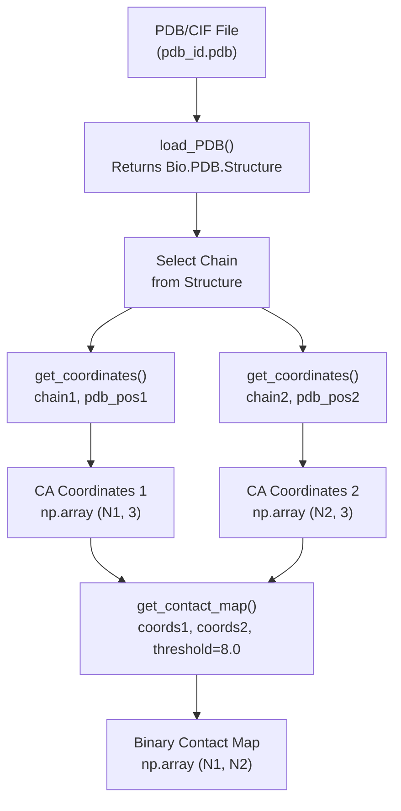
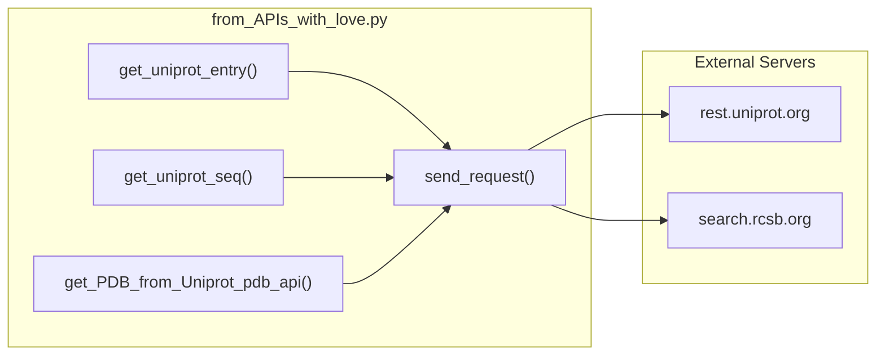
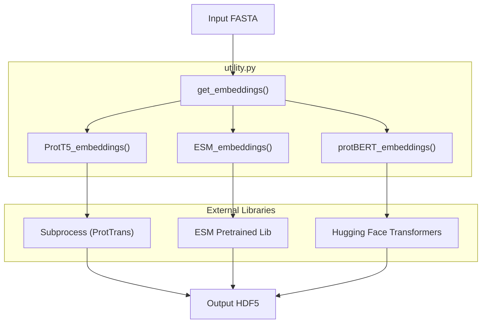

# Data Processing Utilities

Relevant source files

The following files were used as context for generating this wiki page:

- [dataset/from_APIs_with_love.py](dataset/from_APIs_with_love.py)
- [dataset/parse_sifts.py](dataset/parse_sifts.py)
- [dataset/utility.py](dataset/utility.py)

This page documents the low-level utility functions in `dataset/utility.py` and `dataset/from_APIs_with_love.py` that support the Disobind dataset creation pipeline. These functions handle structural data processing, coordinate transformations, sequence encoding, embedding generation, and external database queries.

For information about the high-level dataset creation workflow, see [Dataset Creation Pipeline](). For specific dataset preparation tasks, see [Creating Binary Complexes]() and [Generating Embeddings]().

---

## Overview

The data processing utilities provide fundamental operations for:

- **Structural Processing**: Loading PDB/CIF files and extracting atomic coordinates.
- **Coordinate Transformations**: Converting between PDB and UniProt residue numbering systems.
- **Contact Map Generation**: Creating binary contact maps from 3D coordinates.
- **Disorder Region Processing**: Loading and querying disorder databases (DisProt, IDEAL, MobiDB).
- **Sequence Encoding**: One-hot encoding and tokenization of amino acid sequences.
- **Embedding Generation**: Creating T5, ESM, BERT, and other protein embeddings.
- **Structural Alignment**: Running MMSeqs2, MMalign, and USalign tools.
- **External API Calls**: Fetching data from UniProt and PDB web servers.

Sources: [dataset/utility.py:1-30](), [dataset/from_APIs_with_love.py:1-16]()

---

## PDB Structure Processing

### Loading PDB Files

The `load_PDB()` function reads PDB or CIF format structure files using BioPython parsers.

**Function Signature**: `load_PDB(pdb, pdb_path)` [dataset/utility.py:26-59]()

| Parameter | Type | Description |
|-----------|------|-------------|
| `pdb` | str | PDB ID to load |
| `pdb_path` | str | Directory containing PDB/CIF files |
| **Returns** | Bio.PDB.Structure | All models from the structure file |

The function automatically detects whether a `.pdb` or `.cif` file exists and selects the appropriate parser (`PDBParser` or `MMCIFParser`) [dataset/utility.py:53-56]().

### Coordinate Extraction

The `get_coordinates()` function extracts Cα atom coordinates for specified residues from a protein chain.

**Function Signature**: `get_coordinates(chain, pdb_pos)` [dataset/utility.py:64-103]()

| Parameter | Type | Description |
|-----------|------|-------------|
| `chain` | Bio.PDB.Chain | Chain object from BioPython |
| `pdb_pos` | list[int] | List of residue positions to extract (empty list = all residues) |
| **Returns** | np.ndarray | Coordinates array of shape (N, 3) |

**Processing Logic**:
- Only extracts ATOM entries (residue.id[0] == " "), ignoring HETATM entries [dataset/utility.py:85-87]().
- Handles missing residues or absent Cα atoms gracefully via try-except blocks [dataset/utility.py:90-91]().
- Returns coordinates as float32 for memory efficiency [dataset/utility.py:103]().

### Contact Map Generation

The `get_contact_map()` function creates binary contact maps based on Cα-Cα distance thresholds.

**Function Signature**: `get_contact_map(coords1, coords2, contact_threshold)` [dataset/utility.py:108-124]()

The function computes pairwise Euclidean distances using NumPy broadcasting and applies the threshold to create a binary matrix [dataset/utility.py:121-122]().

### Workflow Diagram

Sources: [dataset/utility.py:26-124]()

---

## External Data Retrieval (from_APIs_with_love)

The `from_APIs_with_love.py` module handles programmatic access to biological databases.

### Core Request Handler
The `send_request()` function is a robust wrapper for `requests.get()` that implements basic retry logic and exponential backoff [dataset/from_APIs_with_love.py:19-77]().

### UniProt API Integration
- **`get_uniprot_entry()`**: Fetches full JSON metadata for a UniProt accession [dataset/from_APIs_with_love.py:85-113]().
- **`get_uniprot_seq()`**: Retrieves the FASTA sequence for a given UniProt ID [dataset/from_APIs_with_love.py:158-186]().
- **`get_PDB_from_Uniprot_uni_api()`**: Queries UniProt for all PDB cross-references [dataset/from_APIs_with_love.py:205-224]().

### PDB API Integration
- **`get_PDB_from_Uniprot_pdb_api()`**: Queries the RCSB PDB Search API to find structures associated with a UniProt ID [dataset/from_APIs_with_love.py:232-261]().

### API Integration Diagram

Sources: [dataset/from_APIs_with_love.py:19-261]()

---

## Residue Position Transformations

Disobind converts between PDB residue numbering and UniProt residue numbering using SIFTS mapping data.

### Basis Conversion Functions

#### change_basis()
Converts residue positions between PDB and UniProt coordinate systems [dataset/utility.py:971-1010]().

| Parameter | Description |
|-----------|-------------|
| `mapped_uni_pos` | UniProt positions from SIFTS mapping |
| `mapped_pdb_pos` | PDB positions from SIFTS mapping |
| `target_pos` | Positions to convert |
| `forward` | If True: PDB→UniProt, else UniProt→PDB |

#### change_basis2()
Alternative basis conversion using index lists for efficiency when working with continuous residue ranges [dataset/utility.py:1038-1093]().

### Missing Residue Handling
- **`add_residue_positions()`**: Adds "null" placeholders to align target positions with a reference [dataset/utility.py:1096-1124]().
- **`remove_nulls()`**: Removes all "null" or NaN values from position lists [dataset/utility.py:1146-1182]().
- **`remove_nulls2()`**: Removes nulls and returns a list of continuous fragments [dataset/utility.py:1185-1236]().
- **`ranges()`**: Identifies continuous residue ranges and returns start-end tuples [dataset/utility.py:1240-1272]().

Sources: [dataset/utility.py:971-1272]()

---

## Overlap and Merging Operations

These functions detect and merge overlapping protein regions, which is critical for creating non-redundant datasets.

- **`get_intersection()`**: Finds intersecting positions between two lists [dataset/utility.py:660-682]().
- **`check_for_overlap()`**: Efficiently checks for overlap between two regions [dataset/utility.py:709-741]().
- **`merge_residue_positions()`**: Merges two lists of residue positions into a sorted, unique array [dataset/utility.py:745-761]().
- **`merge_overlapping_tuples()`**: Merges overlapping disorder region tuples (e.g., `[(1,10), (5,15)]` -> `[(1,15)]`) [dataset/utility.py:790-841]().
- **`consolidate_regions()`**: Parses comma-separated strings (e.g., "1-10,5-15") and merges them [dataset/utility.py:860-883]().

Sources: [dataset/utility.py:660-883]()

---

## Disorder Region Processing

### Loading Disorder Databases
The `load_disorder_dbs()` function loads CSV files from DisProt, IDEAL, and MobiDB [dataset/utility.py:887-908]().

### Finding Disorder Regions
The `find_disorder_regions()` function queries these databases for a list of UniProt IDs and returns overlapping disordered regions as position arrays [dataset/utility.py:911-966]().

Sources: [dataset/utility.py:887-966]()

---

## Sequence Encoding

### One-Hot Encoding
- **`create_one_hot_vectors()`**: Creates a dictionary mapping amino acids (`ACDEFGHIKLMNPQRSTVWYX`) to 21-dimensional vectors [dataset/utility.py:456-478]().
- **`one_hot_encodings()`**: Generates one-hot encoded representations for sequences with optional padding [dataset/utility.py:481-509]().

### Tokenization
- **`create_tokens()`**: Generates integer tokens for amino acids (1-21, with 22 for padding) [dataset/utility.py:512-533]().
- **`tokenizer()`**: Converts protein sequences to integer token arrays [dataset/utility.py:536-569]().

Sources: [dataset/utility.py:456-569]()

---

## Protein Embedding Generation

### Master Embedding Function
The `get_embeddings()` function acts as a dispatcher for various language models [dataset/utility.py:155-181]().

| Embedding Type | Function | Dimension |
|----------------|----------|-----------|
| **T5** | `ProtT5_embeddings()` | 1024 |
| **ESM2-650M** | `ESM_embeddings()` | 1280 |
| **ESM2-3B** | `ESM_embeddings()` | 2560 |
| **BERT** | `protBERT_embeddings()` | 1024 |

### ESM2 Embeddings
The `ESM_embeddings()` function uses `esm.pretrained` models. It extracts representations from the last hidden layer and saves them in HDF5 format as float16 [dataset/utility.py:231-304]().

### ProtBERT Embeddings
The `protBERT_embeddings()` function uses the Hugging Face `transformers` library. It tokenizes sequences with spaces between residues and extracts the `last_hidden_state` [dataset/utility.py:184-227]().

### Embedding Generation Diagram

Sources: [dataset/utility.py:155-402]()

---

## Structural Alignment Utilities

- **`mmseqs_cluster()`**: Wraps MMSeqs2 for sequence-based clustering [dataset/utility.py:1325-1351]().
- **`mmalign()`**: Wraps MMalign for structural alignment of monomers [dataset/utility.py:1372-1394]().
- **`usalign()`**: Wraps USalign for multi-chain/oligomeric structural alignment [dataset/utility.py:1398-1445]().
- **`get_aligned_TM_score()`**: Parses TM-score values from alignment output files [dataset/utility.py:1448-1474]().

Sources: [dataset/utility.py:1325-1474]()

---