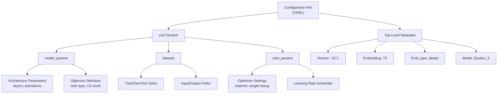
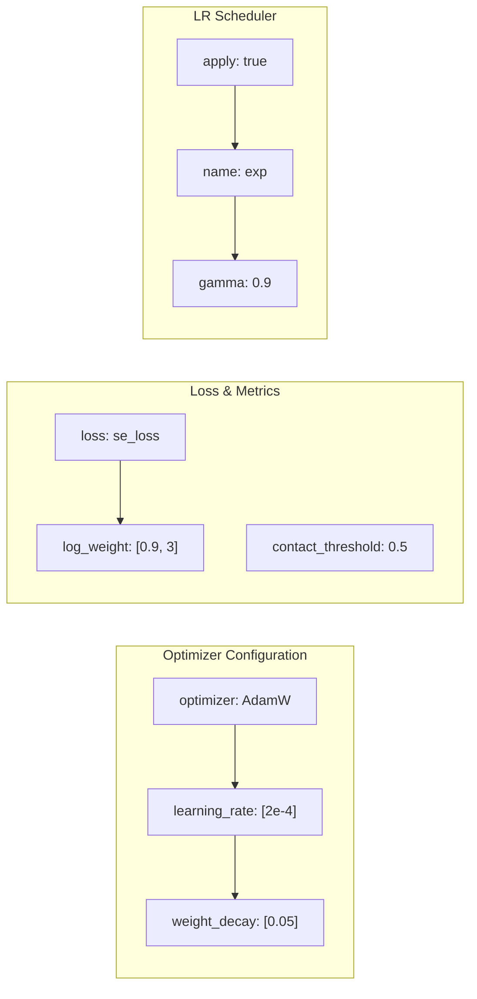
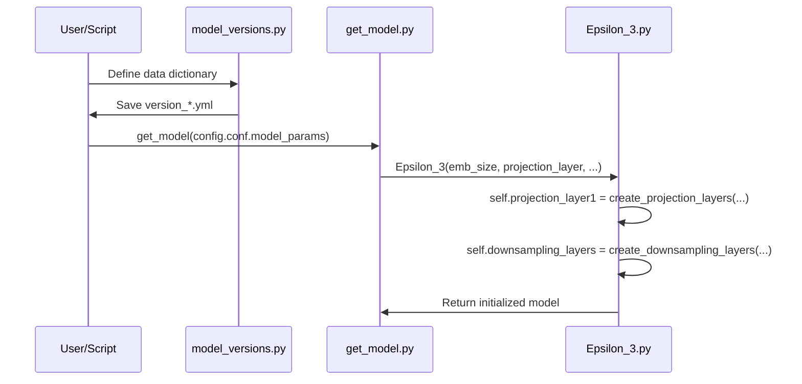

# Model Configuration Files

<details>
<summary>Relevant source files</summary>

The following files were used as context for generating this wiki page:

- [params/Model_config_Epsilon_3_16.1.yml](params/Model_config_Epsilon_3_16.1.yml)
- [params/Model_config_Epsilon_3_16.2.yml](params/Model_config_Epsilon_3_16.2.yml)
- [params/Model_config_Epsilon_3_16.yml](params/Model_config_Epsilon_3_16.yml)
- [params/Model_config_Epsilon_3_6.1.yml](params/Model_config_Epsilon_3_6.1.yml)
- [params/Model_config_Epsilon_3_6.2.yml](params/Model_config_Epsilon_3_6.2.yml)
- [params/Model_config_Epsilon_3_6.yml](params/Model_config_Epsilon_3_6.yml)
- [src/model_versions.py](src/model_versions.py)
- [src/models/Epsilon_3.py](src/models/Epsilon_3.py)
- [src/models/get_model.py](src/models/get_model.py)

</details>


## Purpose and Scope

This document describes the YAML configuration files used to define Disobind model architectures, training parameters, and dataset settings. These configuration files are located in the `params/` directory and control all aspects of model training and behavior for the `Epsilon_3` neural network [src/models/Epsilon_3.py:15-20]().

The system utilizes these files to bridge high-level task definitions (like interaction vs. interface prediction) with specific architectural hyperparameters (like projection dimensions, hidden layers, and activation functions).

## Configuration File Overview

Disobind uses YAML files to define model configurations. The repository includes primary configuration files corresponding to the prediction tasks (2 objectives × 3 coarse-graining levels). These files are typically generated or managed via `src/model_versions.py` [src/model_versions.py:14-16]().

| Configuration File | Task | Objective | Coarse-Graining | Model Version |
|-------------------|------|-----------|-----------------|---------------|
| `Model_config_Epsilon_3_6.2.yml` | interaction_1 | interaction | 1 | 6.2 |
| `Model_config_Epsilon_3_6.1.yml` | interaction_5 | interaction_bin | 5 | 6.1 |
| `Model_config_Epsilon_3_6.yml` | interaction_10 | interaction_bin | 10 | 6 |
| `Model_config_Epsilon_3_16.yml` | interface_1 | interface | 1 | 16 |
| `Model_config_Epsilon_3_16.1.yml` | interface_5 | interface_bin | 5 | 16.1 |
| `Model_config_Epsilon_3_16.2.yml` | interface_10 | interface_bin | 10 | 16.2 |

**Sources:** [params/Model_config_Epsilon_3_6.yml:1-126](), [params/Model_config_Epsilon_3_6.1.yml:1-126](), [params/Model_config_Epsilon_3_6.2.yml:1-126](), [params/Model_config_Epsilon_3_16.yml:1-121](), [params/Model_config_Epsilon_3_16.1.yml:1-121](), [params/Model_config_Epsilon_3_16.2.yml:1-121]()

## Configuration File Structure

Each YAML configuration file follows a hierarchical structure that maps directly to the `Epsilon_3` class initialization in `src/models/get_model.py` [src/models/get_model.py:4-24]().



**Sources:** [params/Model_config_Epsilon_3_16.1.yml:1-121](), [src/model_versions.py:43-149]()

## Model Parameters Section

The `conf.model_params` section defines the `Epsilon_3` neural network architecture.

### Key Hyperparameters

#### Projection Layer Configuration
The `projection_layer` parameter is a list defining the initial transformation of protein embeddings [src/models/Epsilon_3.py:64-80]().

```yaml
projection_layer:
  - 128      # [0] Projection dimension (projection_dim)
  - ln2      # [1] Normalization type (passed to create_projection_layers)
  - true     # [2] Use bias in projection
  - 1        # [3] Multiplier for scaling
  - ''       # [4] Separate projection flag ('separate' or '')
```
- **Source Code Mapping:** This list is unpacked in `Epsilon_3.__init__` to set `self.projection_dim` [src/models/Epsilon_3.py:23]() and call `create_projection_layers` [src/models/Epsilon_3.py:64]().

#### Hidden Layers (`num_hid_layers`)
Defines the depth and structure of the downsampling and upsampling blocks [src/models/Epsilon_3.py:92-108]().

```yaml
num_hid_layers:
  - 0         # [0] num_upsample_layers
  - 3         # [1] num_downsample_layers
  - 0         # [2] num_blocks
  - 2         # [3] scale_factor
  - vanilla   # [4] hidden_block_type (vanilla/residual)
  - ''        # [5] residual_connection type
```
- **Interaction models** (6.x): Use deeper stacks like `[0, 3, 0, 2, vanilla, '']` [params/Model_config_Epsilon_3_6.yml:24-30]().
- **Interface models** (16.x): Often use no hidden layers `[0, 0, 0, 0, vanilla, '']` [params/Model_config_Epsilon_3_16.yml:23-29]().

#### Activation and Normalization
- `activation1`: Primary activation (e.g., `elu`) [src/models/Epsilon_3.py:39-40]().
- `activation2`: Final activation (e.g., `sigmoid`) [src/models/Epsilon_3.py:41-43]().
- `norm`: Normalization strategy, usually `[true, 'LN']` for LayerNorm [src/models/Epsilon_3.py:57-62]().

**Sources:** [src/models/Epsilon_3.py:23-128](), [params/Model_config_Epsilon_3_16.1.yml:8-56](), [src/model_versions.py:51-88]()

## Training Parameters Section

The `conf.train_params` section controls the optimization loop managed by the `Trainer` class.



### Optimizer and Scheduler
Disobind defaults to `AdamW` with an exponential learning rate scheduler [src/model_versions.py:115-139]().
- `amsgrad`: Set to `true` for the AMSGrad variant [params/Model_config_Epsilon_3_16.1.yml:93]().
- `scheduler.name`: Supports `linear`, `exp`, `multistep`, `cycliclr`, and `swa` [src/model_versions.py:127-128]().

**Sources:** [params/Model_config_Epsilon_3_16.1.yml:71-120](), [src/model_versions.py:102-147]()

## Implementation: Mapping Config to Code

The `get_model` function in `src/models/get_model.py` acts as the factory that translates the YAML dictionary into a live `torch.nn.Module`.



**Sources:** [src/models/get_model.py:4-27](), [src/models/Epsilon_3.py:15-128](), [src/model_versions.py:151]()

## Creating Custom Model Configurations

To create a custom model configuration, users should modify `src/model_versions.py` and run it to generate a new YAML file.

1.  **Set Objective:** Choose between `interaction` (contact map) or `interface` (residue list) and set the Coarse-Graining (CG) level [src/model_versions.py:25-26]().
    ```python
    # Example: Interface prediction with CG=10
    objective = ["interface_bin", 10, "avg", False, True, False]
    ```
2.  **Adjust Projection:** Modify `projection_layer` to change the bottleneck size [src/model_versions.py:59]().
3.  **Define Depth:** Adjust `num_hid_layers` to add or remove downsampling stages [src/model_versions.py:73]().
4.  **Set Paths:** Update `input_files` and `output_path` in the `dataset` dictionary [src/model_versions.py:94-98]().
5.  **Run Script:** Execute `python src/model_versions.py` to produce the `version_*.yml` file [src/model_versions.py:151]().

**Sources:** [src/model_versions.py:17-151]()

---