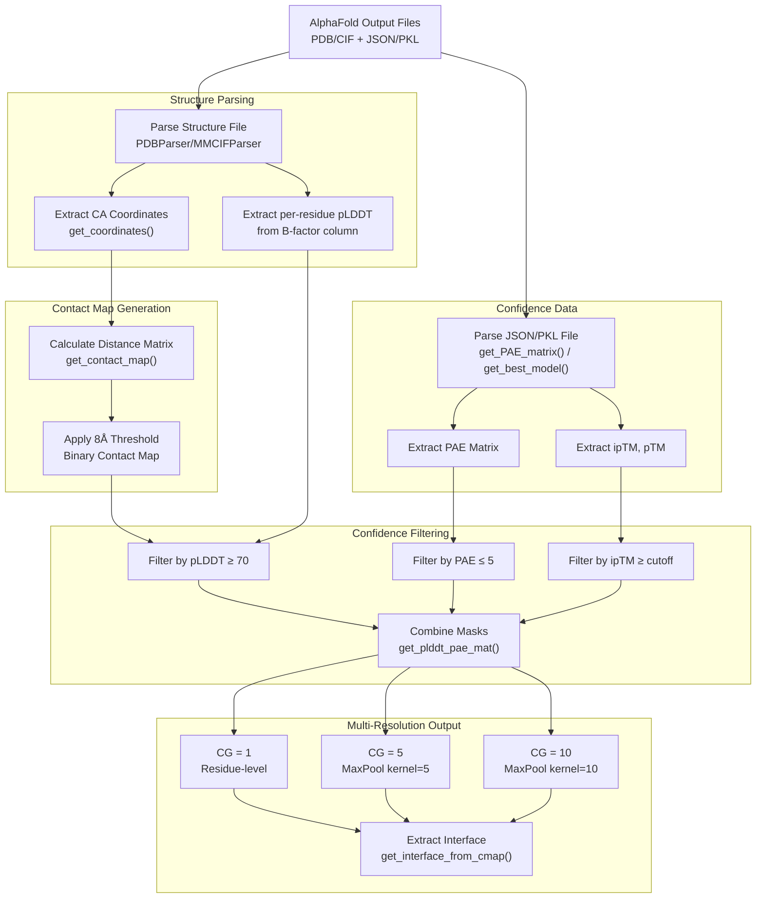
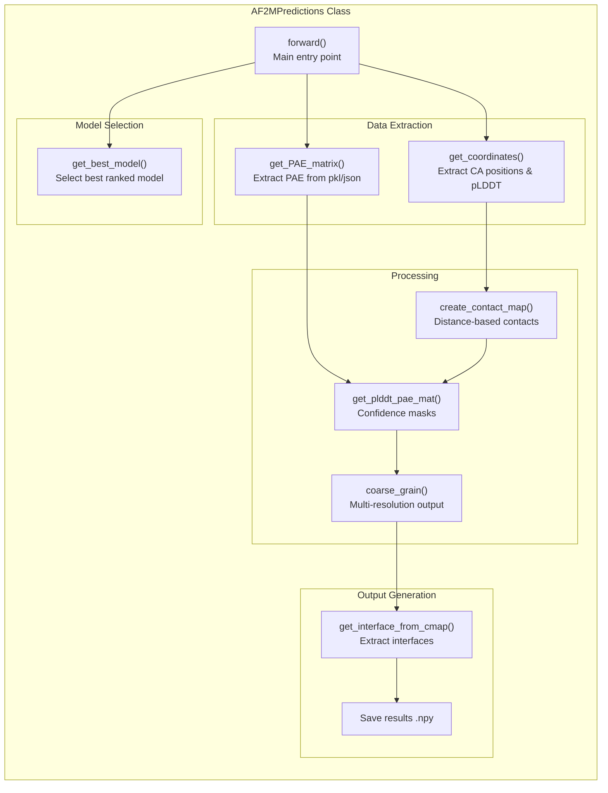
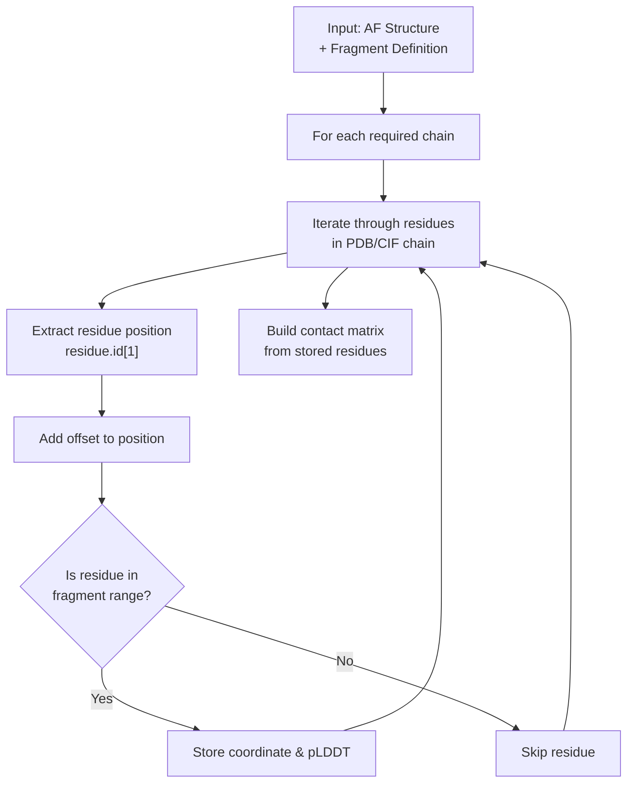
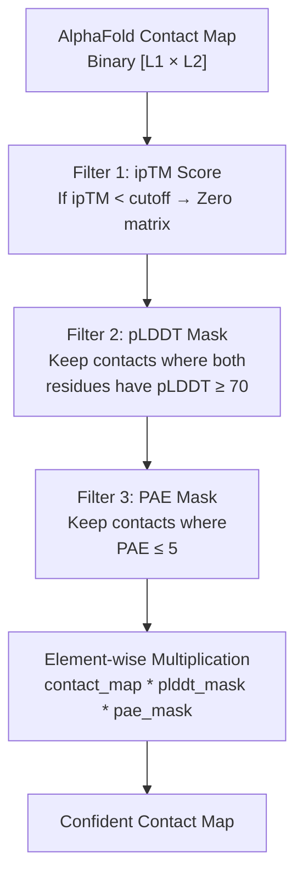

# Processing AlphaFold Predictions

<details>
<summary>Relevant source files</summary>

The following files were used as context for generating this wiki page:

- [analysis/get_af_prediction.py](analysis/get_af_prediction.py)
- [analysis/get_disobind_predictions.py](analysis/get_disobind_predictions.py)
- [analysis/params.py](analysis/params.py)

</details>


## Purpose and Scope

This page describes how Disobind extracts and processes AlphaFold2 and AlphaFold3 structural predictions for integration with sequence-based predictions. The system applies confidence filtering based on pLDDT and PAE metrics to select reliable structural predictions, generates contact maps from predicted structures, and coarse-grains the results to match Disobind's multi-resolution framework.

For information about running combined Disobind+AlphaFold predictions, see [2.3 AlphaFold Integration](). For comprehensive analysis using processed AlphaFold predictions, see [5.1 JudgementDay Analysis Pipeline]().

---

## Overview

Disobind integrates AlphaFold predictions in two contexts:

1.  **Batch Processing for Evaluation** - The `AF2MPredictions` class [analysis/get_af_prediction.py:28-29]() processes entire test sets of AlphaFold predictions for systematic evaluation.
2.  **Single-Entry Processing for Prediction** - The `AfPrediction` class [run_disobind.py:831-832]() processes individual AlphaFold structures during user predictions.

Both approaches extract the same core information: predicted structures, confidence metrics (pLDDT, PAE, ipTM), and generate binary contact maps filtered by confidence thresholds.

**High-Level Processing Workflow**



Sources: [analysis/get_af_prediction.py:28-498](), [run_disobind.py:831-1134]()

---

## The AF2MPredictions Class

The `AF2MPredictions` class processes AlphaFold2 and AlphaFold3 predictions for entire test datasets. It handles both AF2 (PDB format) and AF3 (CIF format) structures with their respective confidence files [analysis/get_af_prediction.py:83-92]().

### Class Configuration

| Parameter | Description | Default |
|-----------|-------------|---------|
| `version` | Dataset version number | 19 [analysis/get_af_prediction.py:31]() |
| `dist_threshold` | Distance cutoff for contacts (Å) | 8 [analysis/get_af_prediction.py:36]() |
| `plddt_threshold` | Confidence cutoff for pLDDT | 70 [analysis/get_af_prediction.py:38]() |
| `pae_threshold` | Confidence cutoff for PAE | 5 [analysis/get_af_prediction.py:40]() |
| `iptm_cutoff` | Minimum ipTM for confident predictions | 0.0 [analysis/get_af_prediction.py:42]() |
| `max_len` | Maximum protein length for padding | 100 (OOD), 200 (Misc) [analysis/get_af_prediction.py:46]() |
| `af_model` | AlphaFold version to process | "AF2" or "AF3" [analysis/get_af_prediction.py:54]() |

**Key Methods Architecture**



Sources: [analysis/get_af_prediction.py:28-498]()

### Selecting the Best Model

The system selects the best-ranked model based on provided metadata [analysis/get_af_prediction.py:96-133]():

*   **For AlphaFold2:** Extracts order from `ranking_debug.json` and loads corresponding `.pkl` result [analysis/get_af_prediction.py:114-121]().
*   **For AlphaFold3:** Extracts metrics from `fold_{header}_summary_confidences_0.json` [analysis/get_af_prediction.py:124-127]().

Sources: [analysis/get_af_prediction.py:96-133]()

---

## The AfPrediction Class

The `AfPrediction` class processes individual AlphaFold structures during user predictions, enabling real-time integration with Disobind predictions [run_disobind.py:831-1134]().

### Handling Fragment Structures

AlphaFold predictions may contain fragments of full-length proteins. The class uses `offsets` to map AlphaFold residue positions to UniProt positions [run_disobind.py:836-842]():

```python
# Mapping logic in AfPrediction
af_residue_position + offset = uniprot_residue_position
```

**Fragment Processing Workflow**



Sources: [run_disobind.py:831-1134]()

---

## Structure Parsing and Coordinate Extraction

### File Format Detection

The system automatically detects structure file format and selects the appropriate Bio.PDB parser [analysis/get_af_prediction.py:178-181]():

*   **AF2:** `PDBParser()` for `.pdb` files [analysis/get_af_prediction.py:179]().
*   **AF3:** `MMCIFParser()` for `.cif` files [analysis/get_af_prediction.py:181]().

Sources: [analysis/get_af_prediction.py:163-196](), [run_disobind.py:856-869]()

### Coordinate Extraction

For each residue, the system extracts CA (alpha-carbon) coordinates and pLDDT values stored in the B-factor column [analysis/get_af_prediction.py:191-192]():

| Quantity | Access Path |
|----------|-------------|
| Residue position | `residue.id[1]` |
| CA coordinates | `residue['CA'].coord` |
| pLDDT confidence | `residue["CA"].get_bfactor()` |

Sources: [analysis/get_af_prediction.py:163-196](), [run_disobind.py:898-923]()

---

## Confidence Metrics Extraction

### PAE Matrix Extraction

The Predicted Aligned Error (PAE) matrix quantifies inter-domain confidence. The system computes a symmetric version for inter-chain quadrants [analysis/get_af_prediction.py:135-161]():

```python
# Symmetrization logic in get_plddt_pae_mat
pae_ur = pae[:L1, L1:]
pae_ll = pae[L1:, :L1]
pae_inter = (pae_ur + pae_ll.T) / 2
```

Sources: [analysis/get_af_prediction.py:135-161](), [analysis/get_af_prediction.py:344-346](), [run_disobind.py:942-956]()

### Confidence Score Extraction

The system extracts three key confidence metrics to select the best model and filter predictions [analysis/get_af_prediction.py:121-127]():
*   **ipTM**: Interface predicted TM-score.
*   **pTM**: Predicted TM-score.
*   **ranking_confidence / ranking_score**: Overall model quality metric.

Sources: [analysis/get_af_prediction.py:96-133]()

---

## Confidence Filtering

### Multi-Layer Filtering Strategy

Disobind applies three levels of confidence filtering to AlphaFold predictions [analysis/get_af_prediction.py:315-362]():



Sources: [analysis/get_af_prediction.py:315-362]()

### Creating Confidence Masks

The `get_plddt_pae_mat()` method creates binary masks [analysis/get_af_prediction.py:315-362]():

*   **pLDDT Mask:** Outer product of per-residue masks where pLDDT ≥ threshold [analysis/get_af_prediction.py:333-339]().
*   **PAE Mask:** Binary matrix where inter-chain PAE ≤ threshold [analysis/get_af_prediction.py:348]().
*   **Combined Mask:** Element-wise multiplication of contact map, pLDDT mask, and PAE mask [analysis/get_af_prediction.py:355]().

Sources: [analysis/get_af_prediction.py:315-362]()

---

## Contact Map Generation

### Distance-Based Contact Definition

The system generates binary contact maps from 3D coordinates using an 8Å distance threshold [analysis/get_af_prediction.py:212]():

```python
# coords_dict contains CA positions for chainA and chainB
contact_map = get_contact_map(coords_dict[chainA], coords_dict[chainB], self.dist_threshold)
```

The `get_contact_map` utility function [dataset/utility.py]() computes pairwise Euclidean distances and applies the threshold.

Sources: [analysis/get_af_prediction.py:198-215](), [run_disobind.py:664-694]()

### Alternative: AlphaFold3 Contact Probabilities

For AlphaFold3, the system can optionally use predicted contact probabilities directly from the JSON file [analysis/get_af_prediction.py:217-239]():

```python
contact_probs = np.array(data["contact_probs"])
# Threshold at 0.5 for binary map
contact_map = np.where(avg_probs >= 0.5, 1, 0)
```

Sources: [analysis/get_af_prediction.py:217-239]()

---

## Coarse-Graining

### Multi-Resolution Processing

To match Disobind's multi-resolution framework, AlphaFold predictions are coarse-grained to resolutions of 1, 5, and 10 residues [analysis/get_af_prediction.py:267-313](). This uses `MaxPool2d` to aggregate the binary contact maps [analysis/get_af_prediction.py:302-306]().

### Interface Extraction from Contact Maps

For interface prediction tasks, the system converts contact maps to interface vectors by finding residues involved in at least one contact [analysis/get_af_prediction.py:242-265]():

```python
# Logic in get_interface_from_cmap
idx1, idx2 = np.where(pred == 1.0)
idx1 = np.unique(idx1) # Protein 1 interface residues
idx2 = np.unique(idx2) # Protein 2 interface residues
```

Sources: [analysis/get_af_prediction.py:242-265](), [run_disobind.py:682-692]()

---

## Output Format

### Prediction Dictionary Structure

The processed AlphaFold predictions are stored in a nested dictionary keyed by `entry_id` [analysis/get_af_prediction.py:277-313]():

*   `interaction_{CG}`: Binary contact map at resolution CG.
*   `interface_{CG}`: Binary interface vector at resolution CG.
*   `best_model`: Identifier for the selected model.
*   `scores`: List of `[ipTM, pTM, ranking_score]`.

Sources: [analysis/get_af_prediction.py:267-313]()

### Saved Files

The `AF2MPredictions` class saves results to `.npy` files [analysis/get_af_prediction.py:85-89]():
*   `Predictions_af2m_results_{iptm_cutoff}.npy`
*   `Predictions_af3_results_{iptm_cutoff}.npy`

Sources: [analysis/get_af_prediction.py:79-93]()

---

## Integration with Disobind Predictions

### Combining Predictions via Max Operation

AlphaFold predictions are combined with Disobind predictions using an element-wise maximum [run_disobind.py:629-633]():

```python
# Combining Disobind and AF2 predictions
combined = np.stack([diso_flat, af_flat], axis=1)
combined = np.max(combined, axis=1)
```

This ensures that high-confidence structural predictions from AlphaFold complement the sequence-based Disobind predictions.

Sources: [run_disobind.py:629-633](), [analysis/analysis.py:334-352]()

---