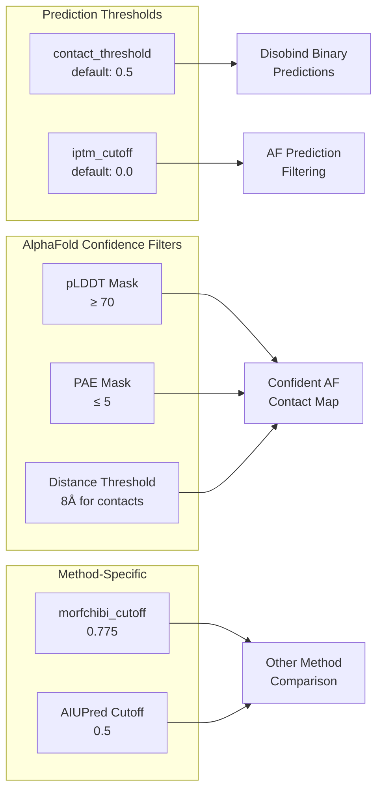
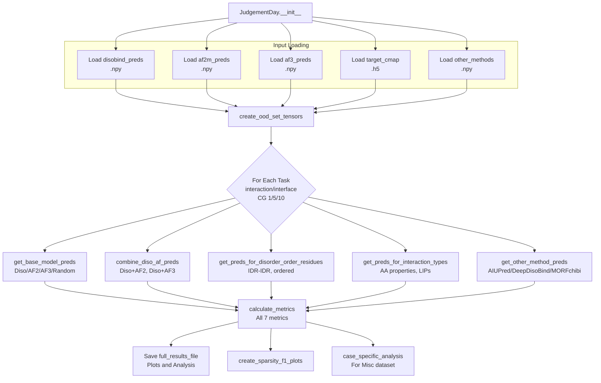
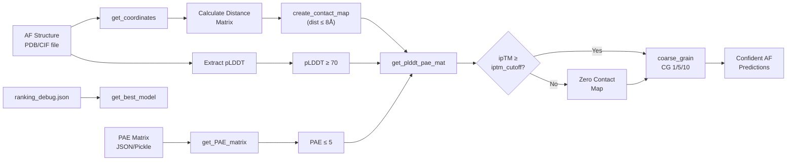

# Performance Metrics and Evaluation

Relevant source files

The following files were used as context for generating this wiki page:

- [analysis/analysis.py](analysis/analysis.py)
- [analysis/get_other_method_preds.py](analysis/get_other_method_preds.py)
- [src/metrics.py](src/metrics.py)

This page describes the performance metrics used to evaluate Disobind predictions and the comprehensive evaluation pipeline implemented in the `JudgementDay` class. It covers the seven-metric suite used for all evaluations, confidence filtering for AlphaFold predictions, disorder-specific analysis, and comparison with competing methods.

For information about generating predictions to be evaluated, see [5.2 Generating OOD Predictions](). For AlphaFold prediction processing details, see [5.3 Processing AlphaFold Predictions](). For disorder-specific filtering approaches, see [5.5 Disorder-Specific Analysis]().

## Core Metrics Suite

Disobind evaluates all predictions using a standardized suite of seven binary classification metrics. These metrics are calculated using the `torch_metrics` function from `src.metrics` and provide comprehensive assessment across multiple performance dimensions.

### Metric Definitions

| Metric | Description | Purpose |
|--------|-------------|---------|
| **Recall** | True Positives / (True Positives + False Negatives) | Measures ability to identify all actual interactions |
| **Precision** | True Positives / (True Positives + False Positives) | Measures accuracy of positive predictions |
| **F1-score** | 2 × (Precision × Recall) / (Precision + Recall) | Harmonic mean balancing precision and recall |
| **Average Precision** | Area under Precision-Recall curve | Performance across all thresholds |
| **MCC** | Matthews Correlation Coefficient | Balanced measure for imbalanced datasets |
| **AUROC** | Area Under ROC Curve | Discrimination ability across thresholds |
| **Accuracy** | (TP + TN) / Total | Overall correctness (less informative for sparse data) |

The metrics are calculated globally across all samples by default, but can also be computed per-sample using the `multidim_avg` parameter [src/metrics.py:39-61]().

**Sources:** [src/metrics.py:15-62](), [analysis/analysis.py:709-737]()

### Threshold Configuration

**Sources:** [analysis/analysis.py:37-42](), [analysis/get_other_method_preds.py:90-91,168](), [analysis/get_af_prediction.py:35-42]()

## JudgementDay Evaluation Pipeline

The `JudgementDay` class orchestrates the complete evaluation workflow, processing predictions from multiple methods and computing metrics across various analysis categories [analysis/analysis.py:25-29]().

### Pipeline Architecture

**Sources:** [analysis/analysis.py:25-123](), [analysis/analysis.py:438-509]()

### Key Methods in JudgementDay

| Method | Purpose | Lines |
|--------|---------|-------|
| `forward()` | Main entry point, orchestrates full pipeline | [analysis/analysis.py:107-123]() |
| `create_ood_set_tensors()` | Generator yielding tensors for each task | [analysis/analysis.py:192-316]() |
| `get_base_model_preds()` | Extract base model predictions | [analysis/analysis.py:319-331]() |
| `combine_diso_af_preds()` | Combine Disobind + AF using max operation | [analysis/analysis.py:334-351]() |
| `get_preds_for_disorder_order_residues()` | Filter by disorder/order | [analysis/analysis.py:354-382]() |
| `get_preds_for_interaction_types()` | Filter by AA types and LIPs | [analysis/analysis.py:385-412]() |
| `eval_performance()` | Calculate and save all metrics | [analysis/analysis.py:438-509]() |
| `calculate_metrics()` | Wrapper for `torch_metrics` call | [analysis/analysis.py:709-737]() |

**Sources:** [analysis/analysis.py:25-741]()

## Evaluation Categories

The evaluation pipeline assesses predictions across multiple orthogonal dimensions, providing granular performance analysis.

### Category Hierarchy

```mermaid
graph TB
    subgraph "Base Models"
        Diso["Disobind"]
        AF2["AF2_pLDDT_PAE"]
        AF3["AF3_pLDDT_PAE"]
        Rand["Random_baseline"]
    end
    
    subgraph "Combined Models"
        DisoAF2["Disobind_AF2<br/>Max operation"]
        DisoAF3["Disobind_AF3<br/>Max operation]"]
    end
    
    subgraph "Disorder-Specific CG=1 Only"
        IDR_IDR["IDR-IDR Interactions"]
        IDR_Any["IDR-any Interactions"]
        Ordered["Ordered Interactions"]
    end
    
    subgraph "Interaction Types CG=1 Only"
        DPAA["Disorder-promoting AA"]
        Aromatic["Aromatic AA"]
        Hydrophobic["Hydrophobic AA"]
        Polar["Polar AA"]
        LIPs["Linear Interacting Peptides"]
    end
    
    subgraph "Other Methods interface_1 Only"
        AIU["AIUPred"]
        Deep["DeepDisoBind"]
        MORF["MORFchibi"]
    end
    
    Diso --> EvalAll["Evaluate All<br/>6 Tasks"]
    AF2 --> EvalAll
    AF3 --> EvalAll
    Rand --> EvalAll
    
    DisoAF2 --> EvalAll
    DisoAF3 --> EvalAll
    
    IDR_IDR --> EvalSubset["Evaluate Subset<br/>Tasks"]
    IDR_Any --> EvalSubset
    Ordered --> EvalSubset
    
    DPAA --> EvalSubset
    Aromatic --> EvalSubset
    Hydrophobic --> EvalSubset
    Polar --> EvalSubset
    LIPs --> EvalSubset
    
    AIU --> EvalInterface["Evaluate<br/>interface_1"]
    Deep --> EvalInterface
    MORF --> EvalInterface
```

**Sources:** [analysis/analysis.py:192-316](), [analysis/analysis.py:453-476]()

### Combining Predictions

The `combine_diso_af_preds` method merges Disobind and AlphaFold predictions using a `torch.maximum` operation [analysis/analysis.py:347-348](). This approach hypothesizes that combining sequence-based and structure-based approaches improves accuracy by taking the maximum confidence from either method for each position in the contact map or interface vector.

**Sources:** [analysis/analysis.py:334-351]()

## AlphaFold Confidence Filtering

AlphaFold predictions are filtered based on multiple confidence metrics to ensure only high-quality structural predictions are used in evaluation.

### Confidence Filtering Pipeline

**Sources:** [analysis/get_af_prediction.py:95-133](), [analysis/get_af_prediction.py:315-361](), [analysis/get_af_prediction.py:364-425]()

### AF2MPredictions Class Methods

| Method | Purpose | Key Logic |
|--------|---------|-----------|
| `get_best_model()` | Select best model from ranking | Uses `iptm+ptm` scores from `ranking_debug.json` [analysis/get_af_prediction.py:270-305]() |
| `get_PAE_matrix()` | Extract PAE from result file | Loads from pickle (AF2) or JSON (AF3) [analysis/get_af_prediction.py:218-268]() |
| `get_coordinates()` | Extract CA coordinates | Parses PDB/CIF using BioPython [analysis/get_af_prediction.py:165-216]() |
| `create_contact_map()` | Binary map from distances | Threshold at 8Å between CA atoms [analysis/get_af_prediction.py:315-361]() |
| `get_plddt_pae_mat()` | Create confidence masks | Binary masks: pLDDT≥70, PAE≤5 [analysis/get_af_prediction.py:364-425]() |
| `coarse_grain()` | Apply CG and masks | MaxPool with confidence filtering [analysis/get_af_prediction.py:428-497]() |

**Sources:** [analysis/get_af_prediction.py:28-497]()

### Confidence Score Analysis

The evaluation tracks and plots AlphaFold confidence scores to understand prediction quality via `count_confident_AF_predictions` [analysis/analysis.py:601-668]().

- **ipTM vs ipTM Scatter**: Compares AF2 vs AF3 confidence [analysis/analysis.py:615-635]().
- **Threshold Counting**: Counts entries with `ipTM >= 0.8` or `ipTM <= iptm_cutoff` [analysis/analysis.py:643-655]().
- **Stats Storage**: Saves counts to `af_conf_pred_counts_file` and raw scores to `af_confidence_scores` [analysis/analysis.py:657-668]().

**Sources:** [analysis/analysis.py:601-668]()

## Disorder-Specific Analysis

Predictions are evaluated separately for different disorder contexts: IDR-IDR interactions, IDR-any interactions, and ordered region interactions.

### Disorder Filtering Logic

The `get_preds_for_disorder_order_residues` method creates three types of filtered predictions [analysis/analysis.py:354-382]():

1. **IDR-IDR**: Only predictions where both residues are disordered.
2. **IDR-any**: Predictions where at least one residue is disordered.
3. **Ordered**: Only predictions where both residues are ordered.

For each model, predictions are masked using matrices derived from UniProt disorder annotations and evaluated separately for these contexts.

**Sources:** [analysis/analysis.py:354-382]()

## Interaction Type Analysis

Predictions are filtered by amino acid properties to assess performance on specific interaction types via `get_preds_for_interaction_types` [analysis/analysis.py:385-412]().

### Amino Acid Property Masks

| Property | Residues | Purpose |
|----------|----------|---------|
| **Disorder-promoting** | R, P, Q, E, G, S, A, K | High flexibility residues |
| **Aromatic** | F, Y, W | π-π stacking interactions |
| **Hydrophobic** | A, V, L, I, P, M, F, W | Hydrophobic core formation |
| **Polar** | S, T, C, N, Q, Y, D, E, K, R, H | Hydrogen bonding |
| **LIPs** | MobiDB curated/homology | Linear Interacting Peptides |

**Sources:** [analysis/analysis.py:385-412]()

## Comparison with Other Methods

Disobind is compared against three partner-independent interface prediction methods on the OOD test set using the `Othermethods` class [analysis/get_other_method_preds.py:14-19]().

### Other Methods Integration

- **AIUPred**: Run via `aiupred_lib.predict_binding` using embedding and regression models [analysis/get_other_method_preds.py:83-97]().
- **DeepDisoBind**: Parsed from result FASTA files by extracting the `protein_binary` field [analysis/get_other_method_preds.py:100-122]().
- **MORFchibi**: Parsed from TSV outputs with a 0.775 threshold and a minimum length requirement of 4 residues [analysis/get_other_method_preds.py:160-181]().

**Sources:** [analysis/get_other_method_preds.py:14-296]()

## Sparsity Analysis

The relationship between dataset sparsity and model performance is analyzed via `create_sparsity_f1_plots` [analysis/analysis.py:670-706]().

1. Loads `fraction_positives` from JSON [analysis/analysis.py:682-683]().
2. Calculates sparsity as `(1 - fraction_positives) * 100` [analysis/analysis.py:686]().
3. Plots sparsity vs Disobind F1-score to reveal how performance degrades with increasing class imbalance across the 6 tasks [analysis/analysis.py:692-700]().

**Sources:** [analysis/analysis.py:670-706]()

## IDPPI Dataset Evaluation

The `IdppiPreds` class evaluates Disobind on the IDPPI protein-protein interaction dataset, converting residue-level interface predictions to binary PPI predictions [analysis/idppi_preds.py:22-26]().

### Interface to PPI Conversion Methods

- **frag_any_prot_any**: PPI=1 if any fragment has any interface residues [analysis/idppi_preds.py:414-418]().
- **frag_any_prot_all**: PPI=1 if any fragment has both proteins interfacing [analysis/idppi_preds.py:421-426]().
- **max_frag_score**: Max residue score across all fragments [analysis/idppi_preds.py:432-436]().
- **avg_assemble_frag_score**: Assemble full proteins from fragments using `get_assembled_proteins` before scoring [analysis/idppi_preds.py:520-563]().

**Sources:** [analysis/idppi_preds.py:369-597]()

## Output Files and Interpretation

The `JudgementDay` pipeline generates multiple output files in the `output_dir` [analysis/analysis.py:81-96]().

- **Results_OOD_set_{version}.csv**: Main metrics table for all models/tasks [analysis/analysis.py:84]().
- **Sparsity_F1_plot_{version}**: Visualization of performance vs imbalance [analysis/analysis.py:92]().
- **AF_confidence_plot_{version}**: AF2 vs AF3 ipTM comparison [analysis/analysis.py:90]().
- **Case_sp_analysis_{version}**: Per-sample analysis for the Misc dataset [analysis/analysis.py:93]().

**Sources:** [analysis/analysis.py:81-96]()

---