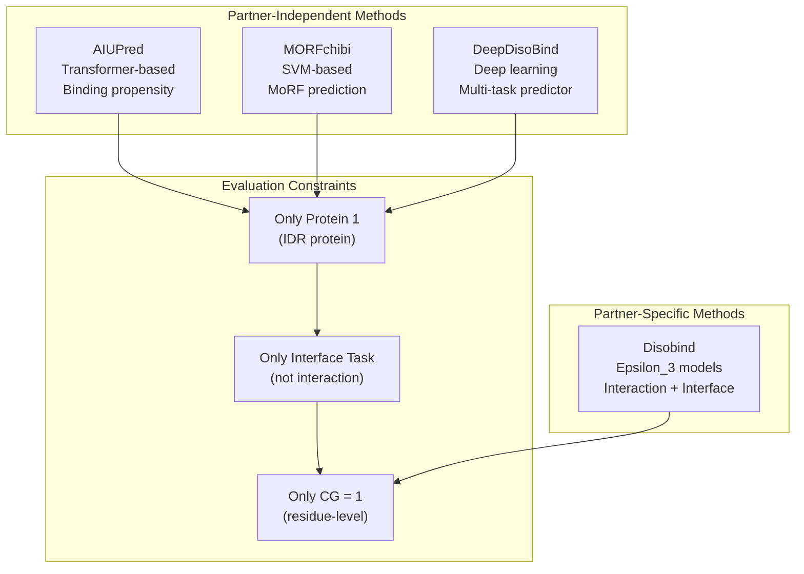
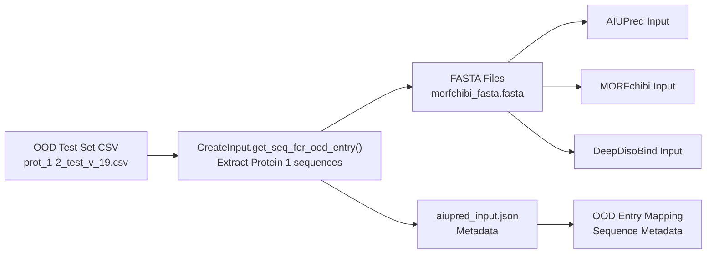
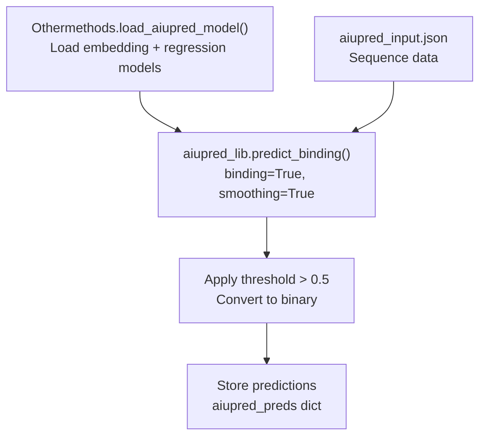
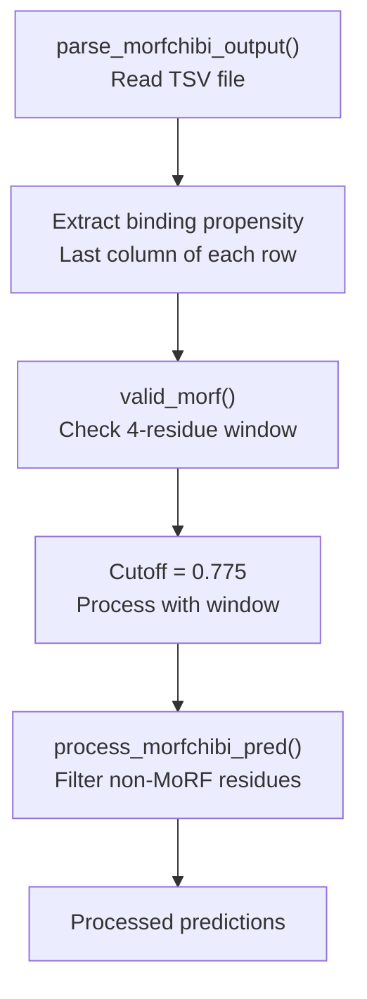
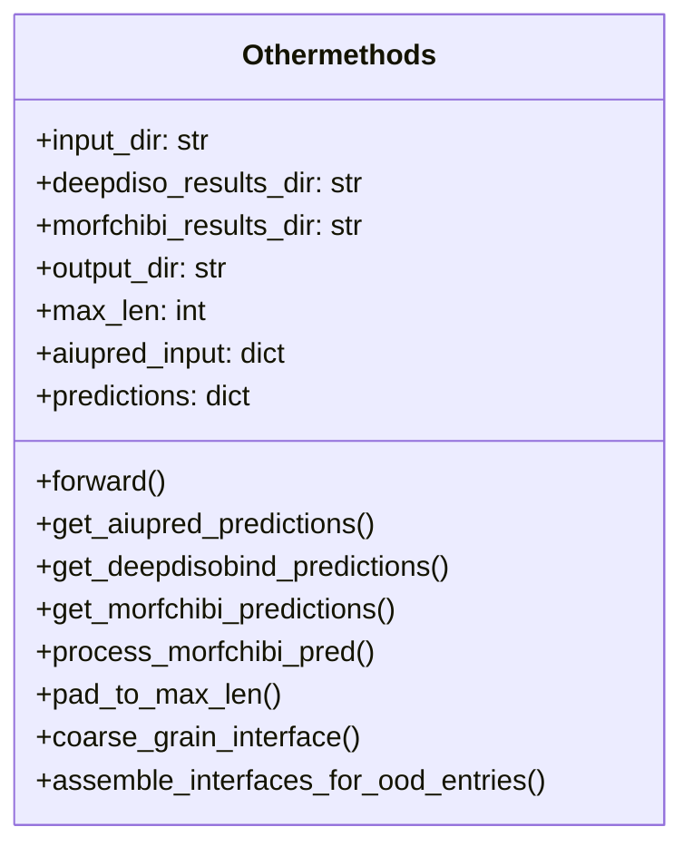
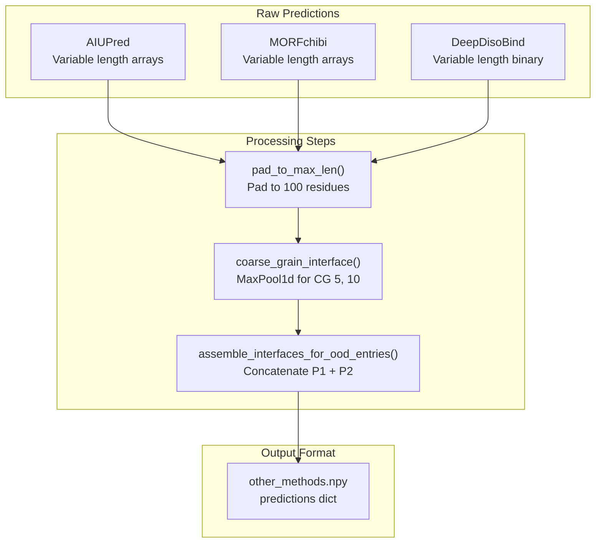
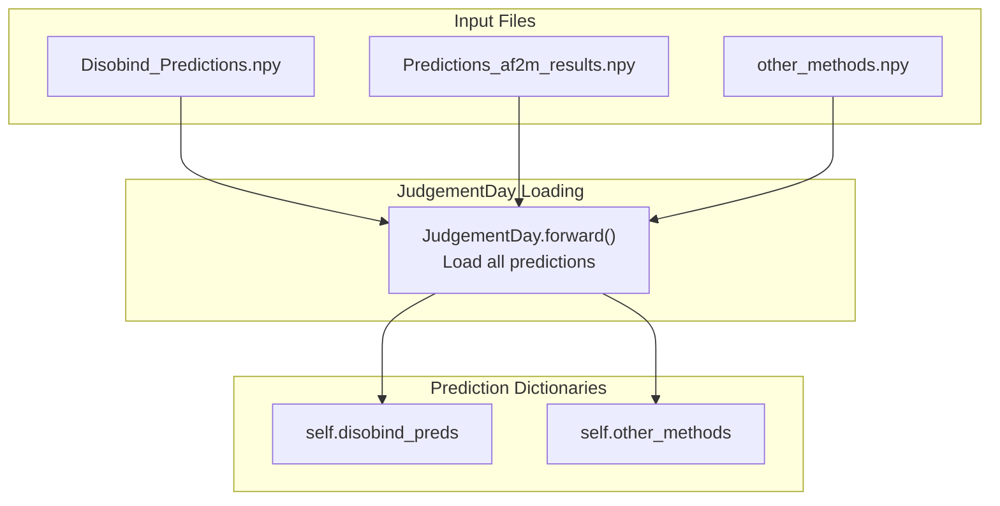

# Comparing with Other Methods

<details>
<summary>Relevant source files</summary>

The following files were used as context for generating this wiki page:

- [analysis/analysis.py](analysis/analysis.py)
- [analysis/get_other_method_preds.py](analysis/get_other_method_preds.py)
- [dataset/prep_other_methods_input.py](dataset/prep_other_methods_input.py)

</details>


## Purpose and Scope

This page explains how to prepare inputs for, obtain predictions from, and evaluate Disobind against competing partner-independent interface prediction methods. These methods (**AIUPred**, **MORFchibi**, and **DeepDisoBind**) predict protein-protein interaction interfaces based on sequence alone, without requiring knowledge of the binding partner.

For information about the broader evaluation pipeline including AlphaFold predictions, see [JudgementDay Analysis Pipeline](5.1). For disorder-specific analysis, see [Disorder-Specific Analysis](5.5). For performance metrics, see [Performance Metrics and Evaluation](5.4).

**Key Distinction**: Unlike Disobind which predicts partner-specific interactions, the competing methods provide partner-independent predictions. Therefore, comparisons are performed only for the interface residue prediction task at CG=1 resolution, and only for the first protein (IDR) in each complex.

Sources: [analysis/analysis.py:1-8](), [dataset/prep_other_methods_input.py:1-10](), [analysis/get_other_method_preds.py:1-7]()

---

## Overview of Compared Methods

Disobind is evaluated against three partner-independent interface prediction methods designed for intrinsically disordered regions:

| Method | Type | Input | Output | Threshold |
|--------|------|-------|--------|-----------|
| **AIUPred** | Disorder-based binding predictor | FASTA sequence | Binding propensity per residue | 0.5 |
| **MORFchibi** | SLiM/MoRF predictor | FASTA sequence | Binding propensity per residue | 0.775 (with 4-residue window) |
| **DeepDisoBind** | ML-based interface predictor | FASTA sequence | Binary interface prediction | Pre-binarized |

### Method Comparison Framework



Sources: [analysis/get_other_method_preds.py:14-35](), [analysis/analysis.py:416-434]()

---

## Input Preparation Workflow

### Step 1: Generate Input Sequences

The `CreateInput` class in `dataset/prep_other_methods_input.py` creates FASTA files containing only the first protein (IDR) sequences from each OOD test entry.



**Diagram: Input Preparation Pipeline**

The script generates:
- **FASTA files**: Protein sequences with headers in format `UniID_start_end` [dataset/prep_other_methods_input.py:100-101]().
- **aiupred_input.json**: Metadata mapping sequence IDs to OOD entries and sequences [dataset/prep_other_methods_input.py:125-130]().

Sources: [dataset/prep_other_methods_input.py:13-46](), [dataset/prep_other_methods_input.py:88-107]()

### Input File Format

Each method requires sequences in FASTA format. The `aiupred_input.json` file stores metadata for mapping predictions back to OOD entries:

```json
{
  "UniID_start_end": {
    "seq": "PROTEIN_SEQUENCE",
    "ood_entry_id": "UniID1:s1:e1--UniID2:s2:e2_num"
  }
}
```

Sources: [dataset/prep_other_methods_input.py:103-106]()

---

## Obtaining Predictions

### AIUPred (Local Execution)

AIUPred is run locally via the `aiupred_lib` library. The `Othermethods` class in `get_other_method_preds.py` generates predictions programmatically.



**Diagram: AIUPred Prediction Flow**

Key implementation details:
- Uses `aiupred_lib.init_models("binding")` to load models [analysis/get_other_method_preds.py:57-62]().
- Calls `aiupred_lib.predict_binding()` with `binding=True, smoothing=True` [analysis/get_other_method_preds.py:86-89]().
- Applies threshold of 0.5 to convert propensities to binary predictions [analysis/get_other_method_preds.py:91]().

Sources: [analysis/get_other_method_preds.py:57-97]()

### MORFchibi (Web Server)

MORFchibi predictions are obtained through the web interface.

**Workflow**:
1. Upload `morfchibi_fasta.fasta` to MORFchibi web server.
2. Download result `.txt` files (TSV format).
3. Place in `../database/other_methods/morfchibi_results/`.
4. Name files as `_{seq_id}.txt`.

**Special Processing**: MORFchibi requires a 4-residue window validation implemented in `valid_morf()` [analysis/get_other_method_preds.py:143-157]().



**Diagram: MORFchibi Processing with Window Validation**

The `valid_morf()` function checks if at least 4 consecutive residues exceed the 0.775 threshold. Residues not meeting this criterion are set to 0 in `process_morfchibi_pred()` [analysis/get_other_method_preds.py:176-178]().

Sources: [analysis/get_other_method_preds.py:125-181]()

### DeepDisoBind (Web Server)

DeepDisoBind predictions are obtained through the web interface.

**Workflow**:
1. Upload batches of 20 sequences (generated by `write_deepdiso_fasta_file()`) to the server [dataset/prep_other_methods_input.py:109-123]().
2. Download result FASTA files.
3. Place in `../database/other_methods/deepdiso_results/`.
4. Name files as `result_deepdiso_{range}.fasta`.

The `get_deepdisobind_predictions()` method parses the `protein_binary` field from the result string [analysis/get_other_method_preds.py:116-119]().

Sources: [analysis/get_other_method_preds.py:100-122]()

---

## Processing Other Method Predictions

### The Othermethods Class

The `Othermethods` class in [analysis/get_other_method_preds.py]() orchestrates the collection and formatting:



Sources: [analysis/get_other_method_preds.py:14-35]()

### Output Format Conversion

All predictions are converted to Disobind's format with padding and coarse-graining:



**Diagram: Prediction Format Conversion Pipeline**

Key conversion steps:
1. **Padding**: Each sequence is padded to `max_len=100` [analysis/get_other_method_preds.py:207-214]().
2. **Coarse-Graining**: Applied using `nn.MaxPool1d` for CG levels 5 and 10 [analysis/get_other_method_preds.py:223-225]().
3. **Assembly**: Protein 1 and Protein 2 interfaces are concatenated into shape `(2*max_len//cg, 1)` [analysis/get_other_method_preds.py:284-288]().

Sources: [analysis/get_other_method_preds.py:207-291]()

---

## Integration with JudgementDay Evaluation

### Loading Other Method Predictions

The `JudgementDay` class loads these predictions at initialization [analysis/analysis.py:117-118]().



Sources: [analysis/analysis.py:73-74](), [analysis/analysis.py:112-119]()

### Evaluation Pipeline for Other Methods

Competing methods are evaluated only for interface predictions. The `get_other_method_preds()` method extracts only the first protein's interface predictions [analysis/analysis.py:416-434]().

```python
if "interface" in task:
    if self.mode == "ood":
        other_methods_dict = self.get_other_method_preds(ood_dict=ood_dict)
        preds_dict.update(other_methods_dict)
```

Target maps are sliced to include only Protein 1: `target[:self.max_len]` [analysis/analysis.py:426]().

Sources: [analysis/analysis.py:416-434](), [analysis/analysis.py:473-476]()

---

## Evaluation Results

### Output Files

| File | Content | Location |
|------|---------|----------|
| `Results_other_methods_{version}.csv` | Metrics for competing methods | `Analysis_OOD_{version}_{iptm}/` |
| `other_methods.npy` | Formatted predictions | `./other_methods/` |

Sources: [analysis/analysis.py:86-87](), [analysis/get_other_method_preds.py:33]()

### Metrics Calculated

For each competing method, the following metrics are computed via `torch_metrics`:
- Recall, Precision, F1-score, Average Precision, MCC, AUROC, Accuracy.

Sources: [analysis/analysis.py:438-509](), [analysis/analysis.py:709-736]()

---

## Key Considerations

### Evaluation Constraints

1. **Partner-Independence**: Other methods don't use partner information.
2. **Protein 1 Only**: Only the IDR protein (Protein 1) is evaluated [analysis/analysis.py:426]().
3. **Interface Task Only**: Not compared for interaction contact maps.

### Method-Specific Thresholds

- **AIUPred**: 0.5 [analysis/get_other_method_preds.py:91]().
- **MORFchibi**: 0.775 with 4-residue window [analysis/get_other_method_preds.py:168-169]().
- **DeepDisoBind**: Pre-binarized [analysis/get_other_method_preds.py:118]().
- **Disobind**: 0.5 (`self.contact_threshold`) [analysis/analysis.py:38]().

Sources: [analysis/get_other_method_preds.py:90-91](), [analysis/get_other_method_preds.py:168-169](), [analysis/analysis.py:37-38]()

---