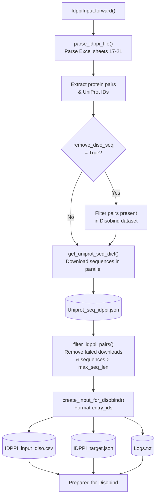
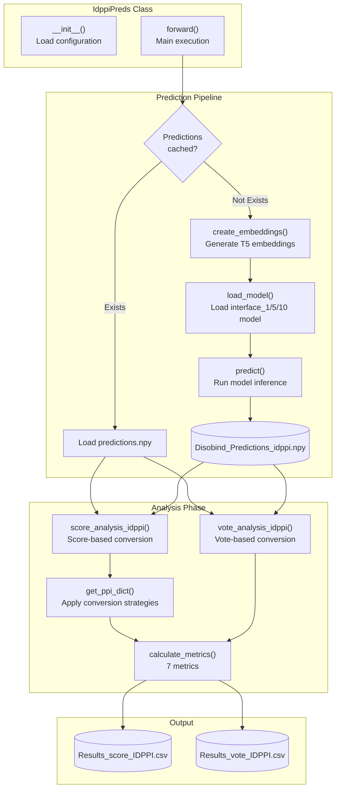
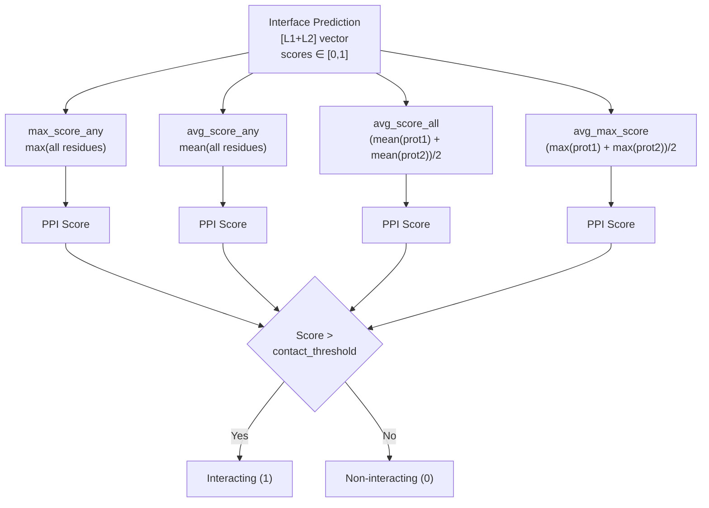
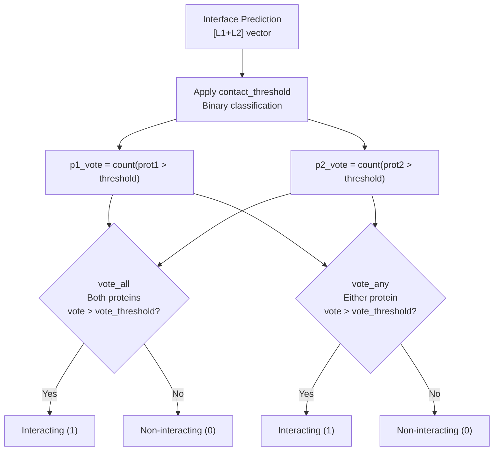
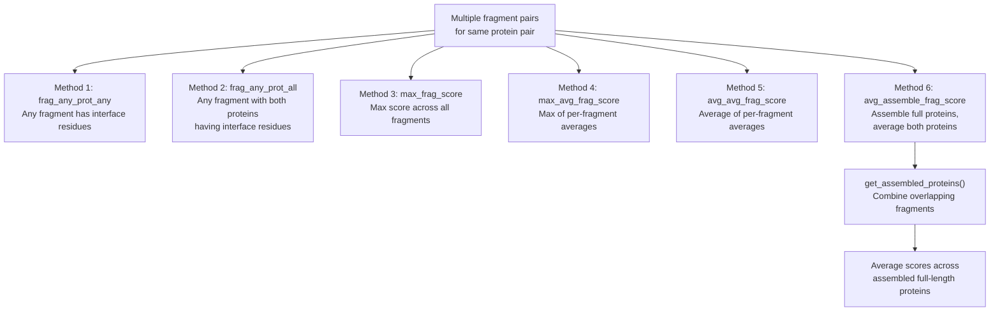
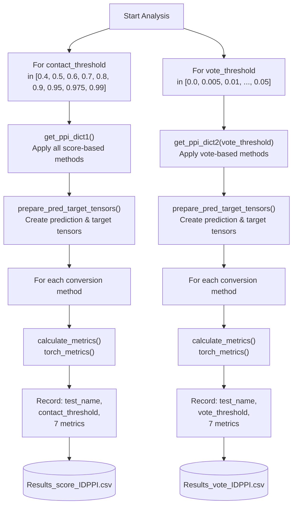

# IDPPI Dataset Evaluation

<details>
<summary>Relevant source files</summary>

The following files were used as context for generating this wiki page:

- [analysis/idppi_preds.py](analysis/idppi_preds.py)
- [analysis/idppi_preds2.py](analysis/idppi_preds2.py)
- [dataset/prep_idppi_input2.py](dataset/prep_idppi_input2.py)

</details>


## Purpose and Scope

This page describes the evaluation of Disobind on the IDPPI (Intrinsically Disordered Protein-Protein Interaction) dataset, a benchmark dataset for binary protein-protein interaction (PPI) classification. The IDPPI dataset tests whether protein pairs interact or not, which differs from Disobind's native interface residue prediction task. This evaluation demonstrates Disobind's capability for PPI classification by converting interface predictions to binary interaction predictions.

For general evaluation workflows and OOD testing, see [JudgementDay Analysis Pipeline](). For disorder-specific analysis methods, see [Disorder-Specific Analysis]().

## IDPPI Dataset Overview

The IDPPI dataset (DOI: [10.1038/s41598-018-28815-x](https://doi.org/10.1038/s41598-018-28815-x)) contains protein pairs with binary labels indicating whether they interact. The dataset consists of 5 test sets stored in an Excel file with sheets "Table S17-TestSet1" through "Table S21-TestSet5".

**Key Characteristics:**
- Binary classification task: interacting (1) vs non-interacting (0) [dataset/prep_idppi_input2.py:182-184]()
- Focuses on intrinsically disordered proteins [dataset/prep_idppi_input2.py:1-4]()
- Can be filtered to exclude overlap with Disobind training data [dataset/prep_idppi_input2.py:28-29]()
- Maximum sequence length filter applied (default: 10,000 residues) [dataset/prep_idppi_input2.py:27]()

Sources: [dataset/prep_idppi_input2.py:1-41]()

## Dataset Preparation Pipeline

### IdppiInput Class Workflow

The `IdppiInput` class prepares the IDPPI dataset for Disobind evaluation:



**Dataset Preparation: IdppiInput Class**

Sources: [dataset/prep_idppi_input2.py:15-64]()

### Configuration Parameters

| Parameter | Default | Description |
|-----------|---------|-------------|
| `base_dir` | `"../database/"` | Base directory for data files [dataset/prep_idppi_input2.py:20]() |
| `idppi_file` | Excel file path | IDPPI dataset file (41598_2018_28815_MOESM2_ESM.xlsx) [dataset/prep_idppi_input2.py:23]() |
| `cores` | `100` | Parallel workers for sequence download [dataset/prep_idppi_input2.py:26]() |
| `max_seq_len` | `10000` | Maximum protein sequence length [dataset/prep_idppi_input2.py:27]() |
| `remove_diso_seq` | `True` | Filter pairs overlapping with Disobind training [dataset/prep_idppi_input2.py:29]() |

Sources: [dataset/prep_idppi_input2.py:19-29]()

### Key Methods

**`parse_idppi_file()`** - Extracts protein pairs from Excel sheets 17-21, optionally filters against Disobind dataset:
```python
# Returns: (idppi_pairs dict, unique_uni_ids list)
idppi_pairs = {"{UniProt1}--{UniProt2}": "0/1", ...}
```
Sources: [dataset/prep_idppi_input2.py:73-98]()

**`get_uniprot_seq_dict()`** - Downloads sequences in parallel using `multiprocessing.Pool`, caches results to `Uniprot_seq_idppi.json`:
Sources: [dataset/prep_idppi_input2.py:113-134]()

**`filter_idppi_pairs()`** - Removes pairs with missing sequences or sequences exceeding `max_seq_len`:
Sources: [dataset/prep_idppi_input2.py:137-155]()

**`create_input_for_disobind()`** - Formats `entry_id` strings compatible with Disobind:
```python
# Format: {UniProt1}:{start1}:{end1}--{UniProt2}:{start2}:{end2}_{copy_num}
entry_id = "Q13011:1:156--Q9BXR5:1:234_0"
```
Sources: [dataset/prep_idppi_input2.py:158-186]()

## Prediction Generation

### IdppiPreds Class Architecture

The `IdppiPreds` class generates Disobind predictions for all IDPPI protein pairs:



**IdppiPreds Prediction and Analysis Pipeline**

Sources: [analysis/idppi_preds2.py:19-76]()

### Configuration Parameters

| Parameter | Default | Description |
|-----------|---------|-------------|
| `model_version` | `19` or `21` | Disobind model version to use [analysis/idppi_preds2.py:33]() |
| `batch_size` | `250` or `1000` | Batch size for processing [analysis/idppi_preds2.py:34]() |
| `max_len` | `200` | Maximum padded sequence length [analysis/idppi_preds2.py:35]() |
| `cg_model` | `"interface_1"` | Task and coarse-graining level [analysis/idppi_preds2.py:36]() |
| `contact_threshold` | `0.5` | Threshold for interface residue classification [analysis/idppi_preds2.py:38]() |
| `device` | `"cuda"` | Device for inference [analysis/idppi_preds2.py:39]() |
| `embedding_type` | `"T5"` | Protein language model [analysis/idppi_preds2.py:41]() |
| `scope` | `"global"` | Embedding scope (global/local) [analysis/idppi_preds2.py:40]() |

Sources: [analysis/idppi_preds2.py:33-41]()

### Batch Processing Workflow

The prediction pipeline processes protein pairs in batches to manage memory:

```mermaid
flowchart LR
    EntryIDs["entry_ids list"] --> BatchLoop["For start:end<br/>in batch_size"]
    BatchLoop --> CreateFasta["Create FASTA file<br/>emb_fasta_{start}-{end}"]
    CreateFasta --> GenEmb["Embeddings.initialize()<br/>Generate embeddings"]
    GenEmb --> SaveEmb[("embeddings_{start}-{end}.h5")]
    
    SaveEmb --> PrepTensor["prepare_emb_tensor()<br/>Pad & coarse-grain"]
    PrepTensor --> ModelForward["model(prot1_emb, prot2_emb)<br/>Interface prediction"]
    ModelForward --> UpdateDict["Update predictions dict"]
    UpdateDict --> CleanCache["torch.cuda.empty_cache()"]
    CleanCache --> MoreBatches{"More batches?"}
    MoreBatches -->|Yes| BatchLoop
    MoreBatches -->|No| SaveAll[("Disobind_Predictions_idppi.npy")]
```



**Batch Processing for IDPPI Predictions**

Sources: [analysis/idppi_preds2.py:138-190]()

### Model Loading

The model loading process selects the appropriate checkpoint based on the task and coarse-graining level using `parameter_files`:

```python
# Task: "interface" or "interaction"
# CG level: "1", "5", or "10"
task, cg = self.cg_model.split("_")  # e.g., "interface_1"
mod_ver = self.parameters[task][f"cg_{cg}"][0]  # e.g., "Epsilon_3_16.2"
params_file = self.parameters[task][f"cg_{cg}"][1]  # e.g., "Epoch_30"
```

Sources: [analysis/idppi_preds2.py:194-220]()

## Interface-to-PPI Conversion Strategies

Disobind predicts interface residues (per-residue scores), while IDPPI requires binary PPI classification. Multiple conversion strategies are implemented:

### Score-Based Methods

These methods use the continuous prediction scores directly:



**Score-Based Interface-to-PPI Conversion Methods**

Sources: [analysis/idppi_preds2.py:421-483]()

#### Method Descriptions

| Method Name | Formula | Description |
|-------------|---------|-------------|
| `max_score_any` | `max(pred_interface)` | Maximum score across all residues in both proteins [analysis/idppi_preds2.py:426]() |
| `avg_score_any` | `mean(pred_interface)` | Average score across all residues in both proteins [analysis/idppi_preds2.py:433]() |
| `avg_score_all` | `(mean(prot1) + mean(prot2))/2` | Average of per-protein average scores [analysis/idppi_preds2.py:440]() |
| `avg_max_score` | `(max(prot1) + max(prot2))/2` | Average of per-protein maximum scores [analysis/idppi_preds2.py:448]() |

Sources: [analysis/idppi_preds2.py:421-483]()

### Vote-Based Methods

These methods count the number of interface residues above a threshold:



**Vote-Based Interface-to-PPI Conversion Methods**

Sources: [analysis/idppi_preds2.py:486-535]()

#### Vote Calculation

```python
# For each protein, calculate vote as fraction of interface residues
p1_vote = count(p1_interface > contact_threshold)
p2_vote = count(p2_interface > contact_threshold)

# vote_all: Both proteins must exceed threshold
if p1_vote > vote_threshold * p1_len and p2_vote > vote_threshold * p2_len:
    ppi_pred = 1

# vote_any: Either protein exceeds threshold
if p1_vote > vote_threshold * p1_len or p2_vote > vote_threshold * p2_len:
    ppi_pred = 1
```

Sources: [analysis/idppi_preds2.py:486-535]()

### Fragment Assembly Method (idppi_preds.py)

The original `idppi_preds.py` includes additional methods for handling fragmented proteins by assembling them:



**Fragment Assembly Methods for Multi-Fragment Protein Pairs**

Sources: [analysis/idppi_preds.py:369-597]()

## Evaluation Workflow

### Threshold Sweep Analysis

The evaluation tests multiple thresholds to find optimal operating points:



**Threshold Sweep Evaluation Workflow**

Sources: [analysis/idppi_preds2.py:292-359]()

### Evaluation Metrics

Seven metrics are calculated for each method and threshold using `torch_metrics`:

| Metric | Description | Function |
|--------|-------------|----------|
| **Recall** | True positive rate | TP / (TP + FN) |
| **Precision** | Positive predictive value | TP / (TP + FP) |
| **F1 Score** | Harmonic mean of precision & recall | 2 × (Precision × Recall) / (Precision + Recall) |
| **Avg Precision** | Area under precision-recall curve | Average precision across all thresholds |
| **MCC** | Matthews correlation coefficient | Balanced measure for imbalanced datasets |
| **AUROC** | Area under ROC curve | True positive rate vs false positive rate |
| **Accuracy** | Overall correctness | (TP + TN) / (TP + TN + FP + FN) |

Sources: [analysis/idppi_preds2.py:539-557](), [src/metrics.py]()

### Results Format

The output CSV files contain rows for each combination of:
- Conversion method (`test_name`)
- Threshold value (`contact_threshold` or `vote_threshold`)
- All 7 metric values

Sources: [analysis/idppi_preds2.py:562-571]()

## Code Organization

### Key Classes and Files

```mermaid
graph TB
    subgraph "Dataset Preparation"
        PrepInput["IdppiInput<br/>dataset/prep_idppi_input2.py"]
        PrepInput --> ParseFile["parse_idppi_file()"]
        PrepInput --> GetSeq["get_uniprot_seq_dict()"]
        PrepInput --> FilterPairs["filter_idppi_pairs()"]
        PrepInput --> CreateInput["create_input_for_disobind()"]
    end
    
    subgraph "Prediction Generation (Version 1)"
        IdppiPreds1["IdppiPreds<br/>analysis/idppi_preds.py"]
        IdppiPreds1 --> CreateEmb1["create_embeddings()"]
        IdppiPreds1 --> LoadModel1["load_model()"]
        IdppiPreds1 --> Predict1["predict()"]
        IdppiPreds1 --> GetPPIDict1["get_ppi_dict()"]
        IdppiPreds1 --> Analysis1["analysis_idppi()"]
    end
    
    subgraph "Prediction Generation (Version 2)"
        IdppiPreds2["IdppiPreds<br/>analysis/idppi_preds2.py"]
        IdppiPreds2 --> CreateEmb2["create_embeddings()"]
        IdppiPreds2 --> LoadModel2["load_model()"]
        IdppiPreds2 --> CoarseGrain["coarse_grain_embedding()"]
        IdppiPreds2 --> Predict2["predict()"]
        IdppiPreds2 --> ScoreAnalysis["score_analysis_idppi()"]
        IdppiPreds2 --> VoteAnalysis["vote_analysis_idppi()"]
    end
    
    subgraph "Shared Dependencies"
        Embeddings["Embeddings<br/>dataset/create_input_embeddings.py"]
        GetModel["get_model()<br/>src/models/get_model.py"]
        TorchMetrics["torch_metrics()<br/>src/metrics.py"]
        ParamFiles["parameter_files()<br/>params/__init__.py"]
    end
    
    IdppiPreds1 --> Embeddings
    IdppiPreds2 --> Embeddings
    IdppiPreds1 --> GetModel
    IdppiPreds2 --> GetModel
    IdppiPreds1 --> TorchMetrics
    IdppiPreds2 --> TorchMetrics
    IdppiPreds1 --> ParamFiles
    IdppiPreds2 --> ParamFiles
```



**Code Organization: IDPPI Evaluation Modules**

Sources: [dataset/prep_idppi_input2.py](), [analysis/idppi_preds.py](), [analysis/idppi_preds2.py]()

### Differences Between Versions

| Aspect | `idppi_preds.py` | `idppi_preds2.py` |
|--------|----------------|-----------------|
| **Batch Size** | 1000 [analysis/idppi_preds.py:32]() | 250 [analysis/idppi_preds2.py:34]() |
| **Model Version** | 21 (fixed) [analysis/idppi_preds.py:31]() | 19 (configurable) [analysis/idppi_preds2.py:33]() |
| **CG Support** | interface_1 only [analysis/idppi_preds.py:204]() | interface_1/5/10 selectable [analysis/idppi_preds2.py:36]() |
| **Predictions Storage** | Nested dict (pair_id -> entry_id) [analysis/idppi_preds.py:192-196]() | Flat dict (entry_id) [analysis/idppi_preds2.py:161]() |
| **Fragment Handling** | 6 fragment assembly methods [analysis/idppi_preds.py:369-597]() | Single entry_id methods [analysis/idppi_preds2.py:369-418]() |
| **Analysis Types** | Score-based only [analysis/idppi_preds.py:236-366]() | Score-based + vote-based [analysis/idppi_preds2.py:292-359]() |

Sources: [analysis/idppi_preds.py](), [analysis/idppi_preds2.py]()

## Usage Examples

### Example 1: Prepare IDPPI Dataset

```bash
# Navigate to dataset directory
cd dataset

# Run preparation script
python prep_idppi_input2.py
```

This will:
1. Parse the IDPPI Excel file [dataset/prep_idppi_input2.py:49]()
2. Download UniProt sequences (cached after first run) [dataset/prep_idppi_input2.py:56]()
3. Filter sequences by length and availability [dataset/prep_idppi_input2.py:57]()
4. Create `IDPPI_input_diso.csv` and `IDPPI_target.json` [dataset/prep_idppi_input2.py:62]()

Sources: [dataset/prep_idppi_input2.py:42-63]()

### Example 2: Generate Predictions (Version 2)

```bash
# Navigate to analysis directory
cd analysis

# Run predictions with interface_1 model
python idppi_preds2.py
```

**Configuration Options (modify in `__init__`):**
```python
self.model_version = 19  # Model version to use
self.cg_model = "interface_1"  # or "interface_5", "interface_10"
self.batch_size = 250  # Reduce if memory issues
```

Sources: [analysis/idppi_preds2.py:33-53]()

### Example 3: Analyze Existing Predictions

If predictions are already cached, the script will skip prediction and run analysis:

```python
# In idppi_preds2.py
if os.path.exists(self.predictions_file):
    print("Disobind predictions for IDPPI already exist...")
    self.predictions = np.load(self.predictions_file, allow_pickle=True).item()
```

Sources: [analysis/idppi_preds2.py:57-74]()

## Performance Considerations

### Memory Management

The prediction pipeline uses several strategies to manage memory:

1. **Batch Processing**: Processes entry_ids in configurable batches [analysis/idppi_preds2.py:143-153]()
2. **Cache Clearing**: `torch.cuda.empty_cache()` after each batch [analysis/idppi_preds2.py:186]()
3. **Wait time**: `time.sleep(5)` after cache clearing [analysis/idppi_preds2.py:187]()
4. **Embedding Caching**: Reuses `Uniprot_seq_idppi.json` across runs [dataset/prep_idppi_input2.py:117-120]()

Sources: [analysis/idppi_preds2.py:143-190]()

### Parallelization

Sequence downloading uses `multiprocessing.Pool`:

```python
# In IdppiInput.get_uniprot_seq_dict()
self.cores = 100  # Number of parallel workers
with Pool(self.cores) as p:
    for result in tqdm.tqdm(p.imap_unordered(self.download_uniprot_seq, unique_uni_ids),
                            total=len(unique_uni_ids)):
        # Process results
```

Sources: [dataset/prep_idppi_input2.py:26](), [dataset/prep_idppi_input2.py:122-128]()

### Time Estimates

Example timing from logs:
```python
print(f"Total time taken for Disobind prediction = {(toc-tic)/60} minutes")
print(f"Time taken for batch {start}-{end} = {(t_end - t_start)/60} minutes")
```

Sources: [analysis/idppi_preds2.py:69](), [analysis/idppi_preds2.py:165]()

---