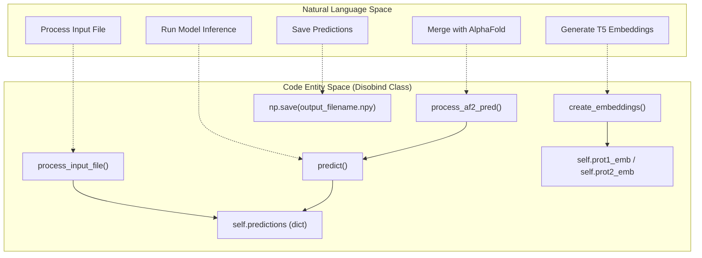
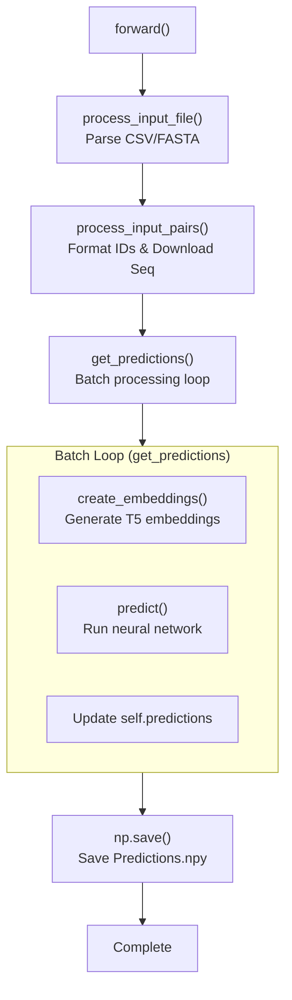
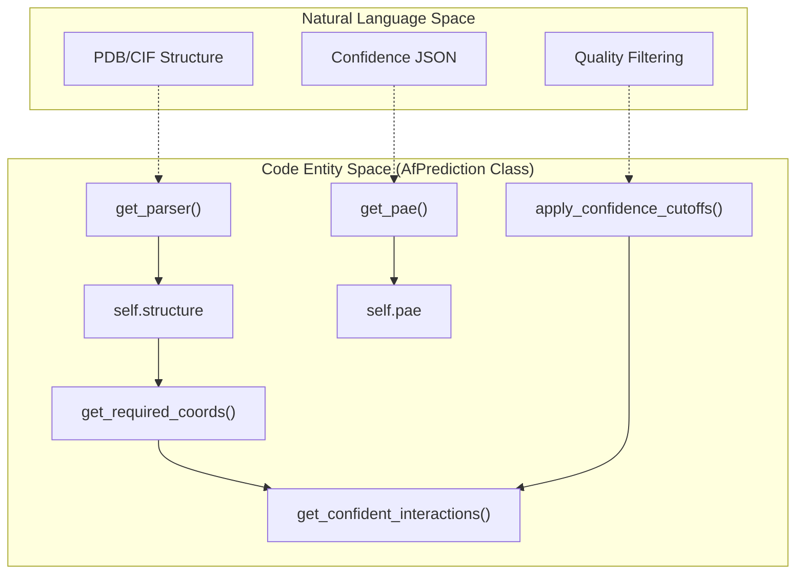
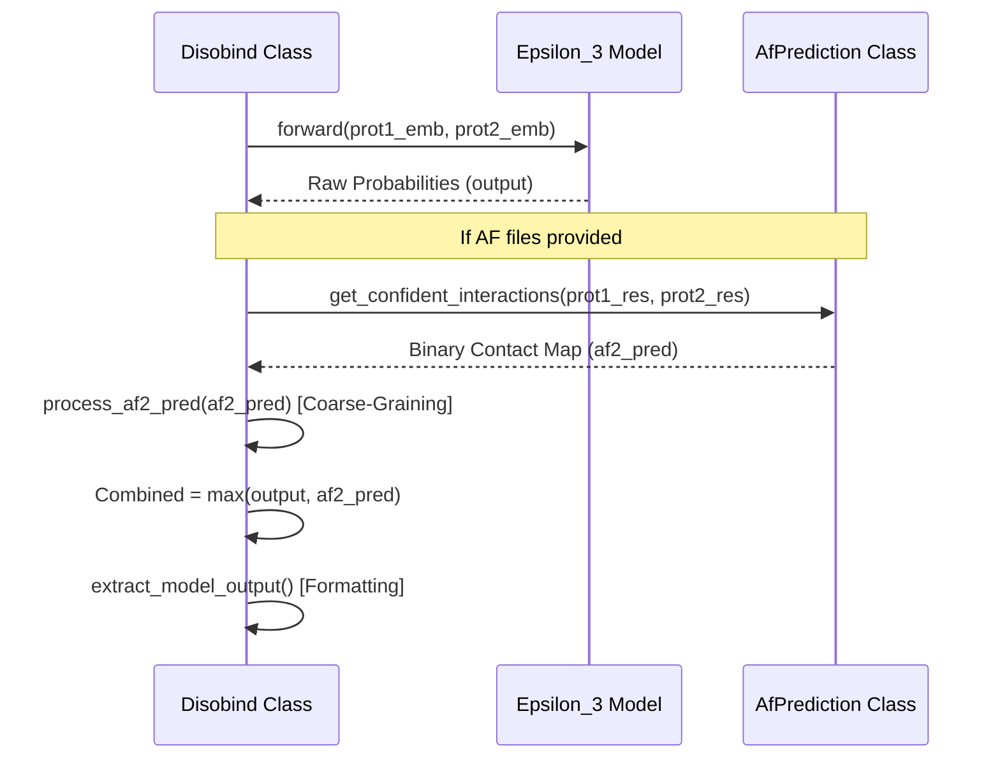

# Core Prediction Classes

Relevant source files

The following files were used as context for generating this wiki page:

- [example/test.fasta](example/test.fasta)
- [run_disobind.py](run_disobind.py)

This page documents the core prediction classes used by Disobind for making disorder-aware protein interaction predictions. These classes form the foundation of the prediction pipeline and handle model loading, input preparation, inference, and AlphaFold integration.

---

## Overview of Core Classes

The prediction system consists of two primary classes that work together to produce enhanced predictions:

| Class | Location | Primary Responsibility |
|-------|----------|----------------------|
| `Disobind` | [run_disobind.py:44-826]() | Main prediction pipeline, model loading, and output generation |
| `AfPrediction` | [run_disobind.py:831-1173]() | AlphaFold structure parsing, confidence filtering, and contact map extraction |

These classes are designed to work independently or in combination, where `Disobind` can optionally integrate predictions from `AfPrediction` to enhance accuracy.

**Sources:** [run_disobind.py:44-1173]()

---

## Disobind Class

### Class Definition and Purpose

The `Disobind` class orchestrates the complete prediction workflow from input parsing to final output generation. It handles UniProt sequence downloads, embedding generation using the `Embeddings` class, model loading, and optional AlphaFold integration.

### Bridge: Natural Language to Code Entity Space (Disobind)

This diagram maps the high-level prediction steps to the specific class methods and internal state transitions.

**Sources:** [run_disobind.py:44-126](), [run_disobind.py:212-255](), [run_disobind.py:375-395](), [run_disobind.py:532-661]()

### Constructor

The constructor initializes all configuration parameters and creates the output directory:

**Signature:** `__init__(self, args)` [run_disobind.py:45]()

**Key Parameters (from argparse):**

| Parameter | Attribute | Type | Description |
|-----------|-----------|------|-------------|
| `-f` | `self.input_file` | str | Path to input CSV or FASTA file [run_disobind.py:51]() |
| `-i` | `self.input_type` | str | Input file type: "fasta" or "csv" [run_disobind.py:53]() |
| `-c` | `self.cores` | int | Number of CPU cores for parallelism [run_disobind.py:55]() |
| `-cm` | `self.predict_cmap` | bool | Whether to predict contact maps [run_disobind.py:57]() |
| `-cg` | `self.required_cg` | int | Coarse-graining level: 1, 5, or 10 [run_disobind.py:59]() |
| `-o` | `self.output_dir` | str | Name for output directory [run_disobind.py:61]() |
| `-d` | `self.device` | str | Device: "cpu" or "cuda" [run_disobind.py:68]() |

**Sources:** [run_disobind.py:45-109]()

### Main Execution Flow

The `forward()` method orchestrates the complete prediction pipeline:

**Sources:** [run_disobind.py:111-126](), [run_disobind.py:168-208]()

### Input and Embedding Methods

#### process_input_file()
Supports two modes:
1.  **CSV:** Allows multiple jobs; limited to UniProt entries [run_disobind.py:224-255]().
2.  **FASTA:** Allows custom sequences; limited to one prediction per run [run_disobind.py:258-279]().

#### create_embeddings()
Utilizes the `Embeddings` class [dataset/create_input_embeddings.py]() to generate T5 protein embeddings. It writes a temporary FASTA file, runs the embedding model, and stores results in an HDF5 file (`.h5`) [run_disobind.py:375-395]().

### Model Management

#### apply_settings()
Configures the internal `self.objective` list which determines the task behavior:
- `objective[0]`: "interaction" or "interface" [run_disobind.py:438-444]().
- `objective[1]`: Coarse-graining bin size (1, 5, or 10) [run_disobind.py:445-451]().
- `objective[2]`: Boolean for binning input embeddings [run_disobind.py:453-458]().

#### load_model()
Loads a pre-trained model based on the version string. It fetches configuration from `./params/Model_config_{model_ver}.yml` and weights from a `.pth` file [run_disobind.py:399-429]().

### Prediction Logic

#### get_input_tensors()
Prepares NumPy embeddings for the neural network by converting them to `torch.tensor`, applying padding, and coarse-graining via `prepare_input()` [run_disobind.py:475-529]().

#### predict()
Iterates through each protein pair and task. If AlphaFold files are provided in the input, it instantiates `AfPrediction` to retrieve structural contacts and merges them with Disobind's output using a `max` operation [run_disobind.py:532-661]().

**Sources:** [run_disobind.py:433-661]()

---

## AfPrediction Class

### Class Definition and Purpose

The `AfPrediction` class extracts structural contact maps from AlphaFold2/3 outputs. It filters these contacts using pLDDT (per-residue confidence) and PAE (Predicted Aligned Error) to ensure only high-confidence structural interactions are considered.

### Bridge: Natural Language to Code Entity Space (AlphaFold)

This diagram maps AlphaFold data concepts to the internal methods of `AfPrediction`.

**Sources:** [run_disobind.py:831-1173]()

### Key Methods

#### get_confident_interactions()
The primary interface for this class. It performs the following:
1.  Extracts residues for the specified fragments [run_disobind.py:1152]().
2.  Retrieves coordinates, pLDDT, and PAE [run_disobind.py:1162]().
3.  Calculates a distance-based contact map (threshold: 8Å) [run_disobind.py:1108]().
4.  Applies thresholds: pLDDT >= 70 and PAE <= 5 [run_disobind.py:1118-1128]().
5.  Returns the element-wise product of the contact map and confidence masks [run_disobind.py:1172]().

#### get_pae()
Parses the AlphaFold JSON file. It handles both AF2 and AF3 formats by looking for `predicted_aligned_error` or `pae` keys. It symmetrizes the matrix using `(PAE + PAE.T) / 2` [run_disobind.py:942-955]().

#### extract_perresidue_quantity()
Helper to extract specific data from BioPython `Residue` objects, such as `"res_pos"`, `"coords"` (CA atom), and `"plddt"` (B-factor) [run_disobind.py:898-922]().

**Sources:** [run_disobind.py:831-1173]()

---

## Data Flow: Prediction Integration

When running in combined mode, the data flows from both the neural network and the structural parser into a final merged result.

**Sources:** [run_disobind.py:616-660](), [run_disobind.py:664-693]()

### Implementation Detail: Coarse-Graining AF2
The `process_af2_pred` method ensures structural contacts match the Disobind task resolution. It uses `MaxPool2d` with a kernel size equal to the CG level (1, 5, or 10) to aggregate the binary contact map [run_disobind.py:676-681]().

**Sources:** [run_disobind.py:664-693]()

---